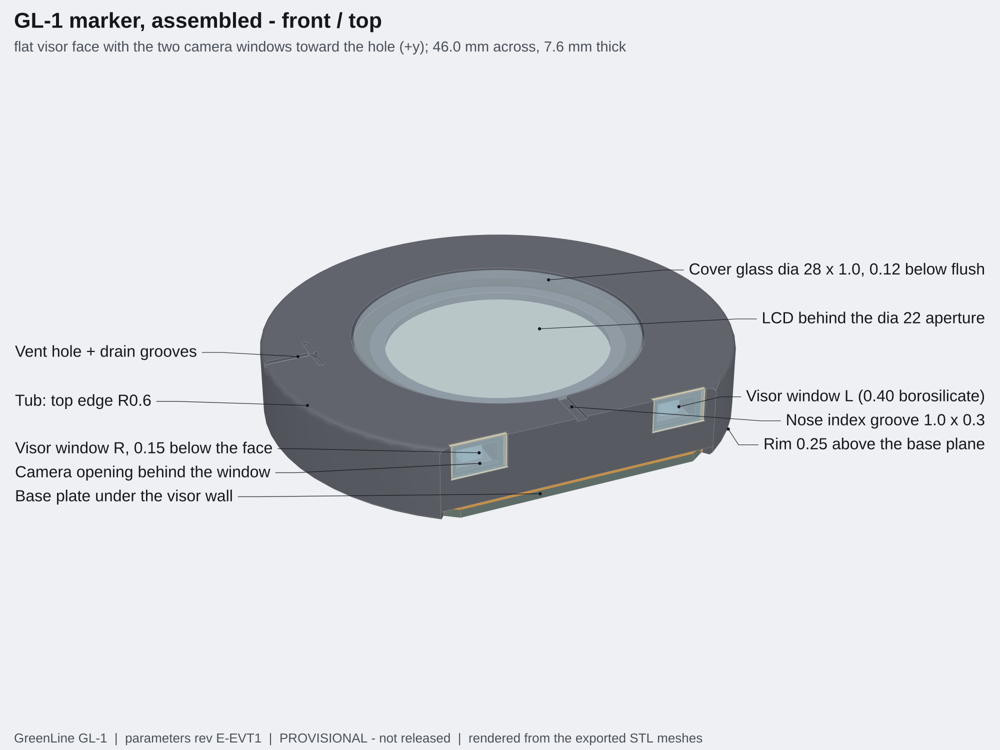
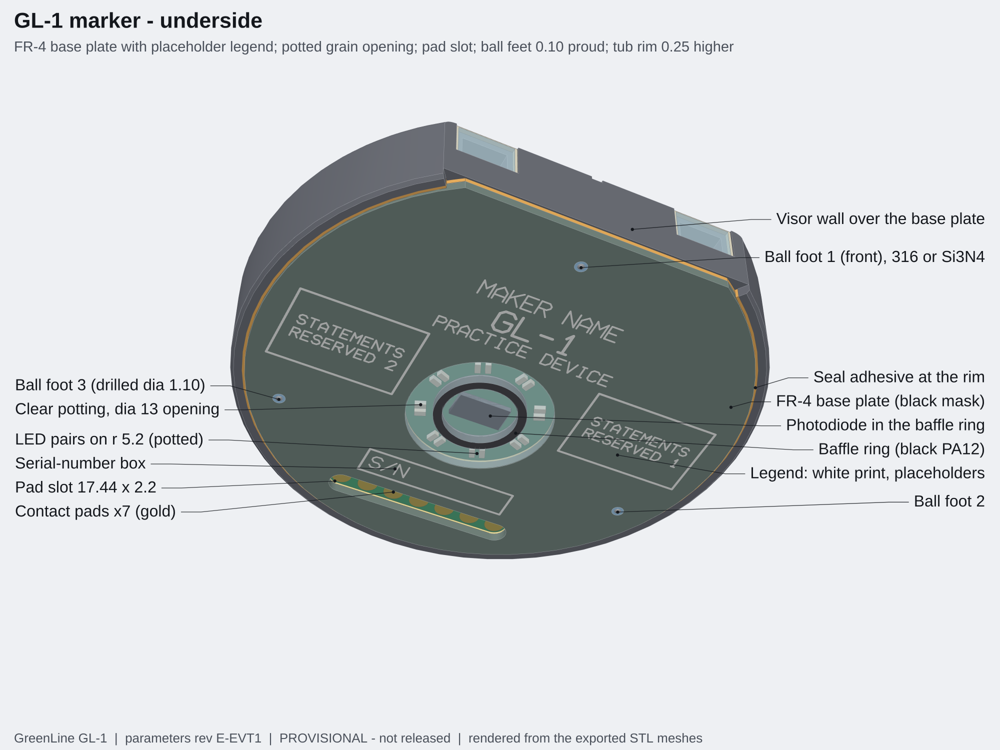
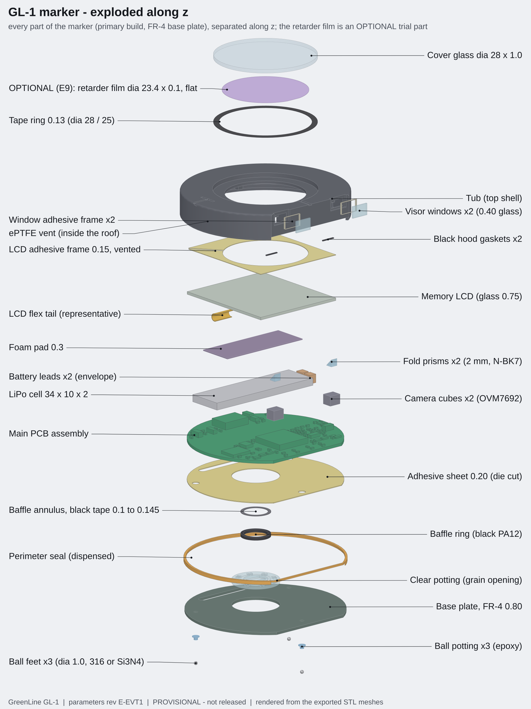
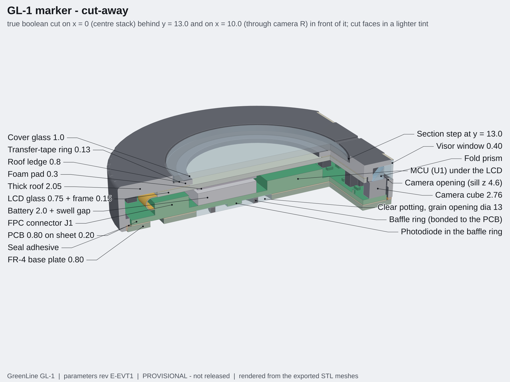
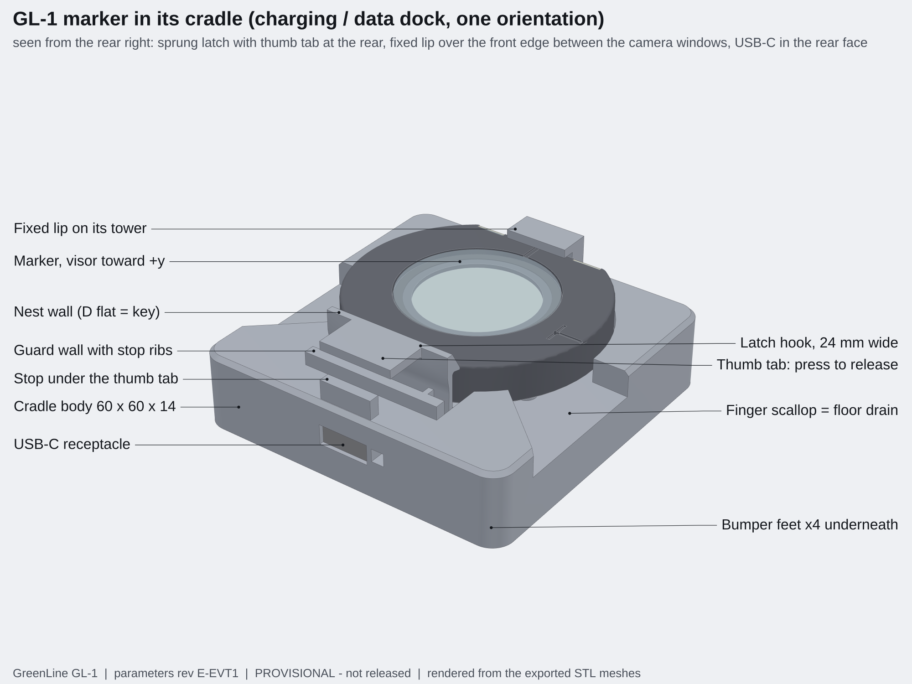
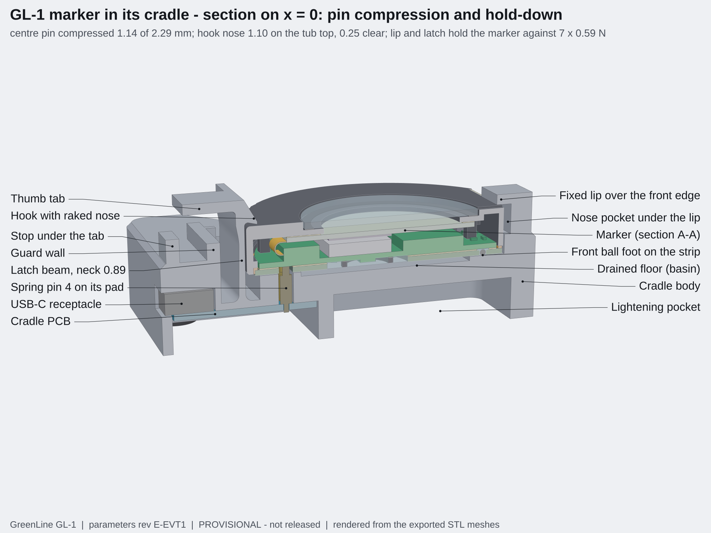
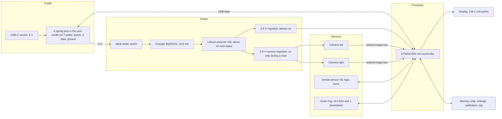
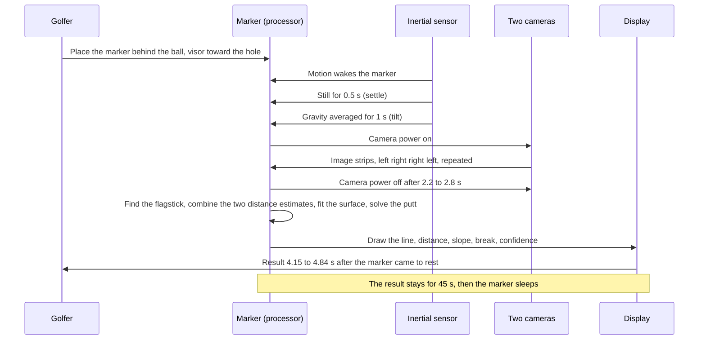
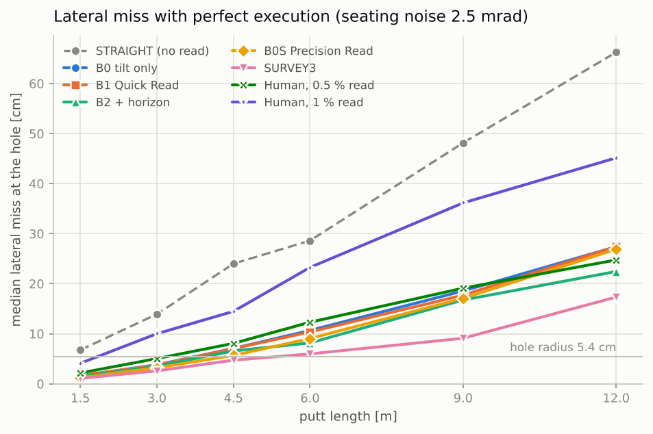

# GreenLine GL-1

Overview of the design package at revision E-EVT1 (revision E of the design, prepared for the first engineering test build; the words are explained below). Written 2026-11-20 for the owner of the project.

## 1. What this is, in five sentences

GreenLine GL-1 is the design of an electronic golf ball marker: a D-shaped puck 46.0 mm across and 7.6 mm thick that is set down behind the ball on a putting green.
It measures the direction and distance to the flagstick with two very small cameras, the tilt of the ground under it with an inertial sensor, and (as an experiment that ships switched off) the lean of the grass with a ring of small lights.
From those measurements it computes where to start the putt and draws that line on a round display on its top face, with the distance, the slope and the expected break.
It has no radio and no buttons; it is driven by placing, tapping and turning it, and it charges and exchanges data in a small cradle with a USB-C socket.
It is a practice and training device, and everything in this directory is a design on paper: no unit exists.

### Words used in this file

| Word | Meaning here |
|---|---|
| Revision E, E-EVT1 | The current issue of the design; the files also mention the earlier revisions C and D. EVT stands for engineering validation test: the first hand-built units, made to find out what is wrong. E-EVT1 is revision E as prepared for the first such build. |
| Specification | `design/DESIGN_SPEC.md`, the file that states what the product is and every design decision. |
| Amendment | A numbered change to the specification. Revision E has 36 of them, E1 to E36. |
| PROVISIONAL | The package's own mark for a value that was written down from memory or from a search extract and is not confirmed against the maker's document. |
| PROPOSED | A requirement or limit that is stated and that nobody has adopted or measured. |
| NOT MET | A requirement that the firmware model does not meet. A model result, not a measurement. |
| Gate | A question that must have a written answer before money is spent on something that cannot be undone. |
| Data sheet | The manufacturer's own document for a part. |
| Pin table, ball map | The table that says which pin of a chip carries which signal. Very small chips have solder balls underneath instead of pins; their table is called a ball map. |
| Stand-in | A plausible value or table put in so that the design could go on. It is not the maker's. |
| Routed board | A circuit board whose wiring (its copper tracks) has been drawn in full, so that fabrication files exist. "Changing the copper" means changing that wiring. |
| Design-rule check | An automatic check that the tracks of a board keep the widths and gaps the fabricator needs. |
| Firmware | The program that runs on the marker's processor. |
| Linked image | The one file that can be loaded into the processor. The firmware has been compiled (each source file checked and translated) but never linked into that file. |
| USB loader | A program that the processor's maker builds into the chip for loading new firmware over USB. |
| mrad | Milliradian: a slope or angle of 1 mm per metre, or 0.1 %. |

## 2. Status: read this before anything else

> **This is a design package. Nothing has been built.**
>
> - The package was produced entirely by software agents. No circuit board, printed part, fixture or marker has been fabricated, assembled, measured or run. The firmware has only ever run on a PC simulator.
> - No supplier has been asked for a quote and nothing has been ordered, certified or approved.
> - Every performance figure in this file is the output of a model or a simulation. None is a measurement.
> - [docs/RELEASE_GATES.md](docs/RELEASE_GATES.md) lists **104 open gates** between this package and the four orders that lead to a product (boards, enclosure and parts, building test units, selling). 32 of them are decisions that only the owner can take.
> - Several pin tables and part dimensions were written down from memory or from search extracts. The package marks them PROVISIONAL. The automatic checks compare the design with itself; they cannot tell whether a pin table copied from memory is the real one.

The request was for a "fully US-sourceable and ready to manufacture device". The package is not at that stage. The table says what "ready" covers today and what it does not.

| "Ready" does mean | "Ready" does not mean |
|---|---|
| The design is complete enough to review: specification, parameters, 3D models and drawings, two routed circuit boards with fabrication files, firmware that passes its tests on a PC, a simulation, and plans for sourcing, building and testing. | That boards or parts can be ordered today. 43 gates stand before the first board order alone. |
| The automatic checks of the package pass: the mechanical check report shows all checks passing, with 23 warnings and 8 recorded deviations from the specification, and the design-rule check of both boards shows 0 errors (`mechanical/export/check_report.md`; `electrical/README.md`, "Result"). | That the parts of the design agree with each other everywhere. The checks cover only what they compare. Known disagreements that no check covers: the cradle spring pin is drawn with a 0.635 mm tail in a 0.80 mm hole on the board and with a 0.76 mm tail in a 0.90 mm hole in the mechanical model (gate G-014); the files disagree on whether the two statement blocks of the legend hold 88 characters each or 88 together (G-045); `mechanical/README.md` gives the depth of the cradle pilot holes as 3 mm in one place and 3.2 mm in three others (G-107). Nor do the checks show that the design agrees with the real parts: that is what the PROVISIONAL items are about. |
| 64 of the 86 lines of the sourcing list are marked VERIFIED: 55 of the 72 purchased lines were seen listed by a US distributor or seller (42 with a stock figure), and for 9 of the 14 custom parts and outside services a US company was seen advertising that kind of work. No quote has been requested, and 17 purchased lines cannot be bought as they stand (`docs/SOURCING.md` sections 1.1 and 1.4). | That the device is US-made or "US-sourced". Where each part is made is unknown for almost every line, and the compliance checklist advises against the phrase in public (gates G-093 and G-097). |
| There is a written list of what must happen next, in order. | That the device works. Whether it reads a putt as well as the simulation says depends on inputs nobody has measured (section 6). |

The name for this stage is an EVT design package. EVT stands for engineering validation test: the first hand-built units, made to find out what is wrong.

This is a kitchen drawn on paper where the position of the sink was sketched from memory (the picture is from `docs/RELEASE_GATES.md`). The drawing is complete and consistent with itself, but the worktop must not be cut until someone has measured the real sink.

## 3. What it looks like

All six pictures are computer renders of the 3D model. Each carries the note "PROVISIONAL - not released" in its footer. They are not photographs.

*The assembled marker from the front and above. The flat face in front is the "visor", which points at the hole; the two small rectangles in it are the camera windows. The round glass on top covers the display, which is seen through a 22 mm opening. The small cross on the left of the top face is the vent with its drain grooves.*

*The underside. The plate is circuit-board material with a printed legend; the words "MAKER NAME" and "STATEMENTS RESERVED" are placeholders, because the regulatory text is not decided (gate G-085). The ring in the middle is the grain sensor: pairs of small lights round a light detector, sealed under clear resin. The slot at the bottom shows seven gold contact pads. The user's cradle touches four of them with spring pins (power, two data lines, ground); the other three are for the factory. The three small dots are steel or ceramic balls that stand 0.10 mm proud and act as feet on a hard surface.*

*Exploded view, with the labels of the render. The main parts, from top to bottom: cover glass, tape ring, the printed shell ("Tub"), the display ("Memory LCD"), a foam pad (the grey-purple rectangle), the battery ("LiPo cell"), the two camera cubes with their small fold prisms, the main circuit board ("Main PCB assembly"), an adhesive sheet, the baffle ring of the grain sensor (a black ring that keeps stray light from the light detector), and the base plate with its three ball feet. The small parts between them: two visor windows with their adhesive frames, the vent, two black hood gaskets, the adhesive frame and the flexible tail of the display, the battery leads, the black tape annulus under the baffle ring, the perimeter seal, the clear potting of the grain opening and the potting of the three balls. The round purple disc, second from the top, is an optional trial film (amendment E9) that is meant to keep the display readable through polarised sunglasses.*

*Cut-away. The stack at the centre, from the bottom: base plate, adhesive, circuit board, battery, foam, display glass, cover glass. On the right, one camera: the camera cube sits flat on the board and looks straight up, and a 2 mm prism on top of it turns its view forward through the visor window.*

*The marker in its charging and data cradle, seen from the rear right. The marker fits one way round only. A fixed lip holds its front edge and a sprung latch with a thumb tab holds the rear. The USB-C socket is in the rear face of the cradle.*

*Section through the marker in its cradle. A spring pin in the cradle presses up against a contact pad on the marker's underside; the lip and the latch hold the marker down against the pins. The floor of the cradle is drained.*

## 4. How it works

Each part is explained first with an everyday picture and then with the real mechanism and its numbers. Unless another file is named, the numbers come from `design/DESIGN_SPEC.md` (sections 2 to 6).

### 4.1 Two cameras: two eyes judging distance

**The picture.** Hold a finger at arm's length and look at it with one eye, then the other. The finger appears to jump sideways against the background. The closer the finger, the bigger the jump. Your brain uses that jump to judge distance. The marker does the same with two cameras a fixed distance apart, looking at the flagstick.

**The mechanism.**

- Two OmniVision OVM7692 camera cubes (each 2.95 x 3.47 x 2.76 mm) sit 20.0 mm apart. That spacing is the "baseline". The jump between the two images is called disparity and is measured in pixels. The focal length of the lens, expressed in pixels, is 657: an object 657 times as far away as it is wide covers one pixel.
- The cameras look out 5.6 mm above the turf. From that height the green is seen almost edge-on, so the cameras **cannot** map the surface between ball and hole: everything beyond a couple of metres collapses into one or two pixel rows. The specification says this plainly. What the cameras do deliver is the flagstick.
- From the flagstick they take three things: the direction to the hole (expected quality about 1 milliradian, which is 1 mm sideways per metre of distance), the distance, and the height of the lowest visible point of the stick, which tells whether the hole is above or below the ball.
- Two eyes 20 mm apart judge far distances poorly. For long putts the marker also uses the apparent height of the flagstick, which it learns per course. The simulated error of the combined distance (random part only) is 1 % at 1.5 m, 2 % at 3 m, 3.4 % at 6 m and 5 % at 12 m. The stick's top is only in view beyond about 6.6 m on a nominal unit and about 8.4 m on a worst-case one.
- The flagstick must be in the hole. Without it the golfer points the marker at the hole and dials in the distance, and the result is marked as approximate.
- PROVISIONAL: the pattern of solder balls under the camera and the lens data behind the field-of-view figures are not confirmed against the maker's documents. The camera pattern is the gravest single gate (G-001): if it is wrong, both camera areas of the board are redone.

### 4.2 The inertial sensor: a carpenter's level

**The picture.** A carpenter's level shows which way a surface tips by where the bubble goes. The marker carries an electronic version of that bubble. Lying on the green, it reads which way the ground under it falls and how steeply.

**The mechanism.**

- The part is an ST LSM6DSV16X, an inertial sensor that measures acceleration (and so the direction of gravity) and rotation. The firmware averages gravity for 1 second once the marker has lain still for 0.5 second.
- The sensor itself is expected to be good to about 0.5 milliradian. A milliradian (mrad) is a slope of 1 mm per metre, or 0.1 %.
- The weak point is not the sensor but how the puck sits on grass: the estimate is 2 to 5 mrad of error per placement, and **nobody has measured it**. The specification calls seating "the dominant error of the whole instrument". The simulation shows the tilt reading does nearly all the work for the aim line, so this unmeasured number decides how good the device is.
- A carpenter checks a level by turning it end for end. The marker uses the same trick twice: the Precision Read (read, spin the marker 180 degrees in place, read again) cancels the device's own bias, and the user zeroing routine on a hard flat surface works the same way.
- One reading tells the slope under the ball only. The slope along the rest of the putt can differ. Survey mode exists for that: two to four placements along the line.

### 4.3 The grain sensor: stroking velvet, with light

**The picture.** Stroke velvet one way and it looks light; stroke it the other way and it looks dark, because the fibres lean. Grass on a green leans too ("grain"), and a ball rolls differently with and against it. The grain sensor does not touch the grass. It shines small lights on it from different sides in turn and watches which side looks brightest.

**The mechanism.**

- On the underside, 16 small LEDs sit on a ring of 5.2 mm radius round one light detector (a photodiode): eight red and eight near-infrared, arranged as eight pairs at eight positions round the ring, 45 degrees apart (`design/master_params.yaml`, `grain_led_ring`). So the grass is lit from eight directions in two colours, which makes 16 separate lights.
- Each LED is switched on in turn and the detector reading is compared with the reading with the LED off. The research note's model puts the brightest direction on the side the blades lean away from (`docs/research/grain-sensing.md`).
- **This is the least proven part of the design.** The specification's own entry reads: "Unproven. Reviewer estimate 15-25 % chance the optical reading improves the line." The research note found that for a single reading the random noise is as large as the signal.
- For that reason the grain sensor ships disabled, and every accuracy figure in section 6 is without it.

### 4.4 The solver: rolling a virtual ball until it drops

**The picture.** Imagine a practice green inside the marker that matches what it just measured. The marker rolls a virtual ball on it, sees where the ball ends up, corrects the aim and the speed, and rolls again, until the ball goes through the hole at the wanted pace. The aim of that last roll is the line it draws.

**The mechanism.**

- From the tilt and the height of the hole the firmware fits a simple curved surface between ball and hole. The sources call it a "quadratic patch": a surface that can tilt and bend like a shallow dish or saddle, and cannot ripple. It then needs the green speed, which the golfer enters as a Stimp number (the usual measure of how fast a green is).
- The ball's motion is computed in small time steps: friction slows it, slope pulls it sideways. The target pace is a ball that would stop 0.30 m past the hole on a flat green (adjustable).
- It takes few rolls and many small steps. In the firmware's own bench table a typical Quick Read takes 5 trial rolls and about 730 time steps; over 240 simulated reads the most was 57 rolls and 25,144 steps (`firmware/README.md`, section "Solver"). The work is capped at 300,000 steps, about 1 to 2 seconds by the timing model.
- On very steep slopes no stable answer exists: near the slope on which a ball no longer stops, the review found the aim flipping on a one-microradian change of input. The marker then says "TOO STEEP" and draws only a dashed line, or no line (amendments E31 and E33).
- The firmware solver is a C port of the Python reference in `sim/`, and is tested against it on a PC.

### 4.5 The electronics as a block diagram

What to notice in the diagram: power flows from the cradle on the left through the charger into the cell, and from the cell through two regulators to everything else; every sensor reports to the one processor; nothing leaves the marker except through the cradle pins.

Three terms in the boxes. The ideal-diode switch is an electronic one-way valve: it lets the cradle's 5 V in and lets nothing flow back out to the contact pads. A regulator turns the cell's changing voltage into a steady 2.8 V. The shared image bus is one set of data lines that both cameras use in turn, so the processor reads one camera at a time.

Points worth knowing, all from `design/DESIGN_SPEC.md` sections 3 and 4:

- There is one processor and no radio. Settings are made on the device; logs, calibration and firmware updates go through the cradle as an ordinary USB device.
- The cameras are powered only during a read, because they take most of the energy (92 % of the charge of a read in the model, `docs/POWER_BUDGET.md`).
- The charger has its own temperature sensor at the cell and stops charging outside its temperature window without any help from the firmware. Its temperature thresholds and its pin table are PROVISIONAL.
- The marker has seven contact pads. The user's cradle fits four spring pins. The factory version of the cradle fits all seven; the three extra pins give service access to the processor.

### 4.6 One read, step by step

The times are from the firmware's timing model in the current test log (`firmware/build/readme/test.log`): 4.45 s at the nominal setting, 4.15 to 4.84 s over the estimated range. Amendment E15 of the specification still says "4.1 to 4.8 s", from an earlier run of the model. The times are not measured, and the model rests on an estimated factor between PC and processor speed (gate G-077).

## 5. Key numbers

| Item | Value | Standing | Source |
|---|---|---|---|
| Marker size | 46.0 mm across, 7.6 mm thick, D-shaped | Design value | `design/DESIGN_SPEC.md` section 1 |
| Marker mass | 12.11 g | Estimate from the 3D model with typical densities, no solder | `mechanical/README.md` section 2 |
| Cradle | 60 x 60 mm, 22.6 mm high overall; about 30.4 g for the factory version with all seven pins (the user cradle has four) | Design value; mass estimated | `design/DESIGN_SPEC.md` section 5; `mechanical/README.md` section 2 |
| Cell | Lithium-polymer, 2 x 10 x 30 mm, about 43 mAh. With its protection board it is modelled as 34 x 10 x 2 mm, which is the size on the label in the exploded view | Listing only; capacity, protection-board length (PROVISIONAL) and safety certificates not obtained. The research notes suspect 34 mAh | `design/DESIGN_SPEC.md` section 3; `mechanical/README.md` part list item 4; `docs/POWER_BUDGET.md` section 1 |
| Charging | 19.8 mA in the cradle; at least 2.2 h from empty | Model; no model of a whole charge exists | `docs/POWER_BUDGET.md` section 2 |
| Read time | Result 4.15 to 4.84 s after the marker comes to rest (4.45 s nominal); cameras on for 2.16 to 2.76 s | MODEL, not measured. The specification (E15) still says 4.1 to 4.8 s | `firmware/build/readme/test.log`; `firmware/README.md` "End to end" |
| Reads per charge | 594 read cycles to empty (528 to 658) | MODEL on the listed capacity | `docs/POWER_BUDGET.md` section 3 |
| Standby | 76 days asleep to empty, underside dark (23.68 microamps) | MODEL | `docs/POWER_BUDGET.md` sections 2 and 3 |
| Ship mode (the lowest power state, for the weeks in a box) | 12.93 microamps against a requirement of at most 5 | **NOT MET** in the model; needs a hardware change or a changed requirement. The specification and the YAML still say ship mode is not modelled (gate G-107) | `docs/POWER_BUDGET.md` section 4 |
| Display | Sharp memory LCD, 128 x 128 points, seen through a 22 mm round opening | Part chosen; tail geometry and pin order PROVISIONAL | `design/DESIGN_SPEC.md` sections 3 and 4 |
| Cameras | Two, 20.0 mm apart, focal length 657 pixels, optical axis 5.6 mm above the turf | Design values; ball pattern and lens data PROVISIONAL | `design/DESIGN_SPEC.md` sections 2 and 5 |
| Main board | 4 layers, 0.8 mm thick, D-shaped | Routed; design-rule check passes; not ordered | `design/DESIGN_SPEC.md` section 4; `electrical/README.md` |
| Cradle board | 2 layers, 1.0 mm thick | Routed; not ordered | `design/DESIGN_SPEC.md` E36 |
| Open gates | 104 (43 + 20 + 22 + 19), of them 32 owner decisions | Count on 2026-11-20, after three gates closed and five were added that day | `docs/RELEASE_GATES.md` sections 1 and 10 |

## 6. How accurate would it be? What the simulation says, and what it does not

The package contains a simulation (`sim/`). It builds synthetic greens on a computer, simulates what the marker's sensors would report on them, runs the same estimator the firmware uses, and then rolls the ball along the line the marker would show. Doing this for many random cases is called a Monte Carlo run.

**What the run covers** (`sim/results/REPORT.md`): 3600 putts, at six lengths from 1.5 to 12 m, on four classes of synthetic green, 150 greens per class and length. Seating error of the puck assumed 2.5 mrad. Grain sensor off. The table below is for a perfect stroke along the displayed line, all lengths pooled.

| Method | Putts holed | Holed at 3 m | Holed at 6 m | Median sideways miss |
|---|---|---|---|---|
| No read: aim straight at the flag | 8.9 % | 11 % | 4 % | 23.2 cm |
| Quick Read (one placement) | 29.5 % | 44 % | 13 % | 9.9 cm |
| Precision Read (read, spin, read) | 31.6 % | 48 % | 14 % | 8.6 cm |
| Survey, three placements | 34.4 % | 52 % | 23 % | 7.1 cm |
| A golfer who reads cross slope to 0.5 % | 29.5 % | 42 % | 14 % | 9.5 cm |
| A golfer who reads cross slope to 1 % | 19.3 % | 25 % | 7 % | 16.4 cm |

Source: `sim/results/REPORT.md` section 1.

In words: in the simulation a Quick Read is about level with a golfer who reads slope very well, and clearly ahead of one who reads it moderately well. With human stroke error added (1 degree in direction, 6 % in speed, which the report calls an elite level) the Quick Read holes 21.0 % and even a perfect read holes only 32.7 %.

*From the simulation report: median sideways miss against putt length for each method. Simulated, not measured. The legend uses the report's codes: "STRAIGHT (no read)" is the first row of the table, "B1 Quick Read" the second, "B0S Precision Read" the third, "SURVEY3" the Survey with three placements, and the two "Human" curves are the two golfer rows. Two curves are not in the table: "B0 tilt only" is a line computed from the tilt reading alone, without the cameras' height of the hole, and "B2 + horizon" is the Quick Read with one more input, the outline of the turf against the background as the cameras see it; B2 is an option that is switched off by default.*

**The caveats. These matter more than the table.**

1. **It is a simulation of the revision C optics.** The design is now at revision E and the simulation has not been re-run. One input is known to differ: the simulation assumes 17.6 degrees of upward camera view, and the specification now guarantees only 14.0 degrees on a worst-case unit (amendment E17). Gate G-071.
2. **The greens are synthetic.** They are smooth at the scale of a metre. With 2 mm of added small-scale relief the Quick Read falls 5.5 points behind the good human reader.
3. **Seating on turf is assumed, not measured.** At 5 mrad instead of 2.5 the Quick Read falls 5.1 points behind the good human reader. The report calls measuring this "the first experiment the project needs".
4. **Copying the line from the puck to the ball is assumed to cost 0.5 degree.** At 1.5 degrees the Quick Read is 6.5 points behind the good human reader. There is no data on this.
5. **No mode reads a long putt to within the hole.** From 4.5 m on, the median miss is larger than the hole radius (5.4 cm) in every mode. The Quick Read is intended for putts up to about 4.5 m.
6. **Two limits no slope sensor removes.** The golfer enters the green speed (assumed 7 % error) and the grain is unknown. Even with the true surface, only 48.0 % of putts drop in the simulation.

So the simulation says the idea is worth a prototype. It does not say the device works.

## 7. Map of the package

| Directory | What is in it |
|---|---|
| `design/` | `DESIGN_SPEC.md`: every architecture decision, with amendments E1 to E36. `master_params.yaml`: the numbers that the 3D model and the boards must share. Two check scripts that compare them with the routed board. |
| `mechanical/` | The 3D model as code (`cad/`), drawings (`drawings/`), 3D export files, the six renders (`renders/`), and a long `README.md` with the checks, the assembly sequence and the open mechanical issues. |
| `electrical/` | Two circuit boards as design scripts with generated KiCad files: the main board (`gl1_main/`) and the cradle board (`gl1_cradle/`). Fabrication and assembly files are in each `out/`. `README.md` lists the PROVISIONAL items that gate ordering. |
| `firmware/` | The program for the marker in C, its PC simulator and tests, the PC tool for the factory, and a very long `README.md`. It has been compiled for the processor, but the one file that can be loaded into the chip has never been produced, so it has never run on one (gate G-061). |
| `sim/` | The Python reference: putt physics, synthetic greens, sensor models, the estimator, and the Monte Carlo run. Results in `sim/results/`. |
| `docs/` | `RELEASE_GATES.md` (the 104 open gates), `POWER_BUDGET.md`, `SOURCING.md` with `sourcing.csv`, `MANUFACTURING_PLAN.md`, `VALIDATION_PLAN.md`, `COMPLIANCE.md`, `USER_GUIDE.md`, and `research/` (the background notes). |

**The three files to open first:**

1. [docs/RELEASE_GATES.md](docs/RELEASE_GATES.md), sections 1 and 7. Section 1 is the status on one page. Section 7 collects the decisions that wait for the owner.
2. [design/DESIGN_SPEC.md](design/DESIGN_SPEC.md), sections 1 and 2. What the product is and, more usefully, what it can and cannot measure.
3. [sim/results/REPORT.md](sim/results/REPORT.md), section 1. The simulated performance and the four unmeasured inputs it rests on.

[docs/USER_GUIDE.md](docs/USER_GUIDE.md) describes how a golfer is meant to use the device, and [docs/POWER_BUDGET.md](docs/POWER_BUDGET.md) explains the battery with a water-tank picture. The other documents: [docs/SOURCING.md](docs/SOURCING.md), [docs/MANUFACTURING_PLAN.md](docs/MANUFACTURING_PLAN.md), [docs/VALIDATION_PLAN.md](docs/VALIDATION_PLAN.md), [docs/COMPLIANCE.md](docs/COMPLIANCE.md).

**State of the documents, and where files still disagree, on 2026-11-20:**

- The documents under `docs/` are all written against revision E. `docs/MANUFACTURING_PLAN.md` and `docs/VALIDATION_PLAN.md` are at plan revision 3 and `docs/COMPLIANCE.md` at checklist revision 3. The compliance checklist made no new legal search for its revision 3: every legal point is the reading of 2026-11-11 and every row still reads "Not started".
- `docs/RELEASE_GATES.md` was first issued with 102 gates. Three closed the same day because the documents they named were re-issued (G-069, G-070, G-082), six were moved to an earlier group and five were added. Its section 10 records this. The count is now 104.
- No person has read these documents against the design files, and the five diagrams drawn with Mermaid (two in this file, three in the manufacturing plan) have not been viewed in a renderer (gate G-106).
- `design/DESIGN_SPEC.md` section 7 says that no `docs/RELEASE_GATES.md` exists. It does (gate G-073).
- The specification and `design/master_params.yaml` still say that ship mode is not modelled and that the model gives about 600 reads; the firmware test log holds a ship-mode model and 594 reads. Other entries of that kind are collected in gate G-107.
- The files disagree on how much text the legend on the base plate holds (gate G-045) and on the diameters of the cradle spring pin (gate G-014).
- `docs/SOURCING.md` advises buying the display and the camera cubes early; the gate list places purchased parts after groups A and B. Which holds is an owner decision (gate G-105).
- Amendment E23 (battery life and drop requirements) is still PROPOSED, not adopted (gate G-072).

## 8. The path to a first prototype

The order follows `docs/RELEASE_GATES.md`. Gate counts are from that file as it stood at the end of 2026-11-20: 104 open gates, of which 43 stand before the board order (group A), 20 before the enclosure and parts order (group B), 22 before the build (group C) and 19 before any sale (group D).

1. **Take three decisions that need no hardware, before any hardware money is spent.**
   - *Measure seating first, or not (G-103).* The device stands or falls on how repeatably the puck seats on grass, and nobody has measured it. The validation plan has a test for it that needs no electronics: a dummy marker, which is a printed shell loaded to the real weight, placed 200 times on each of two greens (`docs/VALIDATION_PLAN.md`, test S0). The plan puts it at a few printed shells and a week; that is a planning figure and no price is given. The plan's proposed bands say what the result would mean: up to 2.5 mrad of scatter, the simulation's assumption holds; between 2.5 and 5 mrad the Quick Read is behind a good human reader and the product would have to rely on the Precision Read and the Survey; above 5 mrad no single-placement mode keeps its simulated standing. A result above 5 mrad is the plan's "red", where it stops the aim tests and asks for a review with the owner.
   - *Start the patent search now, or not (G-104).* The compliance checklist calls the patent search the one item that can stop the product outright, and it depends on no hardware (`docs/COMPLIANCE.md` section 5). The same checklist reads the European battery rule, PROVISIONAL, as blocking sales of the sealed design in the EU from 18 February 2027, so the choice of markets belongs here too (G-098). The package holds no cost for the attorney.
   - *Buy the display and the camera cubes at risk, or not (G-105).* The listings show a factory lead time of 28 weeks for the display and 14 weeks for the camera (20 on an aggregator). Those are listings, not quotes. The cell is not part of any early purchase: it has no data sheet and no transport papers (G-039, G-040).
2. **Read the gate list and take the decisions that change the board.** 32 of the 104 gates are choices only the owner can make. Three of them change the wiring of the board and cannot wait: the ship-mode current (12.9 microamps in the model against 5 required), what the charger may do when no firmware runs, and a way out of the USB loader for a user without a PC (G-028 to G-030).
3. **Obtain the manufacturers' documents (group A, 43 gates before boards are ordered).** 22 of these gates close when about twenty data sheets and outline drawings are obtained and the design files are corrected from them. The camera data sheet must be requested from the maker or its distributor. This step is mostly reading.
4. **Correct the design from those documents and re-run the package checks.** If the camera ball map differs from the stand-in, both camera areas of the main board are redone.
5. **Ask the board fabricator and the assembler.** None is chosen. The fabricator must accept the fine 0.100 mm tracks and gaps on three layers in writing (amendments E7 and E35).
6. **Order the prototype boards.** This is the first large order whose money cannot be recovered.
7. **Close group B (20 gates) and order the enclosure and purchased parts.** No print bureau or part seller has been asked anything. Three parts with one maker or one seller set the schedule: camera, display, cell. No adhesive product is chosen in any class. The regulatory text printed on the base plate must be decided before the base plates are ordered, or the owner records in writing that the test units carry placeholder text (G-085, G-045).
8. **Close group C (22 gates) and build the EVT units.** Ten units are planned. Before that: fixtures that are not yet designed, a firmware image that has never been produced for the processor, factory procedures that are not written, and assembly trials on a mock-up.
9. **Measure.** First seating on turf again, now with real units: this is decision point 1 of the validation plan (red: stop the field aim tests and review with the owner). Then the rest of `docs/VALIDATION_PLAN.md`, which replaces every model figure in this file with a measurement.
10. **Re-run the simulation with the revision E optics and the measured inputs** (gate G-071), and decide whether the device is worth taking further.
11. **Close group D (19 gates) before anything is sold:** the compliance checklist, on which every line reads "Not started", the opinion from the patent search started in step 1, a trademark review, USB identifiers, shipping rules for the lithium cell, and the wording of any claim.

### 8.1 What it would cost and how long, as far as the package knows

No supplier has been asked for a price or a delivery time. Every figure below is a size built from listings and assumptions. None is a quote.

| Item | Figure in the package | Standing | Source |
|---|---|---|---|
| Parts for one marker and one cradle, at 10 units | About USD 896 | 62 % of it rests on assumptions | `docs/SOURCING.md` section 1.1 |
| First-build (EVT) programme: parts and outside services | About USD 17,000 | About 36 % rests on a price seen; the rest is assumed | `docs/SOURCING.md` section 10.5 |
| Fixtures and gauges | USD 8,000 to 15,000 | Assumed; most fixtures are not designed (gate G-060) | `docs/SOURCING.md` section 10.5 |
| Both together: outlay before test equipment and labour | About USD 25,000 to 32,000 | Sum of the two rows above, rounded in the source | `docs/SOURCING.md` section 10.5 |
| Display, factory lead time | 28 weeks | Listing, not a quote; shelf stock not established | `docs/SOURCING.md` section 1.2 and action A11 |
| Camera, lead time | 14 weeks on the distributor's page, 20 on an aggregator | Listing, not a quote | `docs/SOURCING.md` action A10 |
| Hands-on work to build one unit | About 410 minutes, roughly 7 hours | Untimed estimate of an earlier plan revision; the steps added at revision E are not in it | `docs/MANUFACTURING_PLAN.md` section 9 |

Not in the USD 25,000 to 32,000, by the sourcing report's own list: the test equipment and laboratory time of the validation plan, the formal emissions test, labour, freight, tariffs and tax.

The package has no figure at all for the following:

- obtaining the documents of group A, and the review of the board files by a person qualified in electronics that gate G-027 proposes;
- labour, beyond the untimed estimate above. The manufacturing plan says that making and proving the fixtures, the trials, fault-finding on the first boards and finishing the firmware are larger than the build itself, and it does not estimate them;
- test equipment and laboratory time;
- the patent attorney and the trademark search;
- any schedule. The two lead times above are the only durations with a source outside the package, and the validation plan's 12-week test sequence is a proposal in which nothing is timed.

Gate G-059 asks for a staged budget built from quotes before the first order: the spend to close group A, the spend to first boards, the spend to ten units, with the stop points named.

## 9. Rules of golf

`design/DESIGN_SPEC.md` section 1 states that the GL-1 is a practice and training device and that an electronic slope-reading ball marker is not permitted during a round played under the Rules of Golf, citing Rule 4.3 and the Equipment Rules definition of an alignment device. The background is `docs/research/rules-compliance.md`. That research note says of itself that it could not reach the rule-makers' websites, and marks every rule text in it UNVERIFIED. `docs/RELEASE_GATES.md` gate G-095 keeps the matter open: the current rule texts must be read on the official pages and the wording frozen before anything is sold.

Until that is done: treat the device as for practice only, and check the rules for your competition.
