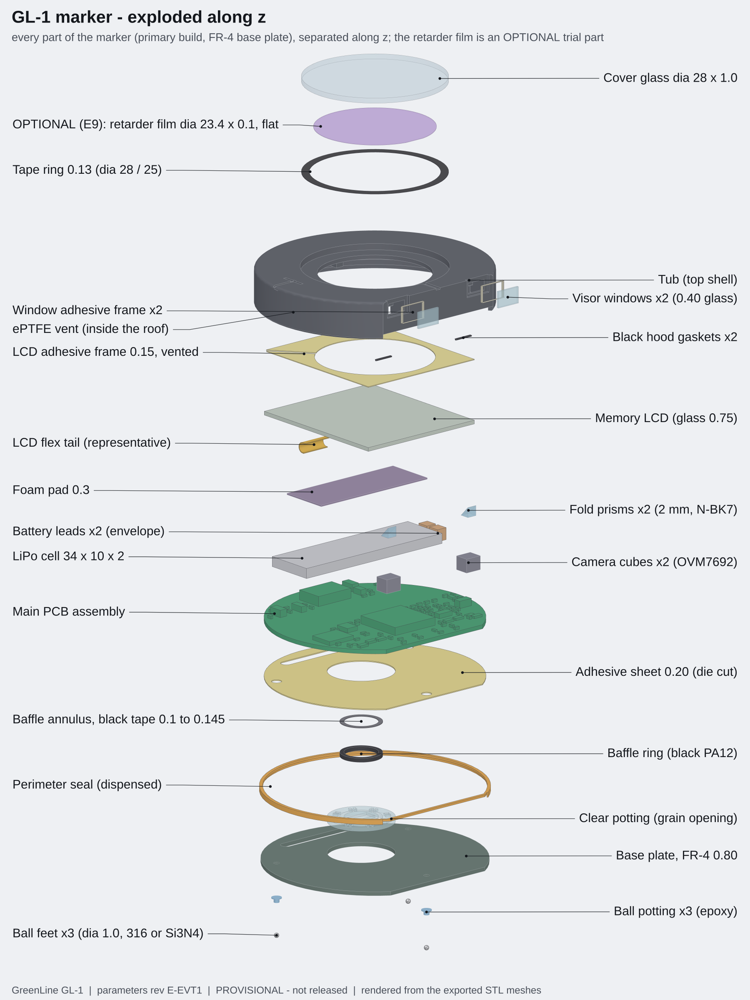
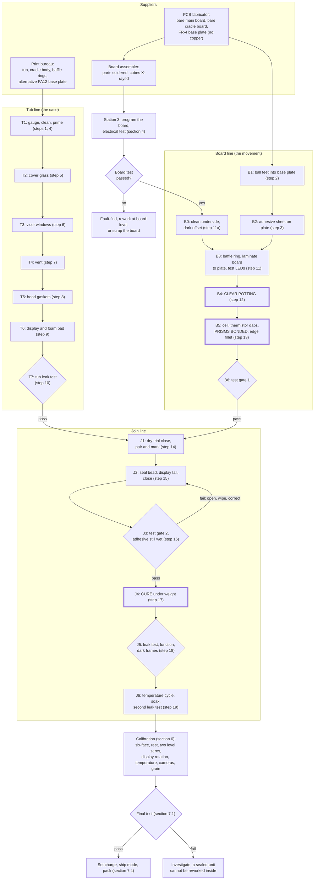
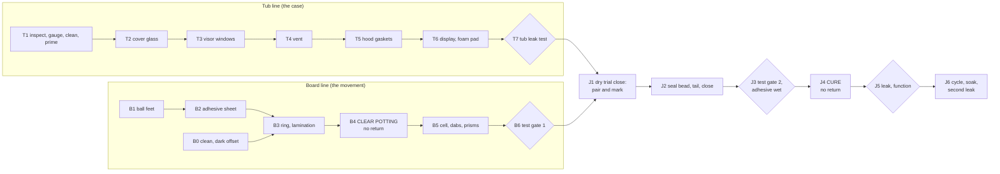

# GreenLine GL-1: manufacturing plan

Plan revision 3, 2026-11-20. Written against `design/DESIGN_SPEC.md` rev E (EVT1, amendments E1
to E36) and `design/master_params.yaml` rev E-EVT1. It replaces plan revision 2 of 2026-11-11,
which was written against rev D and carried only a note about rev E.

**Read this first.** Nothing in this project has been built, assembled, measured or run on
hardware. No circuit board, printed part, fixture or finished unit exists. No supplier has
been asked for a quote. The package is an EVT design package: a complete set of design files
for a first engineering build, with a list of open gates that must be closed before anything
is ordered. Every limit, volume and time in this plan is copied from a design file (the file is
named beside it) or is a proposal of this plan, and is marked as such. A design file is itself
unbuilt, so a figure taken from one is a design intent or a model result, not a test result.

This document owns HOW the GL-1 is made and proven. It is written so that a contract
manufacturer can read it as a procedure and say what it can quote, what it needs first and
what it cannot do. Who supplies each part is in `docs/SOURCING.md`; this plan recommends no
supplier and gives no price or lead time.

The GL-1 is a practice and training device. The package's own research note
(`docs/research/rules-compliance.md`, unverified there) says the Rules of Golf do not allow it
in a round played under those Rules. That statement belongs on the box and on the quick-start card (section
7.4).

**Numbering.** Other files of the package refer to this plan by section and test number
(`firmware/README.md` "Station tests and the commands they use"; `mechanical/README.md` section
7; `docs/VALIDATION_PLAN.md`). Section numbers, the test numbers of sections 4.5 and 7.1 and the
subjects of gates G1 to G12 are therefore kept from revision 2. New tests have new numbers at
the end of each list; new gates are G13 to G20.

## What changed from plan revision 2

| Subject | Revision 2 (rev D) | This revision (rev E), with the file it comes from |
|---|---|---|
| Main board | "Not laid out" | Routed, 4 layers, 0.8 mm; KiCad design-rule check 0 errors; fabrication and assembly outputs exist in `electrical/gl1_main/out/` (`electrical/README.md`) |
| Cradle board | 1.6 mm, "only its outline exists" | Routed, 2 layers, 1.0 mm (E36), outputs in `electrical/gl1_cradle/out/`; M2 x 4 screws |
| Fine tracks | One layer; rule set in conflict | 0.100 / 0.100 mm on three layers inside two fine areas (E35); fabricator acceptance is an open gate |
| Charger | MCP73831, two uncovered safety cases | BQ25101 with its own thermistor input (E1); two thermistors (E2); firmware can only stop a charge |
| VBUS path | Series Schottky | Ideal-diode switch LM66100 (E25); USB regulator LP5907-3.3 with enable (E26) |
| Board test access | Seven pads only | The four top-side test points of E4 (VBAT, V2V8, V2V8_CAM, GND) and power through the two cell-lead pads. A fifth test point, TP5, is on the board and is in no amendment; whether it is adopted is an owner decision (section 4.1) |
| Factory commands | Missing for cameras, display, zero | Protocol version 3 with 17 new commands and the PC tool `glctl`, run against the PC simulator only (`firmware/README.md`) |
| Level zero | One zero | Two seats, base face and ball feet (E11), on seat plates GL1-050 |
| Display rotation | Not calibrated | Measured and stored (E12, E22) |
| Test gate 2 | Target at +17 degrees | Bars at +13.0 and -13.0 degrees (E17) |
| Guaranteed upward field | 14.5 degrees | 14.0 degrees (E17) |
| Assembly sequence | 19 steps | 19 steps plus step 11a (cleaning and dark offset), thermistor dabs, serial mark, second leak test, soak and rest times |
| Base plate thickness accepted | 0.76 to 0.90 mm | 0.78 to 0.90 mm (E20) |
| Baffle ring height | Plate + 0.02 mm | Plate + 0.15 mm - tape thickness (E21) |
| Sleep current model | 20.6 microamps | 23.7 microamps at the cell (`firmware/README.md` "Sleep and the supply model") |
| Ship mode | Proposed | In the firmware (E13); its modelled current does not meet the requirement |
| Firmware update | USB loader only | Write-protected boot stub (E34), linked but never run |
| Gate list file | "`docs/RELEASE_GATES.md` is missing" | `docs/RELEASE_GATES.md` was written on 2026-11-20 and stands at 104 open gates, numbered G-001 to G-107 (three of those numbers are closed), in four groups by the order they block. It collects section 7 of the specification and the PROVISIONAL lists of the packages. Section 7 of the specification still says that no such file exists (that file's own gate G-073) |

## How to read the labels

| Label | Meaning |
|---|---|
| **REPO** | Taken from a file of the design package; the file is named. The package is unbuilt, so a REPO fact is a design intent or a model result. |
| **CARRIED** | An outside fact that plan revision 2 recorded on 2026-11-11 from the text of a web search result. It was not checked again for this revision. Its source is in section 12. |
| **PROVISIONAL** | From memory, from an unconfirmed extract, or from a stand-in. It must be confirmed against the maker's document before parts are ordered or a process is set. |
| **PROPOSAL** | Suggested by this plan. It is not in the design files. The owner accepts it or changes it. |
| **Not yet defined** | The package is silent. Every such item is listed again in section 10. |
| **GATE Gn** | The step depends on open gate Gn of section 2.2. The gate text is given in that table and repeated in short form at the step. |

## Words used

| Word | Plain meaning |
|---|---|
| PCB | Printed circuit board: the thin board (here 0.8 mm) that carries the chips. |
| Fabricator | The company that makes the bare board. |
| Assembler | The company that solders the parts onto the bare board. |
| Contract manufacturer | A company that builds a product for its owner, from the owner's documents. |
| Reflow | Soldering in an oven. Solder paste is printed, parts are placed on it, and the board is heated until the paste melts. |
| BGA | Ball grid array: a chip whose contacts are small solder balls hidden under its body. They cannot be seen after soldering, only X-rayed. |
| Land pattern | The shape and position of the copper pads that one part is soldered to. |
| MSL | Moisture sensitivity level. Some chips soak up water from the air. In the oven that water turns to steam and can crack them. The level says how long a part may sit in room air before soldering. |
| Camera cube | The OVM7692 camera: sensor and lens in one small block, soldered like a chip. |
| IMU | Inertial measurement unit: the chip that feels gravity and so measures tilt. |
| NTC, thermistor | A resistor whose value changes with temperature. Two of them sit beside the cell. |
| Pogo pin, spring pin | A spring-loaded pin that presses on a pad to make contact without soldering. |
| SWD | Serial wire debug: the two-wire port used to load software into a blank processor. |
| DFU | Device firmware update over USB, using a loader that the chip maker builds into the processor. |
| Firmware | The software that runs inside the device. |
| Boot stub | A very small program at the start of the processor's memory that checks the main program before starting it. |
| `glctl` | The PC program of this package that sends the factory commands (`firmware/tools/glctl`). |
| Fixture, jig, nest | A tool made for this product that holds a part in the right place while a step is done. |
| Go gauge, no-go gauge | Simple test pieces. A go gauge must fit; a no-go gauge must not. |
| Cure | The time and conditions an adhesive needs to harden. |
| Thixotropic | An adhesive that stays where it is put, like toothpaste. |
| Wicking | The opposite: a thin adhesive that runs into a narrow gap by itself, like water into a paper towel. |
| Potting | Filling a space with resin so that water and dirt cannot reach the parts inside. |
| Pressure decay | A leak test: the unit sits in a small closed space at a set pressure, and a leak shows as a drifting gauge reading. |
| mrad | Milliradian. 1 mrad is a slope of 1 mm in 1 m (0.1 %, about 0.06 degree). |
| First article | The first part of a new kind from a supplier, measured before any more are used. |
| EVT, DVT, PVT | Three build phases: engineering, design and production validation tests (section 2). |

---

## 1. Overview

### The one analogy to keep

The GL-1 is built like a sealed wristwatch. The "movement" is the circuit board glued to its
base plate. The "case" is the printed tub with its glass. Each half is finished and tested by
itself. The two are tried together dry, then glued shut. After the glue has set, nobody can
open the watch again without destroying it. That is why almost every check in this plan sits
just before a point of no return.

The picture below is a computer rendering of the design model, not a photograph. It shows the
parts in the order they stack.



### The whole chain

Read the chart from top to bottom. The three boxes with a thick border are the points of no
return of the table below the chart (in box B5 it is the bonding of the prisms). Diamonds
are test gates: a unit that fails goes back or goes out, as section 5.7 says.



| # | Stage | Done by | Goes in | Comes out | Main check | Section |
|---|---|---|---|---|---|---|
| 1 | Bare boards and base plate | PCB fabricator | Fabrication files | Bare 4-layer main board; bare 2-layer cradle board; FR-4 base plate with no copper | Thickness, hole sizes, outline | 3 |
| 2 | PCB assembly | Board assembler | Bare boards, parts kit | Main board with all soldered parts. No display, no cell, no prisms | Optical inspection; X-ray of the hidden joints | 3 |
| 3 | Programming and board test | Assembly bench | Assembled board | Board with firmware, electrically proven | Rails, currents, each chip answers | 4 |
| 4 | Mechanical assembly | Assembly bench | Tested board, tub, base plate, glass, display, cell, prisms, adhesives | Sealed marker | Two test gates, one tub leak test and two unit leak tests | 5 |
| 5 | Calibration | Assembly bench | Sealed, cured, temperature-cycled marker | Marker with its own correction numbers stored | Level, display rotation, cameras, grain sensor | 6 |
| 6 | Final test | Assembly bench | Calibrated marker | Accepted marker with a record | Function, cosmetics, record complete | 7 |
| 7 | Pack | Assembly bench | Marker in ship mode, cradle, printed card | Boxed product | Contents and cell state | 7 |

The charging cradle is a second, simple product with its own small board. It is built and
tested beside this chain (section 7.5).

### Three points of no return

| Point | Step in `mechanical/README.md` section 7 | What can no longer be fixed afterwards |
|---|---|---|
| Clear potting has cured | 12 | The 16 grain LEDs and the photodiode under the potting |
| Prisms are bonded to the camera cubes | 13 | The camera cube under each prism |
| Seal adhesive has cured | 17 | Everything inside the marker |

### Where the project stands today

| Item | State at rev E | Source |
|---|---|---|
| Main board | Routed. 121 footprints, 95 nets, 306 of 306 connections. KiCad design-rule check: 0 errors, 0 unconnected, 2 cosmetic silkscreen warnings. Fabrication and assembly files written. Not ordered, not made. 31 of 37 parts-list lines rest on PROVISIONAL design data | REPO: `electrical/README.md` "Result" |
| Cradle board | Routed, 1.0 mm, 20 footprints, 10 nets. Design-rule check 0 errors. Not ordered, not made | REPO: same |
| Mechanical model | 19 automatic checks pass with 23 warnings. Parts modelled and drawn. None printed or measured | REPO: `mechanical/README.md` section 10 |
| Firmware | Runs on a simulator on a PC: 33 test programs pass, and the test log holds 21 lines marked NOT MET. No program file for the real processor exists. The processor-specific layer has been compiled against the chip maker's header files and never linked or run; its USB part is compiled by no build | REPO: `firmware/README.md` "Status" and "What is not done"; `firmware/build/readme/test.log` |
| Factory software (PC side) | `glctl` exists and passes its self-test of 1185 checks against the simulator. Its serial link to a real unit has never been exercised | REPO: `firmware/README.md` "PC tool" |
| Adhesives | No liquid adhesive, sealant or potting is selected: each is a class. Three die-cut tapes are named by type; their converters are PROVISIONAL | REPO: `mechanical/README.md` sections 2 and 12 |
| Fixtures and gauges | Three are drawn (GL1-050: two calibration seat plates and the ball gauge plate). The rest are written requirements. The mechanical package lists six as not designed, among them the bridge gauge, which is stated as a requirement with its footprint. None has been made | REPO: `mechanical/README.md` sections 2 and 12 |
| Simulation | Still the revision C camera preset; not re-run on the rev E optics | REPO: `sim/README.md` |
| Companion documents | `docs/VALIDATION_PLAN.md` is at plan revision 3 and `docs/COMPLIANCE.md` at checklist revision 3, both written against rev E on 2026-11-20. The checklist made no new legal search for its revision 3, and every one of its rows reads "Not started" | Their own headers |

---

## 2. Build phases and what each must prove

Hardware is proven in three builds. Think of a new recipe: first cook it once to see whether it
works at all (EVT), then cook it for many guests in bad conditions (DVT), then check that the
kitchen staff can make it the same way every evening (PVT).

**Status of this package: an EVT design package with open gates. No order may be placed until
the gates of section 2.2 that apply to that order are closed (buying the display and the camera
cubes early, as `docs/SOURCING.md` advises, is a separate owner decision: `docs/RELEASE_GATES.md`
G-105). It is not ready for volume
production.** The reasons are in section 2.5.

### 2.1 The three phases at a glance

| | EVT | DVT | PVT |
|---|---|---|---|
| Question | Does the design work? | Does it survive, and does it meet the specification on every unit? | Can the line build it the same way again and again? |
| Quantity | **10 units** (given). PROPOSAL: buy parts for 15 builds, plus extra tubs, to finish 10 | Not yet defined | Not yet defined |
| Built by | The design team or a contract manufacturer's prototype bench, by hand | Trained operators on second-generation fixtures | The people who will run production, from written instructions |
| Parts | EVT-grade: mineral-glass crystal (not step-proof), ENIG contact pads | Production-intent: strengthened glass or sapphire, hard-gold pads, chosen adhesives | Production parts from production lots |
| Design state | Rev E with open gates | Frozen after EVT (next revision) | Frozen. Only process changes |
| Main output | A list of what works, what does not, and the decisions in 2.6 | Test reports; design freeze for production | Yield per step, time per step, final work instructions |

ENIG is the standard thin gold-over-nickel finish of a circuit board.

### 2.2 Open gates

The specification says that every PROVISIONAL item is a release gate, and that its section 7
together with the PROVISIONAL lists of `electrical/README.md`, `mechanical/README.md`,
`firmware/README.md` and `docs/SOURCING.md` section 12 is the list. `docs/RELEASE_GATES.md`
collects those lists into numbered gates (104 open at the end of 2026-11-20, under numbers
G-001 to G-107) and says who closes each and with what evidence. That file is the gate list to work from.

The table below is this plan's own short index of the same sources, grouped by the station or
order each gate stops, so that a step in this plan can carry one short tag. This plan's tags
are written G1 to G20 without a hyphen; the gates of `docs/RELEASE_GATES.md` are written G-001
to G-107 with a hyphen. The second table maps one to the other. Where this index and a source
file differ, the source file holds.

"Blocks" says which order or which step may not start while the gate is open.

| # | Gate text | Blocks | Source |
|---|---|---|---|
| G1 | **Camera data unverified.** The OVM7692 ball map, the 0.5 mm pitch and the 0.20 mm pad are a stand-in; which package side carries the 640-pixel axis is assumed. The lens pupil position and diameter behind the 14.0 degree guaranteed field are assumed: the model gives 14.03 degrees, a margin of 0.03 degree, and 13.86 or 13.61 degrees with other plausible pupil data. The highest oven temperature, the allowed number of reflows and the washing rules of the cube were not found | Main board order; assembler's reflow profile; gate 2 limit | `DESIGN_SPEC.md` section 7; `electrical/README.md` PROVISIONAL table; `mechanical/README.md` section 12 |
| G2 | **Display tail provisional.** Tail length, exit position, fold and where the surplus loop lies are not read from the Sharp drawing; the YAML zone `tub_keepouts.lcd_tail` is `basis: provisional`. Which tail edge is pin 1 is a guess: a wrong guess mirrors all ten pins (E28). The FH12A connector's numbering against the FH12 land pattern is unconfirmed. The mating with the unit open is not demonstrated | Main board order; station J2 | `DESIGN_SPEC.md` E24, E28; `mechanical/README.md` section 12 (B16); `electrical/README.md` |
| G3 | **Cell data missing.** Delivered thickness, swelling, protection-board length, storage and process temperature, safety certificates. No source says which lead of the cell is positive or where each lead leaves: BT1 = positive and BT2 = negative are assumed. Whether the cell may be charged at 4.06 V between 45 and 60 C is unanswered | Cell order; station B5; every temperature above 45 C | `mechanical/README.md` section 12 (B15); `electrical/README.md`; `firmware/README.md` "Charger and cell temperature" |
| G4 | **Pin tables and land patterns from memory.** BQ25101YFP ball map and 0.23 mm lands; LM66100DCKR pin table and enable polarity; VEMD8080 photodiode land pattern; the generic 0402 LED pattern and its polarity mark for all 16 LEDs; the crystal on another maker's pattern; every passive order code | Main board order | `electrical/README.md` PROVISIONAL table |
| G5 | **Processor facts from memory.** The pins the built-in loader drives; the data-sheet paragraph on the USB supply pin rising before the main supply (E26); the IMU axis map (a wrong map turns every slope by 90 degrees) | Main board order; first firmware load | `DESIGN_SPEC.md` section 7; `electrical/README.md` |
| G6 | **Charger behaviour is a model.** No BQ25101 data sheet was read; its temperature thresholds against the chosen thermistor are unconfirmed. With no firmware running the charger keeps its own window of 0 to 60 C, not the firmware's 0 to 45 C (NOT MET in the firmware test log) | Charging a cell without supervision; tests 6 to 8 of section 4.5 | `firmware/README.md` "Charger and cell temperature" |
| G7 | **No adhesive selected.** Perimeter seal, ball potting (two stages), hood gasket, window adhesive, cover-glass rim sealant, clear potting, thermistor adhesive, prism adhesive, primer: each is a class with no part number and no data sheet. Display frame tape and black baffle tape have no part number | Every bonding station; all cure times; adhesive coupons | `mechanical/README.md` sections 2 and 12 |
| G8 | **Base plate and legend unconfirmed.** The fabricator has not confirmed the build-up for 0.80 mm over the mask, the thickness tolerance or the web rule. The legend print rules are assumptions. The five legend text blocks are placeholders | Base plate order; plates for sale | `mechanical/README.md` sections 4.1 and 12 |
| G9 | **Print bureau unconfirmed.** That 0.8 mm walls survive vapor smoothing; the locked print orientation of the cradle. Tub first articles cannot be closed before the order: they are gauged at station T1 | Printed-part order; station T1 | `mechanical/README.md` section 4.2 |
| G10 | **Ball-foot lot.** A supplier certificate for dia 1.000 mm balls in 316 stainless grade 100 or better, or silicon nitride; the diameter tolerance of 0.0127 mm is from memory of the ball standard (E20) | Ball order; station B1 | `mechanical/README.md` section 12 |
| G11 | **Stock and supply.** Every listing and stock figure is a snapshot of 2026-11-13 or 2026-11-11. No quote was requested. No alternate part is approved. The display and the cell are on no board parts list and have no purchasing list | Every purchase order | `docs/SOURCING.md` header and section 12; `electrical/README.md` |
| G12 | **No firmware file for the real processor.** No linked application image exists; the processor layer is compile-only; the USB layer is not compiled; the boot stub is linked and never run, with six hardware release gates of its own; `glctl` has never talked to a unit | Station 3 and every station that sends a command | `firmware/README.md` "What is not done", "Boot stub" |
| G13 | **Fabricator acceptance of the fine rule.** Written acceptance of 0.100 mm track and 0.100 mm gap on F.Cu, In2.Cu and B.Cu inside the two fine areas (E7, E35); the quote request must name all three layers. Also: whether 0.25 mm is the drill size or the finished size of the via hole, and a solder-mask web of at least 0.075 mm at the cubes and the charger | Main board order | `electrical/gl1_main/out/fab/README.txt` |
| G14 | **Cradle spring pin.** The Mill-Max 0914 drawing was not read. Tail length is taken as about 1.34 mm (0.34 mm through the 1.0 mm board; under 1.2 mm the joint has no fillet). The cradle board is drawn for a tail of 0.635 mm in a 0.80 mm hole; the mechanical model uses 0.76 mm in 0.90 mm; no check compares them. The M2 x 4 screw has no part number | Cradle board order; cradle assembly; the factory fixture | `electrical/README.md`; `mechanical/README.md` section 12; `mechanical/cad/params.py` |
| G15 | **Fixtures not designed.** Not designed: six-face calibration fixture, display-rotation measurement, LCD squaring pusher, film lamination nest, a location for a four-position zero. Stated as a requirement but not drawn: bridge gauge, lamination jig, potting nest, prism jig, join fixture, pogo test fixture, leak tester, gate 2 target and the go gauges | Each station that uses the fixture (section 5.3) | `mechanical/README.md` sections 2 and 12 |
| G16 | **Release placeholders.** USB vendor and product identifiers are placeholders (E34); the regulatory text of the INFO screen is a placeholder; a release build of the firmware refuses to compile for both reasons. The legend text is a placeholder (G8) | Any unit for sale; final firmware | `firmware/README.md` "PC tool" (release gate), "Boot stub" |
| G17 | **Firmware requirements NOT MET.** 21 lines in the test log. Those that touch the factory: ship mode draws 12.9 microamps in the model against 5 required; the 25 microamp sleep limit is met only if the display panel draws less than 4.32 microamps asleep, and no figure is known; a silent USB host loses a docked marker after 30 s; the 45 C charge limit without firmware (G6) | Sleep-current limit; ship-mode shelf life; station software design | `firmware/build/readme/test.log`; `firmware/README.md` |
| G18 | **Missing procedures and limits.** No stereo calibration procedure or fitting program; no fixed-exposure dark frame; no four-position zero; no command for a chosen state of charge; no IMU self-test; no read-out of the flash identity or of the charger's thermistor. No limit for: photodiode dark offset, leak tests, dark frames, six-face offsets, prism centring, final read | The steps marked in sections 4 to 7 | `firmware/README.md` "Station tests that still cannot be run" |
| G19 | **No evidence of performance.** The simulation is the revision C camera preset. The battery-life and drop requirements of E23 are PROPOSED. The latch, seal, footstep and wet-docking figures are calculations | Any claim about the product | `sim/README.md`; `DESIGN_SPEC.md` section 7; `mechanical/README.md` section 12 |
| G20 | **Compliance work not started.** `docs/COMPLIANCE.md` is at checklist revision 3, written against rev E; every one of its rows is "Not started", and its legal content is unchanged since 2026-11-11 (no new search). The legend statements and the INFO text are placeholders, the label route is not chosen, and no shipping instruction exists. The files disagree on how much text the legend blocks hold (88 characters each, or 88 together) | Legend text (before the base plates are ordered); packing and shipping instructions; any unit for sale | `docs/COMPLIANCE.md` header, rows 5, 10 to 12 and section 4.3 |

| This plan | In `docs/RELEASE_GATES.md` (as that file stood at the end of 2026-11-20) |
|---|---|
| G1 | G-001, G-002, G-026, G-041 |
| G2 | G-006, G-007, G-008 |
| G3 | G-013, G-039, G-040 |
| G4 | G-003, G-005, G-009, G-010, G-011, G-022 |
| G5 | G-012, G-017, G-018 |
| G6 | G-004, G-029 |
| G7 | G-048, G-049, G-053 |
| G8 | G-044, G-045 (G-045 also carries the contradiction on the legend capacity) |
| G9 | G-042, G-064 |
| G10 | G-050 |
| G11 | G-025, G-037, G-038, G-057, G-058 |
| G12 | G-061, G-062, G-063 |
| G13 | G-023, G-024 |
| G14 | G-014, G-055 |
| G15 | G-047, G-060 |
| G16 | G-084, G-085 |
| G17 | G-028, G-074, G-075 |
| G18 | G-067, G-068 |
| G19 | G-071, G-072, G-081 |
| G20 | G-085, G-086 (G-082, which said the checklist was at rev D, is closed) |

Gates of that file with no tag here do not stop a step of this plan directly (for example the
owner decisions on layout weaknesses, G-031 to G-035, the three decisions to take before any
hardware money is spent, G-103 to G-105, and the gates before selling, G-083 to G-102).

Gate G4 of revision 2 ("the real board exists") and gate G10 of revision 2 ("mechanical
package rebuilt against the amended parameters") are closed as files: both boards are routed
and both mechanical board-import checks pass (`mechanical/README.md` section 10, checks 17 and
19). Their numbers are reused above for what is still open in the same area.

### 2.3 EVT: the build, and what it must prove

**Trials before the first sealed unit** (REPO: `mechanical/README.md` section 12, test item 8).
These use loose parts and scrap boards, not the ten units: display tilt-in against the rear
ribs; hood gasket bead from the needle guide and its shape after cure; plugging in the display
tail with the unit open, on a mock-up; the dry trial close.

**Build matrix for the ten units (PROPOSAL, kept from revision 2).** The tilt-drift test needs
both base-plate materials, each with the grain opening potted and unpotted, or it cannot
separate the effect of the plate from the effect of the potting (REPO: `mechanical/README.md`
section 12, test item 1).

| Base plate | Grain opening | Units | Use |
|---|---|---|---|
| FR-4 (primary) | Potted | 4 | Full function, turf trials, seal tests |
| FR-4 | Unpotted | 2 | Tilt-drift comparison only (bench; not for wet turf) |
| Printed PA12 (alternative) | Potted | 2 | Tilt-drift comparison, seal comparison |
| Printed PA12 | Unpotted | 2 | Tilt-drift comparison only |

Destructive tests (footstep, sectioning, ball push-out) should use extra shells without
electronics. Their number is not yet defined in the design files.

**What EVT must prove.** The questions are numbered Q1 to Q17 (revision 2 called them E1 to
E17, which collides with the amendment numbers of the specification).

| # | Question | Pass figure | Source |
|---|---|---|---|
| Q1 | Do all boards power up and does every chip answer? | Section 4.5 | - |
| Q2 | Does the tilt reading of the board-and-base sandwich drift with temperature and humidity? | Under 0.05 mrad per kelvin after per-unit correction. Repeats within 0.3 mrad after a -10 to 50 C cycle. Measured again some weeks after cure | `mechanical/README.md` section 12, test item 1 |
| Q3 | How repeatably does the marker seat on real turf? | No pass figure. The specification expects turf seating of 2 to 5 mrad to dominate | `DESIGN_SPEC.md` section 3 |
| Q4 | Do both cameras give images, the right way up? | Both identify themselves (`cam-id`); image orientation as assumed (G1) | `firmware/README.md` "Station tests" |
| Q5 | Is the upper edge of the camera view clear? | Guaranteed 14.0 degrees. At gate 2 the bar at +13.0 degrees is not darker than the bar at -13.0 degrees | `master_params.yaml` `cameras`; `mechanical/README.md` step 16 |
| Q6 | How long does a read take on the real processor? | Model: result 4.1 to 4.8 s after the marker comes to rest, camera rail on for 2.2 to 2.8 s (E15). A model, not a measurement | `DESIGN_SPEC.md` section 6 |
| Q7 | How repeatable is the stereo camera calibration? | Not yet defined (G18) | - |
| Q8 | Do the seals hold? | Leak tests of every tub and every unit, twice. Qualification loads: 25 kPa inward, and 40 kPa outward for 24 h at 70 C. Cut sections show the joint is filled | `mechanical/README.md` section 9 |
| Q9 | Do the potted ball feet hold? | Push-in and pull-out target 100 N. Protrusion unchanged after temperature cycling | `mechanical/README.md` section 12, test item 7 |
| Q10 | Does filling the grain opening by volume hold the level window? | Surface between the ring crest and 0.10 mm inside it, never nearer the base plane than 0.05 mm | `mechanical/README.md` step 12 |
| Q11 | Does the cradle latch last? | 3000 insert and release cycles at 23 C and 0 C; 1000 h at 50 C under seven pins; pull test 12.4 N at the pin row | `mechanical/README.md` section 12, test item 3 |
| Q12 | Does light leak into the cameras? | Dark frames under strong side light. No numeric limit yet | `mechanical/README.md` section 12, test item 4 |
| Q13 | What happens under a footstep? | 800 N on a 20 mm indenter, on glass and on roof, on turf and hard floor, at 23 and 60 C, display powered. The EVT crystal is declared not step-proof | `mechanical/README.md` section 12, test item 2 |
| Q14 | Is the grain sensor worth keeping? | The validation gates of `docs/research/grain-sensing.md`. The sensor ships switched off until it passes | `docs/VALIDATION_PLAN.md` 2.6 |
| Q15 | Does charging start with a dead processor and stop outside its temperature window? | Section 4.5, tests 6 to 8 | `DESIGN_SPEC.md` section 4 (E1) |
| Q16 | Wet docking | 100 dockings of a wetted marker, then pad inspection | `mechanical/README.md` section 9, test 8 |
| Q17 | Do bonded units survive temperature cycling? | 100 cycles of -10 to 70 C, then leak test, display position and tilt offset compared with before. The 70 C figure is above any confirmed cell limit (G3) | `mechanical/README.md` section 9, test 9 |

**EVT exit criteria (PROPOSAL).** EVT ends when: every item above has a measured answer; each
decision in 2.6 marked "EVT" is made and written into the specification; every failure has a
known cause and a design change or a recorded acceptance; and the changed design passes the
automatic checks again.

### 2.4 DVT and PVT

The design files say little about these phases. Quantities, entry and exit criteria are not
yet defined. Two things the files do say point to DVT: the step-proof claim needs the
production glass, which EVT units do not have; and the hard-gold contact pads are a production
item (`mechanical/README.md` section 12). PROPOSAL: DVT repeats the tests of
`mechanical/README.md` section 9 on production-intent parts; PVT measures yield at every gate,
time at every station, and whether each gauge gives the same answer for different operators.

### 2.5 Why this is not ready for volume production

1. Nothing has been built or measured. Every performance figure is a model, and the simulation
   is still the revision C optics (G19).
2. The main board is routed on PROVISIONAL pin data for the cameras, the charger and the VBUS
   switch (G1, G4). A wrong pin table passes every automatic check (`electrical/README.md`
   "Toolchain limits").
3. No firmware file for the real processor exists (G12).
4. No adhesive is selected (G7).
5. Most fixtures are requirements, not drawings (G15).
6. The seal, the latch, the ball feet and the potting are calculated or chosen by class.
7. The EVT cover glass is not step-proof.
8. The upper edge of the camera view has a margin of 0.03 degree in the guaranteed case, on
   assumed lens data (G1).
9. Several hand steps have windows of a few hundredths of a millimetre (ball height, potting
   level, gasket bead). Nobody knows yet how often a person can hit them.
10. Ship mode does not meet its current requirement in the model (G17).
11. The identifiers and texts a unit for sale needs are placeholders (G16), and no regulatory
    work has started (`docs/COMPLIANCE.md`; G20).

### 2.6 Open design decisions and the phase that closes each

| Decision | Evidence needed | Closed in |
|---|---|---|
| Base plate: FR-4 or printed PA12 | Tilt-drift test Q2 on both | EVT |
| Clear potting product and its stiffness | Q2 (potted against unpotted), Q10 | EVT |
| Each adhesive, with primer and cure | Coupons, Q8 | Before EVT order (G7); proof after ageing at DVT |
| Display tail routing; fallback to a 1.0 mm back-flip connector (E24) | Sharp drawing; mock-up trial | Before the board order (G2) |
| Camera ball map and orientation | Maker's data sheet | Before the board order (G1) |
| Clamp and series resistors on SWDIO, SWCLK, NRST; top-side tenting; TP5; the CamPower class; the cradle fuse trip current | Owner decision on the wanted amendments | Before the board order (`electrical/README.md` "Changes needed in other packages") |
| Ship-mode current: change the hardware or the requirement | Measurement; G17 | EVT |
| Gate 2 limit (proposed: upper bar not more than 10 % darker) | First units | EVT |
| Four-position level zero | Fixture and firmware (G15, G18) | Before DVT |
| Production cover glass: strengthened glass or sapphire, 600 MPa ring-on-ring or more. 1.0 mm is reported as not stocked for strengthened glass | Footstep test | DVT |
| 0.2 mm thicker marker above the display (the reserved remedy) | Q13 | DVT |
| Hard-gold contact pads | Wet docking and wear | DVT |

---

## 3. PCB fabrication and assembly: notes for the fabricator and the assembler

Three things are ordered here. They are different animals.

| Item | What it is | Data that exists |
|---|---|---|
| Main board `gl1_main` | 4-layer circuit board, parts on both sides | `electrical/gl1_main/out/gl1_main-fab.zip` and `gl1_main-assembly.zip` (section 3.8) |
| Cradle board `gl1_cradle` | 2-layer board, 30 x 22 x 1.0 mm, with a USB-C socket and spring pins | `electrical/gl1_cradle/out/gl1_cradle-fab.zip` and `gl1_cradle-assembly.zip` |
| Base plate | A mechanical plate made of circuit-board material with **no copper at all**: routed, drilled, black mask on both faces, white legend on the underside. It is ordered from the PCB fabricator because they hold thickness and hole positions well | `mechanical/drawings/GL1-011_base_plate_FR4.pdf` (two sheets); the five files in `mechanical/drawings/fab/`; `mechanical/drawings/dxf/GL1-011_base_plate_FR4_fab.dxf`. Ordering notes: `mechanical/README.md` section 4.1 |

**GATE G13, G1, G4, G2 (main board), G14 (cradle board), G8 (base plate): none of the three may
be ordered while its gates are open.** The files exist so that a fabricator can be asked the
gate questions and can quote.

### 3.1 Main board: stack-up and rules

Source for every row: `electrical/gl1_main/out/fab/README.txt` and `electrical/README.md`
"Result", unless a row says otherwise.

| Item | Value |
|---|---|
| Layers | 4 |
| Finished thickness | 0.80 mm. Stack-up in the fabrication README: outer copper 0.035 mm, inner copper 0.0175 mm, prepreg 0.110 mm, core 0.455 mm, mask 0.010 mm per side. PROPOSAL: ask the fabricator to report the measured thickness of the lot, because the board thickness is in the chain that sets the height of the seal joint (`mechanical/README.md` section 9) |
| Surface finish | ENIG for EVT. Selective hard gold on the seven contact pads for production (`master_params.yaml` `bottom_side_parts`) |
| Layer use | Top: parts and signals. Layer 2 (In1.Cu): solid ground. Layer 3 (In2.Cu): the 2.8 V supply fill and a routing layer, not a solid plane. Bottom: grain LEDs, photodiode, seven contact pads |
| Material grade, solder-mask colour | Not yet defined for the main board |
| Outline | D shape: radius 21.1 mm, flat edge at y = 17.3 mm; 42.20 x 38.40 mm overall |
| Locating features | One non-plated round hole 1.15 mm at (14.35, 10.8). One routed non-plated slot 1.15 x 2.2 mm centred on (-14.35, 10.8). Tolerance of hole and slot width +0.05 / 0 (E17) |
| Vias | Through vias only, 278 of them. 0.50 mm pad. Hole 0.25 mm: intended as the drill size, finished about 0.20 mm. **GATE G13: the fabricator must be asked which reading it uses** |
| Via protection | Tented on both sides and plugged with solder mask from the bottom. No via at all inside the 13 mm grain opening at (0, -4) or inside the pad slot at y = -17 |
| Standard tracks | 0.15 mm track with 0.127 mm clearance. Power 0.30 mm |
| Fine tracks | 0.100 mm track with 0.100 mm gap (3.94 mil) on **three layers**, F.Cu, In2.Cu and B.Cu, only inside two fine areas that reach 5 mm beyond each camera ball field: 175 mm2, 13 % of the board; 218.3 mm of such track on 28 nets. **GATE G13: written acceptance of 0.100 / 0.100 mm on all three layers before the order** |
| Other clearances | Copper to board edge 0.30 mm. Hole to hole 0.25 mm. Hole to copper 0.20 mm. Plane clearance 0.20 mm. Minimum annular ring 0.125 mm |
| Solder mask | Drawn 1:1 on every land. A mask web of at least 0.075 mm must remain between the openings of U9 (charger, 6 balls on 0.4 mm, lands 0.23 mm) and of U2 and U3 (cameras, 25 balls on 0.5 mm, lands 0.20 mm) |
| Under each ball foot (3 places) | Bottom side: an unmasked 1.6 mm copper land inside a 2.5 mm zone with no track and no via, at (0, 15.0), (-16.5, -9.5), (16.5, -9.5). The steel ball bears on the land |
| Under the IMU | No copper and no via in the top-layer rule area under the body |
| Contact pads | Seven 1.8 mm pads on 2.54 mm pitch at y = -17.0. No solder paste on them, on the two cell-lead pads or on the test points |
| Fiducials (targets for the placement machine) | Three per side; coordinates in the assembly README |
| Silkscreen | No reference designators. Use the assembly renders and the position file |
| Controlled impedance | None |
| Assembly | Lead-free (SAC305) reflow, RoHS-compliant parts, no conformal coating at EVT (E5) |

Height rule for anyone who proposes a substitute part: nothing on the top side may stand more
than 2.55 mm above the board; nothing more than 0.95 mm under the two camera hoods except the
camera; nothing more than 0.7 mm behind the mouth of connector J1. A taller "equivalent" part
does not fit the tub (REPO: `master_params.yaml` `tub_keepouts`; `mechanical/README.md` step
15). No alternate part is approved (G11).

Layout weaknesses that the electrical package records as known and not fixed are listed in
`electrical/README.md` ("Known weaknesses of this layout"). They do not change the process, but
the assembler's fault-finder should know them: long camera lines, camera supply capacitors 4.2
to 9.9 mm from the balls, no protection parts on the three service pads.

### 3.2 Parts that need care

Counts from `electrical/gl1_main/out/assembly/README.txt`: 86 parts placed on the top side, 17
on the bottom side, 37 parts-list lines, 103 parts to fit, one position not fitted (R14).

| Ref | Part | Why it needs care | How to handle | Open gate |
|---|---|---|---|---|
| U2, U3 | OVM7692-RYAA camera cube, 25 balls at 0.5 mm, lands 0.20 mm | A tall block on a small ball field with a lens on top. Hidden joints. Its rotation sets which way up the image is | Section 3.3 | **G1: ball map, pitch and orientation unverified** |
| U9 | BQ25101YFP charger, 6 balls at 0.4 mm, lands 0.23 mm | Very small ball package. Hidden joints | Paste inspection; X-ray | **G4: ball map from memory** |
| U12 | LM66100DCKR ideal-diode switch, SC-70-6 | Small leads | Standard | **G4: pin table from memory** |
| U1 | STM32U585RIT6 processor, 64 leads at 0.5 mm | Fine leads; solder bridges | Optical inspection | - |
| U4 | LSM6DSV16X IMU, 14 lands, no leads; mounted at 90 degrees | A tiny mechanical sensor. Stress from solder or board bending shifts its zero. Hidden joints | No solder on the sides of the package (CARRIED [S4]). No ultrasonic cleaning (PROVISIONAL: `docs/research/enclosure-manufacturing.md`). Do not flex the board near it at depanelling | G5: axis map |
| U6 | MX25R6435F flash memory, no leads | Hidden joints | X-ray sample | - |
| J1 | Display connector FH12A-10S-0.5SH(55), 10 contacts at 0.5 mm, 2.0 mm tall | Its pick point is not its footprint anchor: anchor (0.000, -12.900), body centre (0.000, -14.500), 1.600 mm apart. Small flip latch | Use the BodyX / BodyY columns of the position file as the pick point. Ship with the latch closed and the connector empty | **G2: numbering and tail geometry provisional** |
| - | 16 grain LEDs, 0402, bottom side (8 red VLMS1500, 8 near-infrared SFH 4053B) | Each red LED sits beside an infrared one, wired back to back. A reversed LED looks perfect to a camera inspection | Polarity is proven electrically at board test (4.5, test 14) | **G4: the pattern's polarity mark is assumed (pad 1 taken as the cathode); if wrong, all 16 are reversed** |
| - | Photodiode VEMD8080, bottom side | High-impedance input; flux residue near it matters | Clean before lamination (station B0) | **G4: land pattern provisional** |
| NTC1, NTC2 | Two 10 kilohm thermistors, 0402, top side, within 1 mm of the cell edge | Each must end up right beside the cell | Standard placement. The thermal adhesive dabs are applied at station B5 | - |
| Y1 | Crystal | Seated on another maker's land pattern | First-article check | **G4** (pin data from memory) |
| BT1, BT2, TP1 to TP5, J2 | Bare copper: cell-lead pads, test points, the seven-pad row | Not parts | No paste, no placement | - |

### 3.3 The camera cubes

What is known, and how sure.

| Fact | Status |
|---|---|
| The maker describes the cube as built to withstand more than one reflow, for rework or two-sided assembly | CARRIED [S1] (search extract of the maker's product page) |
| Moisture sensitivity level 3: 168 hours of floor life | CARRIED [S2], a distributor listing only. Read the label on the sealed bag |
| What level 3 means: once the dry bag is opened the parts may sit at up to 30 C and 60 % humidity for 168 hours in total before soldering; past that they are baked dry first | CARRIED [S3] |
| Highest oven temperature, largest number of reflows, any protective film on the lens, washing allowed or not | **Not found. GATE G1** (camera data unverified) |
| Ball pitch, ball map, which edge is parallel to the image rows | **PROVISIONAL. GATE G1** (camera data unverified) |

Process notes for the assembler (PROPOSAL, to be agreed with the assembler once the maker's
assembly guide is in hand):

1. Keep the cubes in their dry bag until the top side is ready to place. Log the time out of
   the bag. A moisture clock is like bread going stale once the bag is open: it only runs one
   way unless the part is baked.
2. Place the cubes last on the top side, so nothing else is placed across them.
3. Solder the cubes once only: build the bottom side first (3.5).
4. The top of the cube is an optical and a bonding surface. A prism is glued to its four
   corners later. No fingerprints, no flux, no marker ink, no label on it.
5. Do not wash a board that carries cubes unless the maker's guide allows it. This is why the
   underside is cleaned locally by hand at station B0 and never by immersion
   (`mechanical/README.md` step 11a).
6. X-ray both cubes and the charger on every board (3.6).
7. Report the height of each cube top above the board. The dummy-unit gauge is built for a
   cube top at 2.81 mm (`mechanical/README.md` section 2).

### 3.4 Parts that are NOT soldered in the oven

| Part | Why not | Where it is fitted |
|---|---|---|
| Memory LCD (LS013B7DH03) | Glass with a flexible tail | Glued under the tub roof (step 9). Its tail is plugged into J1 at the final close (step 15) |
| Cell (GM201030-PCB) | A lithium cell must never see oven heat | Stuck to the board and its two leads soldered by hand to BT1 and BT2 (step 13). From then on nothing in the unit is heated above 45 C |
| Two prisms | Glued optics | Bonded to the cube tops (step 13) |
| Baffle ring, base plate, ball feet | Mechanical parts | Steps 2, 3 and 11 |

The display and the cell are on no board parts list. They belong on a purchasing list above the
board lists, which has no file and no owner yet (G11).

### 3.5 Two-sided assembly sequence (PROPOSAL)

1. Check moisture labels. Bake any part whose floor life has run out.
2. **Bottom side first.** Print paste, place the 16 LEDs and the photodiode, reflow. These are
   the only bottom-side parts and they are light, so they stay on when the board is turned
   over.
3. **Top side second.** Print paste, place everything, cubes last, reflow.
4. No wash by the assembler unless the camera maker's guide and the data sheets of the LEDs and
   the photodiode allow the process (G1). The assembler names the flux it used and a solvent
   for it: station B0 needs both names (`mechanical/README.md` step 11a).
5. Optical inspection of both sides. X-ray (3.6).
6. Break out of the panel with a router or a fixture, not by hand (3.7).

### 3.6 What is inspected

| Inspection | On | Looking for |
|---|---|---|
| Solder paste check | Camera footprints, charger, IMU, processor | Paste volume on 0.20 and 0.23 mm lands |
| Automatic optical inspection | Both sides, every board | Missing, shifted or bridged parts |
| **X-ray** | Both camera cubes and the charger on **every** board. IMU and flash on the first boards, then by sample | Bridged balls, open balls, large voids. These joints cannot be seen any other way |
| Cube height and tilt | Both cubes, every board at EVT | Top no more than 2.81 mm above the board; no visible tilt |
| First article | First assembled board | Photographs of both sides and the X-ray images returned before the rest are built |

All of 3.6 is a PROPOSAL. Workmanship standard and X-ray void limits: not yet defined.

### 3.7 Panelisation with the D-shaped outline

The output folders hold no panel file. For the main board the rules below are a PROPOSAL built
from the mechanical fits.

| Rule | Reason |
|---|---|
| Tab-routed panel. No V-score | A curved outline cannot be scored |
| Break-off tabs with their perforations set back inside the outline. No nub proud of the outline anywhere | The board drops into the tub with 0.25 mm of nominal clearance (`mechanical/README.md` section 4.2, item 8) |
| No tab on the flat edge in front of the two fine areas (x from -16.1 to -3.9 and from 3.9 to 16.1) | The camera cubes and their fine tracks sit at that edge (`fab/README.txt`, fine areas) |
| No tab near the IMU | Breaking a tab bends the board locally |
| Panel rails carry the fiducials and tooling holes | The round board has no straight edge to grip |

For the **base plate** the rules are REPO (`mechanical/README.md` section 4.1): order
individually routed pieces; if panelised, tabs only on the flat edge, perforations recessed by
at most 0.25 mm, no V-score, no fabricator marking, no release agent, bow and twist 0.5 % at
most. Do not order plates for sale with the placeholder legend (G8).

### 3.8 The files the fabricator and assembler receive

All of these exist in the repository. Each `out/` folder also holds `outputs.json`, which
lists every output file with its size and SHA-256 checksum, so a receiver can prove it has the
same files (`electrical/README.md` "What is here").

| File (main board; the cradle board has the same set under `electrical/gl1_cradle/out/`) | Content | Goes to |
|---|---|---|
| `electrical/gl1_main/out/gl1_main-fab.zip` (folder `fab/`) | Gerber X2 for four copper layers, two mask, two paste, two silkscreen layers and the outline; Excellon drill files for plated and non-plated holes; drill maps; job file; `README.txt` with stack-up, finish, via protection, rules, the fine-track table and the questions for the fabricator | Fabricator |
| `electrical/gl1_main/out/gl1_main-assembly.zip` (folder `assembly/`) | `gl1_main-pos.csv` (pick-and-place, both sides); `gl1_main-bom.csv` (grouped parts list); `gl1_main-bom-status.csv` (the same list with the sourcing status and the design-evidence status of every line); `README.txt` with origin, axes, rotation convention, the not-fitted list, fiducials and the J1 pick point | Assembler |
| `electrical/gl1_main/out/schematic/gl1_main-schematic.pdf` | An 8-sheet generated netlist drawing. Complete, but not drawn like a hand schematic | Assembler, for fault-finding |
| `electrical/gl1_main/out/gl1_main-board.step`, `renders/`, `review/` | Bare-board 3-D model; pictures of every copper layer and of both assembly sides | Both |
| `electrical/gl1_main/out/drc.json`, `layout_quality.md`, `spec_rules.md` | The design-rule result, the measured layout figures, the specification-to-netlist table | On request |
| `mechanical/drawings/GL1-011_base_plate_FR4.pdf`, `mechanical/drawings/fab/` (profile, two mask layers, underside legend, non-plated drill), `mechanical/export/step/base_plate.step` | Base plate | Fabricator |
| This section 3 | Handling notes | Assembler |

Not produced and still needed: an assembly drawing, a fabrication drawing with dimensions and
tolerances for the two circuit boards, a panel drawing.

Read `bom-status.csv` this way: a line may be ordered only when both of its status columns
allow it. Today every part number is VERIFIED as a listing seen for sale, which is not a stock
promise, while 31 of 37 main-board lines and 6 of 7 cradle lines are PROVISIONAL in their
design data (`electrical/README.md`).

What is asked back with the boards (PROPOSAL): measured board thickness; the X-ray images; cube
heights; the moisture log for the cubes; the flux used and a solvent for it; a list of any
substituted part.

---

## 4. Board bring-up and programming station

"Bring-up" means powering a new board for the first time, carefully, and proving each part of
it in turn. This is station 3 of the chart in section 1.

**GATE G12 applies to the whole section: no firmware file for the real processor exists, and
`glctl` has never talked to a unit.** The commands below were run against the PC simulator
only.

### 4.1 Access to the board

The board is reached in three ways (REPO: `DESIGN_SPEC.md` section 4, E4;
`master_params.yaml` `top_side_test_points`; `electrical/gl1_main/out/gl1_main-netlist.json`,
part J2).

**The seven pads on the underside.** The netlist numbers them 1 to 7 in the order below, and
the mechanical import check finds the seven pads on the pin axes of the cradle.

```
   Design frame, seen from ABOVE (x to the right). Pad row at y = -17.0 mm, pitch 2.54 mm.

   pad      1       2       3       4       5       6       7
   x =    -7.62   -5.08   -2.54    0.00   +2.54   +5.08   +7.62
          VBUS     D-      D+      GND    SWDIO   SWCLK   NRST
          |------ consumer cradle ------|
          |-------------------- factory fixture ---------------------|

   Seen from BELOW (the way the pads are looked at), left and right are swapped.
```

| Pad | Job |
|---|---|
| VBUS | 5 V in. Feeds the charger and the USB supply regulator through the ideal-diode switch |
| D-, D+ | USB data (full speed) |
| GND | Ground |
| SWDIO, SWCLK | Programming and debug port of the processor |
| NRST | Processor reset |

**The two cell-lead pads on the top side**, BT1 (cell positive, at (-18.4, -2.7)) and BT2
(ground, at (-18.4, -5.8)). Before the cell is soldered, the board is powered here from a bench
supply with a current meter. This is also where sleep current is measured (E4). The polarity
assignment is PROVISIONAL for the cell (G3), but it is what the board is wired for.

**Five test points on the top side**, bare round pads of 1.0 mm for spring probes, reachable
only before the unit is closed.

| Test point | Net | Position (x, y) mm |
|---|---|---|
| TP1 | VBAT (cell voltage) | (-17.0, 0.62) |
| TP2 | V2V8 (always-on 2.8 V rail) | (8.0, -15.25) |
| TP3 | V2V8_CAM (switched camera rail) | (-14.6, 9.0) |
| TP4 | GND | (18.4, 0.6) |
| TP5 | VDDUSB (3.3 V USB supply rail) | (18.6, -2.2) |

TP5 is on the board but beyond the four test points of amendment E4; whether it is adopted is
an open owner decision.

Limits of this access (REPO: `electrical/README.md` "Known weaknesses", "Bring-up access"):

1. The boot-select pin of the processor has no pad. The first program load is by SWD only.
2. Neither the pad row nor the service header J2 of the cradle board carries a reference
   voltage for the programming probe. PROPOSAL: the board-test fixture takes the reference
   from TP2; a fixture for sealed units must supply a fixed 2.8 V reference instead.
3. A board without its cell gets at most the charger's 20 mA through VBUS. That is why board
   test powers the board through BT1 and BT2.
4. The three service pads have no protection parts. PROPOSAL: the operator and the fixture are
   grounded before the pins touch.
5. Once the cell is soldered and the unit sealed, no current of the unit can be measured.

### 4.2 The station

| Item | Purpose | State |
|---|---|---|
| Board nest with seven spring pins on the underside pads, two on BT1 and BT2 and five on TP1 to TP5 | Contact without soldering | **GATE G15: not designed.** The mechanical package names a "pogo test fixture for the seven pads" as a requirement only. The pin geometry of the seven-pin cradle can be reused, subject to G14 (spring-pin data unconfirmed) |
| Bench supply with current limit and a microamp range, set to 3.8 V | Stands in for the cell; measures currents | Standard equipment |
| 5 V supply through a meter | VBUS; measures charge current | Standard equipment |
| Programming probe for SWD | Loads the boot stub and the application into a blank processor | Standard equipment; model not chosen |
| PC with `glctl` and a station script | Sends the commands and saves the record | `glctl` exists (`firmware/tools/glctl`; Python 3 with the `pyserial` package for a real unit). The station script that runs the list and files the record does not exist |
| Voltmeter on TP1 to TP5 | Rails | Standard equipment |
| White card and a dark cover | Grain LED and photodiode loop | Not yet defined |
| A test cell, or a supply that can absorb current, on BT1 and BT2 | Charger tests 6 and 7 | Not yet defined |

### 4.3 Loading the firmware

| Situation | Method | Notes |
|---|---|---|
| Blank processor (first load) | **SWD** through SWDIO, SWCLK, NRST and GND | Two pieces are loaded: the boot stub into the first 8 kB page, and the application from address 0x08002000 with its 32-byte image header, stamped by `firmware/tools/stamp_image.py`. Then the option bytes are set, because the stub does not write them: write protection of page 0, the boot-pin selection, the watchdog mode, read-out protection level 0 at EVT. **GATE G12: every option-byte value is PROVISIONAL and no application image exists** |
| Later update, also on a sealed unit | **USB DFU** through VBUS, D-, D+, GND. `glctl update-loader` unlocks the unit and asks the boot stub to start the chip maker's loader | The firmware refuses unless VBUS is present and the cell temperature is inside the charge window. **Once in the loader, only a DFU host or a flat cell gets the unit out**: the loader has no time-out and the cradle has no reset contact (NOT MET for a user without a PC, `firmware/README.md` open issue 59). In the loader the host sees the chip maker's USB identifiers, not the product's. No PC-side updater exists |
| Factory recovery of a sealed unit | SWD on the three service pins of the seven-pin fixture | E34 |
| Read-out protection for production, signed images | Not yet defined (owner decision) | |

Calibration data and settings are kept in the separate flash memory chip, not in the
processor (section 6.6). A firmware update by either method leaves them in place.

What the boot stub does at every start (REPO: `firmware/README.md` "Boot stub"): it checks the
length and checksum of the application image. A valid image is started. An invalid image, or an
update request with VBUS present, starts the loader. An image that fails to confirm its start
three times in a row is no longer started. The stub is 1536 bytes of its 8192-byte page. It has
been linked and has never run; its six hardware release gates (loader entry, write protection
and option bytes, vector relocation, backup registers and watchdog, the image-check time, the
USB identity a host sees) are part of G12.

### 4.4 What the factory commands can test, and what they cannot

The firmware speaks a command language over USB, protocol version 3 (REPO:
`firmware/README.md` "The protocol (version 3)"). A PC sends `GET_IDENT` first; the answer
carries the versions both sides speak. The command name is given first below and the `glctl`
subcommand in brackets.

**The unlock rule.** Commands that write or arm something are refused until the PC sends the
unlock word. `glctl` unlocks by itself before such a command. The unit locks itself when USB
goes (lifted out of the fixture, or asleep in the cradle after 30 s without host activity) and
at every reset. The unlock word guards against accidents; it is not a secret. A charge that a
factory command held stopped is released when the unit locks.

**A station rule that follows from the firmware (G17):** a docked unit goes to sleep 30 s
after the PC last sent something, and a PC that stays silent on a running USB bus then loses
the unit until it is lifted and docked again. The station script must send a command at least
every 30 s.

**Exists (on the simulator):**

| Need | Command (`glctl`) | What comes back |
|---|---|---|
| Identity, versions | GET_IDENT (`ident`) | Model "GL-1", hardware revision 5 'E', firmware, solver, calibration and log versions, the processor's 96-bit unique number, the derived serial, five calibration flag bytes, the bit "calibration complete", parameter revision |
| Rails and temperatures | GET_SENSORS (`sensors`) | Cell millivolts, the 2.8 V rail, the MCU's thermistor NTC2 in 0.1 C with raw counts and a fault flag, MCU and IMU chip temperatures, the states of VBUS, USB supply, camera rail and charger pins, the result of the last sleep test |
| Charger state | GET_POWER (`power`) | Charger and cradle state in 16 bytes |
| Hold the charge stopped | SET_CHARGE (`charge stop`, `charge auto`) | Proves the stop path and, indirectly, the charger's thermistor input |
| Live IMU, tilt, grain, power | STREAM (`stream imu`, `tilt`, `grain`, `power`) | The IMU stream carries the acceleration in g and its total |
| Each camera's identity | CAM_ID (`cam-id 0`, `cam-id 1`) | Product identifier, and whether it is the expected one; works with the other camera dead |
| A camera picture | CAM_CAPTURE and CAM_DATA (`capture`, `frame`) | One exposure of at most 640 x 288 pixels with minimum, maximum, mean and a checksum; `frame` takes a whole picture as two exposures, so the target must be still |
| A dark frame | CAM_CAPTURE kind 1 (`capture --dark`) | An ordinary exposure with statistics. No fixed exposure (G18: procedure or limit missing) |
| Gate 2 bars | CAM_FIELD (`cam-field`) | Mean brightness at the rows of +13.0 and -13.0 degrees and at the centre, and the ratio upper / lower times 1000 |
| Display patterns | DISPLAY_TEST (`display PATTERN SECONDS`) | White, black, two chequers, rows, columns, orientation, reference line raw and corrected. With `--plate` the pattern is armed and shown again when the marker is next put down out of the cradle |
| Grain LEDs and photodiode | GRAIN_TEST (`grain dark`, `grain cycle`, `grain store`) | Dark readings, and dark / lit / dark for each of the 16 LEDs; `store` writes the dark offset |
| Level zero without contacts | LEVEL_ZERO (`zero arm base --rest 30`, `zero arm ball`, `zero status`) | Armed over USB, run on the seat plate after the rest, result fetched at the next docking |
| Six-face calibration | START_CAL and CAL_STATUS (`six-face 0` to `5`, `six-face solve`, `cal-status`) | Progress and raw means |
| Temperature terms | TILT_TEMPCO (`tempco FILE.csv`) | Fits and stores only the change with temperature |
| Display rotation | DISPLAY_ROT (`display-rot --measured DEG`) | Stores the correction |
| Camera horizon row, grain floor | SET_CAM_HORIZON (`cam-horizon`), SET_GRAIN_FLOOR (`grain-floor`) | - |
| Sleep-current test | SLEEP_TEST (`sleep-test --motion`, `--timer N`) | The unit sleeps as soon as VBUS has gone; `sensors` afterwards says how long it slept and what woke it |
| Serial number | SERIAL (`serial`, `serial --commit`) | The 7-character serial derived from the unique number; stored |
| Calibration records | GET_CAL, SET_CAL (`cal-get`, `cal-set`) | Save and restore each of the five records |
| Field log | LOG_READ, LOG_SEEK, LOG_ERASE (`log-download`, `log-decode`, `log-erase`) | - |
| Clock, lock, ship mode, restart | SET_TIME (`time`), UNLOCK "LOCK" (`lock`), SHIP_MODE (`ship`, `ship --stay`), REBOOT (`reboot`) | - |

**Does not exist (GATE G18)** (REPO: `firmware/README.md` "Station tests that still cannot be
run"):

| Need | Why not | Consequence |
|---|---|---|
| Read the charger's thermistor NTC1 | It is wired to the charger only | Proven indirectly: a charge starts at room temperature and stops when the firmware pulls the input low |
| Run the IMU's built-in self-test | Not implemented in the driver | Use the live data instead |
| Report the flash chip's identity bytes | Not reported | Indirect: write a setting, restart, read it back |
| Hold the camera rail on for a meter | The rail is on for about 0.2 s per capture | The rail voltage under load cannot be read with a slow meter |
| Set a chosen state of charge | No automatic command | The PC watches the cell voltage and stops the charge |
| Four-position level zero | Only the 0 / 180 degree reversal exists | Section 6.2 |
| Stereo calibration | Only the commands that write the result exist | Section 6.3 |
| A fixed-exposure dark frame; any dark-frame limit | No verified exposure registers | Section 5.2, stations J3 and J5 |
| A PC-side firmware updater | `glctl` only enters the loader | Section 4.3 |
| Measure voltages and currents | Outside any firmware; V2V8_CAM and VBUS have no measuring channel | Station instruments |

### 4.5 Electrical test list

Run in this order. A current limit on both supplies protects a faulty board. Test numbers 1 to
19 are those of plan revision 2, because other files refer to them; tests 20 to 22 are new.

"E14" in the limit column means `DESIGN_SPEC.md` section 4, "Limits for board test (E14,
PROPOSED until measured)".

| # | Test | How | Pass limit | Limit comes from | Open gate |
|---|---|---|---|---|---|
| 1 | No short circuits | Ohmmeter, power off: VBUS, BT1, TP2, TP3, TP5, each to ground | Not shorted | PROPOSAL | - |
| 2 | Always-on rail | Bench supply on BT1 / BT2 at 3.8 V; meter on TP2; also `sensors` | 2.8 V +-3 % | E14 | - |
| 3 | Idle current before programming | Bench supply meter | Not yet defined | - | G18 (procedure or limit missing) |
| 4 | Program and verify | SWD: boot stub, stamped application, option bytes | Verify passes; `ident` answers | `firmware/README.md` "Boot stub" | **G12: no application image exists** |
| 5 | USB supply rail | VBUS at 5 V; meter on TP5 | 3.3 V +-3 % | E14 | - |
| 6 | Charger starts by itself | VBUS at 5 V, NRST held low so the processor is dead. A test cell on BT1 / BT2. Meter in the cell line | Charge current 19.8 mA nominal (set by a 6.81 kilohm resistor). Tolerance not yet defined | `DESIGN_SPEC.md` section 4, "Charger (E1)" | **G6: charger data is a model; G4: ball map** |
| 7 | Charger end voltage and end of charge | Same set-up; let the test cell fill | 4.20 V nominal; the charger ends the charge at 10 % of the set current. Tolerance not yet defined | Same | G6 (charger behaviour is a model) |
| 8 | Charger stops when told | `charge stop`, then `charge auto`, with `power` and the meter | Current stops and returns. At EVT also: warm and cool both thermistors. Firmware thresholds on the simulator: stops above 43.5 C and below 1.5 C, resumes below 41.5 C and above 3.5 C | `firmware/README.md` "Charger and cell temperature" | G6 (charger behaviour is a model) |
| 9 | USB link | Plug into the PC; `ident` | The unit appears as a serial device and answers; hardware revision 5 'E'; versions as released | `firmware/README.md` | **G16: USB identifiers are placeholders** |
| 10 | Cell voltage reading | `sensors` against the bench meter | Agreement limit not yet defined | - | G18 (procedure or limit missing) |
| 11 | Flash memory | Write a setting, `reboot`, read it back | Setting survives | `firmware/README.md` "Station tests" | - |
| 12 | IMU | `stream imu` with the board lying flat and still | Total acceleration close to 1 g; band not yet defined | Same | G18 (procedure or limit missing); G5 (axis map: check that tilting the board toward +x changes the x reading) |
| 13 | Camera rail | Off: meter on TP3. On: `sensors` flag during a capture | Off: near 0 V. On: 2.8 V +-3 % under camera load, which a slow meter cannot catch in 0.2 s | E14 | G18 (no "hold the rail on" command) |
| 14 | Grain loop | `grain cycle` and `stream grain` over a white card, then `grain dark` under the dark cover | All 16 LEDs give a lit reading above the two dark readings. A reversed or missing LED shows as one dead channel. Numeric limits not yet defined | `firmware/README.md` "Station tests" | G18 (procedure or limit missing); **G4: LED polarity mark assumed** |
| 15 | Camera identities | `cam-id 0`, `cam-id 1` | Both answer with the expected product identifier | Same | **G1** (camera data unverified) |
| 16 | Camera pictures | `frame 0 FILE`, `frame 1 FILE` | A picture from each camera, the right way up. Limits not yet defined | Same | **G1** (orientation); G18 (procedure or limit missing) |
| 17 | Display signals | The display is not fitted at this stage. With a test display plugged into J1: `display orient`, `display rows`, `display columns` | Patterns correct, not mirrored | Same | **G2: pin order of J1 provisional. This test is the first proof of it** |
| 18 | Sleep current | `sleep-test --motion`, remove VBUS, bench supply microamp range at 3.8 V, **underside dark** | No more than 25 microamps. The firmware model gives 20.68 microamps through the cell-lead pads **without the display panel**, for which no figure is known. A lit underside adds up to about 5 microamps (E27) | E14; `firmware/README.md` "Sleep and the supply model" | **G17: the limit is met only if the panel draws less than 4.32 microamps asleep. The board-level test has no panel fitted, so it does not answer that** |
| 19 | Wake on motion | Tap or lift the nest after test 18; then `sensors` | The unit wakes; the sleep-test result names motion as the cause | `firmware/README.md` | - |
| 20 | Photodiode dark offset on the bare board | Station B0 (step 11a): `grain dark`, then `grain store` | Inside its limit. **Limit not yet defined** | `mechanical/README.md` step 11a | **G18 (procedure or limit missing).** That the amplifier works on a bare board without a display is PROVISIONAL |
| 21 | MCU thermistor | `sensors` | NTC2 within 2 K of the room (proposed limit of the mechanical package) | `mechanical/README.md` step 13 | - |
| 22 | Ship-mode current (first boards only, PROPOSAL) | `ship`, remove VBUS, bench supply microamp range | Requirement: no more than 5 microamps at the cell, protection circuit included. Model: 12.9 microamps | `DESIGN_SPEC.md` section 6; `firmware/README.md` | **G17: NOT MET in the model** |

---

## 5. Mechanical assembly

The full step-by-step text, with every dimension, is `mechanical/README.md` section 7 (steps 1
to 19 and step 11a). This section does not repeat it. It groups the steps into stations and
says what each station needs, what it checks and which gates it waits for. Where this plan
and that text differ, that text holds.

### 5.1 Two lines that meet



### 5.2 Station table

"Step" is the step number in `mechanical/README.md` section 7; every figure in the table comes
from that section unless a cell names another file. Adhesives are classes, not products. Cure
times come from the chosen product's data sheet and are not yet defined (G7).

**Rule for every reading taken on the underside:** the outer face of the base plate carries a
printed legend. Every fixture or gauge that takes that face as its reference bears on bare mask
round the three ball feet, never on the print (E18).

| Station | Step | Operation | Fixture or gauge | Adhesive class | Check and limit | Open gates at this station |
|---|---|---|---|---|---|---|
| T1 Incoming and prep | 1, 4 | Gauge tubs, plates, balls, boards, rings; clean with isopropanol; prime or plasma-treat every printed bonding face | Bore discs, 4.90 block, ring gauges 1.10 (go) and 0.95 (no-go), dummy unit, pin gauges 1.15 (go) and 1.21 (no-go), micrometer, ring lapping gauge | Primer, as the adhesive maker says | Tub: seal face 0.60 mm and rim 1.55 mm below the post feet, each +-0.1. Dummy unit seats on all eight posts. Plate thickness over bare mask 0.78 to 0.90 mm (PA12: 0.84 to 0.92). Ball diameter of the lot. Legend on the underside only, not mirrored, none inside dia 8.5 round a foot hole. Rings lapped to plate thickness + 0.15 - tape thickness, +0.00 / -0.03 | **G9** (first articles), **G10** (ball certificate), **G7** (primer), **G15** (gauges not made; the 0.95 no-go gauge does not exist) |
| B1 Ball feet, stage 1 | 2 | Plate on the three bosses of the gauge plate; one ball per hole; clamp; feed epoxy from one side | Ball gauge plate (drawn: GL1-050 item 3), clamp weight, indicator | Dual-cure or two-part epoxy, about 0.27 mm3 per hole (PA12: 0.40) | Protrusion 0.10 +-0.02 mm on all three. Complete epoxy ring seen from below, no void. Dome over the plate 0.08 mm at most | **G7** (no adhesive selected), **G10** (ball lot certificate) |
| B2 Sheet onto plate | 3 | Laminate the die-cut sheet to the plate; leave the top liner on | Lamination jig | Die-cut double-coated sheet 0.20 mm (PA12 build: 0.13 mm transfer tape) | Sheet clear of the seal land all round. 0.25 mm of error puts adhesive on the 0.4 mm land | **G15** (jig not drawn); converter PROVISIONAL |
| T2 Cover glass | 5 | Tape ring to the recess floor; centre and press the crystal; after the dwell, seal the rim gap | Mandrel supporting the roof ledge | Transfer-tape ring 0.13 mm; black wicking sealant, about 25 mm3 | Crystal 0.12 mm below the top face nominal, never proud. No sealant on the crystal. Label the unit "not step-proof" | **G7** (no adhesive selected), **G15** (fixture not designed or not drawn) |
| T3 Visor windows | 6 | Seat each window against shelf and stop; fill the side gaps, fillet, bead; cure through the glass | Window stop | Light-cure, thixotropic. 0.91 mm3 per window. Nothing behind the glass | Frame closed on four sides. Glass 0.15 mm below the visor face. Nothing in the opening. Inner face inspected through the bay | **G7** (no adhesive selected); **G1** (the upper field has 0.054 mm at the roof edge on assumed lens data) |
| T4 Vent | 7 | Apply the vent disc inside the roof | - | Self-adhesive vent disc | Centred on the 1.0 mm hole. A hole fused shut in printing is cleared with a 1.0 mm drill | Vent part PROVISIONAL (`mechanical/README.md` section 2) |
| T5 Hood gaskets | 8 | Dispense one bead per hood along the needle guide; cure now | Needle guide | Black, soft, silicone-free form-in-place gasket, 0.43 mm3 per bead | Bead 0.5 mm wide, 0.33 mm high, centre 0.35 mm in front of the rear face, window -0.10 / +0.08. On the flat, not on the chamfer | **G7** (no adhesive selected), **G15** (fixture not designed or not drawn) |
| T6 Display | 9 | Adhesive frame on the glass; tilt in; square against the two rear ribs with the pusher; press; foam pad | Vacuum pen, LCD squaring pusher | Adhesive frame 0.15 mm with a vent channel; foam pad 0.3 mm | Glass on both ribs when the rear strip tacks. Bonded all round the aperture. Pushed by hand at one corner it can sit up to 1.19 degrees turned | **G15: the pusher is not designed**; frame tape and foam PROVISIONAL |
| T7 Tub leak test | 10 | Close the underside on the gasketed plate, block the vent, pressure decay | Leak tester with gasketed plate | - | **Pressure, time and limit not yet defined** | **G18** (procedure or limit missing), **G15** (fixture not designed or not drawn) |
| B0 Clean and dark offset | 11a | Clean the board underside of flux locally with swab and brush, no immersion; rinse; bake dry at 60 C at most for about 30 minutes (provisional figures); inspect; then read the photodiode dark offset | 10x magnifier, UV lamp, pogo fixture with power through BT1 / BT2 | Solvent named by the assembler for its flux and permitted by the LED and photodiode data sheets | No residue at 10x and under UV. Dark offset inside its limit (test 20 of section 4.5) | **G18** (no limit), **G15** (fixture not designed or not drawn), **G12** (no firmware image for the processor) |
| B3 Board onto plate | 11 | Black annulus and baffle ring round the photodiode; epoxy on each copper land; laminate; cure; check the ring crest; test LEDs and photodiode | Lamination jig, ring tool, press plate with compliant facing, bridge gauge, pogo fixture | Black tape 0.10 to 0.145 mm under the ring; two-part room-temperature epoxy, 0.52 mm3 per land (PA12: 0.35); the adhesive sheet, pressed at the tape maker's pressure | Ring gap visible at all four photodiode corners (0.59 mm nominal). Ring crest 0.00 to 0.15 mm inside the base plane. Sheet edge sealed at pad slot and grain opening. All 16 LEDs and the photodiode tested; dark offset compared with station B0 | **G7** (no adhesive selected), **G15** (bridge gauge and jig not drawn), **G12** (no firmware image for the processor) |
| B4 Clear potting | 12 | Level the unit underside up; mask; degas; dispense by volume inside the ring, then outside; degas; check the level wet; cure; inspect | Potting nest (level to 0.25 degree), volume dispenser good to +-3 %, vacuum bell, mask dia 15 to dia 24, bridge gauge | Clear, low-fluorescence optical epoxy: 25.0 mm3 inside the ring and 68.3 mm3 outside for the nominal unit (93.4 in all), corrected per unit by +3.4 and +8.0 mm3 per 0.1 mm of extra opening depth | Wet: surface between the ring crest and 0.10 mm inside it, never nearer the base plane than 0.05 mm, never deeper than 0.20 mm. Cure at 60 C at most. After cure: no bubble over the photodiode or an LED, none above 0.3 mm elsewhere (provisional criterion), nowhere proud of 0.05 mm, not tacky | **G7** (potting not selected; stiffness to be chosen), **G15** (fixture not designed or not drawn) |
| B5 Cell, dabs, prisms | 13 | Fix the cell; solder its two leads; clean the joints; then one thermal dab per thermistor; bond the prisms; edge fillet; serial mark after gate 1 | Prism jig, prism height gauge | Transfer adhesive 0.06 mm or less under the cell; thermal adhesive, about 1 mm3 per dab, cures at room temperature; UV adhesive at four prism corners; fillet 0.2 mm of the seal adhesive | Lead and joint under 2.4 mm above the board. Both dabs bridge thermistor and cell, and are tack-free before station J1. Prism top 4.85 mm or less above the board. From here on nothing above 45 C | **G3** (cell polarity, lead position, thickness, temperature limit), **G7** (no adhesive selected), **G15** (fixture not designed or not drawn) |
| B6 Test gate 1 | 13 | On the pogo fixture, powered through the pads | Pogo fixture; `glctl` | - | Section 5.6 | **G12** (no firmware image for the processor), **G15** (fixture not designed or not drawn), **G18** (limits) |
| J1 Dry trial close | 14 | Close the unit into its own tub, dry, on the hinged carrier; measure; mark the pair; open | Join fixture, bridge gauge | None | Seats on all eight posts without force. Tub rim 0.25 +-0.15 mm below the base face at four rim stations, the four readings equal within 0.05 mm | **G15** (fixture not designed or not drawn) |
| J2 Seal and close | 15 | Dispense the seal bead; fold the display tail once, insert into J1, close the latch under a magnifier; power; display pattern; close; press; measure | Join fixture with pogo block, volume dispenser, magnifier, bridge gauge | Black, thixotropic structural adhesive, 70 mm3 as one unbroken bead (PA12 build: 65); work life of an hour or more | `display` test pattern seen through the nest window before closing. Base plate 0.25 +-0.15 mm proud of the tub rim, four readings equal within 0.05 mm and equal to the dry close | **G2: tail length, fold and pin-1 edge provisional; mating with the unit open not demonstrated.** **G7** (no adhesive selected), **G15** (fixture not designed or not drawn), **G12** (no firmware image for the processor) |
| J3 Test gate 2 | 16 | Within the open time of the adhesive: pictures, bars, dark frames, display, IMU; then the top-up fillet | Join fixture, gate 2 target (two lit bars at +13.0 and -13.0 degrees: 115 mm above and below the axis at 500 mm from the visor) | Top-up of the seal adhesive from outside | Section 5.6 | **G1** (lens data behind the 14.0 degrees), **G18** (limits to be set on first units), **G15** (fixture not designed or not drawn), **G12** (no firmware image for the processor) |
| J4 Cure | 17 | Cure under the press weight | Press weight | - | Full data-sheet time, at room temperature or 45 C at most. **No rework after this** | **G7** (no adhesive selected), **G3** (the 45 C figure is a trade figure until the cell data sheet confirms it) |
| J5 Leak and function | 18 | Pressure decay with the vent blocked by the soft pad; function test; dark frames under strong side light | Leak-test chamber | - | Free air volume of the unit 4.2 cm3. **Leak limit and dark-frame limit not yet defined** | **G18** (procedure or limit missing), **G15** (fixture not designed or not drawn) |
| J6 Cycle, soak, second leak | 19 | One cycle of -10 to 50 C; soak at room temperature for at least 60 minutes (provisional) and until the cell thermistor reads within 1 K of the room; second leak test as at J5 | Temperature chamber; leak-test chamber | - | Same limit as J5. 1 K is about 340 Pa on the reading, enough for a false pass or fail. Then calibration, section 6 | **G18** (procedure or limit missing). Off the pads the thermistor reading is known only afterwards (section 6.2) |

### 5.3 Fixtures and gauges

"Drawn" means a drawing exists in `mechanical/drawings/`. "Requirement" means
`mechanical/README.md` section 2 states what the fixture must do, with dimensions, and nothing
is drawn. "Not designed" is the README's own term for fixtures whose concept is still open.
None has been made. **GATE G15 covers every row that is not "Drawn".**

| # | Fixture or gauge | Used at | What it controls | Status |
|---|---|---|---|---|
| 1 | **Ball gauge plate**: ground plate 52 x 50 x 10 mm, three bosses dia 7.0, 0.30 mm proud, tops in one plane within 0.005 mm; a ball resting on the rim of its dia 0.60 gauge hole sets the protrusion. Loose guides only: the three balls locate the plate | B1 | Ball protrusion 0.10 mm | **Drawn**: `GL1-050_calibration_seat_plates.pdf`, item 3; detail on GL1-011 sheet 1 |
| 2 | **Calibration seat plates**: base-face seat plate and ball seat plate, hardened tool steel 70 x 112 x 12 mm, two nests 180 degrees apart in one lapped plane, datum fence and stop pin, no contacts | Calibration (6.2 B) | The two level zeros | **Drawn**: GL1-050, items 1 and 2 |
| 3 | **Bridge gauge**: a bridge on three annular feet at the ball-foot positions, lapped in one plane within 0.002 mm, carrying a dial indicator of 0.001 mm that reaches the grain opening and four rim stations at r 22.35 | B3, B4, J1, J2 | Ring crest, potting level, rim relief: every depth reading on the underside | Requirement, not drawn. Its footprint is checked by the mechanical checks 15 and 18 |
| 4 | **Lamination jig** with ring tool and press plate: support nest, two sprung dia 1.10 pins, three sprung fingers, two dia 3.0 posts at (+-27, 0) for the liner, press plate with compliant facing | B2, B3 | Position of the sheet on the plate and of the plate on the board; keeps the press load off the cameras | Requirement, not drawn |
| 5 | Ring lapping gauge: a pocket of adjustable depth and a flat stone | T1 | Ring height | Requirement, not drawn |
| 6 | **Potting nest**, with volume dispenser, vacuum bell and mask | B4 | Level of the underside to 0.25 degree | Requirement, not drawn |
| 7 | Prism jig, referenced to the two locating features of the board; prism height gauge (4.85 mm maximum) | B5 | Prism position, exit face at y = 16.6; prism height | Requirement, not drawn |
| 8 | Window stop: a plate on the tub top with a 0.15 mm step | T3 | Window top edge 0.15 mm below the tub top | Requirement, not drawn |
| 9 | **Needle guide**: hooks on the rear face of the hood wall | T5 | Position of the gasket bead | Requirement, not drawn |
| 10 | **LCD squaring pusher**: a sprung slide on the tub nest, on the centre line | T6 | Display square to the two rear ribs | **Not designed** |
| 11 | **Join fixture**: nest for the upturned tub with a window under the display and an open front; hinged carrier, lateral guidance +-0.1 mm; press plate with openings for the bridge gauge; seven-pin spring block | J1 to J4 | Brings board unit and tub together square | Requirement, not drawn |
| 12 | Gate 2 target: two evenly lit bars on the open front of the join fixture | J3 | The upper edge of the camera field | Requirement, not drawn |
| 13 | **Go and no-go gauges**: discs dia 42.6 x 1 and dia 43.7 x 1; block 4.90 high; ring dia 1.10 (go) and ring dia 0.95 (no-go) for the spigots; pin gauges 1.15 and 1.21 for the board hole and slot | T1 | Tub ledge, bore, bay roof, spigots; board locating features | Requirement, not drawn. The mechanical package notes that the 0.95 no-go gauge does not exist yet |
| 14 | **Dummy unit**: a plate with the board outline, hole and slot at their smallest, and two stepped blocks at the camera positions (3.77 x 3.25 x 2.81 mm at the base) | T1 | That a worst-case board with cameras and prisms fits this tub | Requirement, not drawn |
| 15 | **Leak tester**: pressure-decay instrument; a gasketed plate for a tub; a chamber with a soft pad over the vent for a unit | T7, J5, J6 | Finds a leaking tub or unit | Requirement. Pressure, time and limit not yet defined (G18: procedure or limit missing) |
| 16 | **Pogo test fixture** | Station 3, B0, B3, B6 | Electrical access: seven pads, BT1 / BT2, test points | Requirement ("for the seven pads"). The top-side contacts are this plan's addition (4.2) |
| 17 | Cover-glass mandrel; tub nest; vacuum pen; dispensers | T2 to T6 | Supports the roof while parts are pressed on | Requirement |
| 18 | **Six-face calibration fixture**: holds the marker still in six orientations with spring pins on its pads; a cube of about 60 mm with six square faces; the clamp must hold at least three times the pin force (2.4 N with four pins, 4.1 N with seven) without loading the cover glass or the windows | Calibration (6.2 A) | Six-face calibration | **Not designed.** A candidate, not verified: the seven-pin cradle screwed into a square frame |
| 19 | **Display-rotation measurement**: marker on a seat plate against the fence, a camera looking straight down, resolution about 20 micrometres per pixel for 0.1 degree | Calibration (6.5) | Display rotation | **Not designed** |
| 20 | Location for a four-position zero (three pins on the round wall instead of the fence) | Calibration | 0 / 90 / 180 / 270 degree zero | **Not designed**; the firmware has no such procedure either |
| 21 | Film lamination nest | T2, retarder-film trial units only (E9, optional) | Film centred, flat clocked | **Not designed** |
| 22 | Temperature-chamber fixture with a flat reference; stereo calibration target | Calibration (6.2 C, 6.3) | Section 6 | Not yet defined |
| 23 | Cradle pin soldering jig | Cradle | Pins square to the cradle board | Not yet defined |

### 5.4 The adhesives, by class

**GATE G7: none of the liquid adhesives, sealants or pottings is selected.** REPO:
`mechanical/README.md` sections 2 and 12.

| # | Joint | Class | Quantity | Limit that matters | Status |
|---|---|---|---|---|---|
| 1 | Perimeter seal, tub to base | Opaque black, thixotropic, structural (acrylic or epoxy, not silicone rubber) | 70 mm3 (PA12 build 65) | Cures at room temperature or 45 C at most. Sustained peel at 70 C on primed PA12 and on solder mask. Work life an hour or more | Not selected |
| 2 | Ball feet, stage 1 | Dual-cure or two-part epoxy | 0.27 mm3 per foot | Must cure in the shadow of the ball: a UV-only grade stays liquid there | Not selected |
| 3 | Ball feet, stage 2 | Two-part room-temperature epoxy | 0.52 mm3 per land | Lies between two opaque boards | Not selected |
| 4 | Board to base plate | Double-coated tape 0.20 mm, die cut (`dxf/GL1-030`); the mechanical package names 3M 93020LE | 1 sheet | Press at the tape maker's pressure | Tape named; converter PROVISIONAL |
| 5 | Visor windows | Light-cure, thixotropic | 0.91 mm3 per window | Must not wick behind the glass | Class only |
| 6 | Cover glass | Transfer-tape ring 0.13 mm, die cut (`dxf/GL1-033`), 3M 9472LE named; plus a black wicking rim sealant | 1 ring; about 25 mm3 | Thin tape on smoothed PA12 needs primer and dwell | Tape named, converter PROVISIONAL; sealant not selected |
| 7 | Hood gasket | Black, about Shore A 40, silicone-free, form-in-place | 0.43 mm3 per hood | Holds a 0.5 x 0.33 mm bead without slumping | Not selected |
| 8 | Clear potting | Clear, low fluorescence, non-yellowing, mixed viscosity about 0.1 to 2 Pa.s | 93.4 mm3 (0.10 ml) | Cure at 60 C at most. Low shrinkage. Stiffness to be chosen: it loads the board that carries the IMU | Not selected |
| 9 | Prisms | UV adhesive at four corners | - | Air gap over the lens | Not selected |
| 10 | Thermistor dabs | Thermally conductive, electrically insulating, silicone-free, cures at room temperature | About 1 mm3 each, two dabs | Stays below the cell top | Class only |
| 11 | Baffle ring | Opaque black double-coated tape, 0.10 to 0.145 mm as available, die cut (`dxf/GL1-034`) | 1 annulus | A clear tape would be a light path between LEDs and photodiode | No part number |
| 12 | Display | Foam-type adhesive frame 0.15 mm with a vent channel (`dxf/GL1-032`); foam pad 0.3 mm | 1 each | - | PROVISIONAL |
| 13 | Cell | Transfer adhesive 0.06 mm or less | - | E22 | Candidates in `docs/SOURCING.md` |
| 14 | Primer or plasma on every printed bonding face | As the adhesive maker says | - | - | Follows from 1, 5 and 6 |

### 5.5 Rules that hold at every station

- After the cell is on the board (station B5), nothing is heated above 45 C.
- No silicone anywhere near a bonding face: not in release agents, gloves or hand cream.
- The camera cube tops, prisms and window inner faces are optical surfaces. Inspect and swab
  before each is closed in.
- Each board unit is paired with one tub at the dry close and both are marked.
- After station B3 no solvent touches the black annulus, the cut edge of the adhesive sheet or
  the bore of the baffle ring.
- Wear a grounded wrist strap when handling the bare board (PROPOSAL).
- The EVT units are labelled "not step-proof".
- No step uses the consumer charging cradle.

### 5.6 The two test gates

A test gate is a stop where the unit is tested electrically while a correction is still
possible. Limits marked "station's" are not yet defined (G18) and are to be set on the first
units.

**Test gate 1 (station B6, step 13).** Board unit with cell and prisms, not yet in the tub, on
the pogo fixture.

| Check | Command (`glctl`) | Limit | Source |
|---|---|---|---|
| Supply through the pads | `power`, meter | Charge current 19.8 mA nominal; tolerance not yet defined | `DESIGN_SPEC.md` section 4 |
| Both camera identities | `cam-id 0`, `cam-id 1` | Expected identifier | `firmware/README.md` |
| One picture per camera on a target (prism centring) | `frame` | Station's | - |
| IMU | `stream imu` | Total acceleration close to 1 g; band not yet defined | - |
| Grain LEDs and photodiode through the potting | `grain cycle` | Station's | - |
| MCU thermistor NTC2 | `sensors` | Within 2 K of the room (proposed) | `mechanical/README.md` step 13 |
| Charger thermistor NTC1 | `charge stop`, `charge auto`, meter | A charge starts at room temperature and stops when the firmware pulls the input low. NTC1 itself cannot be read | Same |
| Thermal dabs | By eye | Both bridge thermistor and cell. A thermistor without its dab still reads the room here | Same |
| Serial number | `serial`, then `serial --commit`; mark the 7 characters in the serial box of the legend (14.0 x 2.8 mm), by laser or by ink of 0.03 mm at most | Stored flag set; mark inside the box | Same; `firmware/README.md` "Serial number" |

**Test gate 2 (station J3, step 16).** Unit closed in the join fixture, seal adhesive still wet.

| Check | Command (`glctl`) | Limit | Source |
|---|---|---|---|
| Pictures from both cameras through the windows | `frame` | Prisms centred in their openings; no gasket in the field; station's | `mechanical/README.md` step 16 |
| **Upper edge of the field free of adhesive** | `cam-field 0`, `cam-field 1` | In each camera the bar at +13.0 degrees is not darker than the bar at -13.0 degrees. Proposed limit: ratio not below 0.900, that is, not more than 10 % darker; to be set on the first units | Same; `firmware/README.md` (CAM_FIELD) |
| Dark frames under strong side light | `capture --dark` | Not yet defined; no fixed exposure | G18 (procedure or limit missing) |
| Display | `display` patterns | By eye or a camera | - |
| IMU | `stream imu` | As gate 1 | - |
| Fillet | By eye | Continuous visible fillet all round the rim, across the visor front and at both D corners | `mechanical/README.md` step 16 |

Why the bars stand at 13.0 degrees: the design guarantees 14.0 degrees of clear upward field
on every in-tolerance unit, and one degree is kept for the placement of target and unit. Both
bars are then fully clear on every good unit, so the gate cannot fail a good unit while the
adhesive is wet. What it finds is adhesive or gasket at the roof edge of the opening: from
about 0.06 mm on a unit at the tolerance limit (`mechanical/README.md` step 16). The 14.0
degrees itself rests on assumed lens data (G1).

### 5.7 Rework and scrap rules

The rule behind the table: a fault is corrected at the last station where it can still be
seen, and never later. "Until" is the last step at which the result can be inspected and
corrected (REPO: `mechanical/README.md` section 7, table column "Inspectable / reworkable
until", and the step texts). Dispositions marked PROPOSAL are this plan's.

| Finding | Where found | Disposition | Reworkable until |
|---|---|---|---|
| Board fails electrical test | Station 3 | PROPOSAL: fault-find; rework at board level by the assembler; scrap if a camera cube would need more reflows than its maker allows (G1: the number is not known) | Before station B3 |
| Tub outside seal face 0.60 or rim 1.55, +-0.1 | T1 | Not used | - |
| Spigot too large for the 1.10 ring gauge | T1 | Dress the spigot with a hollow punch or fine file. Never enlarge the board hole | T1 |
| Spigot takes the 0.95 no-go gauge | T1 | Tub not used | - |
| Plate thickness outside 0.78 to 0.90 mm; ball lot over its tolerance; legend mirrored or inside a foot zone | T1 | Lot or piece not used | - |
| Void under a ball, or protrusion outside 0.10 +-0.02 | B1 | Fill a void from below; otherwise re-pot | Step 11 |
| Sheet on the seal land | B2 | Remove and re-laminate (PROPOSAL: with a new sheet) | Step 11 |
| Crystal proud, or sealant on the crystal | T2 | Outside face: can be corrected at any time | Always |
| Window frame open, adhesive in the opening, bad gasket bead, vent off centre, display not bonded all round | T3 to T6 | Correct through the open bays | Step 15 |
| Tub leaks | T7 | Find and rework the leak | Step 15 |
| Flux residue or dark offset out of limit on the bare board | B0 | Clean again | Within step 11a only |
| Leaky photodiode input found after lamination | B3 | **Not cleaned again. The board is set aside** | - |
| Ring crest proud of the base plane | B3 | Pare flush with a flat blade guided on the base underside | Step 12 |
| Dead or reversed grain LED | B3 | Last chance to repair | Step 12 |
| Potting level wrong while wet | B4 | Add with a needle or wick off with a swab | Wet only |
| Potting proud of 0.05 mm, tacky, or with a bubble over an LED or the photodiode after cure | B4 | **Reject the unit. No rework** | Never |
| Prism too high or off centre before cure | B5 | Correct before the UV cure | Before cure; afterwards the cube is lost with the prism |
| Gate 1 failure | B6 | Correct what is still reachable (cell leads, dabs); a camera under a bonded prism cannot be reworked | Step 15 |
| Unit binds at the bore or the hoods | J1 | Try it in another tub. Spare tubs are needed | - |
| Gate 2 failure | J3 | Open the carrier, wipe the adhesive off, correct, close again | Within the open time of the seal adhesive |
| Leak, function or dark-frame failure after cure | J5 | **No rework.** PROPOSAL: the unit goes to the seal investigation and is not shipped | Never |
| Second leak test fails after the temperature cycle | J6 | **Cannot be reworked; goes to the seal investigation** | Never |
| Calibration or final test failure | Sections 6, 7 | Repeat the calibration step. A unit that cannot be calibrated is not shipped (PROPOSAL) | - |

Every scrap or set-aside is recorded against the unit's identity with the station and the
reason (section 7.3). At EVT a scrapped unit is evidence, not waste: PROPOSAL, keep it for
sectioning.

---

## 6. Calibration

Calibration means measuring each unit's own small errors once, and storing numbers that
correct them. It is done after the unit is sealed, the adhesive has fully cured, the unit has
been through one temperature cycle of -10 to 50 C and has passed its second leak test (station
J6), so that the stresses frozen in by the adhesives have relaxed (REPO: `mechanical/README.md`
step 19). No calibration step uses the consumer charging cradle.

**GATE G12 applies to every command in this section; GATE G15 to every fixture that is not
drawn.**

### 6.1 Overview

The order below is the order of step 19.


| Calibration | What it corrects | Firmware (simulator only) | Fixture | Open gates |
|---|---|---|---|---|
| Level A: six-face | The IMU's own zero, scale and axis alignment | Exists: `six-face 0` to `5`, `six-face solve` | Six-face fixture | **G15: fixture not designed**; no limit on the offsets (G18: procedure or limit missing) |
| Level B: zero on two seats | The angle between the IMU and each of the two planes the marker can rest on: the base face (turf) and the three ball feet (hard surface) | Exists: `zero arm base --rest 30`, `zero arm ball`, `zero status`. Only the 0 / 180 degree reversal | Seat plates GL1-050 (drawn) on a surface plate | G18: no four-position zero |
| Display rotation | The angle at which the display glass sits in its pocket (up to about 1.2 degrees) | Exists: `display ref-raw 60 --plate`, `display-rot --measured DEG` | Seat plate and a camera looking down | **G15: measurement not designed** |
| Level C: temperature | Drift of the zero with temperature | Exists: `tempco FILE.csv`, at least 5 points over at least 30 K | Chamber fixture with a flat reference | Fixture, temperature list and limits not yet defined |
| Stereo cameras | Each camera's focal length, centre and distortion; where each camera points | **Does not exist.** Only the commands that write the result (`cal-set`, `cam-horizon`) and the picture commands | Target | **G18: no procedure, no fitting program** |
| Grain: white reference | Brightness differences between the 16 LEDs | Exists: `grain white` | White tile | Tile grade and standoff not yet defined |
| Grain: noise floor | The threshold below which a grain reading is ignored | Exists: `grain-floor FILE`, 20 to 64 readings | Turf | A turf experiment, not a per-unit step |
| Display check | Nothing is stored | Exists: `display` patterns | By eye or a camera | - |

### 6.2 Level calibration

The target for the whole tilt chain is 0.5 to 1 mrad (REPO: `DESIGN_SPEC.md` section 3).

**Step A: six-face.** Like checking a kitchen scale by weighing the same known weight on each
of its sides: gravity is the known weight, and the unit is held still with each of its six
faces up in turn (+x, -x, +y, -y, +z, -z).

1. Clamp the marker in the six-face fixture, with spring pins on at least the four pads VBUS,
   D-, D+ and GND. **GATE G15: the fixture is not designed.** What its dimensions must come
   from is listed in `mechanical/README.md` section 2: a cube of about 60 mm with six square
   faces; a clamp that holds at least three times the pin force without loading the cover
   glass or the windows.
2. For each face 0 to 5: `six-face N`, wait until `cal-status` shows the face captured.
3. `six-face solve`. The unit computes offsets and a 3 x 3 correction matrix into a copy,
   stores it, and adopts it only when the store has acknowledged it.
4. Pass: the solve completes without error and the tilt record carries the FACTORY flag. A
   limit on the size of the offsets is not yet defined (G18).

While USB is attached the charger is on and the processor is awake, so the unit is warmer than
in use. That is the reason for the rest that follows.

**Rest.** Disconnect the unit and let it lie free for at least 30 minutes (provisional figure
of the mechanical package) and until the cell thermistor is within 1 K of the room. Off the
pads the thermistor cannot be read live; the reading is in the result of the zero afterwards,
together with the minutes rested. The station therefore relies on the timer and checks the
recorded temperature after the fact.

**Step B: level zero on two seats (E11).** A surface plate is a slab ground very flat. The
seat plates stand on it. The plate does not have to be level: the reading is taken, the marker
is turned half a turn into the second nest, and the reading is taken again. Like checking a
spirit level by turning it end for end, the slope of the plate cancels and what is left is the
marker's own error.

The marker needs two zeros because it rests on two different planes. On a hard plate it stands
on its three ball feet. On turf it floats on the grass on its whole base face. The two planes
can differ by up to 1.6 mrad (`DESIGN_SPEC.md` section 6).

1. With the unit still on USB (at the end of step A), send `zero arm base --rest 30`. The
   unit then waits out the rest itself: a placement before the rest is over counts as an
   ordinary placement.
2. Lift the unit off the pins. Nothing touches the pads from here on: one spring pin pushes
   five times harder than the marker weighs (`mechanical/README.md` section 2).
3. After the rest, wipe the plate and the base. Dust of 10 micrometres under a foot is 0.4 mrad.
4. Base-face seat (the turf seat, the default for a read): put the marker on the plate with
   the seat pads, in nest A, visor flat against the fence and round wall against the stop pin.
   The unit reads and shows "TURN 180". Lift, turn, set it in nest B. It reads, stores and
   shows "SAVED".
5. Ball seat: the same on the plain plate with `zero arm ball`.
6. Dock again and fetch each result with `zero status`: bias in x and y, scatter, the measured
   turn, the slope of the plate, the thermistor reading and the minutes rested.

Limits (REPO: `firmware/README.md`): the unit refuses a turn more than 30 degrees away from a
half turn and a bias above 5 %; it gives up after three attempts, or 60 minutes plus the rest
asked for. A tighter factory limit on bias and scatter is not yet defined (G18).

Open points of step B:

- Whether both seats can be armed in one docking is not stated in `firmware/README.md`. If not,
  the second seat needs a second docking and a second rest. To be settled with the firmware
  owner before the station is designed.
- The plates give the 0 / 180 degree reversal only. A four-position zero (0, 90, 180, 270
  degrees) needs another fixture and a firmware procedure; neither exists (G15, G18).
- Surface plate. For a 12 x 18 inch plate the standard grades allow an overall flatness error
  of 50, 100 and 200 millionths of an inch for grades AA, A and B (CARRIED [S8]). The two nests
  of a seat plate lie in one lapped plane within 0.001 mm (GL1-050), which is what the
  reversal relies on.

**Step C: temperature.** The specification asks for per-unit temperature compensation.

1. In a chamber, on a flat reference, take a 0 / 180 degree pair at each of at least 5
   temperatures spread over at least 30 K. The data come from `stream imu` or from the tilt
   records of the log. A tilt record is written per placement only, so each chamber stop needs
   a movement that wakes the marker.
2. Write the drift of x and y at each temperature into a file (0 for z) and send it with
   `tempco FILE.csv`. Only the change with temperature is stored; the six-face offsets are
   kept. The unit refuses the fit without a six-face calibration, and applies the terms only
   between -10 and 60 C.
3. Acceptance from the system owner for the EVT drift test: under 0.05 mrad per kelvin after
   correction; repeat within 0.3 mrad after a -10 to 50 C cycle (`mechanical/README.md`
   section 12, test item 1). Whether these become the production limits is not yet decided.

The chamber fixture with a flat reference, the list of temperatures, and the program that
judges the fit on a second run do not exist. Not yet defined.

### 6.3 Stereo camera calibration

Two cameras judge distance the way two eyes do: by how far an object shifts between the left
and the right picture. If the two "eyes" are not exactly parallel and the device does not know
by how much, every distance is wrong by the same factor.

What is stored per camera (REPO: `firmware/README.md` "Calibration records"): focal length in
x and y, image centre in x and y, one distortion term; three pointing angles; the position of
the lens; the horizon row; three flags (intrinsics, extrinsics, horizon). An uncalibrated unit
runs on the nominal design values.

**GATE G18: the procedure does not exist.** The picture commands exist (`frame`, `capture`)
and the result can be written (`cal-set cam_l`, `cal-set cam_r`, `cam-horizon`), but no target
is defined and no program fits the numbers from the pictures. The points below are a PROPOSAL
for what the procedure has to contain, kept from plan revision 2.

| Element | Proposal | Why |
|---|---|---|
| Pose | Marker on a seat plate, so gravity is known from step B | The cameras are referenced to gravity |
| Target | Thin vertical lines or lit slits at known positions | The device measures a flagstick, a vertical line |
| Distances | At least two, both known to about 1 % | Two distances separate a pointing error from a scale error |
| Stillness | The target and the marker do not move during a picture | A whole frame is two exposures (`firmware/README.md`) |
| Height marks | Marks at known heights up to +13.0 degrees | Checks the upper view on every unit |
| Result | Per-camera record written, all three flags set | - |

Room, lighting, target size and tolerance, the pass limit, and whether lens parameters are
measured per unit or taken as fixed: not yet defined.

### 6.4 Grain sensor reference

- **White reference.** The marker sits on a white tile. `grain white`. The unit lights each of
  the 16 LEDs in turn, measures, and stores one gain per LED and a flag. The tile grade and
  the standoff are not yet defined. It is done through the clear potting.
- **Dark offset.** Stored at station B0 with `grain store` (step 11a).
- **Noise floor.** `grain-floor FILE` takes 20 to 64 readings from turf with no lean. This is
  an experiment for the design team, not a per-unit step. The grain sensor ships switched off
  until its validation passes (`docs/VALIDATION_PLAN.md` 2.6).

### 6.5 Display rotation and display check

**Rotation (E12, E22).** The display glass can sit up to about 1.2 degrees rotated in its
pocket, more than the 0.5 degree the aim-line budget allows (`DESIGN_SPEC.md` section 6).

1. On USB: `display ref-raw 60 --plate`. This arms the uncorrected reference line.
2. Lift the unit and set it on a seat plate with its visor flat against the fence. The line
   is shown again, for at most 120 s per placement, with nothing on the pads.
3. A camera looking straight down measures the angle of the line against the fence. Needed
   accuracy: 0.1 degree, which is 0.035 mm over a 20 mm line (`mechanical/README.md` section
   2). **GATE G15: this measurement fixture is not designed.**
4. Dock and send `display-rot --measured DEG`. The tool stores the negative of the measured
   angle. The firmware limits the stored value to +-2 degrees.
5. Verify with `display ref-corrected 60 --plate` and a second measurement. The allowed
   residual is not yet defined (G18).

**Check.** `display white`, `black`, `checker1`, `checker8`, `rows`, `columns`, `orient`: every
row and column lights, the picture is the right way round, the round picture is centred in the
window. Judged by eye or by a camera.

### 6.6 What is stored where

All calibration and settings live in the separate flash memory chip on the board, in the first
4 sectors of the 8 MB chip (REPO: `firmware/README.md` "Calibration records (version 2)"). Each
record carries a layout version, flags and a checksum; a record with a wrong checksum is
refused.

| Record | Size | Content | Flags | Written by |
|---|---|---|---|---|
| TILT | 120 bytes | Offsets on three axes; two temperature terms per axis; reference temperature; 3 x 3 matrix; ball-seat zero and base-face zero, each with temperature, time and scatter | FACTORY (six-face), FLIP (ball seat), BASE (base face), TEMPCO, BASE_DERIVED | `six-face solve`; the zeros; `tempco`; `cal-set` |
| CAM_L, CAM_R | 52 bytes each | Section 6.3 | INTRINSICS, EXTRINSICS, HORIZON | `cal-set`, `cam-horizon` |
| GRAIN | 82 bytes | 16 LED gains; threshold; noise floor; two reject limits; photodiode dark offset | WHITE_REF, NOISE_FLOOR, DARK_OFFSET | `grain white`, `grain store`, `grain-floor`, `cal-set` |
| DEVICE | 28 bytes | Display rotation; the processor's unique number; serial; time | DISPLAY_ROT, SERIAL | `display-rot`, `serial --commit` |
| Settings | 12 bytes | The user's settings, among them SURFACE (turf or hard) and the tilt-log mode | - | Menu on the device; `settings` |
| Learned flagstick height | - | Learned in use; not a calibration record | - | The device |

Because the store is not in the processor, a firmware update does not erase it. Because it is
on the board, a board that carries another board's calibration is detected: `ident` says
whether the stored unique number is this processor's.

**Nothing on the unit shows a missing calibration.** `ident` reports the five flag bytes and
one bit "calibration complete". Final test 4 (section 7.1) must read it; it is the only guard
against shipping an uncalibrated unit.

### 6.7 Time per unit (estimate)

**This table is the estimate of plan revision 2. Nothing has been timed.** It assumed that
fixtures and PC tools exist and work, one operator, and units handled in batches so that
chamber time is shared. It predates the two-seat zero, the display rotation and the waits that
rev E adds: 60 minutes of soak before the second leak test and 30 minutes of rest before the
zeros, both provisional figures of the mechanical package. A contract manufacturer should
replace the table with its own figures.

| Step | Hands-on time | Waiting |
|---|---|---|
| Six-face | 5 min | - |
| Zero on the surface plate | 5 min | Unit at room temperature first: 30 minutes of rest or more |
| Temperature points (five) | 10 min | 3 to 4 hours of chamber time per batch |
| Stereo cameras, two distances, with repeat | 10 to 15 min | - |
| Grain white reference | 2 min | - |
| Display check | 2 min | - |
| Read back, file, check flags | 5 min | - |
| Display rotation; second seat | Not estimated | - |
| **Total of the estimated rows** | **about 40 to 45 min** | **about half a day per batch** |

### 6.8 Pass limits

| Item | Limit | Status |
|---|---|---|
| Six-face solve | Completes without error | REPO. A limit on the offsets is not yet defined |
| Level zero | Refused by the firmware with a turn more than 30 degrees off a half turn or a bias above 5 % | REPO. A tighter factory limit is not yet defined |
| Tilt after temperature correction | Under 0.05 mrad per kelvin; repeat within 0.3 mrad after a cycle | REPO (system owner's EVT acceptance). Not confirmed as the production limit |
| Tilt accuracy overall | 0.5 to 1 mrad target | REPO |
| Display rotation | Stored value within +-2 degrees; measurement good to 0.1 degree | REPO. Residual after correction not yet defined |
| Upper view | Bar at +13.0 degrees not darker than the bar at -13.0 degrees; proposed ratio not below 0.900 | REPO (proposed limit; to be set on first units) |
| Stereo | Not yet defined | G18 (procedure or limit missing) |
| Grain white reference | Flag set. Numeric spread limit not yet defined | - |
| All flags set | `ident` shows "calibration complete" | REPO |

### 6.9 Calibration steps that do not exist

1. The stereo calibration procedure, its target and the program that fits the camera numbers.
2. A four-position level zero, in firmware and as a fixture.
3. The six-face fixture and the display-rotation measurement.
4. The chamber fixture, the temperature list and the judging program for the temperature
   terms.
5. A fixed-exposure dark frame.
6. Limits for nearly every calibration result (6.8).
7. The station script that runs the commands in order and files the record.
8. Any sign on the unit itself that a calibration is missing.

---

## 7. Final test, cosmetics, traceability, packing, and the cradle

### 7.1 Final test

Run after calibration. Test numbers 1 to 11 are those of plan revision 2; test 12 is new.

| # | Test | How (`glctl`) | Pass | Open gate |
|---|---|---|---|---|
| 1 | Leak test after the temperature cycle | Station J6 (now step 19 of the assembly sequence) | Same limit as step 18; the limit is not yet defined | G18 (procedure or limit missing) |
| 2 | Dock in a **consumer** cradle | `ident`, `power` | Latches; charges; appears on USB | G14 (spring-pin data unconfirmed), G16 (placeholder identifiers and texts) |
| 3 | Identity and state | `ident`, `status`, `sensors` | Released firmware version; hardware revision 5 'E'; no error code; cell voltage in range | G12 (no firmware image for the processor), G16 (placeholder identifiers and texts) |
| 4 | All calibration flags | `ident` | "Calibration complete"; stored unique number is this processor's | - |
| 5 | A complete read outside the cradle at a test target, repeated | The read itself, then `log-download`, `log-decode` | Distance, bearing and slope inside limits. Limits not yet defined | G18 (procedure or limit missing) |
| 6 | Dark-frame light-leak test under strong side light | `capture --dark` | Limit not yet defined; no fixed exposure | G18 (procedure or limit missing) |
| 7 | Display check | `display` patterns | 6.5 | - |
| 8 | Wake on pick-up; result shown for 45 s; sleep | By hand | Works | - |
| 9 | Set the clock; erase the log; write default settings | `time`, `log-erase`, `settings` | Done and read back. A unit that stays on the bench is then locked with `lock` | - |
| 10 | Cell state for shipping | `charge stop` / `charge auto` while the PC watches the cell voltage | 7.4. No automatic command; the target voltage is not yet defined | G18 (procedure or limit missing) |
| 11 | Cosmetic inspection | By eye | 7.2 | - |
| 12 | Ship mode | `ship`, then lift the unit out | 7.4 | **G17** (firmware requirement NOT MET) |

### 7.2 Cosmetic criteria

From `mechanical/README.md` section 7:

| Feature | Accept | Step |
|---|---|---|
| Cover glass | At or below the top face (0.12 mm below, nominal). Never proud. No sealant on the glass | 5 |
| Visor windows | Below the visor face and the tub top. Frame closed. Nothing in the opening | 6 |
| Rim | One continuous fillet of black adhesive all round, across the visor front and at both D corners. Excess wiped | 16 |
| Grain window | Clear, not tacky, no bubble over a part, nowhere proud | 12 |
| Vent | Hole and both grooves open | 1 |
| Ball feet | Three, protrusion 0.10 +-0.02 mm, complete epoxy ring | 2 |
| Legend | On the underside, reading correctly, serial number inside its box | 1, 13 |

Not yet defined: scratch and blemish limits on the tub and glass, colour, the final legend
text (G8, G16).

### 7.3 Serialisation, traceability, and the data each unit keeps

**Identity.** The identity of record is the processor's 96-bit unique number. The serial
number is derived from it (a checksum, written as 7 characters) and is not assigned: two units
can share one, about 1.2 % that any two of 10 000 do (`firmware/README.md` "Serial number"). A
freely assigned serial has no field. The serial is stored in the DEVICE record with
`serial --commit` and marked in the serial box of the legend at station B5. The final serial
format for a unit for sale is an open item of the compliance work.

**What the unit itself keeps** (REPO: `firmware/README.md`):

| Kept in | Content | Survives |
|---|---|---|
| Flash chip, first 4 sectors | The five calibration records and the settings (section 6.6); the learned flagstick height | Firmware updates; not a board change |
| Flash chip, log region of 2044 sectors | The field log: for every read, everything the estimator was handed and returned, the versions and checksums of the calibration records in force, temperatures, cell voltage and stage times, so that a read can be replayed on a PC. Holds 6129 Quick Reads before the oldest is overwritten. Erased at final test 9 | Until overwritten or erased |
| Processor flash | Boot stub in the first 8 kB page; application with its image header (length, checksum, version, build) | - |
| Processor backup registers | Update request, ship-mode mark, count of unconfirmed starts, what the boot stub found | Resets |
| Legend on the base plate | Maker, model, statements, the marked serial number | - |

**What the factory record keeps for each unit (PROPOSAL; no record system exists).** The key
is the unique number.

| Group | Logged |
|---|---|
| Identity | Unique number, derived serial, hardware revision, firmware version and build, build date, operator |
| Lots | Board lot and panel position; tub lot; base plate lot and measured thickness; ball lot and measured diameter; baffle ring height and tape thickness; lot and expiry date of every adhesive; cube reel and time out of the dry bag; cell lot; display lot |
| Board test | Every value of section 4.5; X-ray image reference |
| Assembly measurements | Ball protrusions (3); dark offset at B0 and at B3; ring crest and opening depth; potting volume dispensed and level wet and after cure; prism heights (2); rim relief at four stations, dry and sealed; which tub was paired |
| Gates | Gate 1 and gate 2 results with the `cam-field` ratios; tub leak result; unit leak results before and after the temperature cycle, with the unit temperature |
| Calibration | A copy of all five calibration records (`cal-get`); the `zero status` results with thermistor reading and minutes rested; the measured display angle; the temperature file; fixture identity |
| Final | Final test values; cosmetic result; cell voltage at packing; ship mode armed; date |
| Build variant | For EVT: base plate material, potted or not, "not step-proof" |
| Scrap and set-aside | Station, reason, disposition (section 5.7) |

### 7.4 Packing

Box contents, box design and inserts are not yet defined.

**Ship mode before packing (E13).** A unit that is simply asleep wakes on every movement in the
parcel. Ship mode is the marker's lowest state: motion wake-up off, display off; it wakes only
when it is next put into a cradle with power.

1. Finish final tests 1 to 11 with the unit docked.
2. Bring the cell to the shipping state of charge (test 10).
3. Send `ship`. The tool unlocks first; the unit answers "armed". Do not send `lock`, `reboot`
   or `ship --stay` afterwards: a reset disarms ship mode, and `firmware/README.md` does not
   say whether an explicit lock leaves it armed. The unit locks itself when it leaves the pins.
4. Lift the unit out. About 1 s after VBUS has gone it writes its last log record and shuts
   down.
5. Check (PROPOSAL): the display is blank, and tapping or tilting the unit does not wake it.
   If it wakes, it is not in ship mode: dock it and repeat from step 3.
6. Pack. Do not dock the unit again, because docking ends ship mode.

**GATE G17: ship mode does not meet its requirement in the model.** The requirement is no more
than 5 microamps at the cell and at least 3 months from a 30 % charge without the cell falling
below 3.0 V (`DESIGN_SPEC.md` section 6, PROPOSED; "not modelled yet" there). The firmware's
supply model gives 12.9 microamps plus the display panel, for which no figure is known; 30 % of
the cell then lasts 42 days. The firmware controls 3.3 of the 12.9 microamps; the rest is the
board. Until hardware is measured, no shelf-life figure can be given. The specification's rule
stands meanwhile: stock older than 3 months is recharged before sale.

| Topic | Requirement | Status |
|---|---|---|
| Rules statement | That the device is for practice and training and is not permitted during a round played under the Rules of Golf, on the box and the quick-start card | `docs/research/rules-compliance.md` (unverified there); wording is an owner decision |
| User instructions that affect reliability | Dry the marker before docking. Press the thumb tab to release; never pull the marker out. Zero the marker on a hard flat surface, never in the cradle | REPO: `mechanical/README.md` section 7; `firmware/README.md` |
| First use | The marker must be put into its cradle with power once before it works, because that is what ends ship mode | REPO: `DESIGN_SPEC.md` section 6 |
| Lithium cell in transport | The compliance checklist treats the product as lithium-ion cells contained in equipment and records that a charge of no more than 30 % is recommended, not required, for that case (its rows 10 and 11). No shipping instruction exists and no transport test summary for the cell has been seen | `docs/COMPLIANCE.md` (checklist revision 3) rows 9 to 12; G20; G3 (cell data missing) |
| State of charge for air transport | CARRIED [S9], a training provider's summary seen on 2026-11-11: about 30 % is a recommendation for cells contained in equipment. Confirm against the regulation text before the first shipment | CARRIED |
| How the factory sets a state of charge | No automatic command. The PC watches the cell voltage and stops the charge. The voltage that stands for 30 % is not yet defined | G18 (procedure or limit missing) |
| EVT units | Labelled "not step-proof" | REPO |
| Origin wording | Never an unqualified "Made in USA". A country of manufacture is recorded for 3 of the 86 lines of the sourcing list, and none of the three is the US; for the other lines the origin is not known | `docs/COMPLIANCE.md` row 29; `docs/SOURCING.md` section 1.4 |

### 7.5 The charging cradle: build and test

REPO: `mechanical/README.md` sections 7 and 8; `master_params.yaml` `cradle`;
`electrical/README.md`; `electrical/gl1_cradle/out/`.

The cradle board is routed: 30 x 22 mm, 2 layers, 1.0 mm, ENIG. It carries a USB-C socket, two
5.1 kilohm resistors (without them a USB-C charger supplies nothing), a resettable fuse (hold
0.35 A, trip 0.75 A, listing data), a USB protection part, a 100 nF capacitor and seven
spring-pin positions. Its parts list has 7 lines. The consumer cradle has four pins fitted
(VBUS, D-, D+, GND); the three service positions (SWDIO, SWCLK, NRST) are not fitted. The
factory fixture has all seven.

**GATE G14 applies to every step that touches the spring pins.** The pin drawing has not been
read. The board is drawn for a pin tail of 0.635 mm in a finished hole of 0.80 mm; the
mechanical model assumes 0.76 mm in 0.90 mm; the YAML has no key for either, so no check
compares them. The tail length of about 1.34 mm is an estimate.

Build:

1. Printed body arrives. Drill the four pilot holes dia 1.6 x 3.2 mm at the printed spot marks.
   Not deeper: 0.47 mm of material is left above the two front holes (recorded deviation D36).
2. The assembler solders the surface-mount parts and the USB-C socket to the cradle board.
3. Solder the spring pins into the board, square to it, in a soldering jig (not yet defined).
   Each tail comes about 0.34 mm through the underside and is soldered there (PROVISIONAL).
4. Screw the board against the pocket ceiling with four M2 x 4 thread-forming screws (no part
   number). The pins come up through the slot in the nest floor.
5. Fit the four self-adhesive feet.

Test:

| Test | Pass | Source |
|---|---|---|
| Measurements on first articles: front nest wall to hook nose; latch beam thickness at three heights | 39.95 +-0.15 mm; 1.03 / 0.95 / 0.89 mm | `mechanical/README.md` section 4.2 |
| Pin height with a marker seated | 5.82 mm working height; 1.14 mm of 2.29 mm stroke used (pin data PROVISIONAL) | `master_params.yaml` `cradle.pins` |
| Fit | Marker goes in one way round only. Latch clicks at about 11 N. Releases at 9 to 12 N on the thumb tab (calculated) | `mechanical/README.md` section 7 |
| Retention | A pull of 12.4 N at the pin row, three times the seven-pin force, does not release the marker | Same |
| Life, on first articles from two print builds | 3000 insert and release cycles; hook position before and after | Same |
| Electrical | 5 V on the VBUS pin with a USB-C source; data lines continuous; fuse resets. Limits not yet defined | PROPOSAL |
| With a known-good marker | Charges; appears on USB | PROPOSAL |

The cradle latch is sized for printed PA12 in a locked print orientation, not tumbled. Do not
change the material or the orientation without redoing the latch numbers (REPO:
`mechanical/README.md` section 4.2).

---

## 8. Yield and risk: the ten steps most likely to scrap a unit

No yield figure exists, because nothing has been built. The ranking is this plan's judgement,
built on the open issues of `mechanical/README.md` section 12 and the PROVISIONAL table of
`electrical/README.md`.

| Rank | Step | Why it can scrap a unit | Control in place | Can be fixed until | Open gates |
|---|---|---|---|---|---|
| 1 | Soldering the camera cubes, and everything wired from memory | A stand-in ball map; assumed orientation; unknown oven limits. A wrong table scraps every board of the lot, and the automatic checks cannot see it | Close the gates before the order; X-ray; board test before any mechanical work | Board level, before lamination | G1 (camera data unverified), G4 (pin data from memory) |
| 2 | Plugging the display tail into J1 with the unit half open | Tail length, fold and pin-1 edge are unconfirmed; a mirrored connector kills every board. The mating is not demonstrated | Board test 17 with a test display; mock-up trial; display pattern before closing | Step 15 | G2 (display tail provisional) |
| 3 | Clear potting of the grain opening (B4) | A level window of 0.10 mm; a proud or tacky surface is a reject; bubbles over an LED. Nothing can be reworked after cure | Dose by volume with a per-unit correction; level checked wet with the bridge gauge; vacuum; LEDs tested just before | Wet: yes. Cured: never | G7 (no adhesive selected), G15 (fixture not designed or not drawn) |
| 4 | Seal and close (J2 to J4) | A 0.4 mm land, a joint whose height varies from 0.27 to 0.53 mm, an adhesive not yet chosen, and a one-way cure | Dry trial close; 70 mm3 dose; rim readings equal to the dry close; gate 2 with the adhesive wet; two leak tests | The adhesive's open time | G7 (no adhesive selected) |
| 5 | Visor window bonding (T3) | Adhesive at the roof edge of the opening removes upper view: from about 0.06 mm on a unit at the tolerance limit | Thixotropic adhesive; window stop; inspection through the bay; `cam-field` at gate 2 | Step 15 | G1 (camera data unverified), G7 (no adhesive selected) |
| 6 | Cell soldering (B5) | No source says which lead is positive or where it leaves the cell. Heat on the cell | Check polarity with a meter on every cell before soldering (PROPOSAL) | Step 15 | G3 (cell data missing) |
| 7 | Prism bonding (B5) | Prism top must stay at 4.85 mm or less. Adhesive over the lens ruins the camera | Prism jig; four corners only; height gauge; picture at gate 1 | Before the UV cure | G7 (no adhesive selected), G15 (fixture not designed or not drawn) |
| 8 | Ball feet, stage 1 (B1) | A void under the ball removes the foot's only mechanical lock. Protrusion 0.10 +-0.02 mm | Gauge plate on three bosses; feed from one side; inspect from below | Step 11 | G7 (no adhesive selected), G10 (ball lot certificate) |
| 9 | Laminating the board to the base plate (B3) | Sheet on the seal land; epoxy flooding the sheet; ring crest proud; a leaky photodiode input sealed in | Station B0 first; lamination jig; 85 % dose; bridge gauge | Step 12 | G15 (fixture not designed or not drawn) |
| 10 | Tub dimensions and the spigot fit (T1, J1) | Seal face and rim are asked for at +-0.1 mm where the general tolerance stated in the mechanical package is +-0.3 mm | Gauge every tub on arrival; go and no-go gauges on the spigots; dry trial close; spare tubs | Before any adhesive. This scraps tubs, not units | G9 (print bureau unconfirmed; first articles), G15 (fixture not designed or not drawn) |

PROPOSAL for planning: buy parts for 15 builds to finish 10 EVT units. The mechanical package
asks for about twice the needed number of printed PA12 plates and two sets of baffle rings.

---

## 9. Cycle time and labour for an EVT hand build

**This table is the estimate of plan revision 2. Nothing has been timed, and it is not a
quotation basis.** It assumed one experienced technician; every fixture made and proven; the
adhesives chosen; units worked in a batch of five to ten so that cure waits overlap; no rework.
It predates the steps that rev E adds, which are listed below the table without a figure.

| Stage | Hands-on, minutes per unit | Waiting |
|---|---|---|
| Board bring-up, programming, electrical test | 30 | - |
| Incoming gauging and cleaning of tub, plate, rings | 30 | - |
| Lapping the baffle ring | 10 | - |
| Ball feet, stage 1 | 15 | Full cure |
| Adhesive sheet onto base plate | 5 | - |
| Surface preparation, primer | 10 | Primer flash-off |
| Cover glass and rim seal | 15 | Tape dwell, sealant cure |
| Two visor windows | 25 | Light cure |
| Vent | 2 | - |
| Two hood gaskets | 10 | Light cure |
| Display and foam pad | 10 | - |
| Tub leak test | 5 | - |
| Board onto base plate, ring, crest check, LED test | 30 | Epoxy cure, room temperature |
| Clear potting | 30 | Degas, level, cure |
| Cell, leads, thermistor dabs, cleaning | 20 | - |
| Two prisms and height check | 20 | Light cure |
| Edge fillet and test gate 1 | 15 | Gel |
| Dry trial close | 10 | - |
| Seal bead, tail, close, test gate 2, top-up fillet | 35 | - |
| Cure under weight | 2 | Full cure, 45 C at most |
| Leak test, function, dark frames | 15 | - |
| Temperature cycle | 5 | Chamber, several hours |
| Calibration (section 6.7) | 40 | Chamber, half a day per batch |
| Final test, record, pack | 20 | - |
| **Total of these rows** | **about 410 minutes: roughly 7 hours per unit** | **Five cure waits and two chamber runs** |

Added at rev E and not estimated: station B0 (cleaning, bake of about 30 minutes, dark
offset); the serial mark; the soak of at least 60 minutes and the second leak test; the rest of
at least 30 minutes; the second level seat; the display rotation; setting the state of charge
and ship mode.

Not included in either list: making and proving the fixtures, the trials before the first
sealed unit, the coupon tests, fault-finding on the first boards, and finishing the firmware.
At EVT these are larger than the build itself.

---

## 10. Gaps: what is not yet defined

Numbers 1 to 34 are those of plan revision 2, because `docs/RELEASE_GATES.md` refers to them.
A gap that rev E closed keeps its number and says so. Gaps 35 to 46 are new.

**Design data**

1. Closed in part at rev E: `docs/RELEASE_GATES.md` now exists; the specification's section 7
   still says it does not.
2. Closed at rev E as files: the main board has a netlist, a layout, a parts list, fabrication
   and assembly files, the four test points of E4 and TP5 (on the board, not adopted). Open: its PROVISIONAL pin data (G1, G4).
3. Closed at rev E as files: the cradle board. Open: G14.
4. Material grade and mask colour of the main board. (Copper and dielectric thicknesses are
   now in the fabrication README.)
5. The panel drawing for the main board.
6. Tolerances on the charge current and the end voltage. (Rail tolerances are now stated,
   +-3 %, PROPOSED.)
7. Closed at rev E: a sleep-current limit exists (25 microamps, PROPOSED). Open: whether it can
   be met with the display panel (G17).
8. Closed at rev E: the order of the seven pads is in the netlist.

**Process**

9. Every adhesive, primer and cure schedule (G7).
10. Oven limits, reflow count, lens protection and washing rules for the camera cube (G1).
11. Workmanship standard and X-ray acceptance limits for board assembly.
12. Closed at rev E: no conformal coating at EVT (E5).
13. Closed in part at rev E: cleaning of the board underside is step 11a. Open: the solvent,
    which depends on the assembler's flux and on the LED and photodiode data sheets; the bake
    figures are provisional.
14. Leak-test pressure, time and limit, for tubs and for units.
15. Dark-frame (light-leak) limit, and a fixed exposure for it.
16. Drawings and making method for every fixture and gauge except the three on GL1-050 (G15).
17. The number of extra shells for destructive tests.

**Factory software and firmware**

18. A linked firmware image for the real processor (G12).
19. Closed at rev E on the simulator: commands for camera identity, camera pictures and display
    patterns exist.
20. Closed in part: `glctl` exists. Open: the station script; the serial link to a real unit.
21. Closed in part: a level zero can be armed from the PC. Open: a four-position version.
22. The temperature calibration: points, chamber fixture, judging program, limits. (The fit
    command exists.)
23. The stereo calibration: target, room, distances, fitting program, limits.
24. The grain white tile and standoff. (The noise-floor command exists.)
25. Programming security settings of the processor for production.
26. A way to set the cell's state of charge for shipping, and the target voltage.
27. Closed in part: a derived serial number and a place for it on the legend exist. Open: the
    serial format for a unit for sale.

**Product and phases**

28. DVT and PVT quantities, entry and exit criteria.
29. Functional limits for the final read test.
30. Cosmetic limits; final legend text.
31. Box contents and packaging.
32. Which regulatory tests apply (G20: `docs/COMPLIANCE.md` is at checklist revision 3 against
    rev E, and every row there is "Not started").
33. Closed in part: ship mode exists in the firmware. Open: its current (G17).
34. Closed in part: battery-life requirements are stated (E23, PROPOSED). Open: any
    measurement.

**New at rev E**

35. Limit for the photodiode dark offset (step 11a).
36. Limits for the six-face offsets, for the level-zero bias and scatter, and for the display
    rotation residual.
37. Limits for prism centring at gate 1 and for the pictures at gate 2; the final value of the
    `cam-field` ratio (0.900 proposed).
38. Whether both level seats can be armed in one docking.
39. Whether an explicit lock leaves ship mode armed.
40. A reference voltage for the SWD probe on a sealed unit.
41. The option-byte values, confirmed against the processor's documents.
42. A PC-side firmware updater, and a way out of the USB loader for a user without a PC.
43. A test cell or current-absorbing supply for the charger tests, and their tolerances.
44. A purchasing list that includes the display and the cell.
45. The agreement limit between the pin tail and hole diameters of the two packages (G14).
46. The pusher, the six-face fixture, the display-rotation camera and the gate 2 target as
    designs.

---

## 11. Design observations raised while writing this plan

Revision 2 listed 20 observations against rev D. Their state at rev E, then the new ones. Each
names the file. This plan changes none of these files.

**Closed at rev E**

| Rev 2 item | What closed it |
|---|---|
| 2 The real board is missing | Both boards are routed; checks 17 and 19 pass |
| 3 The mechanical package is older than the parameter file | Rebuilt on rev E-EVT1; the slot is 2.2 mm in `dxf/GL1-040` |
| 4 Fine-track rule disagrees | E35: 0.100 / 0.100 mm in two fine areas; acceptance is gate G13 |
| 5 The thermistor adhesive step is missing | Step 13 has two dabs |
| 6 The pad set limits the factory | E4: test points and power through the cell-lead pads. What remains is in 4.1 |
| 7 The assembly sequence asks for tests the firmware cannot run | Protocol version 3. What remains is in 4.4 |
| 9 Test gate 2 uses a limit the tolerances do not guarantee | E17: bars at +-13.0 degrees with a brightness ratio |
| 10 The display is not squared, and nothing calibrates it | E12, E22: squaring pusher and stored rotation. The pusher is not designed |
| 11 Charger safety is open at board level | E1: the charger has its own thermistor input. What remains is G6 |
| 12 Revision names disagree | `ident` reports hardware revision 5 'E' |
| 13 The leak test comes before the temperature cycle | Step 19 has a second leak test |
| 14 Flux residue on the underside | Step 11a |
| 19 Shipping at 30 % and the motion wake-up | Ship mode (E13). Its current is G17 |

**Still open from revision 2**

1. The specification's section 7 and `docs/RELEASE_GATES.md` disagree on whether that file
   exists (rev 2 item 1, turned round).
2. The six-face fixture does not exist, and with USB attached the unit is warmer than in use
   (rev 2 item 8). The rest of 30 minutes is a provisional figure.
3. Ten units against four build variants leave few full-function units and none for
   destructive tests (rev 2 item 16).
4. An uncalibrated unit gives no warning on its display (rev 2 item 17). `ident` is the guard.
5. The power figures are a model on data-sheet values from memory (rev 2 item 18).
6. The 70 C tests of `mechanical/README.md` section 9 are above any confirmed cell limit (rev 2
   item 20; G3).

**New at rev E**

7. **The pin tail and hole diameters differ between two packages.** `electrical/README.md` and
   `electrical/gl1_cradle/gl1_cradle_design.py`: tail 0.635 mm, finished hole 0.80 mm.
   `mechanical/cad/params.py`: `pin_tail_dia=0.76`, in a 0.90 mm hole. No YAML key, no check.
8. **`mechanical/README.md` section 2 says the display test line needs "a firmware command
   that does not exist yet".** `firmware/README.md` has it (`DISPLAY_TEST`, reference line raw
   and corrected, armed for the seat plate). The mechanical text is behind the firmware.
9. **`mechanical/README.md` section 4.2, item 7, gives the cradle pilot holes as dia 1.6 x 3**;
   section 7 and the rev E table give dia 1.6 x 3.2. This plan uses 3.2.
10. **Closed on 2026-11-20: `docs/RELEASE_GATES.md` gate G-069 said this plan and
    `docs/VALIDATION_PLAN.md` were written against rev D.** Both are at plan revision 3 against
    rev E, and the gate list now records G-069 as closed (its section 10). What it keeps open
    about the documents is its gate G-106: no person has read them against the design files, and
    the three charts of this plan have not been viewed in a renderer.
11. **Other files refer to sections, tests, gates and gaps of plan revision 2**
    (`docs/VALIDATION_PLAN.md`, `docs/COMPLIANCE.md`, `docs/RELEASE_GATES.md`,
    `firmware/README.md`, `mechanical/README.md`). Section numbers, test numbers, the subjects
    of gates G1 to G12 and gap numbers 1 to 34 were kept so that these references still land.
    Two things moved: the EVT questions are now Q1 to Q17, and the 20 observations of revision
    2 are listed in this section by their old numbers.
12. **The board-level sleep-current test cannot answer the E14 question.** The limit of 25
    microamps is met only if the display panel draws less than 4.32 microamps asleep, and the
    panel is not on the board at station 3. On a sealed unit no current can be measured.
    PROPOSAL: measure it once on a first board with a display plugged into J1.
13. **Two zeros may need two rests.** Arming a level zero needs USB, and USB warms the unit
    (gap 38).
14. **The six-face fixture and the factory cradle share the open spring-pin data** (G14), so a
    wrong pin tail delays the calibration fixture as well as the cradle.

---

## 12. Sources for outside facts

These outside facts were recorded by plan revision 2 on 2026-11-11 from the text returned by a
web search. No vendor page was read in full then, and none was opened for this revision. They
are CARRIED: use them as pointers, and confirm each against the maker's document before a
process is set. Source S6 of revision 2 concerned the charger of rev D, which E1 replaced; it
is withdrawn.

| Ref | Source | Used for | Status in revision 2 |
|---|---|---|---|
| S1 | OmniVision, OVM7692 product page. https://www.ovt.com/products/ovm7692/ | Cube is designed to withstand multiple reflows | Search extract |
| S2 | Distributor listing for OVM7692-RYAA. https://hotenda.com/product-detail/omnivision-technologies-inc-3430/ovm7692-ryaa | Moisture level 3, 168 hours | A distributor listing; not a maker's document |
| S3 | Microsemi (Microchip) moisture sensitivity application note. https://www.microchip.com/content/dam/mchp/documents/FPGA/ApplicationNotes/ApplicationNotes/Microsemi_Moisture_Sensitivity_Application_Note_V5.pdf | Level 3 floor life: 168 hours at up to 30 C and 60 % humidity | Search extract |
| S4 | STMicroelectronics technical note TN0018, surface mounting guidelines for MEMS sensors in an LGA package. https://www.st.com/web/en/resource/technical/document/technical_note/CD00134799.pdf | No solder on the sides of the package | Search extract |
| S8 | Mitutoyo bulletin 15004A, granite surface plates. https://www.mitutoyo.com/webfoo/wp-content/uploads/15004A.pdf | Flatness by grade for a 12 x 18 inch plate | Search extract |
| S9 | Lion Technology, "Cheat Sheet 012: Lithium SOC 2026". https://www.lion.com/getmedia/34a1639d-f193-4c04-90b2-acc50fb051af/Cheat-Sheet-012-Lithium_SOC_2026.pdf | State of charge of about 30 % recommended for cells contained in equipment | A summary; the regulation text was not seen |

References S5, S7 and S10 of revision 2 (IMU self-test limits of a sister part, a forum thread
on the processor's loader, a tape data sheet) are no longer used in the text: the self-test is
not implemented, first programming is by SWD by design, and the press load is left to the tape
maker's data sheet.

Not found, and therefore open: the camera cube's highest reflow temperature and reflow count;
its washing rules; the moisture level of the processor, the charger and the flash memory from a
maker's document.
