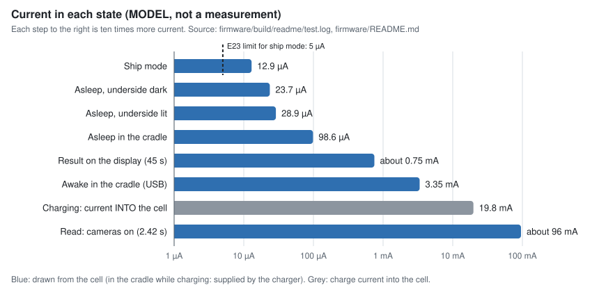
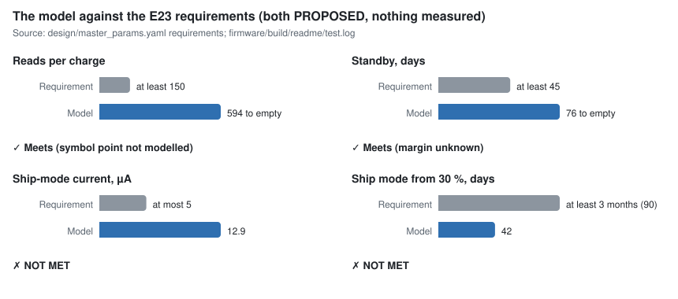

# GreenLine GL-1: power budget (rev E-EVT1)

Revision 1, 2026-11-20. Written against `design/DESIGN_SPEC.md` rev E, `design/master_params.yaml`
rev E-EVT1, `firmware/README.md` and the test log of the firmware's final build
(`firmware/build/readme/test.log`, stamped 2026-11-20 19:31 UTC).

**Read this first.** Every figure on this page is a MODEL, not a measurement. No board, cell or
marker exists. The firmware runs on a PC simulator, and the simulator adds up a current for each
part of the board for as long as each part is switched on. The firmware notes say where those
currents come from: data sheets as remembered, the project's research notes, the netlist notes,
or a plain guess. None has been read off a meter. The cell's capacity of 43 mAh is the figure on a
seller's listing and is not confirmed. A column in each table names the file the figure comes
from. Where this page computes something itself, it says "our arithmetic".

The tests that will replace these figures with measurements are in `docs/VALIDATION_PLAN.md`
section 2.7 (F1 to F8), 2.9 (J1, J10) and 2.13 (Q1).

## 1. The budget as a water tank

Think of the cell as a small water tank and of electric charge as the water in it.

- **The tank holds 43 litres.** (One litre stands for one milliamp-hour, mAh, the unit of charge
  a battery holds. 43 mAh is the listed capacity.)
- **A read is a glass of water taken out.** One read with its 45 seconds of result on the display
  takes 0.072 litre, a small glass. The tank holds about 594 such glasses.
- **Sleeping is a dripping tap.** Asleep, waiting to be picked up, the marker loses 0.57 litre a
  day. Nobody takes a glass, and the tank is still empty after 76 days.
- **Ship mode is the tap turned almost off**, for the weeks in a box between the factory and the
  buyer. It should drip no more than 0.12 litre a day. In the model it still drips 0.31 litre a
  day. That is the one place where the model says the design does not meet its own requirement.
- **The cradle is the hose that refills the tank**, at 19.8 litres an hour. A marker that stays
  awake in the cradle drinks 3.35 litres an hour from the same hose, which is why the firmware
  puts it to sleep there: otherwise the charger never sees the tank as full.

Two things follow from the picture. First, a golfer who plays often empties the tank by the
glass, and one who plays rarely empties it by the drip: both matter. Second, the size of the tank
is the least certain number here. If the real cell holds 34 mAh, as the research notes suspect
(`docs/research/power.md`, quoted in `docs/VALIDATION_PLAN.md` F5), every count of reads and days
below shrinks by a fifth.

## 2. Every operating state

A microamp (µA) is one millionth of an amp; a milliamp (mA) is one thousandth. A milliamp-second
(mAs) is the charge that 1 mA carries in one second; 3600 mAs make 1 mAh.

The scale of the chart is logarithmic: each step to the right is ten times more current. On an
ordinary scale every bar but the last two would be too short to see. A read draws about 4,000
times the current of sleep.

| State | What is switched on | Current (MODEL) | How long | Charge per event or per day (MODEL) | Source |
|---|---|---|---|---|---|
| **Read**, from wake-up to the result | Both cameras and the processor at full speed | About 96 mA while the camera supply is on (cameras 86, processor 9.5). | Camera supply on for 2.42 s (2.16 to 2.76 s over the estimated range of computing speed). Result 4.45 s after the marker comes to rest | 226.7 mAs = 0.063 mAh per read (201.4 to 259.3 mAs). The cameras are 92 % of it | Test log, `test_quick_read_time_and_charge_with_computation`; `firmware/README.md` "End to end" |
| **Display on**, result shown | Display, tilt sensor at full rate, processor asleep 99.5 % of the time | About 0.75 mA mean (our arithmetic: 33.8 mAs in 45 s) | 45 s after each read | 33.8 mAs = 0.009 mAh (the difference between the "cycle" and "charge" columns of the log) | Same log table |
| **One whole cycle**: read, display, asleep again | - | - | About 50 s | 260.5 mAs = 0.072 mAh (235.2 to 293.1 mAs). A round of 40 cycles is 2.9 mAh | Same log table; `firmware/README.md` "Battery life under the supply model" |
| **Asleep**, underside dark | Processor in its sleep state with its clock, tilt sensor waiting for motion, the always-on parts of the board, the cell's protection circuit | 23.68 µA at the cell | Until moved | 0.57 mAh a day | Test log, `test_sleep_current_dark_and_lit_against_25_microamps` |
| **Asleep**, underside lit | The same, plus light on the grain photodiode pulling current through a 150 kilohm resistor | 28.88 µA at the cell | While light reaches the underside | 0.69 mAh a day (our arithmetic) | Same test; `DESIGN_SPEC.md` E27 |
| **Ship mode** | Processor shut down, tilt sensor powered down, the always-on parts of the board, the protection circuit. Motion does not wake it; the cradle does | 12.93 µA at the cell, at 3.9 V | From factory to first docking | 0.31 mAh a day (our arithmetic) | Test log, `test_ship_mode_entry_and_wake_on_vbus`; `firmware/README.md` "Ship mode (E13)" |
| **Cradle, charging** | Charger feeding the cell | 19.8 mA into the cell. The charger ends the charge when its output falls below 1.98 mA | At least 2.2 h from empty (our arithmetic: 43 mAh at 19.8 mA, before the current tapers). No model of a whole charge exists | Charge goes in, not out | `DESIGN_SPEC.md` section 4 "Charger (E1)"; `firmware/README.md` "Charger and cell temperature" |
| **Cradle, awake** with USB | Processor, USB, display | 3.35 mA, taken from the node the charger feeds | For 30 s after docking or after the last word from a PC | Above the charger's 1.98 mA end threshold: while the marker is awake the charge cannot end | Test log, `test_cradle_sleep_on_a_wall_charger_lets_the_charge_end` |
| **Cradle, asleep** | Processor asleep, display showing a still charging picture | 98.6 µA while charging (supplied by the charger). 179.4 µA if a PC has suspended the USB bus | From 30 s after docking | After the firmware's 6-hour limit has stopped the charger, the sleeping marker runs from its own cell at 98.6 plus 28 µA until the cell falls to 4.00 V and the charge restarts | Same test and `test_cradle_sleep_under_a_host_standby_resume_and_silence`; `firmware/README.md` "What the backstop costs" |
| **Storage mode**, cell below 3.25 V | Tilt sensor off as well | No rev E figure: "not measured again in this phase" | - | - | `firmware/README.md` "Sleep and the supply model (rev E)", last table |

Cell capacity used throughout: 43 mAh, "listed, unverified" (`DESIGN_SPEC.md` section 3: "about
43 mAh ... capacity, protection-board size and safety certificates still to be obtained"). The
YAML names the cell (`battery.mpn: GM201030-PCB`) and holds no capacity key; the figure of 43 is
in the specification, the sourcing table and the firmware's test log.

## 3. What one charge buys

All counted from the listed 43 mAh down to empty, with nothing else drawing and no self-discharge.
MODEL.

| Question | Answer (MODEL) | Source |
|---|---|---|
| Read cycles from one charge, doing nothing else | 594 (528 to 658 over the estimated range of computing speed) | Test log: "658 / 594 / 528 read cycles per charge" |
| Days asleep from a full charge, dark | 76 | Test log: "standby from a full cell (43 mAh) at 23.7 uA: 76 days to empty" |
| Days asleep from a full charge, underside lit | 62 | Our arithmetic: 43 mAh at 28.88 µA |
| Days asleep from 30 % charge (12.9 mAh) | 23 | Same log line |
| Days in ship mode from 30 % charge | 42 | Test log: "30 % of the cell (12.9 mAh) lasts 42 days" |
| What one round of 40 reads costs | 2.9 mAh, the same as 5 days asleep | `firmware/README.md` "Battery life under the supply model" |

A golfer does both: plays and leaves the marker in the bag. Our arithmetic on the two model
figures (0.57 mAh a day asleep, 2.9 mAh a round), for a marker that is never put in its cradle:

| Rounds a week | Days until empty | Rounds played in that time |
|---|---|---|
| 0 | 76 | 0 |
| 1 | 44 | 6 |
| 2 | 31 | 9 |
| 3 | 24 | 10 |

So in the model a full cell gives about 15 rounds if they are all played at once (594 cycles at 40
a round, our arithmetic), 76 days if the marker is never used, and for example 6 rounds over 44
days at one round a week. For a weekly golfer the drip takes more of the tank than the glasses do.

## 4. The model against the requirements of E23

Amendment E23 of the specification states battery-life requirements. They are PROPOSED there
until measured on EVT units (`DESIGN_SPEC.md` section 6; `master_params.yaml` `requirements`,
`status: proposed`). E14 adds a limit for board test.

Those two files give the limits. The model figures in the table are from the firmware's test
log, not from them: the specification (section 6: "Ship mode ... Not modelled yet", "about 600 to
empty") and the YAML (`requirements.ship_mode ... modelled: false`,
`reads_per_charge ... model_to_empty: 600`) were written before the firmware had a ship-mode
model and have not been brought up to date. The specification says the YAML wins where files
disagree, so the two stale entries are a gate (`docs/RELEASE_GATES.md` G-107). They are outside
this page.

In the chart, "3 months" is drawn as 90 days (our conversion).

| Requirement | Limit | Model | Verdict on the model | What the model does not cover |
|---|---|---|---|---|
| Reads per charge at 20 C, new cell (E23, test F6) | At least 150, from full to the low-battery symbol | 594 cycles to empty | **Meets it**, with room: 150 cycles are 10.9 mAh (our arithmetic) | Where the low-battery symbol comes on. The firmware shows it at 3.5 V; how much of the cell lies above 3.5 V is not known. With the validation plan's assumption (80 % of a 34 to 41 mAh cell lies above 3.5 V, that is 27.2 to 32.8 mAh) the count is about 380 to 450 at the nominal cycle of 260.5 mAs (our arithmetic). The wider range of 260 to 500 that the validation plan and the specification quote pairs the smaller cell with a read on which the fast clock fails (376.7 mAs: 260) and the larger cell with the low computing cost (235.2 mAs: 500) |
| Reads per charge at 0 C, or after 300 charge cycles (E23, test F6) | At least 100 | None | **Not modelled** | The model has no temperature and no ageing. At about 96 mA the cell is asked for 2.2 times its capacity per hour, and its rated discharge current has not been seen |
| Standby at 20 C (E23, test F7) | At least 45 days asleep, from full to the low-battery symbol | 76 days to empty, dark | **Meets it on the listed capacity.** 45 days asleep are 25.6 mAh (our arithmetic) | The symbol point, as above. The display's own draw when off (counted as 0: no figure is known). Self-discharge. A lit underside (62 days). With the validation plan's assumption for the share above 3.5 V the figure is 48 to 58 days dark and 39 to 47 days lit (our arithmetic): the margin may be small or negative |
| Ship mode current (E23, test F8) | At most 5 µA at the cell, protection circuit included | 12.93 µA | **NOT MET.** Stated so in the firmware's test log | The display's draw comes on top. The firmware controls 3.3 of the 12.9 µA; the other 9.6 are parts of the board |
| Ship mode shelf life (E23, test Q1) | At least 3 months from 30 % charge without the cell falling below 3.0 V | 42 days from 30 % to empty | **NOT MET** | - |
| Sleep current at the cell-lead pads (E14, test F4) | At most 25 µA at 3.8 V, underside dark | 20.68 µA without the display | **Met only if** the display draws less than 4.32 µA when off | The display's figure needs its data sheet. With a lit underside the pads carry 25.88 µA, a case E27 excludes from the limit. All currents are typical values: no maximum, no temperature |

Summary: of the four E23 battery requirements the model meets two (reads at 20 C, standby), has
nothing to say on one (reads in the cold or with an aged cell) and fails one in both its parts
(ship mode). The E23 requirements for drop and for standing on the marker are not power
requirements and are not on this page.

## 5. Where the sleep and ship-mode current goes

Asleep and in ship mode nearly all the current is taken by parts that are always connected to the
cell. This table is the reason the ship-mode figure cannot be fixed in firmware alone.

| Part | Asleep, µA | Ship mode, µA | Standing of the figure (as the firmware notes give it) |
|---|---|---|---|
| Processor | 9.0 (sleep state with clock) | 0.20 (shut down) | Research notes, a reviewer's recollection; data sheet from memory |
| Tilt sensor | 5.0 (waiting for motion) | 3.0 (powered down) | From memory |
| Memory chip | 0.1 | 0.1 | From memory |
| 2.8 V regulator | 1.6 | 1.6 | Research notes |
| Battery-voltage divider, 2 megohm | 1.90 at 3.8 V | 1.95 at 3.9 V | Computed |
| Cell's protection circuit | 3.0 | 3.0 | `docs/research/power.md` |
| Charger, leakage with no input | 0.075 | 0.075 | Netlist notes (the title of a data-sheet copy seen in a search) |
| Camera regulator, disabled | 0.2 | 0.2 | From memory |
| Enable pin of the USB regulator (E26) | 2.8 | 2.8 | From memory, **NOT CONFIRMED**. If the part has no pull-down there, every sleep and ship figure is 2.8 µA lower |
| Housekeeping wake-ups | 0.01 | 0 | Model |
| Display, switched off but still on the always-on supply | 0 counted | 0 counted | **No figure is known** |
| **Sum at the cell** | **23.68** | **12.93** | Test log |

Source: `firmware/README.md` "Sleep and the supply model (rev E)" and "Ship mode (E13)";
`firmware/hal/host/gl_sim.h` (constants `GL_SIM_I_*`); test log lines of
`test_sleep_current_dark_and_lit_against_25_microamps` and `test_ship_mode_entry_and_wake_on_vbus`.

The parts that firmware cannot switch off take 9.6 µA in the model. That alone is more than the
5 µA allowed, before the 3.3 µA of the processor, the tilt sensor and the memory chip are added.
The firmware notes put it this way: what would have to change is hardware, or the requirement.
Neither has been decided.

## 6. What the model leaves out

1. **The real capacity of the cell.** 43 mAh is a listing. No data sheet has been obtained.
2. **How much charge lies above the low-battery symbol** (3.5 V). The requirements count to the
   symbol; the model counts to empty.
3. **Self-discharge of the cell.** The specification's own side calculation uses 2 % a month and
   41 mAh usable and arrives at about 2.3 months of standby.
4. **Temperature and ageing.** No cold case, no hot case, no aged cell.
5. **The display's draw when switched off.** Counted as zero.
6. **Maximum values.** Every current is a typical value.
7. **A whole charge.** The model shows that a charge ends; the firmware notes say its cell curve
   is a guess and is not good for a charge time.
8. **Storage mode** was not run again for rev E.
9. **The currents themselves.** The two largest, 86 mA for the cameras and 9 µA for the sleeping
   processor, are "unverified" and "a reviewer's recollection" in the files they come from.

## 7. What has to happen before any of this can be called a result

These are gates, not tasks done.

| Gate | Why it matters here | Where it is tested or resolved |
|---|---|---|
| Cell data sheet: capacity, rated discharge current, protection circuit draw, temperature limits | Sets the size of the tank and whether about 96 mA is allowed | Battery release gate (`DESIGN_SPEC.md` section 7); validation F3, F5 |
| Display data sheet: current with the display switched off | Decides whether the 25 µA sleep limit holds | Validation F4 |
| Data sheet of the USB regulator: pull-down on the enable pin | 2.8 µA in every sleep and ship figure | Validation F4, F8 |
| Camera current during a read | 92 % of the charge of a read | Validation F2, on boards before sealing |
| Decision on ship mode: change the board or change the requirement | The model does not meet E23 | Owner decision; validation F8 and Q1 supply the measured figures |
| Decision on the restart voltage in the cradle | In the model a marker left docked for 30 days cycles down to 79.3 % | Owner decision (firmware open issue 60); validation J10 |
| First boards | Nothing here is measured | Validation section 2.7 |
