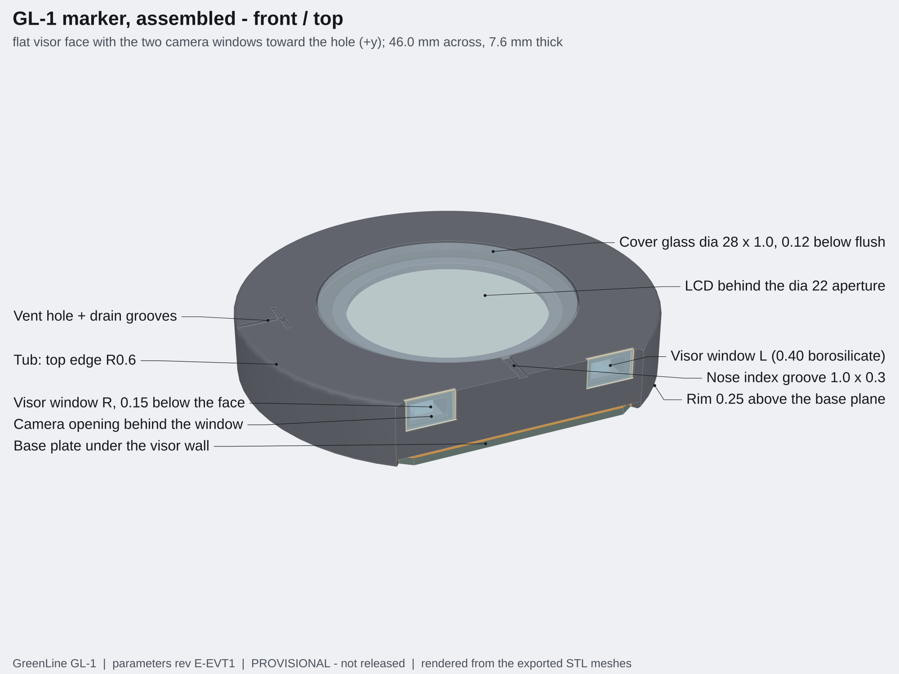
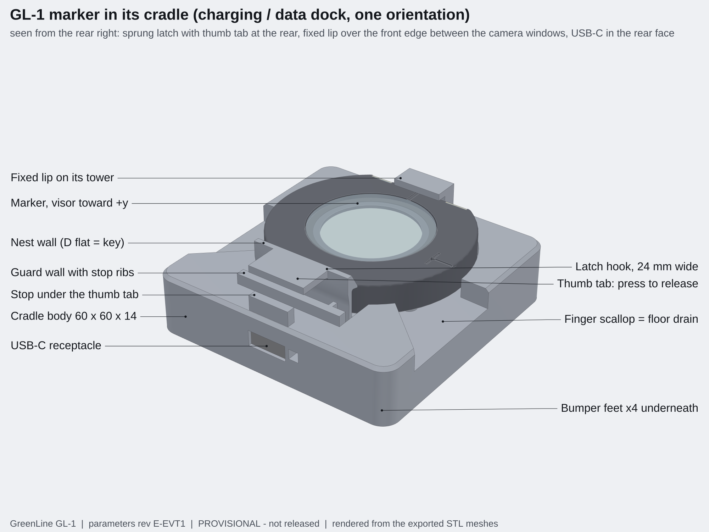

# GreenLine GL-1: user guide (intended behaviour of an untested design)

Draft of 2026-11-20, written against `design/DESIGN_SPEC.md` rev E (EVT1, amendments E1 to E36) and the firmware notes in `firmware/README.md` and `firmware/core/gl_ui.h`.

> **Read this first.** No GL-1 exists. This guide describes how the device is *meant* to behave according to the specification and to firmware that has only run on a PC simulator. Nothing here has been tried by a golfer on a green. Every time and every count is from a model. Words marked PROVISIONAL are the package's own mark for values that are not confirmed. Screen texts are quoted as the firmware draws them in its tests; whether they are legible on the real display is not verified.
>
> This is not the manual for a product on sale. The regulatory statements a manual must carry are not decided ([RELEASE_GATES.md](RELEASE_GATES.md), gate G-085). The words PROVISIONAL, NOT MET, amendment and gate are explained in the word list of the top-level [README.md](../README.md).

## 1. What the marker is for

The GL-1 is a ball marker that reads a putt. You set it down behind the ball with its flat face toward the hole, lift the ball, and a few seconds later a line on its display shows the direction in which to start the putt, with the distance, the slope and the break.

It is a practice and training device. The specification states that an electronic slope-reading ball marker is not permitted during a round played under the Rules of Golf; the package's rule research is marked unverified (see the top-level [README.md](../README.md), section 9). Check the rules for your competition.



*Computer render, not a photograph. The flat face with the two small windows is the "visor". It points at the hole. The line appears on the round display on top.*

**What it needs from you:**

- The flagstick in the hole. The cameras find the hole by the stick.
- The green speed, entered once as a Stimp number (the usual measure of how fast a green is). The marker does not measure it.
- A putt it can handle. The Quick Read is intended for putts up to about 4.5 m. In the simulation no mode reads a longer putt to within the hole.

**Before first use: dock the marker once in a powered cradle.** A new marker is meant to arrive in ship mode, its lowest power state, in which it does not react to being moved or tapped. It looks dead until it has been docked once (section 12).

## 2. How you drive it: no buttons

The marker has no buttons. It senses how it is placed, tapped and turned, a little like a phone that turns its screen when you rotate it.

| What you do | What it means |
|---|---|
| Place the marker flat | It wakes, waits until it lies still, reads, and shows the line |
| Pick it up and place it again | A new read |
| Double tap on a result | Precision Read: the marker asks you to spin it half a turn (section 4) |
| Double tap again, on the spin request or on a Precision result | A Survey starts: several placements along the line (section 5) |
| Double tap on a Survey result | The Survey ends |
| Single tap on a sleeping marker that has not been lifted | Recall: the last result again, with its age |
| Hold it upright on its edge | Settings. Roll it like a knob to change the value, double tap for the next item, lay it flat to confirm |
| Put it in the cradle | Charging and USB |

Source: `firmware/core/gl_ui.h`, "How the golfer drives it". The gesture thresholds are tuned on a simulator only (gate G-080).

## 3. Quick Read: one placement

1. Set the marker on the green directly behind the ball, flat, with the visor toward the hole. Lift the ball.
2. Leave it alone. It must lie still for half a second before it starts; any movement during the read aborts it, and the marker waits for stillness again.
3. It first reads the tilt of the ground for one second, then switches the cameras on for about 2.2 to 2.8 seconds to find the flagstick.
4. The result appears about 4.2 to 4.8 seconds after the marker came to rest (timing model, not measured).
5. The result stays for 45 seconds. Then the display goes off and the marker sleeps.
6. Put the ball back on the spot it was lifted from, in front of the marker, and start it along the line shown.

How the line gets from the marker to the ball. The marker lies behind the ball, so the line on its display is drawn as if the ball lay just beyond the top edge of the screen: continue the line forward off the display and it passes through the ball and on in the start direction.

```
   start direction
        ^
        |
       (o)      the ball, back on its spot
        |
    +-------+
    |   |   |   the marker: the line on the display,
    |   |   |   continued forward, runs through the ball
    +-------+
```

You set the putter (or a line printed on the ball) along that direction by eye. The package has no instruction and no data on how well a golfer does this. The simulation assumes it costs 0.5 degree, and at 1.5 degrees the Quick Read falls behind a good human reader (top-level README, section 6).

**What the result screen shows**, from top to bottom (`firmware/README.md`, "Result on the display"):

| On the screen | Meaning |
|---|---|
| The distance, for example `19.6FT` | Distance to the hole, in feet, metres or paces as set. A `?` after it means the distance was dialled in or assumed, not measured. `--` means nobody measured or dialled it |
| `PLAYS 23.3FT?` | The length of a putt on a flat green that needs the same stroke. Uphill plays longer, downhill shorter. The `?` in this example (a 6 m putt, 1.5 % uphill) means the base of the flagstick was hidden, so the height of the hole is only bounded. Without it, for example `PLAYS 11.6FT`, the base was seen |
| The line | The start direction of the putt. It is drawn as the backward extension of the start line through the ball |
| An arrow with a percentage | The direction in which the ground falls under the marker, and how steeply |
| `<2.7 CUP` or `2.3 CUP>` | The break, in hole widths, with the side to aim at: here 2.7 cups left of the hole, or 2.3 cups right. `STRAIGHT` or `BREAK ?` are also possible |
| Five small boxes | The confidence bar |
| One short message | Only when something is not as usual (section 7) |

A caution about the confidence bar, from the firmware notes: it is essentially the chance of holing the putt. A clean read shows 5 boxes at 1.5 m, 3 at 3 m, 1 at 4.5 and 6 m and none at 9 and 12 m. Beyond about 4 m it does not tell a weak result from a clean one; the line style and the message do.

## 4. Precision Read: read, spin, read

This is the trick of checking a spirit level by turning it end for end. It cancels the marker's own bias and averages two seatings.

1. Make a Quick Read.
2. Double tap on the result. The marker asks for the spin.
3. Turn the marker half a turn (180 degrees) on the spot, without lifting it away.
4. It reads the tilt again and shows the combined result, marked `2X`.

After the spin the marker faces away from the hole, so the whole screen is drawn turned round. It reads upright for you standing behind the ball, with left and right on your own left and right.

Points to know:

- Once per placement. A second double tap on a `2X` result goes on to the Survey.
- Turning the marker back to face the hole counts as a new placement: the `2X` result is gone and a new Quick Read starts. Whether that stays so is an open owner decision (firmware open issue 29).

## 5. Survey: several placements, finishing at the ball

One reading only knows the slope under the ball. On a long or contoured putt the slope changes along the way. In a Survey you let the marker feel the ground at two to four spots, like testing a floor with a level in several places instead of one.

**The Survey finishes at the ball** (amendment E29). The marker always treats the spot it is standing on as the ball.

The ball stays where it lies while the marker visits the other spots. Mark and lift it only at the last placement, as in a Quick Read.

```
   hole  <--  placement 1  <--  placement 2  <--  placement 3
   (flag)     about 1 m         for example       at the ball:
              short of          the midpoint      the result
              the hole                            to putt on
                    you walk this way  -->
```

1. Start away from the ball, toward the hole. The specification's example: about 1 m short of the hole. Place the marker there, visor toward the hole, and let it read.
2. Start the Survey with two double taps:
   - Double tap on the result. The marker asks for a spin, as for a Precision Read. **Do not spin it.**
   - Double tap again, on that request. The Survey has started, and the read you just made is placement 1. (The firmware notes quote marks for the later placements only; this guide has no source for what the screen shows at this moment.)
3. Pick the marker up and place it at the next spot on the line toward the ball, for example the midpoint. It reads and shows a result with a line, marked `D2`.
4. Finish at the ball. The result there, marked `D3`, is the one to putt on.

The same gesture, a double tap, starts a Survey from a spin request and ends one from a Survey result. What decides is what is on the screen when you tap.

| What you do | What happens |
|---|---|
| Second, third or fourth placement | A result with its line each time, marked `D2`, `D3`, `D4` |
| A fifth placement | The Survey is over; it is a new plain read |
| Double tap on a Survey result | The Survey ends; the result stays |
| Leave a result alone for its 45 s | The marker sleeps; the Survey is over; that result can still be recalled by a tap |
| Pick the marker up and do not put it down for 60 s | The marker sleeps; the Survey is gone |
| A placement where no flagstick is seen | As in any read: the distance prompt (section 8). That placement is not stored |

**Walk toward the ball, not away from it.** If you start at the ball and walk toward the hole, the marker cannot use the placements that lie behind the spot it is on. The mark then says so: `D3/1` means "third stop, but this result is made of one placement only". The firmware notes record this as NOT MET against "fitted to all placements" (`firmware/README.md`, "Survey: it finishes at the ball").

## 6. Recall: see the last result again

A result leaves the screen after 45 seconds. If the marker has **not been lifted** since, a single tap brings the same result back for another 45 seconds, with its age at the bottom (`45S AGO`, `12M AGO`, `5H AGO`). No camera is used and nothing new is measured. This works for 24 hours after the result was made; a tap on an older result makes a new read.

The marker shows the old result only if it is sure it still lies as it did. If it was lifted, twisted by more than 2 degrees, shoved, or has settled differently, a tap makes a new read instead. That is the safe side. In the firmware's model a tap of about a tenth of a second always wakes the marker; shorter taps can be missed (a 60 ms tap woke it in 35 of 40 trials).

PROVISIONAL and not verified: every threshold of this rule, and whether a tap wakes the real sensor at all (`firmware/README.md`, "Recall").

## 7. The three display states

The marker never shows a doubtful answer in the same style as a good one (amendment E33). Think of a traffic light without colours: a solid line is go, a dashed line is caution, no line is stop. The display has one colour, so the marker shows the state by the style of the line, not by a colour.

| State | What you see | What it means |
|---|---|---|
| **Normal** | A **solid** line and the five confidence boxes | A proper solution: flagstick seen, distance measured, putt solved |
| **Approximate** | A **dashed** line and the word `APPROX` where the boxes would be | A fallback. A line exists, but something was missing or doubtful. The message says what |
| **No solution** | A **message in large letters, no line**, no break, no boxes | The marker could not solve the putt. The distance and the slope arrow stay, because they were measured |

Messages (`firmware/README.md`, "The three display states"):

| Message | State | Meaning |
|---|---|---|
| `NO SOLUTION` | No solution | The putt could not be solved |
| `NOT SOLVED` | No solution | The solver ran out of its work budget, or neither of its two methods found a line |
| `TOO STEEP` | Approximate (dashed line) where a tentative line exists, no solution (no line) where none does | See below |
| `NO FLAG` | Approximate | No flagstick was found; the line follows the direction you pointed the visor |
| `NO RANGE` | Approximate | The distance was dialled in or assumed, not measured |
| `PACE LIMIT` | Approximate | A line through the hole exists, but the ball cannot arrive as slowly as asked (steep downhill) |
| `FIT NOT DONE`, `POOR HORIZON` | Approximate | The surface fit did not finish cleanly |
| `1 CAMERA` | Normal | Only the left camera saw the stick. A weaker measurement, shown as a normal result with this word |
| `2 LINES SEEN` | Normal | A second stick-like object was in view. Check that the marker looked at the flagstick |

A result in the Normal state can still carry a word of caution: `1 CAMERA` and `2 LINES SEEN` appear with a solid line. Normal means that a full solution exists, not that nothing needs checking.

**TOO STEEP** (amendment E31). On a slope close to the one on which a ball no longer stops, there is no stable answer: in the design review the aim flipped on a one-microradian change of input. When the fitted slope at the ball or at the hole reaches 0.80 of that critical slope, the marker says `TOO STEEP` and draws only a dashed, tentative line; where it finds no solution at all it draws no line. In the firmware's model that begins at a slope of 7.8 % on a slow green (Stimp 8), 6.3 % at Stimp 10 and 4.8 % on a fast one (Stimp 13). The 0.80 is PROVISIONAL: it was chosen from a simulation, not from greens.

Other screens:

| Screen | Meaning |
|---|---|
| `TOO HOT / NO READ / LET IT COOL` with a thermometer | The cell reads above 60 C. No camera read is started. Shown for 4 s, then the marker sleeps. It reads again once the cell has cooled 3 degrees below the limit. A result already on screen can still be recalled |
| A battery symbol | The cell is low (below 3.5 V, PROVISIONAL) |
| A battery warning screen, then sleep | The cell is too low for the cameras (below 3.35 V, PROVISIONAL). Charge the marker |
| `Z?` | No level zero is stored for the surface the marker is set to (a factory calibration is missing). The level zero is the stored reading that the marker takes as "flat". The package defines no action for the user; what a unit shows of a missing calibration is an open decision (gate G-080) |

## 8. When the flagstick is out, or not seen

If the marker finds no flagstick it shows `NO FLAG` with a distance dial and the words `OR PLACE AGAIN`.

- **Place it again** without dialling, and it simply reads again. The stick may be in view this time.
- **Or dial the distance:** hold the marker upright, roll it to set the distance, lay it flat with the visor pointing at the hole. The result is a tilt-only line along the direction you pointed, dashed and marked approximate. Its direction is only as good as your pointing.

A dialled distance belongs to one hole. It is forgotten when a read measures a flagstick and when the marker goes to sleep.

## 9. Settings

Hold the marker upright on its edge. Roll it like a knob to change a value, double tap to move to the next item, lay it flat to confirm.

| Item | What it sets |
|---|---|
| Stimp | Green speed |
| Units | Feet, metres or paces |
| `PAST` | How far past the hole a missed putt should stop: 0 to 90 cm in steps of 5, default 30 |
| Grass | Bent, poa or bermuda. Used only with the grain setting |
| `GRAIN` | Default OFF. The grain sensor is experimental and ships disabled; whether this item stays visible is an open decision (gate G-080) |
| `DIST` | A dialled distance, for one hole |
| Raw logging | Stores camera strips for later analysis |
| `METHOD` | How the line is computed. `B1`, the default, uses the tilt and the height of the hole as the cameras see it. `B2 HORIZ` also uses the outline of the turf against the background; it is an option that the simulation shows helps only on some greens |
| `ZERO` | User zeroing (below) |
| `INFO` | Model, `PRACTICE DEVICE`, hardware and firmware version, serial number. Rolling the marker turns to the regulatory text, which is a placeholder at present |

**Zeroing.** Choose `ZERO` = YES, then lay the marker on any hard, flat surface: a table, not turf. It reads, shows `TURN 180`, you turn it half a turn on the spot, it reads again and stores its own bias. The surface need not be level, because the reversal cancels the surface's tilt. Zeroing is refused in the cradle.

## 10. Charging in the cradle



*Computer render. The marker goes in one way round only. To dock: tilt it nose-down, slide its top front edge under the fixed lip and press the rear down until the latch clicks. To remove: press the thumb tab down, lift the marker at the two finger scallops and draw it back from under the lip. Do not pull the marker out without pressing the tab (`mechanical/README.md`, "Using the cradle"). The USB-C socket is at the rear.*

1. **Dry the marker first.** The specification requires the marker to be dry before docking.
2. Connect the cradle to a USB-C charger or a computer.
3. Seat the marker. For the first 30 seconds it is awake and shows the USB screen.
4. On a wall charger, or once a computer has been silent for 30 seconds, the marker goes to sleep and leaves a still picture on the display (amendment E32). The display holds a picture with almost no power.

| Picture or text | Meaning |
|---|---|
| Battery with a bolt | Charging |
| Battery with a tick, `FULL` | The charge has ended |
| `TOO COLD`, `TOO HOT` | The cell is outside the charging temperature window; no charge runs |
| `TEMP SENSOR` | The cell temperature cannot be read; charging is stopped |
| `TIME LIMIT` | The firmware has held the charger off because six hours have passed since docking |
| `NOT CHARGING`, `CHARGER WAITS` | The charger is not charging: for example the input voltage is too low, or its own temperature window holds it |
| `CHARGE OFF` | Charging was switched off by a factory command |

Things to know:

- **Charge rate and time.** The charger feeds 19.8 mA. From empty that is at least 2.2 hours by simple arithmetic on the listed 43 mAh; no model of a whole charge exists (`docs/POWER_BUDGET.md`).
- **Why it sleeps in the cradle.** The charger ends a charge when the current falls to about 2 mA. An awake marker draws more than that from the same point, so the charge would never end.
- **Two safeguards on temperature.** The charger has its own temperature sensor at the cell and stops by itself outside its window, even if the firmware is not running. The firmware watches a second sensor. The charger's thresholds are PROVISIONAL, and the two windows differ when no firmware runs (gate G-029). In the model the charge also never ends by itself while the USB loader runs.
- **A six-hour backstop.** Six hours after docking the firmware holds the charger off, whether or not the charge had already ended by itself. Charging starts again when the cell has fallen to the restart voltage (4.00 V, PROVISIONAL). The specification's amendment E32 words this as "6 hours of continuous charging"; the firmware counts the time docked.
- **Leaving it docked.** In the model a marker left in its cradle for 30 days cycles between 100 % and 79.3 % while the screen says `FULL`. Whether that is acceptable is an open owner decision (gate G-076).
- **With a computer.** The marker appears as a USB device for settings, logs and firmware updates. A computer that keeps the connection running but sends nothing for 30 seconds loses the marker until it is taken out and docked again (recorded as NOT MET, gate G-075). No USB vendor and product identifier is assigned yet (gate G-084).
- **Firmware update.** A small protected start-up program checks the main program at every start and, if it is damaged, opens the processor's built-in USB loader, a program the chip's maker puts in every chip for loading firmware over USB, so that a new program can be sent (amendment E34). Once in that loader, only a PC with the processor maker's update tool gets the unit out again. For a user with only a wall charger that is NOT MET (gate G-030).
- **Zeroing is not done in the cradle.** The user zeroing of section 9 is refused while the marker is docked; it is done on a table.

## 11. Battery life (model figures)

All from [POWER_BUDGET.md](POWER_BUDGET.md), which explains them with a water-tank picture. All are a model on a cell capacity that is a seller's listing, not a confirmed figure.

| Question | Model answer |
|---|---|
| Reads from one charge, doing nothing else | 594 (528 to 658) to empty |
| One round of 40 reads | 2.9 mAh, about the same as 5 days asleep |
| Asleep in the bag, from full | 76 days to empty |
| Playing one round a week, never docked | About 44 days |

The proposed requirements (amendment E23, not adopted): at least 150 reads per charge and at least 45 days asleep, both counted to the low-battery symbol.

## 12. Ship mode: how a new unit arrives

A new marker is meant to arrive in ship mode: its lowest power state, set at the factory through the cradle (amendment E13).

- **In ship mode the marker does not wake when moved or tapped.** A new unit will appear dead until it is docked.
- **To wake it, put it in a powered cradle.** From then on it behaves normally.
- Ship mode is armed by a command from a PC through the cradle; it is not a setting on the dial.

Not met in the model: the requirement is at most 5 microamps and three months of shelf life from a 30 % charge. The model gives 12.93 microamps and 42 days. Closing that needs a board change or a changed requirement (gate G-028). These two figures are from the firmware's test log; the specification and the YAML still say that ship mode is not modelled (gate G-107). The specification says stock older than three months is recharged before sale.

## 13. Care

Only these care points have a source in the package.

- **Do not stand on it.** The cover glass of the first test units is declared not step-proof (review estimate: it breaks at 100 to 200 N on a 20 mm patch). Step resistance is a requirement for production only.
- **Water.** The enclosure is designed as a bonded, sealed construction, and the validation plan aims to earn a claim for rain and wet grass. No such claim exists until the tests are passed on real units, and no immersion claim is planned. Dry the marker before docking.
- **Heat.** No read is started above a cell temperature of 60 C, for example after lying in a hot car. Let it cool.
- **Drops.** A proposed requirement exists (a 1.0 m fall onto paving in six attitudes). It is PROPOSED and untested.
- **Level reading.** If the slope readings seem off, zero the marker on a hard flat surface (section 9).
- **Polarised sunglasses.** A reflective display can go dark through polarised lenses at some rotations. A film to prevent this is an optional trial part (amendment E9), not a settled feature.
- **Storage.** A sleeping marker empties its cell in about 76 days in the model. The package defines no storage instruction, and it has no figure for what a long time at empty does to this cell (no cell data sheet has been obtained). This is a gap to close before a manual is issued.
- **The cell is sealed in and cannot be replaced by the user.** There is no reset button.
- **Cleaning** of the camera windows, the underside sensor and the contact pads: the package sets no instruction. This is a gap to close before a manual is issued.

## 14. What this guide rests on

| Topic | Source |
|---|---|
| Modes, intended putt lengths | `design/DESIGN_SPEC.md` section 2 |
| Survey order (E29), Recall (E30), TOO STEEP (E31), cradle sleep (E32), display states (E33), update recovery (E34) | `design/DESIGN_SPEC.md` amendment table; `firmware/README.md`, "Phase 3, builder 3" |
| Gestures, settings, zeroing, flag-out prompt | `firmware/core/gl_ui.h`; `firmware/README.md`, "Application" |
| Cradle screens, ship mode, hot cell | `firmware/README.md`, "Cradle, ship mode and the hot cell" |
| Read time | `firmware/build/readme/test.log` (4.15 to 4.84 s; the specification's E15 says 4.1 to 4.8) |
| Battery figures | `docs/POWER_BUDGET.md` |
| Low-battery thresholds | `firmware/core/gl_provisional.h` |
| Care limits | `design/DESIGN_SPEC.md` sections 5 and 6; `docs/VALIDATION_PLAN.md` (water tests) |
| Open gates named here | [RELEASE_GATES.md](RELEASE_GATES.md) |
