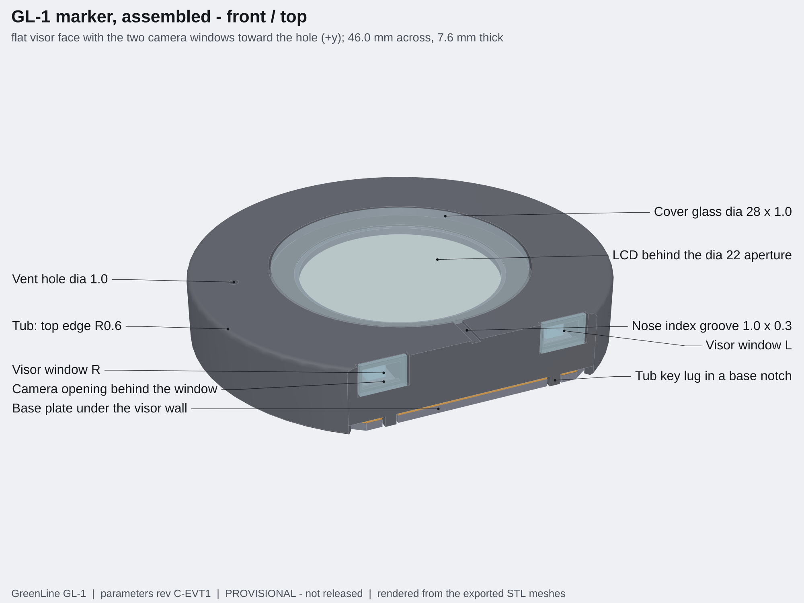
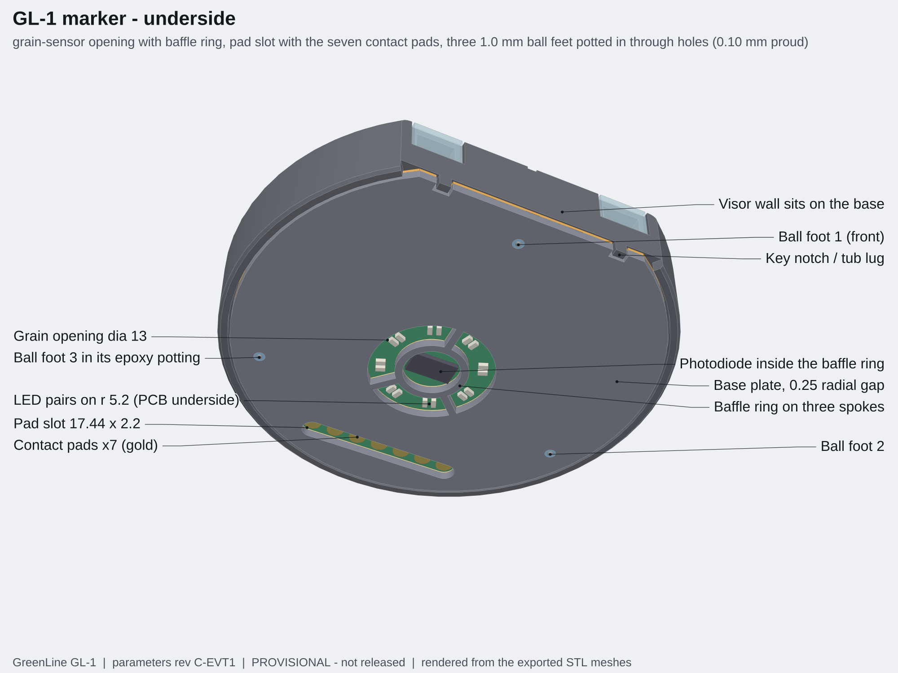
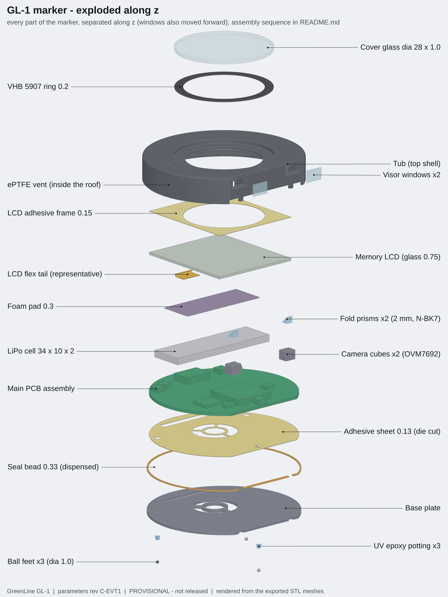
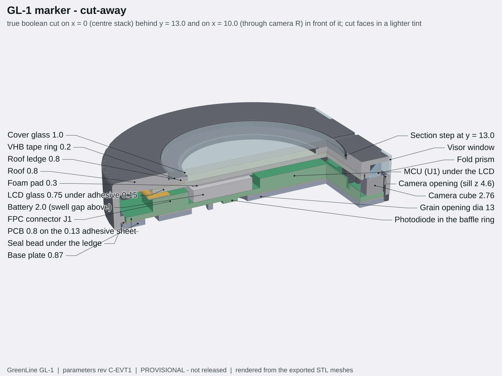
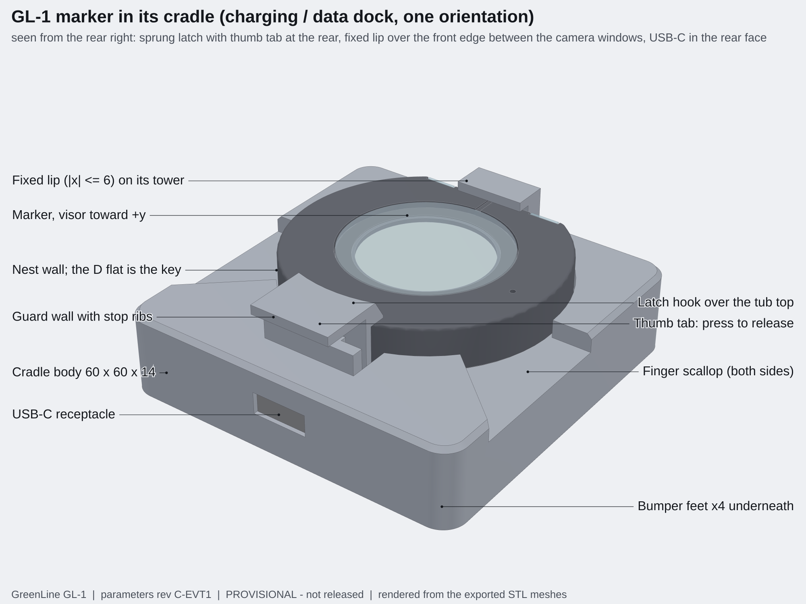
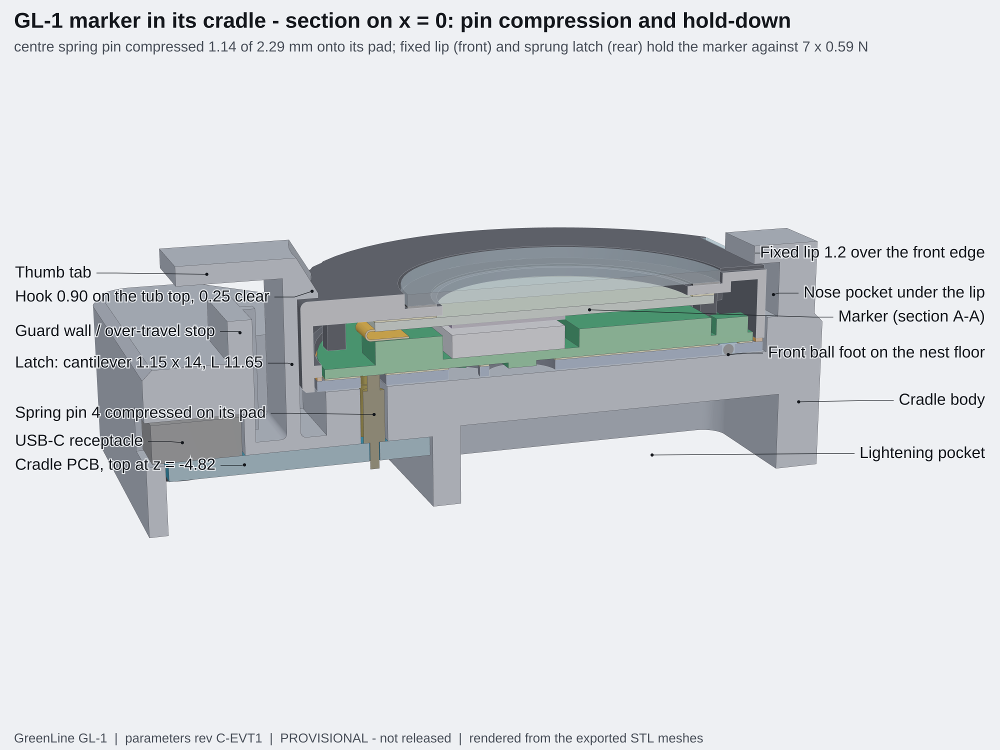

# GreenLine GL-1 mechanical design package (parameters rev C-EVT1, drawings rev C-EVT1)

**Status: PROVISIONAL, not released. Nothing in this folder has been built, printed or measured.**
Every number comes from the CAD model, which is driven by `../design/master_params.yaml` (rev C). Where the model
differs from the written specification the difference is a numbered deviation (section 11); where a shared number
should change it is in `PROPOSED_PARAM_CHANGES.md`. `master_params.yaml` was not edited.

The package is for two readers: a US 3D-printing bureau (tub, base plate, cradle) and the person who assembles the
first units. Read "Open mechanical issues" (section 12) before ordering anything: the upper edge of the camera field
has almost no margin for print tolerance, and the cradle latch is calculated, not tested.



## 1. One command

```
cd greenline-marker/mechanical
python3 cad/build.py              # about 3.5 minutes; exits non-zero on any failed check, drawing or render
python3 cad/build.py --selftest   # seeds twelve defects and confirms each check catches its defect (about 3 minutes)
```

`build.py` regenerates the solids, STEP and STL files, the resolved parameters, the check report, the drawings
(PDF, SVG, DXF, PNG previews) and the renders. Options: `--no-export`, `--no-drawings`, `--no-renders`, `--summary`.
It needs python3 with cadquery 2.8, numpy, scipy, shapely, matplotlib, pyyaml and ezdxf; `pdftoppm` for the previews;
node with Playwright (headless Chromium) and three.js 0.160 for the renders (`npm install three@0.160.0` in
`tools/render` if three.js is not found; `node_modules` is not committed).

| Path | Content |
|---|---|
| `cad/params.py` | loads the YAML, holds the mechanical-only choices (`MECH`), derives every dependent dimension once |
| `cad/parts.py` | one function per part, each returns a CadQuery solid in the assembly frame |
| `cad/assembly.py` | named, coloured parts; allow-list of intended contacts; STEP / STL export |
| `cad/checks.py` | the twelve checks; `cad/optics.py` the exact ray trace; `cad/geom.py` sections, projections, ray casting |
| `cad/holddown.py` | cradle hold-down: beam formulas for the latch and the lip, poses of the insertion path |
| `cad/deviations.py` | the recorded deviations with their status (text is built from the parameters) |
| `cad/drawings.py`, `cad/drawlib.py` | dimensioned drawings from projections and true sections of the solids |
| `cad/renders.py`, `tools/render/render.js` | renders of the exported STL meshes |
| `cad/selftest.py` | negative tests of the checks |
| `export/step/` | `GL1_assembly.step` (39 named parts, marker seated in the cradle), `GL1_marker_only.step`, one STEP per part |
| `export/stl/print/` | `tub_print.stl` (roof down), `base_plate_print.stl`, `cradle_print.stl`: the files to send to the bureau |
| `export/stl/parts/` | every part in the assembly frame (used for the renders and for the mesh checks) |
| `export/params_resolved.json` | YAML + mechanical-only + derived numbers, and the support-post rectangles |
| `export/check_report.md`, `.json` | full check results with every table; `export/selftest_report.json` |
| `drawings/` | GL1-001, -002, -010, -011, -020 as PDF and SVG; `dxf/` 2D profiles; `preview/` PNG of every sheet |
| `renders/` | six PNG renders |
| `PROPOSED_PARAM_CHANGES.md` | disposition of the rev B proposals and the new changes proposed to the shared YAML |

Frame (same as the YAML): origin at the puck centre on the base plane (the plane that rests on the turf), +x right,
+y forward toward the hole (the flat visor face), +z up, millimetres. The cradle is modelled in the same frame with the
marker seated.

### What revision C changed in this package

| Rev C decision | In the model |
|---|---|
| Base plate 0.87 + adhesive sheet 0.13 | sheet at z 0.87 to 1.00, PCB at 1.00 to 1.80, no modelling overlap; seal bead 0.33 |
| Ball feet in through holes | three dia 1.15 holes, balls potted (epoxy modelled), dia 2.0 holes in the adhesive sheet; conical seats removed |
| PCB radius 21.1, two locating holes | 0.25 mm to the ledge; spigots dia 1.0 x 0.6 under posts E in a round hole and a slot |
| Cameras at x = +-10.0, larger windows | windows 5.0 x 3.4 in 5.5 recesses, clear opening +-2.0 (straight, no bevel), section B-B on x = 10.0 |
| Tub keep-outs are a contract | posts and hoods are generated from `tub_keepouts`; new check 12 proves the contract on the tub solid |
| Cradle is a dock only | one orientation, no reference plate; fixed lip + sprung latch hold the marker against the pins (section 8) |

## 2. Part list

### Printed parts

| Drawing | Part | Material, process, finish | Box (mm) | Volume | Mass | Surface |
|---|---|---|---|---|---|---|
| GL1-010 | Tub (top shell) | HP 3D High Reusability PA 12, Multi Jet Fusion, dyed black, chemical vapor smoothing | 46.0 x 41.4 x 7.6 | 2.481 cm3 | 2.51 g | 50.4 cm2 |
| GL1-011 | Base plate | same | 43.5 x 40.0 x 0.87 | 1.111 cm3 | 1.12 g | 28.0 cm2 |
| GL1-020 | Cradle body with lip and latch | HP PA 12, Multi Jet Fusion, any colour, no smoothing needed | 60.0 x 60.0 x 22.3 | 29.91 cm3 | 30.2 g | 148.8 cm2 |

The STL files are watertight single shells (tub 5,268 triangles, base 2,044, cradle 4,060; 0.02 mm chord tolerance).
The cradle latch is sized for PA12; do not substitute SLA resin without redoing the latch numbers.

### Purchased and custom parts (mechanical bill of materials)

Status is copied from `../design/DESIGN_SPEC.md` (VERIFIED or PROVISIONAL as defined there). Where the spec gives no
status the item is PROVISIONAL here. Every envelope in the CAD is a simple solid for fit checks, not a manufacturer model.

| # | Item | Qty | Part / source | Envelope modelled (mm) | Status |
|---|---|---|---|---|---|
| 1 | Camera cube | 2 | OmniVision OVM7692-RYAA, DigiKey 884-1027-1-ND | 3.47 x 2.95 x 2.76 | Dimensions VERIFIED (product brief via search); ball map, pitch, image orientation PROVISIONAL |
| 2 | Fold prism | 2 | Edmund Optics 32-526, 2.00 mm legs, N-BK7, aluminised hypotenuse | 2 x 2 x 2 right-angle | VERIFIED (dimensions, coating, $105 at 1-5); production source to be quoted |
| 3 | Memory LCD | 1 | Sharp LS013B7DH03, DigiKey 425-2903-ND | glass 26.6 x 30.3 x 0.75 | Outline VERIFIED (Sharp brochure via search); active-area offset, flex tail geometry and pin-1 side PROVISIONAL |
| 4 | Battery | 1 | PowerStream GM201030-PCB, 2 x 10 x 30 mm cell with protection board | 34 x 10 x 2.0 (+0.4 swell) | Listing VERIFIED; protection-board length, capacity and certificates PROVISIONAL |
| 5 | Cover glass | 1 | Flat mineral-glass watch crystal 28.0 x 1.0 (EVT); chemically strengthened glass with black border for production | dia 28.0 x 1.0 | PROVISIONAL |
| 6 | Cover-glass tape ring | 1 | 3M VHB 5907, 0.20 mm, die-cut dia 28 / dia 23 (`dxf/GL1-030`) | 0.2 thick | PROVISIONAL (converter not found) |
| 7 | Visor window | 2 | EVT: 0.5 mm clear cast acrylic or cover glass, cut 5.0 x 3.4; production: AR-coated borosilicate or sapphire, custom | 5.0 x 3.4 x 0.5 | PROVISIONAL (custom part, no source) |
| 8 | Vent | 1 | W. L. Gore VE80205 adhesive ePTFE vent, 5.0 outer, 2.0 vent area, 0.26 thick | dia 5.0 x 0.26 | PROVISIONAL (YAML basis: provisional) |
| 9 | Ball feet | 3 | 1.0 mm stainless balls (grade 25 or better) | dia 1.0 | PROVISIONAL |
| 10 | Ball potting | - | UV-cure epoxy per the YAML; see open issue 4 (the joint is half in shadow: a dual-cure grade is needed) | dia 1.15 x 0.87 plug + dome 0.08 | PROVISIONAL (no part number) |
| 11 | LCD adhesive frame | 1 | 0.15 mm PSA frame 26.6 x 30.3 with a dia 23 window (`dxf/GL1-030`), for example 3M VHB 5906 | 0.15 thick | PROVISIONAL |
| 12 | PCB-to-base adhesive sheet | 1 | 3M 9472LE (300LSE) adhesive transfer tape 0.13 mm, die cut with the grain opening, the pad slot and three dia 2.0 foot holes (`dxf/GL1-030`) | 0.13 thick | PROVISIONAL (YAML basis: provisional) |
| 13 | Foam pad | 1 | 0.3 mm PU foam, 26.6 x 10, adhesive one side | 0.3 thick | PROVISIONAL |
| 14 | Perimeter seal adhesive | - | dispensed thixotropic adhesive, bead 0.33 high on a 0.4 mm land plus the 0.25 mm radial gap | 0.33 ring | PROVISIONAL: adhesive not selected (must bond vapor-smoothed PA12; primer or plasma likely) |
| 15 | Window and prism adhesive | - | light-cure acrylic (windows, cured through the window); UV-cure adhesive at the four prism corners | - | PROVISIONAL (class only) |
| 16 | Black hood sealant | - | soft black RTV silicone (non-corrosive, electronics grade) for the slit above each camera cube | two dabs, about 4 x 0.5 mm | PROVISIONAL (class only) |
| 17 | Main PCB assembly | 1 | 4-layer 0.8 mm, D outline R 21.1, flat y 17.3, two non-plated locating holes (`dxf/GL1-040`) | board + the 13 YAML part boxes | Part boxes from the YAML; passives not modelled |
| 18 | Cradle spring pin | 4 or 7 | Mill-Max 0914-series long stroke; consumer cradle 4 (VBUS, D-, D+, GND), factory fixture 7 | plunger dia 1.07, barrel dia 1.83 | PROVISIONAL (working height 5.82, 0.59 N, stroke 2.29; diameters and barrel length not confirmed) |
| 19 | Cradle USB-C receptacle | 1 | GCT USB4105 | 8.94 x 7.35 x 3.26 | Envelope PROVISIONAL |
| 20 | Cradle PCB | 1 | 2-layer 1.6 mm, 30 x 22 (YAML), seven pin positions | 30 x 22 x 1.6 | Position is a mechanical proposal (`PROPOSED_PARAM_CHANGES.md` B5) |
| 21 | Cradle feet | 4 | self-adhesive bumpers dia 8 x 3 | dia 8 x 3 | PROVISIONAL (generic) |
| 22 | Cradle PCB screws | 4 | M2 x 5 thread-forming screws for plastic | not modelled | PROVISIONAL (generic) |

The stainless reference plate of rev B is deleted.

Fixtures the build needs (not product parts, not in this CAD):

- **Ball gauge plate** (assembly, step 2): a flat ground plate with three pockets 0.10 mm deep and about 0.8 mm across
  at (0, 15.0), (-16.5, -9.5), (16.5, -9.5), or a 0.10 mm shim with three clearance holes on a flat plate, with two
  edge stops for the base plate. Mould release on the pocket area.
- **Press plate** for closing the base (step 11): flat, with three relief holes for the ball feet.
- **Factory calibration fixture** (manufacturing plan): a flat with a three-point nest on a granite surface plate for
  the tilt calibration. Zeroing in the field is done by the user on any hard flat surface. Neither uses the cradle.

Estimated mass (typical densities, envelope solids, no solder or passives): marker 11.2 g, centre of gravity at
(0.05, -1.40, 3.75) mm, 8.1 mm inside the triangle of the ball feet; cradle assembly with seven pins 34.0 g.

## 3. What the parts look like

| | |
|---|---|
|  |  |
|  |  |
|  | |

Renders (2000 x 1500; the exploded view is 1800 x 2400). The tub is drawn dark grey so that its shape reads; the real part is black.

- `GL1_render_a_front_top.png`: assembled marker from the front and above: visor windows, cover glass, nose groove, vent hole.
- `GL1_render_b_underside.png`: from below: grain opening with baffle ring, LED pairs and photodiode, pad slot with the seven pads, the three potted ball feet, key lugs.
- `GL1_render_c_exploded.png`: every marker part separated along z and labelled, including the adhesive sheet with its foot holes and the epoxy pottings.
- `GL1_render_d_cutaway.png`: boolean cut on x = 0 behind y = 13.0 and on x = 10.0 through camera R in front of it, labelled.
- `GL1_render_e_in_cradle.png`: marker in the cradle from the rear right: latch with thumb tab, guard wall, lip, finger scallop, USB-C receptacle.
- `GL1_render_f_cradle_section.png`: marker in the cradle cut on x = 0: centre spring pin compressed on its pad, lip over the front edge, latch hook over the rear edge.

Drawings (A3, PDF and SVG; PNG previews in `drawings/preview/`; title block with part, material, process, general tolerance,
revision C-EVT1 and "PROVISIONAL - not released"):

- `GL1-001_assembly_outline`: top view, view on the visor face and side view with overall size (dia 46.0, 41.4, 7.6), camera baseline 20.0, optical axis height 5.61, window and recess sizes, ball feet.
- `GL1-002_sections` sheet 1: section A-A on x = 0 with every part labelled; detail C with the full z stack (base 0.87, adhesive sheet 0.13, PCB 1.00 to 1.80, ...).
- `GL1-002_sections` sheet 2: section B-B on x = 10.0 through camera R; detail D with the camera stack, the wall build-up in y and the traced chief rays (+17.6 / -8 deg).
- `GL1-010_tub` sheet 1: view into the cavity with posts, spigots, hoods, ribs, ledge; detail E of wall, ledge and roof; post table (the YAML keep-outs).
- `GL1-010_tub` sheet 2: top view, sections A-A and B-B of the tub alone, detail G of the camera opening in plan (straight, 4.0 wide), view on the visor face.
- `GL1-011_base_plate`: top view with every hole dimensioned, detail H of a ball foot as assembled (ball, potting, adhesive-sheet hole, gauge plate), feature table.
- `GL1-020_cradle` sheet 1: top view, section D-D with the marker seated, view from below.
- `GL1-020_cradle` sheet 2: detail J of the latch and detail K of the lip with dimensions, section E-E through the pin row, insertion path, hold-down table, cradle PCB table.
- `drawings/dxf/`: tub, base plate and cradle profiles on named layers (GL1-010, -011, -020); the three adhesive die-cuts (GL1-030; the PCB sheet now has the three dia 2.0 foot holes); the main PCB outline with its locating holes (GL1-040); sections A-A and B-B. The stainless-plate DXF of rev B is gone.

## 4. Print orientation and notes for the bureau

1. **Process.** HP Multi Jet Fusion, PA 12. Tub and base plate dyed black and chemically vapor smoothed. The cradle: PA 12, any colour, not smoothed.
2. **Orientation.** `export/stl/print/` holds the parts in the proposed build orientation (z up): the tub roof-down so that the
   cosmetic top face and the cover-glass recess face the bed and the cavity is open upward for depowdering; base plate and cradle
   as modelled. The functional planes of the tub must stay parallel to each other whatever the orientation: LCD bonding plane z 5.55,
   recess floor z 6.35, seal face z 1.2 and the eight post feet at z 1.8. **Cradle: if you re-orient it, lay the latch beam
   (the 14 x 1.15 mm wall at the rear, 11.65 mm tall) in the build plane, not along the build direction.**
3. **Walls.** Designed to 0.8 mm minimum (side wall 1.0). The wall audit (check 5) lists every place below 0.8 mm: the 0.525 mm
   strip behind each window recess in front of the camera (D04, accepted, 4.0 x 0.4 mm), the feet of two chamfered edges
   (0.70 and 0.68 mm), the radiused top corner of the 1.05 mm land beside each window recess, and the nose of the cradle hook
   (a solid wedge ending in a 0.4 mm flat). The base plate has no wall below 0.8 mm. Please confirm that 0.8 mm walls survive
   your vapor smoothing.
4. **Powder.** No closed void and no cavity without a 2 mm escape path (check 6). Open narrow places that need attention: the
   two camera bays and visor openings, the gaps between posts C and the side wall, the dia 1.0 vent hole (it may fuse shut: clear
   it with a 1.0 mm drill), the three dia 1.15 ball-foot holes, the cradle pin slot (2.33 mm wide, through) and the latch well
   (gaps of 2.2, 2.6 and 1.2 mm round the cantilever, open at the top, 6.8 mm deep).
5. **Small features to report at first article.** The two locating spigots under posts E (dia 1.0 x 0.6): measure their
   diameter and position; they must enter a dia 1.15 hole (section 5). The latch: beam thickness 1.15, hook height above the
   nest floor 7.95, hook nose radius.
6. **Flatness.** The base plate is a 0.87 mm disc 43.5 mm across and will not come out flat. It is laminated to the rigid PCB;
   request best flatness and report it. The cradle is not a datum.
7. **Post-processing by us, not the bureau.** Four dia 1.6 x 3 pilot holes in the cradle at the printed spot marks; gauging of the spigots.
8. **Tolerance.** Quoted general tolerance +-0.3 mm or +-0.3 %. Every drop-in fit has 0.25 mm nominal clearance; the only fit below it is the spigot fit (section 5).

## 5. Tolerances and fits

Nominal values from check 2 (all computed on the solids). "Rule" is the 0.25 mm drop-in clearance of the specification.

| Fit | Nominal gap (mm) | Against the rule | Comment |
|---|---|---|---|
| Base plate in the tub, radial (and key lugs in their notches) | 0.25 | meets | gap is filled with seal adhesive |
| Base plate top to tub seal face | 0.33 | bead | liquid bead; absorbs post-height and flatness errors |
| PCB edge to the seating ledge, radial | 0.25 | meets | rev C: PCB radius 21.1 |
| PCB locating spigots in the round hole / across the slot | 0.075 | **below (D19), by specification** | this is the locating fit that positions the cameras; +-0.325 along the slot. Gauge the spigots |
| Spigot tip above the adhesive sheet | 0.20 | - | spigot is 0.6 long in a 0.8 board |
| PCB flat edge to visor wall | 0.30 | meets | |
| LCD glass in its pocket (ribs, posts E, hood rear walls) | 0.25 | meets | |
| LCD glass past the seating ledge during assembly | 0.12, glass biased 0.25 forward | below (D11, accepted) | rear glass corners are at r 21.43, ledge at r 21.35 |
| LCD glass to roof bonding plane | 0.15 | adhesive frame | |
| Cover glass in its recess, radial | 0.25 | meets | top face 0.05 below flush |
| Visor window in its recess, per side | 0.25 | meets | rev C: 5.0 window in a 5.5 recess; 0.05 bond line behind it |
| Camera cube to hood (sides, top, front pad) | 0.25 (sides 0.265) | meets | |
| Prism to roof | 0.19 | YAML stack value | |
| Prism hypotenuse to hood rear wall | 0.26 | meets | |
| LCD glass to camera cube | 0.63 | meets | |
| Battery to foam pad | 0.55 | 0.40 swell + 0.15 | battery to LCD glass 0.85 |
| Photodiode to baffle ring | 0.249 | meets (YAML rounds the ring to 5.91) | LEDs 0.75 from the nearest plastic |
| Support posts on the PCB | 0 (contact) | datum | posts set the PCB height; nearest listed part 0.45 mm (U1 to posts E) |
| Ball top to PCB underside / epoxy dome to PCB | 0.10 / 0.05 | - | ball stands 0.03 above the plate inside the dia 2.0 hole of the sheet |
| Ball feet below the base plane | 0.10 | - | set on the gauge plate, not by the print |
| Marker in the cradle nest, radial | 0.25 | meets | |
| Tub rim above the nest floor | 0.10 | - | the three balls carry the marker |
| Lip and latch hook above the tub top | 0.25 | meets | the marker floats up to 0.25 against them when pins are fitted (D21) |
| Lip to the visor windows / cover glass / vent hole | 1.52 / 3.21 / 20.0 | clear | the lip is 12 mm wide, the window recesses start at |x| = 7.25 |
| Latch to the walls of its well | 1.2 (sides), 1.57 (stop ribs), 2.2 (front) | printable gaps | |
| Spring-pin plunger in the base and adhesive slot | 0.565 | meets | pin diameters PROVISIONAL |
| Spring-pin barrel in the printed slot; cradle PCB in its pocket; USB shell | 0.25 | meets | |
| Light bundle to the visor opening: sides / sill / top | 0.378 / 0.397 / 0.054 | **top has no margin** | see open issue 1 |

Camera position tolerance (check 4, camera R). The PCB is located by the two spigots, 8.4 mm apart; +-0.075 mm at each
gives +-0.094 mm sideways and +-0.179 mm fore-aft at a camera and +-1.02 deg of yaw (a stereo-calibration item).

| Case | Full pupil clear to (deg): left / right / up / down | Worst field-point transmission |
|---|---|---|
| Nominal | 25.6 / 25.6 / 18.6 / 15.4 | 97.4 % |
| PCB at the end of its spigot play, 0.094 mm sideways | 25.6 / 25.6 / 18.6 / 15.4 | 97.4 % |
| Spigot play plus 0.2 mm print tolerance, 0.294 mm sideways | 25.6 / 25.6 / 18.6 / 15.4 | 97.4 % |
| Yaw play, optics 0.179 mm toward the visor | 25.6 / 25.6 / 19.7 / 16.3 | 97.4 % |
| Yaw play, optics 0.179 mm away from the visor | 25.6 / 25.6 / 17.6 / 14.5 | 97.4 % |
| Optics 0.2 mm low | 25.6 / 25.6 / 22.1 / 11.7 | 97.4 % |
| Optics 0.2 mm high | 25.6 / 25.6 / 15.0 / 18.9 | 64.0 % |

Required field: +-26 deg horizontal, +17.6 / -8 deg vertical (rev C). The horizontal limit of 25.6 deg is the 2.0 mm
prism exit face, not the opening (2.3 % of the assumed pupil is clipped at the field edge). The opening is now wide
enough sideways for the spigot play plus the print tolerance; the lower field has 3.7 deg in hand even with the optics
0.2 mm low; **the upper field does not survive 0.2 mm of height error**. A looser spigot hole (dia 1.25) was evaluated
and rejected: its yaw play would drop the upper field to 17.0 deg (`PROPOSED_PARAM_CHANGES.md` B3). The entrance-pupil position (0.4 mm below the
cube top) and diameter (0.38 mm) are assumptions; the lens data is not published.

Thermal note (estimate): PA12 expands about 100 ppm/K against about 14 ppm/K for FR-4. Over 30 K the PCB-to-ledge gap
changes by about 0.06 mm and the distance between the two spigots by about 0.02 mm (the slot takes it); every bond
between PCB, base and tub is sheared by that amount. Not analysed further.

## 6. The z stack in revision C

| From | To | Item |
|---|---|---|
| -0.10 | 0.90 | ball feet (dia 1.0), potted in the dia 1.15 through holes of the base plate |
| 0.00 | 0.87 | base plate |
| 0.87 | 1.00 | die-cut adhesive sheet (0.13), with the grain opening, the pad slot and three dia 2.0 holes round the feet |
| 0.87 | 1.20 | perimeter seal bead (0.33) between the base land and the tub seal face |
| 1.00 | 1.80 | main PCB; spigots reach from 1.80 down to 1.20 inside the two locating holes |
| 1.80 | 3.80 | battery; 3.80 to 4.20 swelling allowance |
| 4.35 | 4.65 | foam pad |
| 4.65 | 5.40 | LCD glass; 5.40 to 5.55 adhesive frame |
| 5.55 | 6.35 | roof ledge; 6.35 to 6.55 tape ring; 6.55 to 7.55 cover glass |
| 7.60 | | top of the tub |

At the cameras: base 0.87, adhesive 0.13, PCB 0.80, cube 2.76, bond 0.05, prism 2.00 (top at 6.61), 0.19 clearance,
roof 0.80. Optical axis 5.61 mm above the base plane. The modelling overlap of rev B (sheet inside the PCB) is gone:
check 1 finds no volume overlap anywhere in the assembly.

## 7. Assembly sequence

Adhesive types are classes, not released part numbers; cure times are to be taken from the chosen product's data sheet.
Work on the tub upside-down in a nest that supports the roof ring unless a step says otherwise.

1. **Incoming inspection.** Measure on the tub: z of the bonding plane, recess floor, seal face and post feet (one plane each,
   +-0.1), recess dia 28.5, window recesses 5.5 wide, ledge radius 21.35. Gauge the two spigots under posts E with a dia 1.10
   ring gauge (go) and check that a bare PCB drops over both and seats on all eight posts without force; dress an oversize
   spigot with a hollow punch or a fine file, never by enlarging the PCB hole. Check that the vent hole, both camera openings
   and the three ball-foot holes are clear of powder. Clean all printed parts with isopropanol and dry them.
2. **Ball feet (gauge plate).** Lay the base plate, PCB side up, on the ball gauge plate against its edge stops (release agent
   on the pockets). Drop one 1.0 mm ball into each dia 1.15 hole: it rests in its 0.10 mm pocket. Dispense epoxy from above
   into each hole until it is filled round the ball and domes no more than 0.08 mm over the plate (the dome must stay inside
   the dia 2.0 hole of the adhesive sheet and under the PCB, which is 0.13 mm above the plate). Cure completely before lifting
   the plate off the fixture (UV from above, then the secondary cure: the lower half of the joint is in the ball's shadow).
   Check the protrusion on a surface plate: 0.10 +-0.02 mm, all three; reject and re-pot otherwise.
3. **Adhesive sheet.** Laminate the die-cut 0.13 mm sheet to the base-plate top (grain opening, pad slot and the three foot
   holes aligned; the epoxy domes must sit inside the holes). Leave the liner on.
4. **Surface preparation.** Prime or plasma-treat every PA12 bonding face according to the adhesive maker: recess floor, LCD
   bonding plane, seal face and visor-wall underside, window recesses, vent pad, base-plate land.
5. **Cover glass.** Tub top-up on a mandrel that supports the roof ledge from inside. Apply the VHB 5907 ring to the recess
   floor, remove the liner, centre the crystal (0.25 mm radial gap) and press with the load the tape maker specifies. Allow the
   stated dwell (typically 72 h to full strength) before the leak test.
6. **Visor windows.** From outside, a thin bead of light-cure acrylic on the recess floor round the opening: 0.5 mm of overlap
   at each side, 0.4 mm on the bottom shelf, 0.8 mm at the roof edge. Set the 5.0 x 3.4 window (0.25 mm side gaps) flush with
   the visor face, check that no adhesive has entered the 4.0 x 2.2 opening, cure through the window.
7. **Vent.** Tub upside-down. Apply the vent disc to the pad inside the roof, centred on the 1.0 mm hole; press evenly.
8. **LCD (biased insertion, D11).** Apply the 0.15 mm adhesive frame to the bonding plane (liner on). Offer the LCD glass
   face-down, biased 0.25 mm toward the visor against posts E and the hood rear walls so that its rear corners pass the
   seating ledge (0.12 mm clearance), lower it, slide it back 0.25 mm against the rear ribs, remove the liner and press it
   onto the frame around the aperture. Leave the flex tail standing. Stick the foam pad to the underside of the glass over the
   battery zone.
9. **PCB sub-assembly** (outside the tub). Cameras are soldered. Bond each prism on its cube with UV adhesive at the four
   corners only (air gap over the lens), exit face toward +y at y = 16.6, in a jig referenced to the two locating holes of the
   PCB; cure. Fix the cell to the PCB with a transfer adhesive of 0.05 mm or less and connect it.
10. **Black adhesive dab, then join (spigot location).** The slit of 0.25 to 0.37 mm above each camera cube at the rear of its
    hood cannot be reached once the PCB is in, so it is closed wet: dispense a bead of soft black RTV silicone, about 0.5 mm,
    along the lower inside edge of each hood rear wall (4 mm long, D13). Keep it off the prism bay. Then hold the PCB
    component-side down over the tub, make the one U-fold in the LCD tail and latch it into J1 (top contact). Lower the PCB
    through the ledge ring (0.25 mm radial): the round hole at x = -4.2 goes over its spigot first, then the slot at x = +4.2;
    press until the board rests on the eight posts and each cube top beds into its silicone bead. Check through the visor
    windows that both prisms sit centred in their openings and that no silicone is visible on a prism.
11. **Base plate and seal bead (0.33 mm gap).** Remove the liner of the adhesive sheet. Dispense the seal adhesive as a
    continuous bead about 0.5 mm high on the land of the base (r 21.35 to 21.75 on the arc, the front strip under the visor
    wall): the gap it has to bridge is 0.33 mm, so it must be a thixotropic grade that stands that high on a 0.4 mm land;
    add extra in the two key notches and at the two front corners. Lower the base onto the PCB with the key notches on the
    tub lugs. Press with the press plate (relief holes over the three ball feet) over the post positions until the adhesive
    sheet has wetted the PCB; the bead must squeeze into the 0.25 mm radial gap all round. Wipe the squeeze-out at the rim
    and at the visor.
12. **Cure** the seal adhesive and the silicone under light pressure for the full time on their data sheets. Do not move the unit before handling strength.
13. **Leak test** with the vent hole occluded in the fixture (pressure decay). Then functional test, including a dark-frame light-leak test of both cameras under strong side light.
14. **Tilt calibration** only after full cure, in the factory calibration fixture on the granite plate (not in the cradle).

Cradle: drill the four dia 1.6 x 3 pilots at the spot marks; solder the pins into the cradle PCB square to the board in a
soldering jig (four pins at x = -7.62, -5.08, -2.54, 0.0 for the consumer cradle, all seven for the factory fixture) and the
USB-C receptacle; screw the PCB against the pocket ceiling with four M2 thread-forming screws (the pins come up through the
slot in the nest floor); fit the four bumpers. Cycle the latch ten times with a marker and check that the marker seats,
that every fitted pin makes contact and that the hook returns.

Using the cradle: tilt the marker nose-down, slide its top front edge under the lip, press the rear down until the latch
clicks (about 10 N). To remove: press the thumb tab down (about 9 N), the pins lift the rear about 1.3 mm, lift the marker
at the two finger scallops and draw it back from under the lip.

## 8. Cradle hold-down: design and calculation

Seven pins at 0.59 N push up with 4.13 N at y = -17 (four pins: 2.36 N); the marker weighs 0.11 N.

- **Fixed lip** at the front: 12 mm wide (|x| <= 6, between the window recesses, which start at |x| = 7.25), 1.6 mm thick,
  reaching 1.2 mm over the top front edge of the tub with 0.25 mm clearance. It stands on a tower in front of the visor;
  under it a nose pocket 1.0 mm deep lets the top front corner of the tilted marker swing in. Nearest window 1.52 mm,
  cover glass 3.21 mm, vent hole 20 mm away.
- **Sprung latch** at the rear: a uniform rectangular cantilever 14.0 wide x 1.15 thick x 11.65 mm free length, standing in
  an open well (root at z = -3.8, 1.02 mm above the PCB pocket, R0.5 root fillets). Its hook has a 90 deg retaining face
  0.25 mm above the tub top, a nose concentric with the marker at r = 21.5 (0.90 mm onto the flat top, inside the R0.6 edge
  radius) and a 30 deg lead-in. A thumb tab 8.6 mm long projects rearward from the top: pressing it down bends the beam
  back. A guard wall with two stop ribs 1.57 mm behind the beam stops the hook after 1.9 mm of travel.
- The marker rests on its three ball feet on the nest floor; the D flat (front nest wall at y = 18.65) is the key, so it
  seats one way round only (check 7: at 90, 180 and 270 deg the solids collide by 210 to 244 mm3).

Numbers (check 7; formulas in `cad/holddown.py`; E = 1700 MPa, HP PA 12 data sheet, dry, 23 C; I = b h^3 / 12 = 1.774 mm4):

| Quantity | Formula | Value |
|---|---|---|
| Hold-down reactions with seven pins | moments about lip (y 17.80) and hook (y -21.95) | hook 3.56 N, lip 0.46 N (four pins: 2.01 / 0.24 N) |
| Retention at the hook, no friction | F = 2 E I u / (e L^2), u = 0.90 overlap, e = 1.875 (hook contact to beam axis) | 21.3 N = 24.4 N at the pin row = **5.9 x** the seven-pin force (required 3 x) |
| Same, marker pushed fully forward in the nest | u = 0.65, e = 2.0 | 14.4 N = 16.5 N at the pin row = **4.0 x** |
| Friction above which the hook is self-locking | mu >= 1.5 e / L | 0.24 (with mu = 0.2 the hook holds 124 N) |
| Root stress at 3 x the seven-pin force | 6 F e / (b h^2) + F / (b h) | 7.3 MPa, safety factor 6.6 to yield (48 MPa) |
| Hook travel: insertion / release / release worst case / stop | posed solids; nose back to the marker radius | 1.36 / 1.50 / 1.75 / 1.90 mm |
| Latch strain at those travels | eps = 3 h d / (2 L^2) | 1.72 / 1.91 / 2.22 / **2.41 %** (limit 2.5 %) |
| Insertion force at the thumb | W = P (mu + tan 30 deg) / (1 - mu tan 30 deg), P = 3 E I d / L^3 = 7.8 N | 8.5 / 10.2 / 12.2 N for mu = 0.2 / 0.3 / 0.4; 7.6 N to finish seating against seven pins |
| Release force on the thumb tab | M = 2 E I d / L^2, lever 7.7 mm | 8.7 N (10.1 N worst case) |
| Lip | plate bending with the whole 3 x force on it | 4.5 MPa, safety factor 10.7 |
| Creep-out of the hook under the continuous pin load | d = F e L^2 / (2 E I) | 0.15 mm elastic, 0.45 mm with a creep factor of 3, against 0.90 mm overlap |

The retention figure is the frictionless lower bound: an upward force on the hook acts 1.9 mm in front of the beam axis and
bends the beam backward until the hook has moved by its overlap. Any friction above 0.24 makes the hook self-locking.

Insertion path (check 7, drawing GL1-020 sheet 2): the marker solids (tub, base plate, balls) were posed at 19 tilts from
17 deg to 0, resting on the nest floor and as far forward as the front wall, the nose pocket and the lip tip allow. At every
pose the intersection with the cradle (latch removed) is zero, the free-length plungers (tip at z = 2.14) enter the pad slot
without touching base plate or adhesive sheet, and the latch needs at most 1.36 mm of travel (at 12 deg, when the rear
bottom edge runs down the lead-in). The pads meet the plungers at about 1.9 deg; seated, the pins are compressed 1.14 of
2.29 mm. With pins fitted the marker is pushed up against lip and hook: it floats up to 0.25 mm above its feet and the pins
then stand 6.07 mm high (0.89 mm of stroke, D21).

Finger access: the nest wall is removed over two sectors beside the marker (from -42 deg to 0 deg on each side, 16.5 mm of
the marker's side, full height); 42 of 42 test rays from each side reach the marker.

Printability: no wall below 0.8 mm, latch root 1.15 mm, no trapped powder (the well is open at the top, checks 5 and 6).

## 9. Sealing concept and what must be tested

The marker is bonded, with no O-ring. There are four seal lines and one vent:

| Seal | Geometry | Concern |
|---|---|---|
| Cover glass | VHB 5907 ring dia 28 / 23 (2.5 mm wide) on the recess floor | foam tape on vapor-smoothed PA12: primer, dwell |
| Visor windows (2) | light-cure adhesive on the recess floor: 0.5 mm overlap at the sides, 0.4 mm bottom shelf, 0.8 mm at the top; 0.05 mm bond line | narrow lands; adhesive must not creep into the 4.0 x 2.2 opening; the 0.525 mm strip behind the recess (D04) relies on the bonded window |
| Base perimeter | liquid bead 0.33 mm high on a 0.4 mm land under the tub ledge, continued under the visor wall (0.65 mm overlap); the 0.25 mm radial gap beside the base plate is filled as well | a taller bead than rev B (0.33 instead of 0.20): thixotropic adhesive; no glue channel is possible (D06); the two key lugs interrupt the front land (the notch at x = 8.4 to 10.1 lies under camera R's window, mirrored for L) and the two front corners have open notches about 2 mm wide that the adhesive must bridge (D07, D14) |
| PCB underside | the 0.13 mm adhesive sheet closes the grain opening and the pad slot around the wetted PCB areas | PCB vias must be tented and plugged (spec); the sheet is the only barrier at the pad slot. The three ball-foot holes are closed by their epoxy potting, not by the sheet (the sheet has dia 2.0 holes there): each potting is a seal |
| Vent | Gore VE80205 on a flat pad inside the roof, 1.0 mm hole to the top face | water-entry pressure not confirmed |

The two PCB locating holes are inside the sealed volume (solid base plate and adhesive sheet below them).

Tests required before any water claim (loads from `../docs/research/enclosure-manufacturing.md`, itself unverified):

1. Pressure-decay leak test of every unit with the vent occluded.
2. 25 kPa inward (hot unit into cold water at 1 m) and 40 kPa outward (blocked vent, altitude plus heat) on sealed samples.
3. Dunk test including the hot-unit-into-cold-water case on the first units; vent water-entry pressure of at least 50 kPa.
4. Lap-shear and peel coupons of each adhesive on vapor-smoothed black PA12, with and without primer, before and after
   thermal cycling (-10 to 70 C), UV and sunscreen / fertiliser exposure; push-out test of a potted ball.
5. Light-leak coupon: black MJF PA12 at 0.8 mm in direct sun; dark frames of assembled units with the hood slits sealed (D13).
6. Footstep: 800 N on the cover glass and on the roof, with the LCD powered, on turf and on a hard floor. Not analysed (open issue 7).

## 10. Check report summary

Full tables: `export/check_report.md`. All twelve checks pass on the build of 2026-11-11 with 20 warnings. A check fails when a
requirement is violated and the violation is not a recorded deviation; recorded deviations stay visible as warnings.
`python3 cad/build.py --selftest` seeded twelve defects (a prism raised 0.3 mm, an LCD shifted 0.2 mm, a bar across a camera
opening, a 0.3 mm roof pocket, a closed void, a cavity with a 1 mm exit, a lip 0.4 mm too low, a hook cut back by 0.6 mm,
a rib over the PCB outside the keep-outs, a shortened post and others) and every one was caught.

| # | Check | Result | Numbers |
|---|---|---|---|
| 1 | Interference, all 741 pairs of 39 solids | pass | 148 pairs with overlapping boxes tested by boolean common (limit 0.01 mm3): no interference; 46 intended zero-volume contacts; no modelling overlap (the rev B overlap of adhesive sheet and PCB is gone) |
| 2 | Clearances | pass, 2 warnings | 57 key gaps and 12 PCB parts; the only gaps below the 0.25 rule are the two spigot fits, 0.075 by specification (D19) |
| 3 | Field of view | pass, 4 warnings | field frusta from the prism exit face to 200 mm (chief rays and full pupil, both cameras) have zero intersection with tub, base, seal bead and the other camera's parts. Chief rays clear to 31.2 deg left and right, 21.9 up, 18.7 down (required 26 / 17.6 / 8). The full 0.38 mm pupil is clear to 25.65 deg horizontally (prism exit face), 18.6 up, 15.35 down |
| 4 | Fold ray trace | pass, 9 warnings | chief rays of all nine field points pass prism and opening. Pupil transmission 97.7 % at the horizontal field edges (prism exit face, clipped by 0.013 mm), 100 % elsewhere. Bundle margin to the opening: sides 0.378, sill 0.397, top 0.054 mm. Sensitivity table in section 5 |
| 5 | Wall thickness | pass, 1 warning | tub minimum 0.525 mm (D04), base plate 0.800 mm, cradle 0.401 mm (hook nose, an edge). Seven recorded regions below 0.8 mm, none unrecorded |
| 6 | Trapped volume | pass | no closed void, no cavity without a 2 mm exit (voxel 0.1 / 0.087 / 0.2 mm); six small open recesses listed in the tub, none in base plate or cradle |
| 7 | Cradle: pins, key, hold-down, insertion | pass, 3 warnings | seven pin positions on pad centres, 0.565 mm clear in the slots; seats at 0 deg only; retention 5.9 x the seven-pin force without friction (4.0 x with the marker fully forward; required 3 x); latch strain 1.72 % at insertion, 2.41 % at the stop (limit 2.5 %); insertion about 10 N, release about 9 N; 19 posed tilts without interference; finger access 42 of 42 rays on each side |
| 8 | Mass, centre of gravity | pass | marker 11.24 g, CoG (0.05, -1.40, 3.75), 8.1 mm inside the foot triangle; cradle assembly 34.0 g (densities stated in the report) |
| 9 | Quoting data, export integrity | pass | boxes and volumes as in section 2; all 39 STEP files re-imported and all 39 STL files re-read: volumes match, meshes closed |
| 10 | Support posts | pass | eight posts 1.6 x 1.6 mm on the YAML keep-out squares, solid from PCB top to roof, 0.45 mm or more from listed parts, 0.25 mm from the LCD glass; spigots under posts E; seat area 17.9 mm2 (post E+ beside its slot: 0.96 mm2) |
| 11 | `design/check_layout.py` | pass | "OK: no layout errors" (PCB edge to ledge 0.25, visor face outboard of each recess 1.05) |
| 12 | Tub keep-out contract | pass, 1 warning | tub INTERSECT layout space (PCB outline x z 1.80 to 4.35, minus the eight post squares, minus the hood zones above z 2.75) = 0.000000 mm3 of 3290 mm3; hoods span +-2.80 of +-2.85 from y 13.75 (zone from 13.7), skirts 1.20 mm above the PCB (parts to 0.95 allowed); lowest tub feature elsewhere 2.95 mm above the PCB (glass rib). Warning D22: no free height is defined in the YAML above 4.35 |

How check 12 reads the contract: "touches or overhangs the PCB top side" is evaluated up to the free height
`pcb.max_top_height_under_lcd` = 2.55 mm above the PCB top (z 4.35), the height the layout may use anywhere on the board.
Below it, tub material exists over the PCB only inside the post-foot squares and inside the hood zones from 0.95 mm upward.
Above it the roof structure begins (glass ribs at z 4.75, thick roof at z 5.55, nose pad 6.5, vent pad 6.6); that part
of the contract is not in the YAML yet (D22, `PROPOSED_PARAM_CHANGES.md` B1).

## 11. Deviations from the specification

Full text with numbers: `export/check_report.md` (end) and `cad/deviations.py`.

| ID | Status | Requirement | What is modelled | Why |
|---|---|---|---|---|
| D04 | accepted (rev C) | every wall 0.8 mm | 0.525 mm behind each window recess in front of the cube, 4.0 x 0.4 mm | 1.325 mm available for recess 0.55 + wall 0.8 + clearance 0.25; the bonded window backs it |
| D05 | recorded | opening bevelled toward the inside | straight opening +-2.0, flush with the bay walls | the light bundle is narrower inside the wall than at the aperture; a wider bay would leave the 2.85 mm keep-out |
| D06 | recorded | glue channel if possible | none | any relief in the 0.65 mm ledge or the 0.8 mm visor wall goes below the wall minimum |
| D07 | recorded | 1.2 mm locating pins or keys between base and tub | two tub lugs under the visor wall in base notches | no room for pins inside the seal line; the lugs interrupt the front seal |
| D09 | recorded | nose groove from the aperture edge | from the cover-glass recess edge | the aperture edge is under the glass |
| D11 | accepted (rev C) | LCD drops in from below | biased insertion, 0.12 mm clearance (assembly step 8) | rear glass corners are outside the ledge radius |
| D13 | accepted (rev C) | light-tight hood | slit of 0.25 to 0.37 mm above the cube at the rear, closed with black adhesive (assembly step 10) | the hood rear wall cannot pass the cube |
| D14 | recorded | top radius and bottom chamfer all round; lower cavity clipped at the visor face | radius and chamfer on the arc only; wall ends cut on a radial plane | windows are flush with the top; the clipped cavity would leave feather edges |
| D18 | recorded | four 3 mm feet pockets | pockets dia 8.4 x 1.0 for dia 8 x 3 bumpers; PCB held by four screws | "3 mm feet" read as 3 mm high |
| D19 | **open** | PCB located by two spigots (YAML) | as specified: 0.075 mm radial fit | below the print tolerance: spigots must be gauged; B3 discusses a looser hole |
| D20 | recorded | cradle body 60 x 60 x 14 | body 60 x 60 x 14, lip to z 9.45, latch to z 11.28 (22.3 mm overall), body from y -36 to 24 | hook above the marker top on an 11.65 mm cantilever; room for latch well and USB-C behind the marker |
| D21 | recorded | marker rests on its feet, pins at working height | marker floats up to 0.25 mm against lip and hook; pins 5.82 to 6.07 mm | a 90 deg hook with drop-in clearance cannot preload; inside the pin stroke |
| D22 | **open** | `tub_keepouts` is the complete contract | complete below z 4.35; above it ribs, thick roof and pads hang over the PCB outside the keep-outs | `check_layout.py` allows parts to z 6.7 outside the LCD; a free height must be added |

Closed by revision C (kept in `cad/deviations.py` as pointers): D01 pad slot, D02 ball seats, D03 baffle ring, D08 vent
position, D10 adhesive-sheet thickness, D12 PCB and window clearances, D15 two-orientation nest, D16 pin holes and
reference plate, D17 missing hold-down.

Geometry decisions of this pass that are not in the YAML: opening without bevel and bay 4.0 wide (hood 5.6 of 5.7
allowed); corner fill between hood and side wall starts at y = 16.79 so that it does not hang over the PCB outside the hood
zone; lip overlap 1.2 (1.5 was tried: insertion travel 1.59 mm instead of 1.36); finger scallops as sectors with radial
ends (a straight cut left a feather edge); pin barrel top assumed 0.25 mm below the nest floor.

## 12. Open mechanical issues

1. **The upper edge of the camera field has no tolerance margin.** The +17.6 deg field edge clears the top of the opening
   (the roof underside, z 6.8) by 0.054 mm. Optics 0.2 mm high clip the upper field at 15.0 deg (64 % transmission at the worst
   field point); the fore-aft spigot play alone brings the limit to 17.6 deg. Sideways and downward the rev C openings are
   now adequate. Curing this needs a thicker puck, a lower optical axis or a smaller required upper field
   (`PROPOSED_PARAM_CHANGES.md` B2).
2. **Spigot fit (D19).** 0.075 mm radial on printed dia 1.0 spigots is tighter than the print tolerance. Gauge and dress at
   first article; measure the achieved camera position through the windows.
3. **The cradle latch is calculated, not tested.** Strain at the over-travel stop is 2.41 % against a 2.5 % limit, with
   0.15 mm between the worst-case release travel and the stop. Modulus (1700 MPa dry; lower when conditioned), friction
   (0.3 assumed), creep and the build direction of the beam are unverified; insertion (10 N) and release (9 N) are estimates.
   The root stands on a 1.02 mm skin above the PCB pocket. Hook overlap is 0.90 mm nominal, 0.65 mm with the marker fully
   forward, and changes with the print tolerance over a 42 mm span. Ten-cycle test and pull test (12.4 N at the pin row) on
   the first article.
4. **Ball potting.** The epoxy below the ball's equator is shadowed by the ball and by black PA12: a UV-only grade will not
   cure there. Use a dual-cure grade or a two-part epoxy. Each potting is also a seal and carries a foot: on a hard floor a
   footstep loads the three balls before the rim (0.10 mm proud); the ball top is 0.10 mm under the PCB. Not analysed.
5. **Prism slightly undersized for the assumed pupil**: 2.3 % of the pupil is clipped at the horizontal field edge by the
   2.0 mm exit face. Confirm with the OVM7692 lens data.
6. **Thin wall behind the window recess (D04, accepted)**, 0.525 mm over 1.6 mm2 per camera, and window lands of 0.4 to 0.8 mm.
7. **Footstep load not analysed.** Post seat area is 17.9 mm2 (45 MPa if 800 N went through the posts alone, an upper bound);
   post E+ seats on 0.96 mm2 beside its slot. The cover glass loads a 0.8 mm ledge with the LCD bonded under it.
8. **Seal** not tested and adhesive not chosen: 0.4 mm land, 0.33 mm bead, lugs and corner notches in the front seal, PA12 bonding (section 9).
9. **LCD insertion (D11)** has 0.12 mm nominal clearance past the ledge, less than the print tolerance.
10. **Vapor smoothing of 0.8 mm walls** and flatness of the 0.87 mm base plate: bureau confirmation and coupons.
11. **Light leaks**: the hood slit is closed with silicone that cannot be inspected after the join (D13); the silicone also
    couples the cube top to the tub, so it must be a soft grade. Translucency of 0.8 mm black PA12 is untested.
12. **Keep-out contract above z 4.35 (D22)** and passives: passives are not in the YAML, so no check can see a clash with them.
13. **Battery**: retention not designed (adhesive thickness comes out of the 0.15 mm swell margin); protection-board size provisional.
14. **LCD flex tail** shape is representative; it clears J1 by 0.05 mm in the model.
15. **Cradle details**: pin diameters, barrel length and stroke are provisional (the barrel top is assumed at z -0.35, 0.25 mm
    under the nest floor); the marker floats 0.25 mm (D21); the thumb tab is directly above the USB plug; no cable strain
    relief; the latch well is an open pocket that collects dirt.
16. **Vent**: part data unverified; the printed dia 1.0 hole may need drilling.
17. **Purchased-part envelopes** are simple solids; every PROVISIONAL item in section 2 must be checked against a
    manufacturer drawing before parts are ordered.
