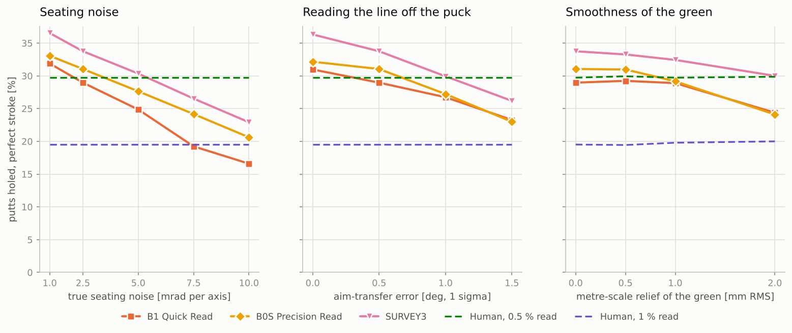

# GreenLine simulation report

Generated by `python -m greenline_sim.montecarlo` from the Python reference in `sim/greenline_sim`. Every number below is read from `results/summary.json`; the wording of the verdicts follows fixed rules applied to those numbers. Nothing here is a measurement of hardware: it is a simulation of the GL-1 design (hardware revision C) on synthetic greens, and several decisive inputs are estimates (section 13).

**Size of the run.** 3600 putts in the main experiment: 6 putt lengths x 4 green classes x 150 seeded greens, i.e. N = 150 per (length, class) cell and N = 600 per length. Each putt is evaluated for every method at 3 seating-noise levels, once with a perfect stroke and 20 times with human execution noise (1 deg direction, 6 % speed, 1 sigma). The sensitivity sweeps use the first 1440 putts; variant comparisons that are reported for the perfect stroke only are rolled once per putt. Master seed 20261111. Runtime 718 s wall clock (427 s main, 282 s sweeps) and 489 s of CPU time on 4 cores, with numba 0.68.1; the load average of the machine when the run started was 8.7 (it was shared with other jobs, so the wall-clock figure is inflated; on a machine of its own the run cannot take longer than its CPU time). 0 (green, length) pairs had no legal putt and were skipped.

**Statistical resolution.** With N = 600 per length a make probability near 50 % has a standard error of about 2.0 percentage points (pp); per (length, class) cell it is about 4 pp, so single cells of the appendix tables are indicative only. Method comparisons are paired (same greens, same noise draws) and are quoted with 95 % intervals; a difference is called real only beyond 2 standard errors.

**Shipping configuration - the default of every table unless it says otherwise.** (1) The grain reading is NOT used (`use_grain = False`): the design specification ships the grain sensor disabled. The human baselines solve without grain too (`human_grain = "none"`). (2) The golfer follows the LINE on the puck: its direction is quantised by the 1-bit display in steps of 0.94 deg and transferred to the ball with a further 0.5 deg (1 sigma, an estimate). "Perfect stroke" for a device mode therefore means a perfect stroke along the line the golfer took from the display. (3) Firmware default method: `B1`.

## 1. Headline

All putt lengths pooled, seating noise 2.5 mrad, shipping configuration:

| Method | holed, perfect stroke [%] | holed, human execution [%] | median lateral miss [cm] | holed at 3 m [%] | holed at 6 m [%] | minus the 0.5 % reader [pp]: perfect / human execution |
| --- | --- | --- | --- | --- | --- | --- |
| STRAIGHT (no read) | 8.9 | 8.6 | 23.2 | 11 | 4 | - |
| B1 Quick Read | 29.5 | 21.0 | 9.9 | 44 | 13 | +0.0 ± 1.6 / +0.1 ± 0.6 |
| B0S Precision Read | 31.6 | 22.0 | 8.6 | 48 | 14 | +2.2 ± 1.6 / +1.1 ± 0.6 |
| SURVEY3 | 34.4 | 23.4 | 7.1 | 52 | 23 | +5.0 ± 1.6 / +2.5 ± 0.5 |
| Human, 0.5 % read | 29.5 | 20.9 | 9.5 | 42 | 14 | - |
| Human, 1 % read | 19.3 | 14.7 | 16.4 | 25 | 7 | - |
| ORACLE_SLOPE (true surface, entered speed) | 48.0 | 26.9 | 3.8 | 68 | 36 | - |
| ORACLE | 100.0 | 32.7 | 0.0 | 100 | 100 | - |

- **A read is worth a lot.** Aiming straight holes 8.9 % of all putts with a perfect stroke; the Quick Read (B1) holes 29.5 % and cuts the median miss from 23.2 cm to 9.9 cm. At 3 m it holes 44 % against 11 %, at 6 m 13 % against 4 %.
- **Against a golfer who reads the cross slope to 0.5 %** (and who, like the shipping device, does not know the grain): the Quick Read is indistinguishable from him (+0.0 ± 1.6 pp with a perfect stroke, +0.1 ± 0.6 pp with human execution); the Precision Read is ahead of him (+2.2 ± 1.6 pp with a perfect stroke, +1.1 ± 0.6 pp with human execution); the three-drop Survey is ahead of him (+5.0 ± 1.6 pp with a perfect stroke, +2.5 ± 0.5 pp with human execution). Against a 1 % reader the Quick Read is ahead of him by +10.2 ± 1.6 pp.
- **That standing rests on four inputs nobody has measured** (section 4):
  - *Seating noise of the puck on turf* (2.5 mrad assumed). With a perfect stroke the Quick Read equals the 0.5 % reader at 2.5 mrad (not distinguishable at 2 standard errors from 1.7 to 3.3 mrad) of seating noise and the 1 % reader at 7.4 mrad (not distinguishable at 2 standard errors from 6.3 to 9.5 mrad); the Survey equals the 0.5 % reader at 5.4 mrad (not distinguishable at 2 standard errors from 3.6 to 7.0 mrad).
  - *Reading the line off the puck* (0.5 deg assumed, plus the 0.94 deg steps of the 1-bit display). Quick Read minus 0.5 % reader: +1.2 ± 2.5 pp at 0 deg, -0.8 ± 2.5 pp at 0.5 deg, -3.0 ± 2.5 pp at 1 deg, -6.5 ± 2.6 pp at 1.5 deg.
  - *Metre-scale smoothness of the green* (the synthetic greens are smooth below about 15 m wavelength). Quick Read minus 0.5 % reader with added relief of 0.5 mm RMS: -0.7 ± 2.5 pp, 1 mm RMS: -0.8 ± 2.6 pp, 2 mm RMS: -5.5 ± 2.6 pp.
  - *The grain.* The grain sensor ships disabled, so every device number here is without it. Switched on and working as specified it would add +4.0 ± 1.2 pp to the Quick Read; a human who reads the grain equally well gains +3.5 ± 1.2 pp.
- **No mode reads a long putt to within the hole.** The median miss exceeds the hole radius (5.4 cm) from 4.5 m on for the Quick Read, from 4.5 m for the Precision Read and from 4.5 m for the three-drop Survey (medians at 6 m: 13.2, 12.2 and 8.5 cm). For a single placement the reason is that the slope under the ball differs from the average slope along the line (section 8).
- **The tilt does nearly all the work on the line.** B0 (tilt only) and B1 have the same median miss (9.8 cm and 9.9 cm). The flag-base height improves the pace, not the line: median pace error at 6 m 51 cm for B0 against 40 cm for B1; B1 holes +1.2 ± 0.9 pp more putts than B0 (section 3).
- **Turf horizon (B2 against B1, same putts).** With no fringe at all (optimistic): helps (+1.9 ± 1.1 pp makes, -2.18 ± 0.53 cm mean miss). With the realistic geometry as modelled: reduces the mean miss, makes unchanged (+0.6 ± 1.2 pp makes, -0.85 ± 0.60 cm mean miss); extending the terrain model from 24 m to 60 m changes that to -0.2 ± 1.9 pp and +0.60 ± 1.06 cm (no measurable effect, sweep subset). With mounded surrounds: hurts (-3.7 ± 1.3 pp makes, +2.95 ± 0.72 cm mean miss). The firmware default is B1 (section 5).
- **More placements beat more optics.** Precision Read: +2.2 ± 1.1 pp makes over B1; three-drop Survey: +5.0 ± 1.3 pp, with the median miss falling from 9.9 cm to 7.1 cm. Camera presets and lens height change next to nothing (section 11).
- **Two limits no slope sensor removes.** With the true surface but the golfer's entered green speed (7 % error) and no grain knowledge, only 48.0 % of putts drop with a perfect stroke. And with human execution at the specified 1 deg / 6 % - an elite level - even the oracle holes 32.7 %; at 2 deg / 10 %, nearer a club golfer, the oracle holes 16.9 % and the Quick Read 13.6 % (section 9).


## 2. What was simulated

**Hardware (preset GL1, revision C).** Stereo pair with f = 657 px and baseline 20 mm, optical axis 5.6 mm above the base plane (the puck sinks an unknown 0-1.5 mm into the canopy), horizontal field ±26 deg, usable upward field 17.6 deg. The device measures: puck tilt; flagstick bearing, stereo disparity, elevation of the lowest visible point of the stick and, when in the field, of its top; the turf-horizon elevation at 41 azimuths; grain (unused by default); and takes the green speed from the golfer. It cannot see the surface between ball and hole in a range-resolved way, and nothing in the estimator pretends it can: at lens height h the ground at distance d subtends h / d^2 rad per metre (0.6 mrad per metre at 3 m, 0.4 px), so the whole green collapses onto the horizon line.

**Methods.**

| Name | What it is | Inputs |
| --- | --- | --- |
| STRAIGHT | aim at the flag, flat-green pace | the golfer aims at the hole himself; entered Stimp, camera range |
| B0 | plane from one tilt reading (what a digital-level ball marker gives) | + puck tilt |
| B1 | Quick Read: MAP fit of a quadratic patch (convex problem) | + flag-base height (or a one-sided bound when the base is hidden) |
| B2 | B1 + turf horizon, anchored: slopes at the ball and along-line curvature held at the B1 solution, twist and cross curvature from the horizon | + horizon profile |
| B0S | Precision Read: B1 with a 180-degree spin-and-reread | two seatings averaged, device bias cancelled |
| SURVEY2 / SURVEY3 | Survey: drops at the ball, the midpoint (and 1 m short of the hole) | each drop: tilt, own range and bearing, own hole height |
| FLAGOUT | flag-out fallback, tilt only | visor pointed by hand (1.5 deg), dialled distance (10 %) |
| HUMAN05 / HUMAN10 | golfer who reads the path-average cross slope with 0.5 % / 1 % error | true hole height, bearing and distance; the same entered Stimp as the device; no grain; aims without the display |
| ORACLE_SLOPE | true surface, but the entered Stimp and the device's grain knowledge (none) | isolates slope reading from speed and grain knowledge |
| ORACLE | true surface, true Stimp, true grain | upper bound |

All methods aim for the same target pace (the ball would roll 0.30 m past the hole on a flat green). A camera read that does not find the flag is retried as a flag-out read, and every device mode then works from that. The estimator's assumed noise levels are firmware constants and stay at their nominal values in every sweep, as they would in a shipped device.

**Greens.** Four classes (planar, gentle, undulating, tiered), overall tilt 0.5-3 %, undulation correlation length 4-8 m (no relief below about 15 m wavelength: section 4.3), hole where the local slope is at most 3 %, green edge 9-16 m from the centre, collar +8 mm, rough +40 mm, surround terrain beyond the collar with a mean radial slope of -8 % to +2 %, modelled out to 24 m from the centre. True Stimp ~ N(10, 1.2), grain strong on 35 % of greens. The ball rolls with `dv/dt = -a_r v_hat - (5/7) G grad z + kappa a_r g_hat`.

## 3. What each sensor buys, and the results at the nominal seating noise (2.5 mrad)

**What each sensor buys** (all lengths pooled; each row adds one measurement to the row above):

| Step | What it adds | holed, perfect stroke [%] | holed, human execution [%] | median miss [cm] | 90th pct miss [cm] | median pace error [cm] | short of the hole [%] | gain over the row above: makes, mean miss (± 95 %) |
| --- | --- | --- | --- | --- | --- | --- | --- | --- |
| STRAIGHT | camera bearing and range, entered green speed (no slope reading) | 8.9 | 8.6 | 23.2 | 87.5 | 66 | 34 | - |
| B0 | + puck tilt (accelerometer) | 28.2 | 20.6 | 9.8 | 48.7 | 37 | 26 | +19.4 ± 1.5 pp, -14.77 ± 0.90 cm |
| B1 | + flag-base height (elevation of the lowest visible point of the stick) | 29.5 | 21.0 | 9.9 | 48.8 | 31 | 23 | +1.2 ± 0.9 pp, -0.04 ± 0.17 cm |
| B2 | + turf-horizon profile (anchored fit) | 30.1 | 21.3 | 9.1 | 46.1 | 31 | 23 | +0.6 ± 1.2 pp, -0.85 ± 0.60 cm |
| ORACLE | the true surface, speed and grain (not a sensor: the ceiling) | 100.0 | 32.7 | 0.0 | 0.0 | 0 | 0 | +69.9 ± 1.5 pp, -17.74 ± 0.73 cm |

Read down the table. The camera and the entered green speed alone (STRAIGHT) hole 8.9 % with a perfect stroke. The **tilt** is the step that matters: +19.4 ± 1.5 pp. The **flag-base height** adds +1.2 ± 0.9 pp of makes and nothing measurable to the line (-0.04 ± 0.17 cm of mean miss); what it buys is pace (median pace error 37 cm -> 31 cm). The **turf horizon**, in the anchored form and with the realistic silhouette as modelled, gives +0.6 ± 1.2 pp of makes - no change that can be told from zero - and -0.85 ± 0.60 cm of mean miss; section 5 shows that even this depends on the surrounds and on how far the terrain is modelled. The gap from the Quick Read to the oracle (+70.5 ± 1.5 pp with a perfect stroke, +11.7 ± 0.5 pp with human execution) is what no sensor on this device closes: the surface between ball and hole, the true green speed and the grain.

The same chain by putt length (median lateral miss [cm] / putts holed with a perfect stroke [%]):

| Putt | STRAIGHT | B0 | B1 | B2 | ORACLE |
| --- | --- | --- | --- | --- | --- |
| 1.5 m | 6.9 / 32 | 2.2 / 84 | 2.3 / 85 | 2.2 / 84 | 0.0 / 100 |
| 3 m | 13.9 / 11 | 5.2 / 42 | 5.1 / 44 | 4.8 / 47 | 0.0 / 100 |
| 4.5 m | 24.0 / 4 | 9.5 / 23 | 9.2 / 26 | 10.0 / 24 | 0.0 / 100 |
| 6 m | 28.5 / 4 | 13.4 / 12 | 13.2 / 13 | 12.0 / 17 | 0.0 / 100 |
| 9 m | 47.7 / 1 | 23.2 / 4 | 23.6 / 5 | 22.6 / 7 | 0.0 / 100 |
| 12 m | 65.2 / 1 | 34.4 / 4 | 35.2 / 3 | 28.0 / 2 | 0.0 / 100 |

**All methods.** Median absolute lateral miss at the hole, perfect stroke [cm]:

| Method | 1.5 m | 3 m | 4.5 m | 6 m | 9 m | 12 m | all |
| --- | --- | --- | --- | --- | --- | --- | --- |
| STRAIGHT | 6.9 | 13.9 | 24.0 | 28.5 | 47.7 | 65.2 | 23.2 |
| B0 | 2.2 | 5.2 | 9.5 | 13.4 | 23.2 | 34.4 | 9.8 |
| B1 | 2.3 | 5.1 | 9.2 | 13.2 | 23.6 | 35.2 | 9.9 |
| B2 | 2.2 | 4.8 | 10.0 | 12.0 | 22.6 | 28.0 | 9.1 |
| B0S | 1.8 | 4.8 | 8.2 | 12.2 | 23.4 | 32.5 | 8.6 |
| SURVEY2 | 1.8 | 4.2 | 7.4 | 10.4 | 18.1 | 27.1 | 7.7 |
| SURVEY3 | 1.9 | 4.3 | 6.8 | 8.5 | 15.7 | 23.3 | 7.1 |
| FLAGOUT | 4.2 | 7.6 | 13.0 | 17.2 | 28.4 | 37.7 | 12.7 |
| HUMAN05 | 2.4 | 5.7 | 8.7 | 13.6 | 21.0 | 28.5 | 9.5 |
| HUMAN10 | 4.1 | 10.1 | 15.6 | 23.6 | 36.7 | 48.1 | 16.4 |
| ORACLE_SLOPE | 0.8 | 2.1 | 3.7 | 5.0 | 7.5 | 10.0 | 3.8 |
| ORACLE | 0.0 | 0.0 | 0.0 | 0.0 | 0.0 | 0.0 | 0.0 |

90th percentile of the lateral miss, perfect stroke [cm]:

| Method | 1.5 m | 3 m | 4.5 m | 6 m | 9 m | 12 m | all |
| --- | --- | --- | --- | --- | --- | --- | --- |
| STRAIGHT | 14.7 | 33.9 | 54.8 | 73.7 | 116.3 | 158.9 | 87.5 |
| B0 | 6.0 | 14.4 | 26.1 | 36.8 | 68.7 | 107.5 | 48.7 |
| B1 | 6.0 | 14.2 | 25.6 | 37.7 | 68.9 | 107.6 | 48.8 |
| B2 | 5.9 | 14.5 | 27.2 | 36.0 | 72.3 | 95.5 | 46.1 |
| B0S | 5.5 | 14.0 | 26.1 | 38.4 | 66.6 | 105.6 | 48.1 |
| SURVEY2 | 5.9 | 11.6 | 21.1 | 26.7 | 46.6 | 83.4 | 35.9 |
| SURVEY3 | 5.9 | 12.0 | 19.9 | 26.0 | 42.0 | 67.5 | 32.4 |
| FLAGOUT | 9.8 | 18.5 | 33.3 | 47.3 | 81.1 | 111.6 | 58.4 |
| HUMAN05 | 6.4 | 15.9 | 24.7 | 34.3 | 51.8 | 70.5 | 40.6 |
| HUMAN10 | 10.7 | 27.6 | 41.3 | 60.5 | 88.3 | 122.7 | 69.6 |
| ORACLE_SLOPE | 4.8 | 9.4 | 16.3 | 21.6 | 35.4 | 48.2 | 22.5 |
| ORACLE | 0.0 | 0.0 | 0.0 | 0.0 | 0.0 | 0.0 | 0.0 |

Make probability with a perfect stroke [%]:

| Method | 1.5 m | 3 m | 4.5 m | 6 m | 9 m | 12 m | all |
| --- | --- | --- | --- | --- | --- | --- | --- |
| STRAIGHT | 32 | 11 | 4 | 4 | 1 | 1 | 9 |
| B0 | 84 | 42 | 23 | 12 | 4 | 4 | 28 |
| B1 | 85 | 44 | 26 | 13 | 5 | 3 | 29 |
| B2 | 84 | 47 | 24 | 17 | 7 | 2 | 30 |
| B0S | 87 | 48 | 28 | 14 | 9 | 5 | 32 |
| SURVEY2 | 85 | 52 | 32 | 17 | 8 | 5 | 33 |
| SURVEY3 | 86 | 52 | 32 | 23 | 10 | 4 | 34 |
| FLAGOUT | 56 | 26 | 14 | 9 | 4 | 3 | 19 |
| HUMAN05 | 82 | 42 | 25 | 14 | 8 | 5 | 29 |
| HUMAN10 | 60 | 25 | 16 | 7 | 5 | 2 | 19 |
| ORACLE_SLOPE | 91 | 68 | 52 | 36 | 25 | 16 | 48 |
| ORACLE | 100 | 100 | 100 | 100 | 100 | 100 | 100 |

Make probability with human execution noise (1 deg, 6 %) [%]:

| Method | 1.5 m | 3 m | 4.5 m | 6 m | 9 m | 12 m | all |
| --- | --- | --- | --- | --- | --- | --- | --- |
| STRAIGHT | 30.2 | 11.3 | 4.5 | 3.7 | 1.1 | 0.7 | 8.6 |
| B0 | 65.7 | 28.3 | 14.6 | 9.0 | 3.9 | 2.2 | 20.6 |
| B1 | 66.2 | 28.8 | 15.1 | 9.5 | 3.9 | 2.4 | 21.0 |
| B2 | 66.5 | 30.1 | 14.5 | 9.9 | 4.6 | 2.5 | 21.3 |
| B0S | 68.8 | 30.3 | 16.4 | 9.8 | 4.1 | 2.7 | 22.0 |
| SURVEY2 | 68.2 | 32.3 | 16.9 | 11.0 | 5.4 | 2.9 | 22.8 |
| SURVEY3 | 68.1 | 33.0 | 18.0 | 12.1 | 5.9 | 3.0 | 23.4 |
| FLAGOUT | 48.7 | 20.1 | 10.4 | 6.8 | 3.1 | 1.7 | 15.1 |
| HUMAN05 | 64.3 | 27.9 | 16.0 | 9.1 | 5.0 | 3.0 | 20.9 |
| HUMAN10 | 48.8 | 18.5 | 10.4 | 5.7 | 3.0 | 1.9 | 14.7 |
| ORACLE_SLOPE | 74.9 | 37.7 | 21.8 | 14.8 | 7.5 | 4.5 | 26.9 |
| ORACLE | 84.8 | 46.7 | 28.1 | 19.3 | 10.6 | 6.8 | 32.7 |

By green class, all lengths pooled (median miss [cm] / make probability with a perfect stroke [%]):

| Method | planar | gentle | undulating | tiered |
| --- | --- | --- | --- | --- |
| STRAIGHT | 24.1 / 9 | 19.9 / 10 | 25.4 / 8 | 23.5 / 9 |
| B0 | 7.8 / 32 | 8.5 / 31 | 12.3 / 25 | 11.4 / 26 |
| B1 | 7.6 / 31 | 8.3 / 32 | 12.6 / 26 | 11.2 / 28 |
| B2 | 7.0 / 34 | 8.8 / 31 | 11.2 / 26 | 10.3 / 29 |
| B0S | 6.7 / 34 | 7.0 / 35 | 11.5 / 27 | 11.1 / 30 |
| SURVEY2 | 7.4 / 33 | 7.3 / 35 | 8.2 / 32 | 8.1 / 33 |
| SURVEY3 | 6.9 / 34 | 6.7 / 36 | 7.3 / 34 | 7.4 / 34 |
| FLAGOUT | 10.5 / 23 | 11.9 / 19 | 14.1 / 17 | 15.4 / 17 |
| HUMAN05 | 9.3 / 29 | 9.9 / 28 | 9.4 / 31 | 9.4 / 30 |
| HUMAN10 | 17.0 / 18 | 16.2 / 18 | 15.8 / 22 | 15.8 / 20 |
| ORACLE_SLOPE | 4.0 / 47 | 3.7 / 49 | 3.6 / 48 | 4.0 / 48 |
| ORACLE | 0.0 / 100 | 0.0 / 100 | 0.0 / 100 | 0.0 / 100 |


The per-length, per-class tables are in the appendix (section 14).

## 4. Seating noise, aim transfer and the smoothness of the green: the inputs nobody has measured



### 4.1 Seating noise

How a 46 mm puck seats on turf has not been measured; 2-5 mrad per placement is an estimate. Every method was therefore run at a TRUE seating noise of 1, 2.5, 5 mrad per axis (the estimator keeps assuming 2.5). The two human baselines, STRAIGHT and the oracles do not use the tilt and are identical in all three blocks.

**Seating noise 1 mrad** - median lateral miss [cm]:

| Method | 1.5 m | 3 m | 4.5 m | 6 m | 9 m | 12 m | all |
| --- | --- | --- | --- | --- | --- | --- | --- |
| STRAIGHT | 6.9 | 13.9 | 24.0 | 28.5 | 47.7 | 65.2 | 23.2 |
| B0 | 1.9 | 4.4 | 8.0 | 11.9 | 21.3 | 30.2 | 8.5 |
| B1 | 1.9 | 4.5 | 8.3 | 12.0 | 21.9 | 30.5 | 8.6 |
| B2 | 1.9 | 4.5 | 9.4 | 11.5 | 21.2 | 28.6 | 8.6 |
| B0S | 1.7 | 4.5 | 7.2 | 11.5 | 21.5 | 30.9 | 7.9 |
| SURVEY2 | 1.7 | 3.9 | 6.0 | 8.5 | 16.1 | 24.1 | 6.7 |
| SURVEY3 | 1.8 | 4.0 | 5.8 | 8.0 | 14.5 | 22.3 | 6.5 |
| FLAGOUT | 3.9 | 6.9 | 12.0 | 16.7 | 27.9 | 34.9 | 12.2 |
| HUMAN05 | 2.4 | 5.7 | 8.7 | 13.6 | 21.0 | 28.5 | 9.5 |
| HUMAN10 | 4.1 | 10.1 | 15.6 | 23.6 | 36.7 | 48.1 | 16.4 |
| ORACLE_SLOPE | 0.8 | 2.1 | 3.7 | 5.0 | 7.5 | 10.0 | 3.8 |
| ORACLE | 0.0 | 0.0 | 0.0 | 0.0 | 0.0 | 0.0 | 0.0 |

Seating noise 1 mrad - make probability, perfect stroke [%]:

| Method | 1.5 m | 3 m | 4.5 m | 6 m | 9 m | 12 m | all |
| --- | --- | --- | --- | --- | --- | --- | --- |
| STRAIGHT | 32 | 11 | 4 | 4 | 1 | 1 | 9 |
| B0 | 87 | 47 | 28 | 14 | 6 | 4 | 31 |
| B1 | 88 | 50 | 30 | 16 | 7 | 4 | 32 |
| B2 | 87 | 49 | 26 | 18 | 8 | 4 | 32 |
| B0S | 88 | 50 | 31 | 16 | 8 | 5 | 33 |
| SURVEY2 | 88 | 55 | 37 | 22 | 11 | 5 | 36 |
| SURVEY3 | 87 | 56 | 37 | 23 | 12 | 5 | 37 |
| FLAGOUT | 58 | 28 | 15 | 8 | 6 | 3 | 20 |
| HUMAN05 | 82 | 42 | 25 | 14 | 8 | 5 | 29 |
| HUMAN10 | 60 | 25 | 16 | 7 | 5 | 2 | 19 |
| ORACLE_SLOPE | 91 | 68 | 52 | 36 | 25 | 16 | 48 |
| ORACLE | 100 | 100 | 100 | 100 | 100 | 100 | 100 |

Seating noise 1 mrad - make probability, human execution [%]:

| Method | 1.5 m | 3 m | 4.5 m | 6 m | 9 m | 12 m | all |
| --- | --- | --- | --- | --- | --- | --- | --- |
| STRAIGHT | 30.2 | 11.3 | 4.5 | 3.7 | 1.1 | 0.7 | 8.6 |
| B0 | 68.7 | 29.9 | 15.8 | 9.5 | 4.3 | 2.3 | 21.8 |
| B1 | 68.9 | 30.9 | 16.6 | 9.9 | 4.2 | 2.6 | 22.2 |
| B2 | 68.7 | 31.2 | 14.9 | 10.1 | 4.9 | 2.6 | 22.0 |
| B0S | 69.5 | 31.5 | 17.7 | 10.0 | 4.5 | 2.7 | 22.6 |
| SURVEY2 | 69.2 | 33.5 | 18.5 | 12.2 | 5.9 | 3.0 | 23.7 |
| SURVEY3 | 68.7 | 34.0 | 18.6 | 12.4 | 6.2 | 3.4 | 23.9 |
| FLAGOUT | 49.9 | 21.3 | 10.9 | 6.5 | 3.3 | 1.9 | 15.6 |
| HUMAN05 | 64.3 | 27.9 | 16.0 | 9.1 | 5.0 | 3.0 | 20.9 |
| HUMAN10 | 48.8 | 18.5 | 10.4 | 5.7 | 3.0 | 1.9 | 14.7 |
| ORACLE_SLOPE | 74.9 | 37.7 | 21.8 | 14.8 | 7.5 | 4.5 | 26.9 |
| ORACLE | 84.8 | 46.7 | 28.1 | 19.3 | 10.6 | 6.8 | 32.7 |

**Seating noise 2.5 mrad** - median lateral miss [cm]:

| Method | 1.5 m | 3 m | 4.5 m | 6 m | 9 m | 12 m | all |
| --- | --- | --- | --- | --- | --- | --- | --- |
| STRAIGHT | 6.9 | 13.9 | 24.0 | 28.5 | 47.7 | 65.2 | 23.2 |
| B0 | 2.2 | 5.2 | 9.5 | 13.4 | 23.2 | 34.4 | 9.8 |
| B1 | 2.3 | 5.1 | 9.2 | 13.2 | 23.6 | 35.2 | 9.9 |
| B2 | 2.2 | 4.8 | 10.0 | 12.0 | 22.6 | 28.0 | 9.1 |
| B0S | 1.8 | 4.8 | 8.2 | 12.2 | 23.4 | 32.5 | 8.6 |
| SURVEY2 | 1.8 | 4.2 | 7.4 | 10.4 | 18.1 | 27.1 | 7.7 |
| SURVEY3 | 1.9 | 4.3 | 6.8 | 8.5 | 15.7 | 23.3 | 7.1 |
| FLAGOUT | 4.2 | 7.6 | 13.0 | 17.2 | 28.4 | 37.7 | 12.7 |
| HUMAN05 | 2.4 | 5.7 | 8.7 | 13.6 | 21.0 | 28.5 | 9.5 |
| HUMAN10 | 4.1 | 10.1 | 15.6 | 23.6 | 36.7 | 48.1 | 16.4 |
| ORACLE_SLOPE | 0.8 | 2.1 | 3.7 | 5.0 | 7.5 | 10.0 | 3.8 |
| ORACLE | 0.0 | 0.0 | 0.0 | 0.0 | 0.0 | 0.0 | 0.0 |

Seating noise 2.5 mrad - make probability, perfect stroke [%]:

| Method | 1.5 m | 3 m | 4.5 m | 6 m | 9 m | 12 m | all |
| --- | --- | --- | --- | --- | --- | --- | --- |
| STRAIGHT | 32 | 11 | 4 | 4 | 1 | 1 | 9 |
| B0 | 84 | 42 | 23 | 12 | 4 | 4 | 28 |
| B1 | 85 | 44 | 26 | 13 | 5 | 3 | 29 |
| B2 | 84 | 47 | 24 | 17 | 7 | 2 | 30 |
| B0S | 87 | 48 | 28 | 14 | 9 | 5 | 32 |
| SURVEY2 | 85 | 52 | 32 | 17 | 8 | 5 | 33 |
| SURVEY3 | 86 | 52 | 32 | 23 | 10 | 4 | 34 |
| FLAGOUT | 56 | 26 | 14 | 9 | 4 | 3 | 19 |
| HUMAN05 | 82 | 42 | 25 | 14 | 8 | 5 | 29 |
| HUMAN10 | 60 | 25 | 16 | 7 | 5 | 2 | 19 |
| ORACLE_SLOPE | 91 | 68 | 52 | 36 | 25 | 16 | 48 |
| ORACLE | 100 | 100 | 100 | 100 | 100 | 100 | 100 |

Seating noise 2.5 mrad - make probability, human execution [%]:

| Method | 1.5 m | 3 m | 4.5 m | 6 m | 9 m | 12 m | all |
| --- | --- | --- | --- | --- | --- | --- | --- |
| STRAIGHT | 30.2 | 11.3 | 4.5 | 3.7 | 1.1 | 0.7 | 8.6 |
| B0 | 65.7 | 28.3 | 14.6 | 9.0 | 3.9 | 2.2 | 20.6 |
| B1 | 66.2 | 28.8 | 15.1 | 9.5 | 3.9 | 2.4 | 21.0 |
| B2 | 66.5 | 30.1 | 14.5 | 9.9 | 4.6 | 2.5 | 21.3 |
| B0S | 68.8 | 30.3 | 16.4 | 9.8 | 4.1 | 2.7 | 22.0 |
| SURVEY2 | 68.2 | 32.3 | 16.9 | 11.0 | 5.4 | 2.9 | 22.8 |
| SURVEY3 | 68.1 | 33.0 | 18.0 | 12.1 | 5.9 | 3.0 | 23.4 |
| FLAGOUT | 48.7 | 20.1 | 10.4 | 6.8 | 3.1 | 1.7 | 15.1 |
| HUMAN05 | 64.3 | 27.9 | 16.0 | 9.1 | 5.0 | 3.0 | 20.9 |
| HUMAN10 | 48.8 | 18.5 | 10.4 | 5.7 | 3.0 | 1.9 | 14.7 |
| ORACLE_SLOPE | 74.9 | 37.7 | 21.8 | 14.8 | 7.5 | 4.5 | 26.9 |
| ORACLE | 84.8 | 46.7 | 28.1 | 19.3 | 10.6 | 6.8 | 32.7 |

**Seating noise 5 mrad** - median lateral miss [cm]:

| Method | 1.5 m | 3 m | 4.5 m | 6 m | 9 m | 12 m | all |
| --- | --- | --- | --- | --- | --- | --- | --- |
| STRAIGHT | 6.9 | 13.9 | 24.0 | 28.5 | 47.7 | 65.2 | 23.2 |
| B0 | 2.9 | 6.7 | 12.4 | 16.0 | 28.5 | 40.6 | 12.5 |
| B1 | 3.0 | 6.4 | 12.5 | 15.7 | 28.2 | 40.9 | 12.2 |
| B2 | 2.8 | 5.4 | 11.1 | 13.2 | 25.6 | 32.6 | 10.2 |
| B0S | 2.4 | 6.1 | 10.0 | 14.0 | 26.4 | 36.1 | 10.2 |
| SURVEY2 | 2.6 | 5.1 | 9.6 | 12.8 | 22.9 | 35.1 | 9.7 |
| SURVEY3 | 2.3 | 4.8 | 8.2 | 10.0 | 19.1 | 27.4 | 8.2 |
| FLAGOUT | 4.4 | 9.0 | 14.1 | 18.7 | 32.2 | 44.2 | 14.3 |
| HUMAN05 | 2.4 | 5.7 | 8.7 | 13.6 | 21.0 | 28.5 | 9.5 |
| HUMAN10 | 4.1 | 10.1 | 15.6 | 23.6 | 36.7 | 48.1 | 16.4 |
| ORACLE_SLOPE | 0.8 | 2.1 | 3.7 | 5.0 | 7.5 | 10.0 | 3.8 |
| ORACLE | 0.0 | 0.0 | 0.0 | 0.0 | 0.0 | 0.0 | 0.0 |

Seating noise 5 mrad - make probability, perfect stroke [%]:

| Method | 1.5 m | 3 m | 4.5 m | 6 m | 9 m | 12 m | all |
| --- | --- | --- | --- | --- | --- | --- | --- |
| STRAIGHT | 32 | 11 | 4 | 4 | 1 | 1 | 9 |
| B0 | 73 | 32 | 16 | 12 | 4 | 2 | 23 |
| B1 | 74 | 36 | 19 | 11 | 4 | 2 | 24 |
| B2 | 76 | 43 | 23 | 14 | 7 | 3 | 28 |
| B0S | 81 | 39 | 20 | 13 | 6 | 4 | 27 |
| SURVEY2 | 81 | 45 | 22 | 14 | 8 | 4 | 29 |
| SURVEY3 | 82 | 47 | 26 | 17 | 8 | 2 | 30 |
| FLAGOUT | 53 | 20 | 11 | 8 | 3 | 2 | 16 |
| HUMAN05 | 82 | 42 | 25 | 14 | 8 | 5 | 29 |
| HUMAN10 | 60 | 25 | 16 | 7 | 5 | 2 | 19 |
| ORACLE_SLOPE | 91 | 68 | 52 | 36 | 25 | 16 | 48 |
| ORACLE | 100 | 100 | 100 | 100 | 100 | 100 | 100 |

Seating noise 5 mrad - make probability, human execution [%]:

| Method | 1.5 m | 3 m | 4.5 m | 6 m | 9 m | 12 m | all |
| --- | --- | --- | --- | --- | --- | --- | --- |
| STRAIGHT | 30.2 | 11.3 | 4.5 | 3.7 | 1.1 | 0.7 | 8.6 |
| B0 | 58.1 | 23.5 | 12.0 | 7.3 | 3.1 | 1.7 | 17.6 |
| B1 | 58.9 | 25.2 | 12.2 | 8.0 | 3.4 | 2.0 | 18.3 |
| B2 | 61.4 | 27.9 | 13.6 | 9.0 | 4.0 | 2.2 | 19.7 |
| B0S | 64.6 | 27.6 | 14.1 | 9.2 | 3.8 | 2.0 | 20.2 |
| SURVEY2 | 63.7 | 28.4 | 15.3 | 9.8 | 4.6 | 2.1 | 20.7 |
| SURVEY3 | 64.8 | 30.3 | 16.2 | 10.9 | 5.0 | 2.4 | 21.6 |
| FLAGOUT | 45.2 | 17.5 | 9.0 | 5.7 | 2.6 | 1.4 | 13.6 |
| HUMAN05 | 64.3 | 27.9 | 16.0 | 9.1 | 5.0 | 3.0 | 20.9 |
| HUMAN10 | 48.8 | 18.5 | 10.4 | 5.7 | 3.0 | 1.9 | 14.7 |
| ORACLE_SLOPE | 74.9 | 37.7 | 21.8 | 14.8 | 7.5 | 4.5 | 26.9 |
| ORACLE | 84.8 | 46.7 | 28.1 | 19.3 | 10.6 | 6.8 | 32.7 |


Beyond the main range (sweep subset, 1440 putts; make probability, perfect stroke / human execution [%]; 0.5 % reader 29.7 / 20.2, 1 % reader 19.5 / 14.4):

| Seating noise | B1 | B0S | SURVEY3 |
| --- | --- | --- | --- |
| 1 mrad | 31.9 / 21.8 | 33.1 / 22.3 | 36.5 / 23.5 |
| 2.5 mrad | 29.0 / 20.9 | 31.0 / 21.7 | 33.8 / 23.0 |
| 5 mrad | 24.9 / 18.3 | 27.6 / 20.0 | 30.3 / 21.5 |
| 7.5 mrad | 19.2 / 15.6 | 24.2 / 18.1 | 26.5 / 19.4 |
| 10 mrad | 16.6 / 13.1 | 20.6 / 15.8 | 22.9 / 17.4 |

Paired differences in make probability with a perfect stroke (device mode minus human baseline, ± 95 %):

- Quick Read (B1) minus the 0.5 % reader: +2.9 ± 1.6 pp at 1 mrad, +0.0 ± 1.6 pp at 2.5 mrad, -5.1 ± 1.6 pp at 5 mrad; minus the 1 % reader: +13.1 ± 1.6 pp at 1 mrad, +10.2 ± 1.6 pp at 2.5 mrad, +5.1 ± 1.6 pp at 5 mrad.
- Precision Read (B0S) minus the 0.5 % reader: +3.7 ± 1.6 pp at 1 mrad, +2.2 ± 1.6 pp at 2.5 mrad, -2.2 ± 1.6 pp at 5 mrad.
- Survey (SURVEY3) minus the 0.5 % reader: +7.1 ± 1.6 pp at 1 mrad, +5.0 ± 1.6 pp at 2.5 mrad, +0.9 ± 1.6 pp at 5 mrad.

Break-even seating noise: the level at which the paired difference to the human baseline is zero, by linear interpolation between the levels run (main run: 1, 2.5, 5 mrad; beyond that the sweep subset: 1, 2.5, 5, 7.5, 10 mrad). In brackets the band inside which the two cannot be told apart at 2 standard errors:

| Mode | equals the 0.5 % reader at (perfect stroke) | (human execution) | equals the 1 % reader at (perfect stroke) | (human execution) |
| --- | --- | --- | --- | --- |
| B1 | 2.5 mrad (not distinguishable at 2 standard errors from 1.7 to 3.3 mrad) | 2.6 mrad (not distinguishable at 2 standard errors from 1.9 to 3.1 mrad) | 7.4 mrad (not distinguishable at 2 standard errors from 6.3 to 9.5 mrad) | 8.7 mrad (not distinguishable at 2 standard errors from 7.6 to 9.8 mrad) |
| B0S | 3.7 mrad (not distinguishable at 2 standard errors from 2.8 to 4.7 mrad) | 4.1 mrad (not distinguishable at 2 standard errors from 3.3 to 4.9 mrad) | not crossed between 1 and 10 mrad; not distinguishable at 2 standard errors from 9.0 mrad on | beyond 10 mrad (the range tested) |
| SURVEY3 | 5.4 mrad (not distinguishable at 2 standard errors from 3.6 to 7.0 mrad) | 6.6 mrad (not distinguishable at 2 standard errors from 5.5 to 7.7 mrad) | beyond 10 mrad (the range tested) | beyond 10 mrad (the range tested) |

Three things follow.

1. The device's standing against a good human reader is decided by a number nobody has measured. At 5 mrad the modes that are still ahead of the 0.5 % reader beyond 2 standard errors are: none; behind him: B1, B0S. At 10 mrad (0.46 mm under one edge of the 46 mm puck) the Quick Read holes 16.6 % against 19.5 % for the 1 % reader. Measuring the seating repeatability of the real puck on real turf is the first experiment the project needs.
2. Lower seating noise has diminishing returns for single-placement modes. Going from 2.5 to 1 mrad raises B1 by 2.9 pp, because the error that remains is the difference between the slope under the ball and the average along the line (5.1 mrad RMS at 6 m, section 8), which no single placement sees.
3. The simulated human baselines read the PATH-AVERAGE cross slope and know the hole height and the bearing exactly; only the size of the read error is varied, and they aim without any display. That is generous to the human on long, contoured putts. Lengths at which the 0.5 % reader has a smaller median miss than B1 at 2.5 mrad: 4.5 m, 9 m, 12 m.

### 4.2 Aim transfer: reading the line off the puck

Sweep subset; make probability, perfect stroke / human execution [%]. The human baselines do not use the display (0.5 % reader 29.7 / 20.2 in every row):

| Transfer error (1 sigma) | B1 | B0S | SURVEY3 | B1 minus 0.5 % reader [pp] | SURVEY3 minus 0.5 % reader [pp] |
| --- | --- | --- | --- | --- | --- |
| 0 deg | 31.0 / 21.1 | 32.2 / 22.1 | 36.3 / 23.7 | +1.2 ± 2.5 / +0.9 ± 0.9 | +6.6 ± 2.5 / +3.5 ± 0.8 |
| 0.5 deg | 29.0 / 20.9 | 31.0 / 21.7 | 33.8 / 23.0 | -0.8 ± 2.5 / +0.7 ± 0.9 | +4.0 ± 2.5 / +2.8 ± 0.8 |
| 1 deg | 26.7 / 19.3 | 27.2 / 20.1 | 29.9 / 21.1 | -3.0 ± 2.5 / -0.9 ± 1.0 | +0.2 ± 2.5 / +0.9 ± 0.9 |
| 1.5 deg | 23.3 / 17.6 | 23.0 / 18.3 | 26.2 / 19.0 | -6.5 ± 2.6 / -2.7 ± 1.0 | -3.5 ± 2.5 / -1.2 ± 1.0 |
| 0, ideal display | 30.8 / 21.7 | 32.8 / 22.4 | 38.3 / 24.3 | +1.0 ± 2.5 / +1.5 ± 0.9 | +8.5 ± 2.5 / +4.1 ± 0.8 |

The device shows a LINE; the golfer has to start the ball along it. Two things stand between the computed aim and the ball: the 1-bit, 128 x 128 display can only draw the 122 px line in direction steps of 0.94 deg (hardware, 0.27 deg RMS), and the golfer has to set the ball or the putter to a 22 mm line by eye (assumed 0.5 deg, 1 sigma; no data). Neither applies to the human baselines, who aim at a spot they chose themselves. The execution noise of section 9 is separate and applies to everybody.

- With the display quantisation alone (0 deg) the Quick Read is indistinguishable from the 0.5 % reader (+1.2 ± 2.5 pp); from 1 deg of transfer error on it is behind him beyond 2 standard errors (-3.0 ± 2.5 pp). An ideal display without quantisation would be worth -0.2 pp to the Quick Read and +1.9 pp to the Survey.
- The assumption used elsewhere in this report for the reverse task - pointing the puck at the hole by hand - is 1.5 deg. If reading the line back were that poor, the Quick Read would be at -6.5 ± 2.6 pp against the 0.5 % reader.
- **The other use model.** If the golfer ignores the line and uses the displayed break in cup widths, aiming by eye relative to the hole he can see, there is no quantisation and no transfer error (and the measured bearing no longer matters for the aim). On the same reads that model gives the Quick Read 31.3 % (+1.8 ± 1.1 pp over following the line; +1.8 ± 1.6 pp against the 0.5 % reader) and the Survey 38.6 % (+9.1 ± 1.6 pp against the 0.5 % reader). It assumes the golfer places the aim point exactly; judging "1.4 cups left" at 6 m has an error of its own that is not modelled. Every table in this report other than the rows marked "cups" assumes the golfer follows the line.

### 4.3 Metre-scale relief of the green

Sweep subset; make probability, perfect stroke / human execution [%]:

| Relief RMS | added slope per axis [mrad] | B1 | B0S | SURVEY3 | HUMAN05 | HUMAN10 | STRAIGHT | B1 minus 0.5 % reader [pp] | SURVEY3 minus B1 [pp] |
| --- | --- | --- | --- | --- | --- | --- | --- | --- | --- |
| 0 mm | 0.0 | 29.0 / 20.9 | 31.0 / 21.7 | 33.8 / 23.0 | 29.7 / 20.2 | 19.5 / 14.4 | 8.8 / 8.6 | -0.8 ± 2.5 | +4.8 ± 2.0 |
| 0.5 mm | 1.3 | 29.2 / 20.7 | 31.0 / 21.5 | 33.3 / 23.1 | 29.9 / 20.2 | 19.4 / 14.4 | 8.5 / 8.5 | -0.7 ± 2.5 | +4.0 ± 2.0 |
| 1 mm | 2.6 | 28.9 / 20.1 | 29.2 / 20.8 | 32.4 / 22.9 | 29.7 / 20.2 | 19.8 / 14.4 | 8.3 / 8.4 | -0.8 ± 2.6 | +3.5 ± 2.1 |
| 2 mm | 5.2 | 24.4 / 18.0 | 24.1 / 18.2 | 30.0 / 21.7 | 29.9 / 20.2 | 20.0 / 14.4 | 8.5 / 8.3 | -5.5 ± 2.6 | +5.6 ± 2.2 |

The generated greens are built from waves of 15 m wavelength and longer: the slope at a point and the mean slope half a metre around it differ by less than 0.3 mrad, so one 46 mm tilt sample is as representative of the first metre of the putt as it can possibly be. Real turf has relief at the metre scale; how much is not known. The sweep adds a random field with wavelengths of 1-3 m to the surface the ball rolls on and the puck sits on (same putts, same noise draws; the human baselines read the path average of the new surface).

- Added slope per axis: 1.3 mrad at 0.5 mm, 2.6 mrad at 1 mm, 5.2 mrad at 2 mm.
- Quick Read, all lengths: 29.0 % at 0 mm, 29.2 % at 0.5 mm, 28.9 % at 1 mm, 24.4 % at 2 mm; at 3 m: 45 %, 44 %, 41 %, 32 %.
- The Precision Read re-reads the same spot. Its gain over the Quick Read shrinks with the relief: +2.1 ± 1.7 pp at 0 mm, +1.7 ± 1.7 pp at 0.5 mm, +0.3 ± 1.6 pp at 1 mm, -0.3 ± 1.6 pp at 2 mm.
- The Survey samples three spots. Against the smooth green it changes by -0.5 ± 1.5 pp at 0.5 mm, -1.3 ± 1.9 pp at 1 mm, -3.8 ± 2.2 pp at 2 mm (Quick Read: +0.3 ± 1.5 pp, -0.1 ± 2.0 pp, -4.6 ± 2.2 pp); at 2 mm it is indistinguishable from the 0.5 % reader (+0.1 ± 2.5 pp).
- Quick Read against the 0.5 % reader: behind beyond 2 standard errors at 2 mm. The amplitudes are an assumption, not data: the first field experiment should include the tilt at spots 0.3-1 m apart on real greens.

## 5. Is the turf horizon usable? (B2 against B1)

Reviewers of the concept expected the turf-horizon path to cross slope to fail in practice because the silhouette is formed by collar, rough and surrounds rather than by the putting surface. This was tested, not assumed. B2 differs from B1 only by the horizon residuals, and the same putts were re-measured with four versions of what lies beyond the putting surface: nothing (the camera sees the smooth continuation of the green - optimistic), the collar and rough canopy steps only, the generator's default surrounds (realistic as modelled), and surrounds with mounds and hollows of 0.2 m RMS that are independent of the green (pessimistic). Four forms of the horizon fit are shown, because the answer depends on the form.

| Silhouette seen by the camera | Form of the horizon fit | Δ make prob. [pp] | Δ mean miss [cm] | median miss B1 -> B2 [cm] | B2 closer in [%] of putts | verdict |
| --- | --- | --- | --- | --- | --- | --- |
| no fringe (optimistic) | anchored (B2, the estimator's default form) | +1.9 ± 1.1 | -2.18 ± 0.53 | 9.9 -> 8.2 | 60 | helps |
| no fringe (optimistic) | anchored, c free, no silhouette offset | +3.3 ± 1.1 | -2.38 ± 0.50 | 9.9 -> 8.1 | 59 | helps |
| no fringe (optimistic) | joint fit, lowest of 25 starts | +1.7 ± 1.1 | -1.94 ± 0.53 | 9.9 -> 8.5 | 58 | helps |
| no fringe (optimistic) | joint fit, single start (the earlier implementation) | +2.4 ± 1.1 | -2.76 ± 0.44 | 9.9 -> 8.2 | 59 | helps |
| canopy steps only | anchored (B2, the estimator's default form) | +1.2 ± 1.1 | -1.89 ± 0.54 | 9.9 -> 8.7 | 58 | helps |
| canopy steps only | anchored, c free, no silhouette offset | +3.7 ± 1.2 | -2.43 ± 0.49 | 9.9 -> 8.2 | 59 | helps |
| canopy steps only | joint fit, lowest of 25 starts | +1.6 ± 1.1 | -1.62 ± 0.55 | 9.9 -> 8.7 | 56 | helps |
| canopy steps only | joint fit, single start (the earlier implementation) | +2.1 ± 1.1 | -2.73 ± 0.44 | 9.9 -> 8.4 | 58 | helps |
| realistic as modelled | anchored (B2, the estimator's default form) | +0.6 ± 1.2 | -0.85 ± 0.60 | 9.9 -> 9.1 | 55 | reduces the mean miss, makes unchanged |
| realistic as modelled | anchored, c free, no silhouette offset | +3.2 ± 1.2 | -1.74 ± 0.53 | 9.9 -> 8.5 | 57 | helps |
| realistic as modelled | joint fit, lowest of 25 starts | +1.0 ± 1.2 | -0.20 ± 0.63 | 9.9 -> 9.2 | 55 | no measurable effect |
| realistic as modelled | joint fit, single start (the earlier implementation) | +2.0 ± 1.2 | -2.20 ± 0.47 | 9.9 -> 8.9 | 57 | helps |
| mounded surrounds (pessimistic) | anchored (B2, the estimator's default form) | -3.7 ± 1.3 | +2.95 ± 0.72 | 9.9 -> 11.4 | 46 | hurts |
| mounded surrounds (pessimistic) | anchored, c free, no silhouette offset | -0.3 ± 1.3 | +0.12 ± 0.58 | 9.9 -> 9.7 | 51 | no measurable effect |
| mounded surrounds (pessimistic) | joint fit, lowest of 25 starts | -7.2 ± 1.4 | +10.79 ± 0.96 | 9.9 -> 16.0 | 38 | hurts |
| mounded surrounds (pessimistic) | joint fit, single start (the earlier implementation) | -1.9 ± 1.3 | +0.44 ± 0.56 | 9.9 -> 10.4 | 48 | lowers the make probability, mean miss unchanged |

Δ = B2 minus B1 on the same putts with the same noise, ± 95 % interval. "Mean miss" clips each miss at 1 m. Verdict rule (fixed before looking at the numbers): each of the two measures counts as moved when it changes by more than 2 standard errors; "helps" / "hurts" need both to move the same way, otherwise the verdict names the one that moved.

Anchored fit (B2) by green class:

| Silhouette | planar | gentle | undulating | tiered |
| --- | --- | --- | --- | --- |
| no fringe (optimistic) | +3.9 pp, -1.3 cm (helps) | +1.0 pp, -1.6 cm (reduces the mean miss, makes unchanged) | +0.3 pp, -2.4 cm (reduces the mean miss, makes unchanged) | +2.3 pp, -3.3 cm (reduces the mean miss, makes unchanged) |
| canopy steps only | +3.8 pp, -1.4 cm (helps) | -0.3 pp, -1.2 cm (reduces the mean miss, makes unchanged) | +0.1 pp, -1.8 cm (reduces the mean miss, makes unchanged) | +1.3 pp, -3.1 cm (reduces the mean miss, makes unchanged) |
| realistic as modelled | +2.4 pp, +0.3 cm (raises the make probability, mean miss unchanged) | -0.4 pp, +0.2 cm (no measurable effect) | +0.1 pp, -1.3 cm (no measurable effect) | +0.3 pp, -2.5 cm (reduces the mean miss, makes unchanged) |
| mounded surrounds (pessimistic) | -4.7 pp, +5.8 cm (hurts) | -5.4 pp, +4.6 cm (hurts) | -1.6 pp, +0.7 cm (no measurable effect) | -3.1 pp, +0.7 cm (lowers the make probability, mean miss unchanged) |

What each form does to the quantities the device measures directly (realistic silhouette, camera reads, RMS error against the truth [mrad]):

| Fit | fitted along-line slope at the ball | fitted cross slope at the ball | mean along-line slope, base visible | mean cross slope along the line | fits in which another start found a lower minimum than the first [%] |
| --- | --- | --- | --- | --- | --- |
| B1 (no horizon) | 2.45 | 2.72 | 0.52 | 5.94 | - |
| anchored (B2, the estimator's default form) | 2.45 | 2.72 | 0.52 | 6.16 | 0.1 |
| anchored, c free, no silhouette offset | 2.45 | 2.72 | 4.81 | 5.39 | 0.2 |
| joint fit, lowest of 25 starts | 10.42 | 4.74 | 1.19 | 6.57 | 18.6 |
| joint fit, single start (the earlier implementation) | 11.28 | 2.92 | 1.24 | 4.66 | - |

Weight of the horizon residuals, anchored fit (sweep subset, 1440 putts; per-sample sigma of the horizon residual, default 1 mrad):

| B2 vs B1 at sigma_horizon = | 0.3 mrad | 1 mrad | 3 mrad | 10 mrad |
| --- | --- | --- | --- | --- |
| no fringe (optimistic) | +1.2 pp, -2.2 cm (reduces the mean miss, makes unchanged) | +1.9 pp, -2.4 cm (helps) | +2.4 pp, -2.6 cm (helps) | +2.4 pp, -2.7 cm (helps) |
| realistic as modelled | +0.9 pp, -0.9 cm (no measurable effect) | +1.2 pp, -0.9 cm (no measurable effect) | +1.7 pp, -1.2 cm (reduces the mean miss, makes unchanged) | +1.7 pp, -1.4 cm (reduces the mean miss, makes unchanged) |
| mounded surrounds (pessimistic) | -3.8 pp, +3.6 cm (hurts) | -2.9 pp, +2.8 cm (hurts) | -2.1 pp, +1.8 cm (hurts) | -0.8 pp, +0.3 cm (no measurable effect) |

Extent of the modelled terrain (sweep subset; the ray-march stops where the terrain model ends, so a silhouette formed there is an artefact of the simulation):

| Half-width of the terrain model | horizon samples formed at the edge of the model [%] | Δ make prob., B2 - B1 [pp] | Δ mean miss [cm] | verdict |
| --- | --- | --- | --- | --- |
| 24 m | 15.6 | +1.2 ± 1.9 | -0.89 ± 0.94 | no measurable effect |
| 40 m | 14.4 | +0.2 ± 1.9 | +0.03 ± 1.02 | no measurable effect |
| 60 m | 13.2 | -0.2 ± 1.9 | +0.60 ± 1.06 | no measurable effect |

What forms the silhouette in the realistic case (share of the horizon samples):

| Putt | putting surface [%] | collar [%] | rough / surrounds [%] | median distance of the silhouette [m] |
| --- | --- | --- | --- | --- |
| 1.5 m | 25 | 0 | 75 | 11.8 |
| 3 m | 28 | 0 | 72 | 12.2 |
| 4.5 m | 28 | 0 | 72 | 14.1 |
| 6 m | 27 | 0 | 73 | 14.4 |
| 9 m | 31 | 0 | 69 | 15.7 |
| 12 m | 35 | 0 | 65 | 18.2 |


**Verdict, stated plainly (anchored fit, the estimator's B2).** With no fringe at all (optimistic) the horizon term **helps** (+1.9 ± 1.1 pp makes, -2.18 ± 0.53 cm mean miss). With the realistic geometry as this simulator models it - collar, rough, smooth surrounds that mostly fall away - the result is: **reduces the mean miss, makes unchanged** (+0.6 ± 1.2 pp makes, -0.85 ± 0.60 cm mean miss); with the terrain modelled out to 60 m instead of 24 m it is -0.2 ± 1.9 pp and +0.60 ± 1.06 cm (no measurable effect; sweep subset). That gain does not survive a larger terrain model, so it is not evidence that the horizon helps on a real course: the plain reading for the realistic case is **no reliable effect**. With mounded surrounds that are independent of the green (pessimistic) it **hurts** (-3.7 ± 1.3 pp makes, +2.95 ± 0.72 cm mean miss).

What the numbers mean:

- **The silhouette is mostly not the putting surface.** In the realistic case 65-75 % of the horizon samples are formed by the rough and the ground beyond it, at a median distance of 12-18 m from the lens; 15.9 % of all samples (22.5 % of those formed by rough and surrounds) sit exactly where the ray leaves the modelled terrain, i.e. their height is set by where the simulated world ends. The reviewers' premise is confirmed.
- **The answer depends on the form of the fit, which is itself a finding.** The literal joint MAP problem (all parameters, all rows) has many local minima: a single Levenberg-Marquardt run from the tilt plane ends in a non-global one in 19 % of realistic reads, 14 % without fringe and 48 % with mounds. An earlier version of this report was produced with that single run and concluded that the horizon helps in the realistic case (here: +2.0 ± 1.2 pp, -2.20 ± 0.47 cm). The lowest minimum of the same cost gives +1.0 ± 1.2 pp and -0.20 ± 0.63 cm (no measurable effect) and, with mounds, -7.2 ± 1.4 pp (hurts). The earlier gain came from the optimiser stopping near its B1-like start, not from the stated objective.
- **Why the joint fit goes wrong.** The 41 horizon samples are treated as 41 independent 1 mrad measurements, but their errors are common-mode: the silhouette is whatever stands behind the green, at a height the patch model does not know. A height error common to all samples has the same signature as the along-line slope `a` (cos θ, 0.9-1 across the field), so the fit moves `a`: its RMS error at the ball is 10.4 mrad against 2.5 mrad for the tilt reading it started from.
- **What the anchored fit does instead.** B2 holds what the Quick Read measures directly - the slopes at the ball (tilt) and the along-line curvature (hole height) - gives the silhouette height a free offset, and lets the horizon determine only how the surface tilts across the field (the twist `d` and the cross curvature `e`). Its minimum is start-independent in practice (another start is lower in 0.06 % of realistic reads) and it leaves the slope at the ball, the fall line and the along-line profile as in B1. A variant that lets `c` move as well scores more makes in the realistic case (+3.2 ± 1.2 pp) and is harmless with mounds (-0.3 ± 1.3 pp), but only because the silhouette height then goes into `c`: its mean along-line slope with the base visible is wrong by 4.8 mrad against 0.5 mrad for B1, i.e. it overrules the flag-base height and wrecks the pace. It is shown for completeness, not offered.
- **Mounds.** With mounds and hollows of 0.2 m RMS behind the green the anchored fit hurts (-3.7 ± 1.3 pp, +2.95 ± 0.72 cm), and the device flags a poor horizon on 65 % of those reads (against 4 % in the realistic case) - a warning, but not a cure. A 0.2 m mound seen from 12 m stands 17 mrad high and is several metres wide: to the fit it is a tilt across the field, not an outlier.
- **Seating noise.** B2 minus B1 in make probability with the realistic silhouette: -0.5 pp at 1 mrad, +0.6 pp at 2.5 mrad, +3.4 pp at 5 mrad. The horizon is worth more when the tilt is worse, as it should be if it carries some independent information; at the nominal level that information is too weak to show reliably.
- **What is not in the simulation at all.** Trees, buildings, spectators, bunker lips and the flagstick's own surroundings above the turf line; errors in picking the turf silhouette out of the image; sun glare; a wet or dirty window. The surround terrain itself (both the default and the mounded variant) is an assumption with named parameters, not survey data. None of the omitted effects makes a silhouette more trustworthy.

**Decision for the firmware default: B1 (horizon off).** Verdicts for the horizon term: "helps" when the camera sees the smooth continuation of the green; "reduces the mean miss, makes unchanged" with the fringe as modelled at the default extent of the terrain model and "no measurable effect" at the largest one; "hurts" with greenside shaping. The device cannot tell which of these cases it is in. B2 remains selectable (`estimate(meas, "B2")`) so that logged horizon profiles from real greens with surveyed slopes can settle the question.

## 6. Range to the flag: stereo, stick height, fused

| Putt | stereo only RMS [%] | stereo predicted D sigma_disp / (f b) [%] | stick-height range available [% of reads] | stick height only RMS [%] (learned, 2 %) | fused RMS [%] (learned) | stick height only RMS [%] (first hole, 7 % prior) | fused RMS [%] (first hole) |
| --- | --- | --- | --- | --- | --- | --- | --- |
| 1.5 m | 1.0 | 0.9 | 0 | - | 1.0 | - | 1.0 |
| 3 m | 1.9 | 1.8 | 0 | - | 1.9 | - | 2.0 |
| 4.5 m | 2.7 | 2.7 | 0 | - | 2.7 | - | 2.7 |
| 6 m | 3.5 | 3.7 | 3 | 2.3 | 3.4 | 4.0 | 3.5 |
| 9 m | 5.3 | 5.5 | 59 | 2.0 | 3.6 | 3.8 | 4.5 |
| 12 m | 7.3 | 7.3 | 52 | 2.1 | 5.1 | 3.9 | 6.3 |

The first-hole columns come from the sweep subset. Camera presets (sweep subset, fused RMS range error [%] / flag found [%]):

| Preset | 1.5 m | 3 m | 4.5 m | 6 m | 9 m | 12 m | flag found, all lengths [%] |
| --- | --- | --- | --- | --- | --- | --- | --- |
| GL1 | 1.0 | 2.0 | 2.7 | 3.5 | 3.6 | 5.5 | 96.0 |
| QVGA | 1.2 | 2.3 | 3.1 | 4.1 | 4.4 | 6.0 | 83.0 |
| VGA | 0.8 | 1.5 | 2.1 | 2.7 | 3.1 | 4.4 | 94.7 |
| 2MP | 0.3 | 0.6 | 0.9 | 1.1 | 1.6 | 2.0 | 98.1 |

Stereo calibration drift (sweep subset; a constant disparity error on every read; fused range, signed mean error / RMS error [%]):

| Variant | 4.5 m | 6 m | 9 m | 12 m | B1 holed [%] | B1 short of the hole [%] | B1 change [pp] |
| --- | --- | --- | --- | --- | --- | --- | --- |
| baseline | -0.1 / 2.7 | +0.2 / 3.5 | +0.1 / 3.6 | +0.6 / 5.5 | 29.0 | 22 | - |
| disparity bias +0.1 px | -3.4 / 4.3 | -4.1 / 5.2 | -2.9 / 5.0 | -3.6 / 6.7 | 27.6 | 30 | -1.4 ± 1.1 |
| disparity bias -0.1 px | +3.4 / 4.4 | +4.9 / 6.3 | +3.4 / 6.3 | +5.6 / 10.2 | 30.7 | 15 | +1.7 ± 1.3 |
| disparity bias +0.2 px | -6.5 / 6.9 | -8.0 / 8.6 | -5.5 / 7.9 | -7.2 / 10.6 | 24.9 | 39 | -4.0 ± 1.5 |
| disparity bias -0.2 px | +7.2 / 7.8 | +10.0 / 11.0 | +7.2 / 11.1 | +11.7 / 18.2 | 30.2 | 10 | +1.2 ± 1.7 |


- Stereo alone follows the textbook formula: 1.9 % at 3 m, 5.3 % at 9 m, 7.3 % at 12 m. The estimate `f b / disparity` is biased long by about the square of that (0.8 % at 12 m); this is not corrected.
- Ranging from the stick's angular height needs the top inside the 17.6 deg upward field (beyond about 6.7 m for a 2.13 m stick) AND a visible base. It is therefore available on 59 % of the reads at 9 m and 52 % at 12 m, where it is good (2.1 % with a learned stick height, 3.9 % with the first-hole default of 2.13 m; the simulated sticks are 2.0-2.3 m, the 7 % is the uncertainty the estimator assigns to that default).
- Fused: 3.6 % at 9 m and 5.1 % at 12 m over all reads (first hole: 4.5 % and 6.3 %). The design-spec figure of "about 2-3 % once the stick height is learned" is met only on the reads where the stick-height channel is available; on crowned lines, where the base is hidden, the range falls back to stereo.
- **The table above is random error only.** Every optical error in it is zero-mean. A systematic disparity error - stereo calibration drift - is not: 0.1 px is 0.15 mrad of relative yaw between the two cameras, which a bow of the board of 0.38 µm (sagitta) across the 20 mm baseline would produce. At +0.1 px the fused range reads -2.9 % at 9 m (RMS error 5.0 %) and 30 % of perfectly struck putts stop short (baseline 22 %); at -0.1 px it reads +3.4 % (6.3 % RMS). The learned stick height cannot remove a stereo scale error, because it is learned from stereo. Reading the range LONG is not a loss here: at -0.1 px B1 holes +1.7 ± 1.3 pp against the baseline. With the green-speed error as large as it is, a target pace of 0.30 m past the hole leaves many putts short, and anything that makes the device hit firmer recovers some of them. The 0.30 m target was specified, not optimised; this affects every method alike.
- Range hardly matters for the line: the 2MP preset ranges to 2.0 % at 12 m and its B1 median miss over all lengths is 9.9 cm against 9.9 cm for GL1. Range feeds the displayed distance and the pace.

## 7. The flagstick: detection and the hidden base

| Putt | flag found [%] | flag inside the field [%] | base hidden [%] | median hidden stick length when hidden [mm] | hidden, planar [%] | hidden, gentle [%] | hidden, undulating [%] | hidden, tiered [%] |
| --- | --- | --- | --- | --- | --- | --- | --- | --- |
| 1.5 m | 96.5 | 99.0 | 1 | 3 | 0 | 0 | 1 | 1 |
| 3 m | 98.0 | 99.8 | 11 | 6 | 0 | 1 | 23 | 19 |
| 4.5 m | 96.3 | 98.7 | 26 | 10 | 0 | 19 | 50 | 33 |
| 6 m | 97.0 | 99.0 | 28 | 18 | 0 | 30 | 46 | 38 |
| 9 m | 93.5 | 98.8 | 41 | 34 | 2 | 35 | 63 | 64 |
| 12 m | 91.3 | 99.3 | 48 | 45 | 5 | 47 | 65 | 76 |

- **Detection.** The flag is found on 96.5 % of reads at 1.5 m and 91.3 % at 12 m (2 % floor, loss of the 12.7 mm stick at long range, and the visor pointing more than 26 deg off the flag about 1 % of the time). A read without the flag falls back to hand-pointing; on those putts every device mode is as poor as FLAGOUT (section 12, subset "flag_not_found"). The detection model is an engineering guess; section 11 shows a 20 % floor.
- **Hidden base.** From 5.6 mm above the turf a gently crowned line hides the bottom of the stick: on 0.7 % of putts at 1.5 m, 28 % at 6 m and 48 % at 12 m, with a median of 45 mm of stick hidden at 12 m. By class at 12 m: planar 5 %, gentle 47 %, undulating 65 %, tiered 76 %.
- **Consequence for the pace.** With the base visible B1 knows the mean slope along the line to 0.5 mrad RMS at 6 m; with the base hidden only to 7.4 mrad (the tilt alone: 11.1 mrad). The one-sided bound is a weak constraint: the fit sits at the tilt plane or on the bound, never below it, so on crowned lines B1 expects the hole at least as high as it is. Mean pace error of B1 at 6 m: +10 cm, against +2 cm with the true surface.
- **The device is assumed to know whether the base is hidden.** That flag comes from the simulator's line-of-sight test; real firmware has to infer it. The sweep in section 11 shows that nothing is lost if it cannot: treating the lowest visible point as the base in every case gives B1 29.4 % makes against 29.0 % with perfect knowledge (paired difference +0.5 ± 0.5 pp).

## 8. Error budget of the read

RMS error of the mean cross slope along the line (the quantity that sets the break) [mrad]:

| Putt | RMS of the true mean cross slope | true slope at the ball minus true path average | B0 | B1 | B2 | B0S | SURVEY2 | SURVEY3 |
| --- | --- | --- | --- | --- | --- | --- | --- | --- |
| 1.5 m | 12.7 | 1.5 | 3.3 | 3.3 | 3.4 | 2.5 | 2.6 | 2.4 |
| 3 m | 12.8 | 3.0 | 4.2 | 4.2 | 4.4 | 3.5 | 2.6 | 2.0 |
| 4.5 m | 13.1 | 4.4 | 5.2 | 5.1 | 6.6 | 4.7 | 2.8 | 2.1 |
| 6 m | 13.4 | 5.1 | 5.8 | 5.8 | 5.7 | 5.5 | 2.8 | 2.0 |
| 9 m | 14.2 | 7.5 | 8.2 | 8.2 | 8.5 | 7.9 | 3.6 | 2.3 |
| 12 m | 14.3 | 7.6 | 7.7 | 7.7 | 7.2 | 7.4 | 5.2 | 3.5 |

RMS error of the mean slope along the line (which sets the pace) [mrad], base visible / base hidden from the ball:

| Putt | B0 | B1 | B2 | B0S | SURVEY2 | SURVEY3 |
| --- | --- | --- | --- | --- | --- | --- |
| 1.5 m | 3.4 / 13.7 | 0.6 / 2.5 | 0.6 / 2.5 | 0.6 / 2.6 | 0.5 / 1.0 | 0.5 / 1.4 |
| 3 m | 4.7 / 10.1 | 0.5 / 4.8 | 0.5 / 4.8 | 0.5 / 4.8 | 0.5 / 1.3 | 0.5 / 1.6 |
| 4.5 m | 6.3 / 11.1 | 0.5 / 6.9 | 0.5 / 6.9 | 0.5 / 6.9 | 0.5 / 1.2 | 0.5 / 1.9 |
| 6 m | 7.0 / 11.1 | 0.5 / 7.4 | 0.5 / 7.4 | 0.5 / 7.5 | 0.5 / 1.5 | 0.5 / 3.7 |
| 9 m | 7.3 / 13.5 | 0.5 / 10.1 | 0.5 / 10.1 | 0.5 / 10.2 | 0.5 / 2.8 | 0.5 / 6.2 |
| 12 m | 7.4 / 15.0 | 0.6 / 13.2 | 0.6 / 13.2 | 0.6 / 13.1 | 0.5 / 3.5 | 0.5 / 9.5 |

RMS error of the FITTED patch slopes at the ball against the true slope there, along the line / across it [mrad] (the displayed slope and fall line are always the tilt reading, whatever the fit):

| Putt | B0 | B1 | B2 | B2J (joint horizon fit) | B0S | SURVEY2 | SURVEY3 |
| --- | --- | --- | --- | --- | --- | --- | --- |
| 1.5 m | 2.7 / 2.8 | 1.9 / 2.8 | 1.9 / 2.8 | 3.6 / 4.7 | 1.5 / 1.8 | 1.8 / 2.4 | 1.9 / 2.3 |
| 3 m | 2.7 / 2.7 | 2.3 / 2.7 | 2.3 / 2.7 | 9.3 / 3.8 | 1.7 / 1.7 | 2.0 / 2.3 | 2.1 / 2.3 |
| 4.5 m | 2.8 / 2.9 | 2.6 / 2.9 | 2.6 / 2.9 | 14.4 / 5.4 | 1.8 / 1.9 | 2.3 / 2.7 | 2.8 / 2.7 |
| 6 m | 2.6 / 2.5 | 2.5 / 2.5 | 2.5 / 2.5 | 13.7 / 5.2 | 1.8 / 1.7 | 2.4 / 2.4 | 4.7 / 2.4 |
| 9 m | 2.7 / 2.7 | 2.7 / 2.7 | 2.7 / 2.7 | 10.0 / 4.3 | 1.7 / 1.7 | 2.5 / 2.6 | 4.6 / 2.7 |
| 12 m | 2.7 / 2.7 | 2.7 / 2.7 | 2.7 / 2.7 | 7.3 / 4.8 | 1.8 / 1.8 | 2.6 / 2.6 | 5.3 / 2.9 |

Pace: median absolute error of the roll-out past the hole against the 0.30 m target [cm] (perfect stroke):

| Method | 1.5 m | 3 m | 4.5 m | 6 m | 9 m | 12 m | all |
| --- | --- | --- | --- | --- | --- | --- | --- |
| STRAIGHT | 21 | 42 | 66 | 89 | 144 | 182 | 66 |
| B0 | 11 | 23 | 37 | 51 | 84 | 119 | 37 |
| B1 | 10 | 20 | 30 | 40 | 65 | 96 | 31 |
| B2 | 10 | 20 | 29 | 40 | 65 | 97 | 31 |
| B0S | 10 | 20 | 29 | 40 | 65 | 94 | 31 |
| SURVEY2 | 10 | 20 | 27 | 40 | 58 | 87 | 30 |
| SURVEY3 | 10 | 20 | 27 | 41 | 60 | 92 | 31 |
| FLAGOUT | 15 | 30 | 49 | 68 | 100 | 144 | 47 |
| HUMAN05 | 9 | 20 | 27 | 35 | 49 | 69 | 27 |
| ORACLE_SLOPE | 9 | 20 | 26 | 35 | 48 | 69 | 27 |
| ORACLE | 0 | 0 | 0 | 0 | 0 | 0 | 0 |

Putts that stop short of the hole with a perfect stroke [%]:

| Method | 1.5 m | 3 m | 4.5 m | 6 m | 9 m | 12 m | all |
| --- | --- | --- | --- | --- | --- | --- | --- |
| STRAIGHT | 16 | 30 | 36 | 41 | 40 | 40 | 34 |
| B0 | 2 | 17 | 25 | 35 | 37 | 42 | 26 |
| B1 | 2 | 13 | 21 | 29 | 33 | 38 | 23 |
| SURVEY3 | 2 | 14 | 22 | 35 | 39 | 42 | 26 |
| HUMAN05 | 1 | 13 | 21 | 29 | 34 | 36 | 22 |
| ORACLE_SLOPE | 1 | 13 | 22 | 29 | 34 | 36 | 22 |
| ORACLE | 0 | 0 | 0 | 0 | 0 | 0 | 0 |


- **Line.** A single placement measures the slope under the ball with 2.7 mrad per axis (seating 2.5 mrad and device bias 1 mrad). The slope it should have measured - the average along the line - differs from the slope under the ball by 1.5 mrad RMS at 1.5 m, 5.1 mrad at 6 m and 7.5 mrad at 9 m (all classes pooled; on these smooth synthetic greens - see section 4.3). From 3 m on, this representativeness error is larger than the measurement error. The two add in quadrature to the B1 column. The Precision Read shrinks only the first term (to 1.8 mrad if the two seatings are independent); the Survey attacks the second (2.0 mrad at 6 m against 5.8 mrad for B1).
- **What the display shows for the slope at the ball** is the tilt reading itself, for every method: RMS error 0.27 % slope for a single placement and 0.18 % for the Precision Read. No fit - with or without horizon - is allowed to change it. (The fitted patch of B2 has the same slopes at the ball as B1, 2.45 mrad along the line; the joint horizon fit of section 5 would have shown 10.4 mrad.)
- **Pace.** The median pace error of B1 at 6 m is 40 cm; with the true surface and the same entered green speed it is still 35 cm. A 7 % error in the entered Stimp is a 7 % error in roll-out, about 44 cm at 6 m, larger than the 0.30 m of intended over-run: 29 % of perfectly struck 6 m putts stop short even with perfect knowledge of the surface. Green-speed knowledge, not slope sensing, sets the pace accuracy of every mode. B2's along-line slope and pace are identical to B1's by construction (section 5).

## 9. Sensing against human execution

| Putt | ORACLE | ORACLE_SLOPE | SURVEY3 | B0S | B1 | HUMAN05 | HUMAN10 | STRAIGHT | median miss, execution only (ORACLE) [cm] | median miss, read only (B1) [cm] | median miss, read + execution (B1) [cm] |
| --- | --- | --- | --- | --- | --- | --- | --- | --- | --- | --- | --- |
| 1.5 m | 84.8 | 74.9 | 68.1 | 68.8 | 66.2 | 64.3 | 48.8 | 30.2 | 2.1 | 2.3 | 3.2 |
| 3 m | 46.7 | 37.7 | 33.0 | 30.3 | 28.8 | 27.9 | 18.5 | 11.3 | 4.4 | 5.1 | 6.8 |
| 4.5 m | 28.1 | 21.8 | 18.0 | 16.4 | 15.1 | 16.0 | 10.4 | 4.5 | 6.7 | 9.2 | 11.3 |
| 6 m | 19.3 | 14.8 | 12.1 | 9.8 | 9.5 | 9.1 | 5.7 | 3.7 | 8.6 | 13.2 | 15.6 |
| 9 m | 10.6 | 7.5 | 5.9 | 4.1 | 3.9 | 5.0 | 3.0 | 1.1 | 13.1 | 23.6 | 26.3 |
| 12 m | 6.8 | 4.5 | 3.0 | 2.7 | 2.4 | 3.0 | 1.9 | 0.7 | 17.2 | 35.2 | 36.9 |

Columns 2-9: make probability with human execution at 1 deg / 6 % [%].

With 1 deg of direction scatter and 6 % of speed scatter (the specified default), the make probability splits as follows:

- 1.5 m: execution alone costs 15 pp (the oracle holes 85 %); the Quick Read costs a further 18.6 pp (66.2 %); the Survey gives 1.8 pp of that back (68.1 %).
- 3 m: execution alone costs 53 pp (the oracle holes 47 %); the Quick Read costs a further 17.9 pp (28.8 %); the Survey gives 4.2 pp of that back (33.0 %).
- 6 m: execution alone costs 81 pp (the oracle holes 19 %); the Quick Read costs a further 9.8 pp (9.5 %); the Survey gives 2.6 pp of that back (12.1 %).

**That default is an elite putter.** With a perfect read on a perfectly smooth green it holes 85 % at 1.5 m, 47 % at 3 m, 28 % at 4.5 m, 19 % at 6 m, 11 % at 9 m, 7 % at 12 m. Commonly quoted tour averages at about these lengths are roughly 77 / 40 / 23 / 15 / 7 / 4 % (quoted from memory, not computed here), so the specified execution noise describes a better-than-tour putter; the device is a training aid for golfers who do not putt like that. The execution sweep (sweep subset, same reads) shows what a read is worth to them:

| Execution (direction / speed, 1 sigma) | ORACLE | SURVEY3 | B1 | HUMAN05 | HUMAN10 | STRAIGHT | B1 minus 1 % reader [pp] | B1 minus 0.5 % reader [pp] | ORACLE minus B1 [pp] |
| --- | --- | --- | --- | --- | --- | --- | --- | --- | --- |
| 1 deg / 6 % | 32.7 | 23.0 | 20.9 | 20.2 | 14.4 | 8.6 | +6.5 ± 1.1 | +0.7 ± 0.9 | +11.8 ± 0.9 |
| 1.5 deg / 8 % | 22.8 | 17.9 | 16.9 | 16.3 | 12.4 | 8.3 | +4.5 ± 0.8 | +0.5 ± 0.7 | +5.9 ± 0.7 |
| 2 deg / 10 % | 16.9 | 14.2 | 13.6 | 13.1 | 10.4 | 7.8 | +3.2 ± 0.6 | +0.5 ± 0.5 | +3.3 ± 0.5 |
| 2.5 deg / 12 % | 12.9 | 11.5 | 11.0 | 10.6 | 8.8 | 7.2 | +2.2 ± 0.5 | +0.3 ± 0.4 | +2.0 ± 0.4 |

Make probability with human execution [%], all lengths pooled. From 1 deg / 6 % to 2.5 deg / 12 % the whole value of a perfect read (ORACLE minus STRAIGHT) shrinks from 24.1 pp to 5.7 pp, the Quick Read's gain over no read from +12.4 ± 1.2 pp to +3.8 ± 0.5 pp, and what a perfect read would add on top of the Quick Read from +11.8 ± 0.9 pp to +2.0 ± 0.4 pp. For a typical amateur the read is not the bottleneck; the stroke is.

On long putts nobody holes much: at 12 m the oracle holes 6.8 % and B1 2.4 % at the default execution level. There the product's value is the leave, not the make, and that is governed by the pace (section 8).

**Capture rule.** With Penner's quadratic speed limit instead of the default (exponent 1.0 (Penner-style)) every method loses about 3 pp (B1 26.0 % with a perfect stroke, 18.3 % with human execution) and no comparison changes: B1 minus the 0.5 % reader is -0.6 ± 2.5 pp against -0.8 ± 2.5 pp with the default rule.

## 10. Bearing and distance: the flag-out fallback

| Method | 1.5 m | 3 m | 4.5 m | 6 m | 9 m | 12 m | all |
| --- | --- | --- | --- | --- | --- | --- | --- |
| B0 | 2.2 | 5.2 | 9.5 | 13.4 | 23.2 | 34.4 | 9.8 |
| FLAGOUT | 4.2 | 7.6 | 13.0 | 17.2 | 28.4 | 37.7 | 12.7 |
| FLAGOUT_CUPS | 2.1 | 5.3 | 8.8 | 11.9 | 19.7 | 32.0 | 9.0 |

Median lateral miss [cm] above; make probability with a perfect stroke [%] below (FLAGOUT_CUPS: the same reads under the break-in-cups use model).

| Method | 1.5 m | 3 m | 4.5 m | 6 m | 9 m | 12 m | all |
| --- | --- | --- | --- | --- | --- | --- | --- |
| B0 | 84 | 42 | 23 | 12 | 4 | 4 | 28 |
| FLAGOUT | 56 | 26 | 14 | 9 | 4 | 3 | 19 |
| FLAGOUT_CUPS | 79 | 37 | 22 | 13 | 4 | 3 | 27 |

Bearing x distance (sweep subset, tilt-only plane, perfect stroke):

| Variant | holed [%] | median miss [cm] | median pace error [cm] | short of the hole [%] |
| --- | --- | --- | --- | --- |
| hand bearing, dialled distance (FLAGOUT) | 18.3 | 12.9 | 46 | 33 |
| hand bearing, dialled distance, break-in-cups use model | 26.0 | 9.4 | 46 | 33 |
| hand bearing, true distance | 21.3 | 12.7 | 35 | 27 |
| true bearing, dialled distance | 23.2 | 10.1 | 46 | 32 |
| true bearing, true distance | 28.1 | 9.7 | 35 | 27 |
| camera bearing and range (B0) | 27.8 | 9.7 | 39 | 26 |

| Paired difference | Δ make prob. [pp] | Δ mean miss [cm] |
| --- | --- | --- |
| bearing, at the dialled distance | +4.9 ± 2.0 | -3.00 ± 0.70 |
| bearing, at the true distance | +6.8 ± 2.3 | -3.48 ± 0.72 |
| distance, with the hand bearing | +3.0 ± 1.6 | -0.00 ± 0.39 |
| distance, with the true bearing | +4.9 ± 1.7 | -0.49 ± 0.39 |
| camera (B0) against FLAGOUT | +9.5 ± 2.5 | -3.61 ± 0.92 |
| FLAGOUT, cups against line | +7.6 ± 2.0 | -3.80 ± 0.71 |

Both tables use the same tilt-only plane; FLAGOUT replaces the camera's bearing (about 1 mrad) by hand-pointing (1.5 deg, 1 sigma) AND the camera's range by a dialled distance (10 %). The camera is worth +9.2 ± 1.6 pp of make probability in total (main run). The 2 x 2 table splits that: the bearing alone is worth +4.9 ± 2.0 pp with the dialled distance and +6.8 ± 2.3 pp with the true distance; the distance alone +3.0 ± 1.6 pp with the hand bearing and +4.9 ± 1.7 pp with the true bearing. The bearing is the larger part, the range is not negligible (it sets the pace: fewer putts short).

The value of the bearing exists only under the follow-the-line use model. If the golfer uses the break in cups relative to the hole he can see, hand-pointing costs almost nothing: FLAGOUT then holes 26.0 % (+7.6 ± 2.0 pp over following the line), close to the true-bearing row. A pointing error of 1.5 deg is 7.9 cm at 3 m, more than the hole radius, before any slope error. The 1.5 deg figure is an assumption about how well a golfer can aim a 46 mm puck by eye.

## 11. Other sensitivity sweeps (1440 putts, seating noise 2.5 mrad)

All rows of one table use the same putts and the same noise draws. "pace err" is the median absolute pace error; "make" is with a perfect stroke.

**Camera preset.** The legacy presets also differ from GL1 in baseline (34 mm), field of view (±40 deg) and lens height (4.5 mm).

| Preset | Method | miss 1.5 m | miss 3 m | miss 4.5 m | miss 6 m | miss 9 m | miss 12 m | miss all [cm] | make all [%] | pace err [cm] |
| --- | --- | --- | --- | --- | --- | --- | --- | --- | --- | --- |
| GL1 | B1 | 2.4 | 5.5 | 9.4 | 13.0 | 23.5 | 35.4 | 9.9 | 29.0 | 32 |
| QVGA | B1 | 2.4 | 5.3 | 9.2 | 13.5 | 25.1 | 37.1 | 10.0 | 28.6 | 32 |
| VGA | B1 | 2.4 | 5.5 | 9.4 | 12.9 | 23.6 | 34.6 | 10.0 | 29.2 | 31 |
| 2MP | B1 | 2.3 | 5.4 | 9.3 | 12.2 | 23.6 | 35.4 | 9.9 | 29.8 | 31 |

**Lens height** (fraction of reads with the base hidden in the last column):

| Lens height | Method | miss 1.5 m | miss 3 m | miss 4.5 m | miss 6 m | miss 9 m | miss 12 m | miss all [cm] | make all [%] | pace err [cm] | base hidden [%] |
| --- | --- | --- | --- | --- | --- | --- | --- | --- | --- | --- | --- |
| 3 mm | B1 | 2.4 | 5.5 | 9.3 | 13.0 | 23.3 | 35.6 | 10.0 | 29.2 | 32 | 29 |
| 4.5 mm | B1 | 2.4 | 5.5 | 9.4 | 13.1 | 23.2 | 35.4 | 9.9 | 29.0 | 32 | 26 |
| 6 mm | B1 | 2.4 | 5.5 | 9.3 | 13.1 | 23.5 | 35.4 | 9.9 | 29.0 | 32 | 24 |
| 5.6 (GL1) mm | B1 | 2.4 | 5.5 | 9.4 | 13.0 | 23.5 | 35.4 | 9.9 | 29.0 | 32 | 25 |

**Flag-base height.**

| Variant | Method | miss 1.5 m | miss 3 m | miss 4.5 m | miss 6 m | miss 9 m | miss 12 m | miss all [cm] | make all [%] | pace err [cm] |
| --- | --- | --- | --- | --- | --- | --- | --- | --- | --- | --- |
| with flag base | B1 | 2.4 | 5.5 | 9.4 | 13.0 | 23.5 | 35.4 | 9.9 | 29.0 | 32 |
| with flag base | B2 | 2.2 | 4.9 | 10.6 | 12.3 | 24.6 | 27.7 | 9.5 | 30.1 | 32 |
| without flag base | B1 | 2.3 | 5.6 | 9.1 | 12.8 | 24.5 | 35.1 | 9.7 | 28.0 | 39 |
| without flag base | B2 | 2.4 | 5.0 | 10.6 | 13.1 | 22.1 | 29.1 | 9.4 | 28.9 | 39 |
| base visibility unknown (always assumed visible) | B1 | 2.4 | 5.5 | 9.4 | 13.1 | 23.0 | 33.3 | 9.6 | 29.4 | 32 |

**Error of the entered green speed** (1 sigma, % of Stimp):

| Stimp error [%] | Method | miss 1.5 m | miss 3 m | miss 4.5 m | miss 6 m | miss 9 m | miss 12 m | miss all [cm] | make all [%] | pace err [cm] |
| --- | --- | --- | --- | --- | --- | --- | --- | --- | --- | --- |
| 0 | B1 | 2.2 | 5.2 | 9.2 | 13.1 | 25.1 | 36.1 | 9.7 | 32.5 | 16 |
| 0 | ORACLE_SLOPE | 0.8 | 1.9 | 3.2 | 4.5 | 7.4 | 9.2 | 3.5 | 57.8 | 8 |
| 7 | B1 | 2.4 | 5.5 | 9.4 | 13.0 | 23.5 | 35.4 | 9.9 | 29.0 | 32 |
| 7 | ORACLE_SLOPE | 0.9 | 2.2 | 4.0 | 5.8 | 8.7 | 9.9 | 4.2 | 46.5 | 28 |
| 15 | B1 | 2.7 | 5.3 | 9.1 | 11.6 | 25.0 | 33.4 | 9.1 | 24.7 | 55 |
| 15 | ORACLE_SLOPE | 1.1 | 2.2 | 4.2 | 6.0 | 9.5 | 11.9 | 4.5 | 36.5 | 55 |

**Grain sensor** (make probability with a perfect stroke [%]; the first row is the shipping default):

| Variant | B1 | B0S | SURVEY3 | HUMAN05 | HUMAN10 | B1 on strongly grained greens | B1 minus B1 without sensor [pp] |
| --- | --- | --- | --- | --- | --- | --- | --- |
| sensor off (shipping default) | 29.0 | 31.0 | 33.8 | 29.7 | 19.5 | 20.8 | - |
| sensor as specified (20 deg, 30 %) | 34.1 | 35.8 | 39.9 | 33.2 | 19.9 | 30.4 | +5.1 ± 1.9 |
| perfect sensor | 35.4 | - | - | - | - | 33.8 | +6.5 ± 2.0 |
| additive floor 0.02 per axis | 32.9 | - | - | - | - | 30.9 | +4.0 ± 2.2 |
| additive floor 0.04 per axis | 29.4 | - | - | - | - | 27.0 | +0.5 ± 2.3 |
| direction sigma 60 deg | 31.8 | - | - | - | - | 24.7 | +2.8 ± 2.0 |
| 180-deg ambiguity wrong 25 % | 31.1 | - | - | - | - | 24.6 | +2.2 ± 1.8 |
| 180-deg ambiguity wrong 50 % | 28.1 | - | - | - | - | 18.7 | -0.9 ± 1.8 |
| strength error 100 % | 31.0 | - | - | - | - | 25.1 | +2.0 ± 1.8 |

In the second row the human baselines are given the same grain reading as the device; in the first row neither has any.

**Precision Read when the two seatings are correlated** (0 = independent, 1 = the spin only cancels the device bias):

| Correlation | Method | miss 1.5 m | miss 3 m | miss 4.5 m | miss 6 m | miss 9 m | miss 12 m | miss all [cm] | make all [%] | pace err [cm] |
| --- | --- | --- | --- | --- | --- | --- | --- | --- | --- | --- |
| 0 | B1 | 2.4 | 5.5 | 9.4 | 13.0 | 23.5 | 35.4 | 9.9 | 29.0 | 32 |
| 0 | B0S | 1.9 | 4.9 | 9.2 | 11.9 | 23.8 | 32.5 | 8.9 | 31.0 | 31 |
| 0.5 | B0S | 2.1 | 4.6 | 9.2 | 12.0 | 25.6 | 34.1 | 9.3 | 30.0 | 31 |
| 1 | B0S | 2.2 | 4.5 | 9.1 | 12.5 | 27.0 | 35.0 | 9.6 | 30.4 | 31 |

**Survey: lateral placement error of the drops** (1 sigma, off the true ball-to-hole line):

| Lateral sigma | SURVEY2 holed [%] | SURVEY3 holed [%] | SURVEY3 minus B1 [pp] | SURVEY2 minus B1 [pp] | SURVEY3 holed at 3 m [%] |
| --- | --- | --- | --- | --- | --- |
| 0.05 m | 33.8 | 34.2 | +5.3 ± 2.0 | +4.8 ± 2.0 | 52.9 |
| 0.15 m | 33.2 | 33.8 | +4.8 ± 2.0 | +4.2 ± 1.9 | 53.3 |
| 0.3 m | 32.5 | 32.3 | +3.3 ± 2.0 | +3.5 ± 2.1 | 49.6 |
| 0.5 m | 30.6 | 31.8 | +2.8 ± 2.1 | +1.7 ± 2.2 | 50.8 |

**Survey: allowance for the slope field not being plane-plus-curvature** (`sigma_field`):

| sigma_field [mrad] | Method | miss 1.5 m | miss 3 m | miss 4.5 m | miss 6 m | miss 9 m | miss 12 m | miss all [cm] | make all [%] | pace err [cm] |
| --- | --- | --- | --- | --- | --- | --- | --- | --- | --- | --- |
| 2.5 (default) | SURVEY2 | 1.9 | 4.2 | 8.1 | 10.2 | 18.5 | 27.0 | 7.9 | 33.2 | 30 |
| 2.5 (default) | SURVEY3 | 1.9 | 4.2 | 7.4 | 8.3 | 16.2 | 24.1 | 7.4 | 33.8 | 31 |
| 0 (local samples trusted fully) | SURVEY2 | 2.0 | 4.3 | 8.0 | 10.2 | 18.7 | 27.0 | 8.0 | 33.2 | 30 |
| 0 (local samples trusted fully) | SURVEY3 | 1.9 | 4.3 | 7.4 | 8.4 | 16.3 | 24.6 | 7.5 | 33.8 | 31 |

**Seating outliers.**

| Variant | B1 | B0S | SURVEY3 |
| --- | --- | --- | --- |
| no outliers | 29.0 | 31.0 | 33.8 |
| 10 % of seatings carry an extra 11 mrad | 27.6 | 30.4 | 32.6 |
| 25 % of seatings carry an extra 11 mrad | 25.3 | 28.2 | 31.5 |

**Systematic and out-of-range sensor errors** (B1):

| Variant | holed [%] | change [pp] | median miss [cm] | median pace error [cm] | flag found [%] | base hidden [%] | along-line slope error, base visible, 6 m / 12 m [mrad] |
| --- | --- | --- | --- | --- | --- | --- | --- |
| baseline | 29.0 | - | 9.9 | 32 | 96.0 | 24.8 | 0.49 / 0.52 |
| disparity bias +0.1 px | 27.6 | -1.4 ± 1.1 | 10.3 | 33 | 96.0 | 24.8 | 0.49 / 0.52 |
| disparity bias -0.1 px | 30.7 | +1.7 ± 1.3 | 9.7 | 35 | 96.0 | 24.8 | 0.50 / 0.52 |
| disparity bias +0.2 px | 24.9 | -4.0 ± 1.5 | 10.6 | 36 | 96.0 | 24.8 | 0.50 / 0.52 |
| disparity bias -0.2 px | 30.2 | +1.2 ± 1.7 | 9.5 | 41 | 96.0 | 24.8 | 0.50 / 0.52 |
| mirage x 10 | 29.5 | +0.6 ± 0.7 | 9.8 | 31 | 96.0 | 27.1 | 1.45 / 2.45 |
| tilt bias 2.5 mrad | 27.9 | -1.0 ± 1.4 | 10.8 | 31 | 96.0 | 24.8 | 0.49 / 0.52 |
| level reference shares the tilt bias | 30.1 | +1.2 ± 0.8 | 9.9 | 32 | 96.0 | 24.8 | 1.01 / 1.03 |
| detection floor 20 % | 26.9 | -2.0 ± 1.1 | 10.5 | 33 | 78.5 | 24.8 | 0.47 / 0.51 |
| visor pointing sigma 20 deg | 26.0 | -3.0 ± 1.7 | 10.5 | 35 | 75.8 | 24.8 | 0.50 / 0.54 |

- **Camera preset.** B1 make probability: GL1 29.0 %, QVGA 28.6 %, VGA 29.2 %, 2MP 29.8 %. Focal length and baseline change the range accuracy and the flag-detection rate (QVGA finds the flag on 83 % of reads against 96 % for GL1), not the read.
- **Lens height.** B1 make probability 29.2 % at 3 mm, 29.0 % at 4.5 mm, 29.0 % at 6 mm; the share of hidden bases goes from 29 % to 24 %. A crown hides the base beyond sqrt(2 h / curvature), which grows only with the square root of the height.
- **Flag-base height.** Removing it changes B1 by +1.0 ± 1.3 pp (with minus without) and raises the median pace error from 32 to 39 cm; the median lateral miss is unchanged (9.9 and 9.7 cm). For B2 the same comparison gives +1.2 ± 1.6 pp: the anchored fit takes its along-line profile from the Quick Read, so the flag base serves it in the same way.
- **Entered green speed.** B1 make probability 32.5 % at 0 % error, 29.0 % at 7 % error, 24.7 % at 15 % error; with the true surface 57.8 % at 0 %, 46.5 % at 7 %, 36.5 % at 15 %. Going from 7 % to 0 % error is worth +3.5 pp to B1 and +11.4 pp to a device that knew the surface exactly: the better the read, the more the green speed limits it. Even with a perfectly known Stimp the true-surface reference stays below 100 % because it does not know the grain.
- **Grain.** The sensor ships disabled; that is the default of every other table. Switched on and working as specified it is worth +5.1 ± 1.9 pp to B1 (29.0 % -> 34.1 %), almost all of it on the 40 % of putts on strongly grained greens (20.8 % -> 30.4 % there). The specified sensor model is purely multiplicative - it never reports grain where there is none and knows the direction of the weakest grain to 20 deg - which no photometric sensor will do. With defects: perfect sensor: +6.5 ± 2.0 pp against no sensor; additive floor 0.02 per axis: +4.0 ± 2.2 pp against no sensor; additive floor 0.04 per axis: +0.5 ± 2.3 pp against no sensor; direction sigma 60 deg: +2.8 ± 2.0 pp against no sensor; 180-deg ambiguity wrong 25 %: +2.2 ± 1.8 pp against no sensor; 180-deg ambiguity wrong 50 %: -0.9 ± 1.8 pp against no sensor; strength error 100 %: +2.0 ± 1.8 pp against no sensor. The worst of these (180-deg ambiguity wrong 50 %) is indistinguishable from having no sensor at all. Against the 0.5 % reader: sensor off; humans without grain: -0.8 ± 2.5 pp; sensor off; humans with the sensor's grain reading: -4.2 ± 2.6 pp; sensor on; humans with the sensor's grain reading: +0.9 ± 2.5 pp.
- **Precision Read.** Its gain over B1 (+2.1 pp) assumes two independent seatings. If half of the seating error is a property of the spot the gain is +1.0 pp, and if all of it is (the spin only cancels the device bias) +1.5 pp. Which of these is true is part of the unmeasured seating question; metre-scale relief (section 4.3) has the same effect.
- **Survey: placing the drops.** Once the puck is lifted from the ball position nothing marks the line; the drops are placed by eye. A drop that is off the line has its "toward the hole" frame rotated, which leaks the along-line slope into its cross tilt (0.30 m off the line 1 m short of the hole is 17 deg). The estimator allows for 0.15 m. SURVEY3 minus B1: +5.3 ± 2.0 pp at 0.05 m, +4.8 ± 2.0 pp at 0.15 m, +3.3 ± 2.0 pp at 0.3 m, +2.8 ± 2.1 pp at 0.5 m. The gain survives to 0.5 m.
- **Survey model-error allowance.** With `sigma_field` = 2.5 (default) SURVEY3 holes 33.8 %, with 0 (local samples trusted fully) 33.8 %. It is kept because it keeps the Survey's stated uncertainty honest (section 12).
- **Seating outliers.** 10 % of seatings carry an extra 11 mrad: B1 27.6 %, B0S 30.4 %, SURVEY3 32.6 %; 25 % of seatings carry an extra 11 mrad: 25.3 %, 28.2 %, 31.5 % (no outliers: 29.0 %, 31.0 %, 33.8 %). The Huber loss cannot reject an outlier when there is only one tilt reading.
- **Systematic and out-of-range sensor errors** (B1; change against the baseline on the same putts): mirage x 10: 29.5 % (+0.6 ± 0.7 pp); tilt bias 2.5 mrad: 27.9 % (-1.0 ± 1.4 pp); level reference shares the tilt bias: 30.1 % (+1.2 ± 0.8 pp); detection floor 20 %: 26.9 % (-2.0 ± 1.1 pp); visor pointing sigma 20 deg: 26.0 % (-3.0 ± 1.7 pp). A ten times stronger mirage does not move the make probability measurably but degrades what the flag base is for: the mean along-line slope with the base visible goes from 0.52 to 2.45 mrad at 12 m. If the cameras' level reference carries the same accelerometer bias as the tilt it goes to 1.03 mrad. The disparity-bias rows are discussed in section 6.

## 12. Where fusion helps, where it does not, and what the confidence score is worth

Median miss [cm] / make probability with a perfect stroke [%] on subsets of the putts:

| Subset | N | STRAIGHT | B0 | B1 | B2 | B0S | SURVEY3 | HUMAN05 | HUMAN10 |
| --- | --- | --- | --- | --- | --- | --- | --- | --- | --- |
| base_visible | 2670 | 18.3 / 11 | 7.4 / 34 | 7.4 / 36 | 7.0 / 36 | 6.5 / 38 | 5.7 / 41 | 7.6 / 35 | 13.5 / 23 |
| base_hidden (crowned line) | 930 | 40.7 / 3 | 19.5 / 11 | 20.0 / 11 | 18.1 / 13 | 19.0 / 13 | 12.3 / 16 | 16.3 / 14 | 26.5 / 9 |
| single_break | 3367 | 23.4 / 9 | 9.0 / 30 | 8.9 / 31 | 8.4 / 32 | 7.7 / 34 | 6.7 / 36 | 9.0 / 31 | 15.6 / 20 |
| double_break | 233 | 20.2 / 6 | 38.9 / 4 | 40.0 / 3 | 28.1 / 5 | 39.1 / 3 | 15.7 / 15 | 19.8 / 12 | 31.8 / 6 |
| double_break, D >= 6 m | 194 | 24.5 / 3 | 46.9 / 2 | 46.4 / 1 | 34.7 / 3 | 45.1 / 2 | 18.7 / 10 | 24.6 / 8 | 38.8 / 3 |
| flag_not_found | 164 | 31.6 / 7 | 20.2 / 13 | 20.2 / 13 | 20.2 / 13 | 17.6 / 10 | 20.2 / 13 | 13.7 / 22 | 23.7 / 17 |

Share of putts with a double break (cross slope changes sign along the line with at least 0.3 % on both sides): 1.5 m 0 %, 3 m 2 %, 4.5 m 4 %, 6 m 6 %, 9 m 10 %, 12 m 16 %.

Confidence score against outcome (perfect stroke; "within" = the line passes within the hole radius of the centre):

| Mode | mean score | fraction within | RMS (cross-slope error / claimed sigma) | rank correlation of score with |miss|, all putts | same for minus the distance alone | rank correlation inside one putt length (mean) | score / within at 1.5 m | score / within at 3 m | score / within at 4.5 m | score / within at 6 m | score / within at 9 m | score / within at 12 m |
| --- | --- | --- | --- | --- | --- | --- | --- | --- | --- | --- | --- | --- |
| B1 | 0.342 | 0.349 | 1.04 | -0.68 | -0.67 | -0.13 | 0.93 / 0.87 | 0.50 / 0.51 | 0.28 / 0.33 | 0.18 / 0.20 | 0.10 / 0.11 | 0.06 / 0.07 |
| B2 | 0.339 | 0.366 | 1.11 | -0.63 | -0.63 | -0.11 | 0.92 / 0.86 | 0.50 / 0.55 | 0.28 / 0.31 | 0.18 / 0.24 | 0.10 / 0.14 | 0.06 / 0.10 |
| B0S | 0.356 | 0.379 | 1.05 | -0.65 | -0.65 | -0.14 | 0.95 / 0.89 | 0.54 / 0.55 | 0.30 / 0.35 | 0.19 / 0.23 | 0.10 / 0.14 | 0.06 / 0.11 |
| SURVEY2 | 0.393 | 0.403 | 1.02 | -0.65 | -0.64 | -0.11 | 0.93 / 0.87 | 0.56 / 0.61 | 0.35 / 0.40 | 0.25 / 0.26 | 0.15 / 0.16 | 0.11 / 0.11 |
| SURVEY3 | 0.420 | 0.422 | 1.04 | -0.62 | -0.61 | -0.08 | 0.94 / 0.88 | 0.60 / 0.60 | 0.39 / 0.42 | 0.29 / 0.34 | 0.18 / 0.18 | 0.13 / 0.12 |
| FLAGOUT | 0.251 | 0.271 | 1.03 | -0.60 | -0.60 | -0.01 | 0.67 / 0.64 | 0.34 / 0.38 | 0.21 / 0.23 | 0.14 / 0.18 | 0.08 / 0.10 | 0.06 / 0.10 |

| Confidence bin | B1: mean score -> fraction within | B0S | SURVEY3 | B2 |
| --- | --- | --- | --- | --- |
| 0.00-0.10 | 0.07 -> 0.08 (n=950) | 0.07 -> 0.12 (n=914) | 0.07 -> 0.11 (n=98) | 0.07 -> 0.11 (n=957) |
| 0.10-0.20 | 0.15 -> 0.17 (n=698) | 0.15 -> 0.20 (n=663) | 0.15 -> 0.14 (n=954) | 0.15 -> 0.20 (n=704) |
| 0.20-0.35 | 0.27 -> 0.31 (n=738) | 0.27 -> 0.32 (n=774) | 0.28 -> 0.32 (n=908) | 0.27 -> 0.30 (n=729) |
| 0.35-0.50 | 0.45 -> 0.45 (n=243) | 0.42 -> 0.42 (n=155) | 0.42 -> 0.46 (n=497) | 0.45 -> 0.50 (n=254) |
| 0.50-0.70 | 0.54 -> 0.54 (n=384) | 0.56 -> 0.57 (n=507) | 0.61 -> 0.59 (n=556) | 0.54 -> 0.57 (n=369) |
| 0.70-0.85 | 0.73 -> 0.55 (n=11) | 0.74 -> 0.55 (n=11) | 0.73 -> 0.55 (n=11) | 0.74 -> 0.66 (n=41) |
| 0.85-1.00 | 0.94 -> 0.88 (n=576) | 0.96 -> 0.91 (n=576) | 0.96 -> 0.89 (n=576) | 0.94 -> 0.89 (n=546) |


How the aim was obtained (number of reads solved on the fitted patch / on its secant plane / best effort / straight): B0 3598/0/2/0; B1 3599/1/0/0; B2 3593/7/0/0; B0S 3600/0/0/0; SURVEY2 3595/5/0/0; SURVEY3 3600/0/0/0; FLAGOUT 3599/0/1/0.

**Where it works.** On planar and gently contoured greens a single placement is representative of the line: B1's median miss is 7.6 cm on planar and 8.3 cm on gentle greens (all lengths), the Precision Read 6.7 and 7.0 cm. With the base visible (N = 2670) B1 holes 36 % against 35 % for the 0.5 % reader.

**Where it does not.**

- *Contoured greens.* On undulating greens B1's median miss is 12.6 cm and on tiered greens 11.2 cm; the Precision Read helps little there (11.5 and 11.1 cm) because the error is not seating noise. The Survey does (7.3 and 7.4 cm).
- *Convex (crowned) lines.* When the base of the stick is hidden (N = 930, mostly long putts on contoured greens) B1's median miss is 20.0 cm and it holes 11 %; B0 gives 19.5 cm and 11 %: on these putts the fusion adds next to nothing to the tilt. SURVEY3 reaches 12.3 cm and 16 %.
- *Double breaks.* Where the cross slope changes sign along the line (N = 233) a single read is WORSE than no read: B1 misses by a median of 40.0 cm, STRAIGHT by 20.2 cm. The puck reads the first break correctly and applies it to the whole putt. SURVEY3 gets 15.7 cm, the 0.5 % human 19.8 cm. The device has no way of knowing from one placement that it is on such a putt.
- *Survey pace on long crowned putts.* SURVEY3's mean slope along the line is worse than SURVEY2's when the base is hidden from the ball (6.2 against 2.8 mrad RMS at 9 m). The plane-plus-curvature model has two parameters for the slope along the line; the third drop adds a precise local height difference near the hole that this model cannot place correctly on a tiered or S-shaped profile. A piecewise slope field through the drops would be the natural next step; it was not implemented because the specification asks for plane plus curvature.

**Confidence score.** The score is `erf(R_hole / (sqrt(2) sigma_lat))`, with `sigma_lat` built from the tilt reading error, an allowance for the slope changing along the line, the grain the solve does not know about and (flag missing) the hand-pointing error. The constants of the allowance were calibrated on these synthetic greens (they replace the 0.004 1/m curvature prior of the fit, which overstated the uncertainty of a single placement by about a factor of two), so the following is a consistency check, not a validation:

- *Calibration.* The claimed sigma of the mean cross slope is about right for every mode (RMS of error / sigma: B1 1.04, B2 1.11, B0S 1.05, SURVEY2 1.02, SURVEY3 1.04, FLAGOUT 1.03; 1 = exact). Mean score against the fraction of reads whose line passes within the hole radius: B1 0.34 / 0.35, B2 0.34 / 0.37, B0S 0.36 / 0.38, SURVEY2 0.39 / 0.40, SURVEY3 0.42 / 0.42, FLAGOUT 0.25 / 0.27.
- *It reflects the mode.* Mean score 0.342 for the Quick Read, 0.356 for the Precision Read, 0.420 for the Survey, in the order of the fractions inside the hole radius (0.349, 0.379, 0.422). The horizon never raises it: B2's score is B1's, lowered when the horizon is flagged as poor (0.339).
- *What it does NOT do.* Within one mode the score is almost entirely a function of the putt length. Its rank correlation with the absolute miss over all B1 reads is -0.68, but minus the distance alone gives -0.67; inside one putt length the correlation is only -0.13 for B1 (-0.14 B0S, -0.08 SURVEY3). A golfer cannot use it to tell a good 6 m read from a bad 6 m read. It tells him how much to trust a read of this kind at this length, which he could also learn from a table.

## 13. Limitations and honest caveats

**Unmeasured inputs that decide the result** (each is swept; none has data behind it):

- **Seating noise** (2.5 mrad nominal; 1 to 10 mrad run, plus an outlier mixture). No published data. The Precision Read additionally assumes that two seatings on the same spot are independent (section 4.1, 11).
- **Aim transfer** (0.5 deg assumed): how well a golfer starts the ball along a 22 mm line on the puck. No data. Quick Read minus the 0.5 % reader: +1.2 ± 2.5 pp at 0 deg, -0.8 ± 2.5 pp at 0.5 deg, -3.0 ± 2.5 pp at 1 deg, -6.5 ± 2.6 pp at 1.5 deg (section 4.2). The 0.94 deg direction steps of the 1-bit display are hardware and are included.
- **Metre-scale smoothness of the green**: the synthetic greens have none of the 1-3 m relief real turf has; 2 mm RMS of it changes the Quick Read by -4.6 ± 2.2 pp and cannot be engineered away in the puck (section 4.3).
- **Grain**: the sensor is unproven and ships disabled, so the shipping device does not know the grain at all; the specified sensor model (20 deg, 30 %, purely multiplicative) is optimistic (section 11).
- **Survey drop placement** (0.15 m off the line assumed, by eye; section 11) and the **hand-pointing error** (1.5 deg).
- **Surround terrain** (default: mean radial slope -8 % to +2 % with slow azimuthal variation; stress case: 0.2 m RMS mounds) and the **extent of the terrain model**. Together they decide the horizon result (section 5).
- **Device tilt bias** 1 mrad per axis after the user's zeroing on a hard flat surface (read, turn 180 degrees in place, read again); 2.5 mrad is in section 11.
- **Stereo calibration drift** (none by default; ±0.1 and ±0.2 px in section 6), **mirage** (5e-05 1/m; ten times that in section 11), **flag detection** (2 % floor; 20 % in section 11).
- **Entered green speed** (7 %): it sets the pace of every mode, and the better the read the more it limits the make probability (section 11).
- **Human execution**: 1 deg and 6 %, independent, Gaussian - an elite level; an amateur gets much less out of any read (section 9).
- **Human baselines**: read error applied to the true path-average cross slope; perfect hole height, bearing and distance; no display to read; no grain knowledge unless stated. On long contoured putts this is generous to the human.
- **Capture rule** (Holmes / Penner style: holed if the path passes within the hole radius slower than 1.63 m/s x sqrt(1 - (delta/R)^2)); lip-outs do not deflect the ball. The alternative exponent moves every method by about 3 pp and no comparison (section 9).

**Simplifications of the model:**

- The ball rolls deterministically on a smooth surface: no bumpiness, footprints, wind or ball imbalance. Real putts scatter even with perfect execution, so all make probabilities with a "perfect stroke" are upper bounds.
- Grain is a constant push; green speed is uniform over the green; the rough does not slow a ball that runs off.
- The lens is taken to be at the ball position (the real cameras sit 16 mm ahead and 10 mm either side of the puck centre).
- The device is told whether the base of the stick is visible (section 7), and the turf silhouette is assumed to be extracted from the image without error; nothing above the turf line exists in the simulated scene.
- The estimator's noise constants stay at their nominal values when the true noise is varied.
- The confidence score's constants and the horizon fit's form were chosen on these same synthetic greens; neither has seen real data.

**Things that did not work as hoped, in one place:**

1. In the shipping configuration the Quick Read is indistinguishable from a golfer who reads cross slope to 0.5 % (+0.0 ± 1.6 pp). At 5 mrad of seating noise it is behind him (-5.1 ± 1.6 pp), and at 1 deg of transfer error behind him (-3.0 ± 2.5 pp, sweep subset) (sections 1, 4).
2. The median miss of a single placement exceeds the hole radius from 4.5 m on (undulating greens, all lengths: 12.6 cm); the limit is the green, not the sensor (sections 1, 8).
3. The flag-base height does not improve the line (-0.04 ± 0.17 cm of mean miss), is hidden on 28 % of the putts at 6 m and 48 % at 12 m, and its one-sided form on crowned lines is no better than treating the sight line as the base (+0.5 ± 0.5 pp for doing so) (sections 7, 11).
4. The turf-horizon path: with realistic surrounds a gain at the default extent of the terrain model and no effect that can be told from zero at the largest one; with greenside mounds a loss. An earlier, more favourable result was an artefact of the optimiser. It is off by default (section 5).
5. Stick-height ranging is available on only about half of the long putts; the fused range at 12 m is 5.1 % RMS, not the 2-3 % of the design spec, and a stereo calibration drift of +0.1 px shifts it by -2.9 % at 9 m against a random error of 3.6 % (section 6).
6. On double-breaking putts a Quick Read misses by a median of 40.0 cm against 20.2 cm for aiming straight, and nothing in a single read reveals that it is on such a putt (section 12).
7. The Survey's plane-plus-curvature model handles the cross slope well but not the pace on long crowned putts (section 12).
8. The confidence score is calibrated on average but carries almost no information beyond putt length and mode (section 12).
9. Pace accuracy is set by the golfer's green-speed entry, not by anything the device senses (sections 8, 11).
10. Numerics: the aim solver could not solve the fitted patch in a handful of reads and fell back to the secant plane or a best-effort iterate (counts in section 12); the true-surface oracle solved 3600 of 3600 putts. Of 1717200 evaluation rolls at the nominal seating level, 11 were still moving at the 30 s time limit or the step budget and 0 left the modelled surface (neither holed nor at rest; they are counted as misses, not dropped; section 14.3).

## 14. Appendix

### 14.1 Per length and class

Median lateral miss, perfect stroke [cm] (N = 150 per row):

| Putt | Class | STRAIGHT | B0 | B1 | B2 | B0S | SURVEY3 | HUMAN05 | HUMAN10 | ORACLE |
| --- | --- | --- | --- | --- | --- | --- | --- | --- | --- | --- |
| 1.5 m | planar | 7.3 | 2.3 | 2.4 | 2.4 | 2.2 | 2.2 | 2.8 | 4.8 | 0.0 |
| 1.5 m | gentle | 6.0 | 2.3 | 2.3 | 2.2 | 1.8 | 2.1 | 2.2 | 4.0 | 0.0 |
| 1.5 m | undulating | 7.6 | 2.2 | 2.2 | 2.2 | 1.8 | 1.7 | 1.9 | 3.3 | 0.0 |
| 1.5 m | tiered | 6.6 | 2.0 | 2.1 | 2.1 | 1.7 | 1.7 | 2.8 | 4.7 | 0.0 |
| 3 m | planar | 15.9 | 4.2 | 4.3 | 4.0 | 4.4 | 4.1 | 6.1 | 10.2 | 0.0 |
| 3 m | gentle | 11.7 | 5.2 | 4.9 | 5.1 | 4.0 | 4.1 | 5.5 | 10.0 | 0.0 |
| 3 m | undulating | 15.5 | 6.1 | 6.2 | 5.9 | 5.5 | 4.4 | 5.5 | 9.7 | 0.0 |
| 3 m | tiered | 13.2 | 5.6 | 5.6 | 4.6 | 5.0 | 4.4 | 5.7 | 10.6 | 0.0 |
| 4.5 m | planar | 24.4 | 7.4 | 7.0 | 7.5 | 7.0 | 6.0 | 8.9 | 16.4 | 0.0 |
| 4.5 m | gentle | 21.9 | 7.8 | 7.2 | 9.1 | 7.1 | 6.1 | 10.5 | 16.5 | 0.0 |
| 4.5 m | undulating | 24.4 | 10.7 | 11.4 | 14.5 | 10.0 | 7.5 | 8.3 | 14.6 | 0.0 |
| 4.5 m | tiered | 24.5 | 11.0 | 10.6 | 10.9 | 9.7 | 7.3 | 7.7 | 14.5 | 0.0 |
| 6 m | planar | 24.9 | 10.8 | 10.4 | 7.6 | 9.0 | 8.1 | 11.9 | 24.6 | 0.0 |
| 6 m | gentle | 22.7 | 10.3 | 10.2 | 12.1 | 7.7 | 8.1 | 13.5 | 22.7 | 0.0 |
| 6 m | undulating | 37.0 | 17.0 | 17.4 | 14.2 | 16.6 | 8.0 | 14.8 | 23.1 | 0.0 |
| 6 m | tiered | 28.7 | 18.7 | 16.6 | 13.6 | 16.8 | 9.6 | 14.3 | 24.3 | 0.0 |
| 9 m | planar | 46.5 | 15.5 | 15.6 | 14.3 | 13.6 | 14.0 | 18.8 | 35.7 | 0.0 |
| 9 m | gentle | 39.9 | 23.5 | 22.6 | 22.1 | 19.8 | 15.1 | 19.1 | 30.5 | 0.0 |
| 9 m | undulating | 53.1 | 32.6 | 31.5 | 30.0 | 32.3 | 17.3 | 21.9 | 40.4 | 0.0 |
| 9 m | tiered | 52.1 | 32.6 | 32.6 | 29.5 | 31.3 | 17.8 | 22.2 | 37.2 | 0.0 |
| 12 m | planar | 65.8 | 26.7 | 25.0 | 22.5 | 17.5 | 22.5 | 28.5 | 53.4 | 0.0 |
| 12 m | gentle | 55.7 | 30.6 | 30.1 | 25.8 | 28.0 | 19.8 | 25.9 | 46.8 | 0.0 |
| 12 m | undulating | 63.6 | 42.7 | 43.5 | 34.2 | 51.6 | 25.8 | 30.6 | 48.6 | 0.0 |
| 12 m | tiered | 81.4 | 43.7 | 47.1 | 36.8 | 45.0 | 27.0 | 27.2 | 44.1 | 0.0 |

90th percentile of the lateral miss, perfect stroke [cm] (N = 150 per row):

| Putt | Class | STRAIGHT | B0 | B1 | B2 | B0S | SURVEY3 | HUMAN05 | HUMAN10 | ORACLE |
| --- | --- | --- | --- | --- | --- | --- | --- | --- | --- | --- |
| 1.5 m | planar | 15.8 | 6.5 | 6.6 | 6.1 | 6.1 | 6.3 | 7.2 | 11.3 | 0.0 |
| 1.5 m | gentle | 14.0 | 5.6 | 5.7 | 5.7 | 5.0 | 5.6 | 6.7 | 10.8 | 0.0 |
| 1.5 m | undulating | 15.8 | 6.0 | 5.9 | 6.2 | 5.6 | 5.9 | 5.5 | 8.3 | 0.0 |
| 1.5 m | tiered | 13.5 | 5.2 | 5.4 | 5.9 | 5.1 | 5.0 | 6.2 | 11.5 | 0.0 |
| 3 m | planar | 33.0 | 12.7 | 13.5 | 14.5 | 13.1 | 12.1 | 16.5 | 28.8 | 0.0 |
| 3 m | gentle | 29.8 | 13.1 | 12.8 | 14.0 | 11.7 | 12.5 | 16.8 | 27.2 | 0.0 |
| 3 m | undulating | 36.9 | 17.0 | 15.5 | 15.0 | 14.9 | 11.1 | 15.9 | 27.9 | 0.0 |
| 3 m | tiered | 36.5 | 16.9 | 15.6 | 13.1 | 15.4 | 10.5 | 13.9 | 25.5 | 0.0 |
| 4.5 m | planar | 51.7 | 20.4 | 22.2 | 22.1 | 20.4 | 19.8 | 20.7 | 39.7 | 0.0 |
| 4.5 m | gentle | 52.4 | 22.8 | 21.0 | 24.8 | 18.2 | 17.8 | 29.8 | 45.4 | 0.0 |
| 4.5 m | undulating | 58.3 | 30.8 | 29.7 | 35.6 | 29.7 | 20.3 | 24.7 | 41.9 | 0.0 |
| 4.5 m | tiered | 55.0 | 32.4 | 31.2 | 26.9 | 31.2 | 20.3 | 24.7 | 37.1 | 0.0 |
| 6 m | planar | 64.6 | 23.9 | 26.1 | 28.9 | 22.6 | 26.1 | 29.3 | 50.1 | 0.0 |
| 6 m | gentle | 64.4 | 26.9 | 26.1 | 29.1 | 25.1 | 25.3 | 33.7 | 66.7 | 0.0 |
| 6 m | undulating | 78.0 | 45.6 | 46.5 | 45.2 | 46.0 | 26.0 | 37.4 | 66.5 | 0.0 |
| 6 m | tiered | 83.8 | 59.2 | 47.2 | 40.4 | 48.1 | 26.4 | 34.1 | 60.0 | 0.0 |
| 9 m | planar | 102.6 | 36.1 | 38.1 | 43.2 | 38.6 | 34.8 | 55.0 | 90.1 | 0.0 |
| 9 m | gentle | 101.0 | 48.3 | 51.3 | 55.1 | 48.9 | 42.2 | 49.8 | 89.0 | 0.0 |
| 9 m | undulating | 136.3 | 71.8 | 73.0 | 84.0 | 74.6 | 45.4 | 49.8 | 88.5 | 0.0 |
| 9 m | tiered | 134.1 | 123.2 | 111.8 | 87.8 | 109.8 | 49.1 | 48.6 | 83.0 | 0.0 |
| 12 m | planar | 153.4 | 64.1 | 63.6 | 69.8 | 63.3 | 60.7 | 67.1 | 115.3 | 0.0 |
| 12 m | gentle | 133.1 | 66.2 | 68.0 | 63.3 | 63.2 | 50.9 | 60.8 | 110.7 | 0.0 |
| 12 m | undulating | 154.6 | 131.7 | 140.8 | 108.9 | 130.0 | 73.0 | 77.2 | 129.5 | 0.0 |
| 12 m | tiered | 201.7 | 150.8 | 156.6 | 142.5 | 147.4 | 92.5 | 74.9 | 122.9 | 0.0 |

Make probability, perfect stroke [%] (N = 150 per row):

| Putt | Class | STRAIGHT | B0 | B1 | B2 | B0S | SURVEY3 | HUMAN05 | HUMAN10 | ORACLE |
| --- | --- | --- | --- | --- | --- | --- | --- | --- | --- | --- |
| 1.5 m | planar | 29 | 78 | 79 | 81 | 81 | 81 | 79 | 53 | 100 |
| 1.5 m | gentle | 37 | 86 | 87 | 87 | 91 | 87 | 83 | 61 | 100 |
| 1.5 m | undulating | 28 | 84 | 85 | 82 | 87 | 85 | 86 | 70 | 100 |
| 1.5 m | tiered | 34 | 88 | 89 | 87 | 89 | 91 | 80 | 57 | 100 |
| 3 m | planar | 13 | 51 | 49 | 51 | 50 | 54 | 39 | 24 | 100 |
| 3 m | gentle | 9 | 47 | 46 | 45 | 50 | 53 | 43 | 25 | 100 |
| 3 m | undulating | 12 | 34 | 38 | 39 | 42 | 49 | 44 | 26 | 100 |
| 3 m | tiered | 11 | 39 | 45 | 52 | 48 | 51 | 45 | 26 | 100 |
| 4.5 m | planar | 4 | 31 | 33 | 27 | 33 | 31 | 23 | 16 | 100 |
| 4.5 m | gentle | 4 | 29 | 31 | 28 | 32 | 34 | 21 | 11 | 100 |
| 4.5 m | undulating | 3 | 16 | 22 | 20 | 24 | 34 | 31 | 20 | 100 |
| 4.5 m | tiered | 4 | 17 | 19 | 19 | 22 | 29 | 25 | 17 | 100 |
| 6 m | planar | 3 | 14 | 13 | 25 | 14 | 21 | 15 | 8 | 100 |
| 6 m | gentle | 9 | 19 | 18 | 18 | 23 | 25 | 12 | 3 | 100 |
| 6 m | undulating | 3 | 8 | 9 | 13 | 5 | 23 | 15 | 7 | 100 |
| 6 m | tiered | 3 | 8 | 13 | 10 | 12 | 21 | 13 | 8 | 100 |
| 9 m | planar | 2 | 8 | 10 | 15 | 17 | 13 | 13 | 5 | 100 |
| 9 m | gentle | 1 | 1 | 4 | 6 | 8 | 10 | 5 | 3 | 100 |
| 9 m | undulating | 1 | 3 | 2 | 2 | 4 | 9 | 7 | 5 | 100 |
| 9 m | tiered | 1 | 4 | 3 | 5 | 5 | 8 | 9 | 6 | 100 |
| 12 m | planar | 1 | 8 | 5 | 3 | 9 | 4 | 4 | 2 | 100 |
| 12 m | gentle | 1 | 3 | 4 | 4 | 7 | 8 | 4 | 2 | 100 |
| 12 m | undulating | 1 | 2 | 2 | 2 | 2 | 4 | 5 | 3 | 100 |
| 12 m | tiered | 1 | 2 | 2 | 0 | 2 | 2 | 7 | 3 | 100 |

Make probability, human execution [%] (N = 150 per row):

| Putt | Class | STRAIGHT | B0 | B1 | B2 | B0S | SURVEY3 | HUMAN05 | HUMAN10 | ORACLE |
| --- | --- | --- | --- | --- | --- | --- | --- | --- | --- | --- |
| 1.5 m | planar | 28 | 63 | 64 | 65 | 65 | 66 | 60 | 45 | 84 |
| 1.5 m | gentle | 32 | 65 | 67 | 67 | 70 | 68 | 65 | 50 | 86 |
| 1.5 m | undulating | 29 | 65 | 65 | 65 | 68 | 67 | 68 | 55 | 84 |
| 1.5 m | tiered | 31 | 69 | 69 | 68 | 72 | 71 | 64 | 46 | 85 |
| 3 m | planar | 10 | 32 | 32 | 32 | 32 | 34 | 26 | 18 | 46 |
| 3 m | gentle | 13 | 31 | 30 | 30 | 34 | 33 | 29 | 20 | 49 |
| 3 m | undulating | 10 | 23 | 24 | 27 | 26 | 31 | 27 | 18 | 45 |
| 3 m | tiered | 12 | 28 | 29 | 32 | 30 | 34 | 29 | 19 | 47 |
| 4.5 m | planar | 4 | 17 | 16 | 16 | 17 | 18 | 16 | 9 | 28 |
| 4.5 m | gentle | 5 | 18 | 19 | 16 | 20 | 20 | 15 | 10 | 28 |
| 4.5 m | undulating | 4 | 12 | 13 | 11 | 14 | 17 | 15 | 12 | 28 |
| 4.5 m | tiered | 4 | 12 | 13 | 14 | 15 | 18 | 18 | 11 | 29 |
| 6 m | planar | 4 | 10 | 9 | 11 | 11 | 12 | 9 | 5 | 19 |
| 6 m | gentle | 5 | 12 | 13 | 12 | 12 | 12 | 9 | 6 | 19 |
| 6 m | undulating | 2 | 7 | 8 | 9 | 8 | 13 | 9 | 6 | 19 |
| 6 m | tiered | 3 | 7 | 8 | 8 | 8 | 12 | 10 | 5 | 20 |
| 9 m | planar | 1 | 6 | 6 | 7 | 7 | 6 | 5 | 3 | 10 |
| 9 m | gentle | 1 | 4 | 4 | 5 | 5 | 6 | 5 | 3 | 12 |
| 9 m | undulating | 1 | 3 | 3 | 4 | 3 | 5 | 5 | 3 | 10 |
| 9 m | tiered | 1 | 2 | 2 | 3 | 3 | 6 | 5 | 3 | 10 |
| 12 m | planar | 1 | 3 | 3 | 3 | 4 | 3 | 4 | 2 | 7 |
| 12 m | gentle | 1 | 3 | 2 | 3 | 4 | 3 | 3 | 2 | 7 |
| 12 m | undulating | 1 | 1 | 2 | 2 | 2 | 3 | 3 | 2 | 7 |
| 12 m | tiered | 0 | 2 | 2 | 2 | 2 | 2 | 3 | 2 | 7 |

### 14.2 Closed-form check of the physics

Dying putt (`past = 0`) on a plane with pure cross slope `s`; small-slope theory `phi = (5/14) G s / a_r`:

| Cross slope | Stimp | theory (5/14) G s / a_r [rad] | solved, 2 m | solved, 4 m | solved, 8 m | solved / theory |
| --- | --- | --- | --- | --- | --- | --- |
| 0.5 % | 8 | 0.025501 | 0.025521 | 0.025521 | 0.025521 | 1.0008 |
| 0.5 % | 10 | 0.031877 | 0.031915 | 0.031915 | 0.031915 | 1.0012 |
| 0.5 % | 12.5 | 0.039846 | 0.039920 | 0.039920 | 0.039920 | 1.0019 |
| 1 % | 8 | 0.051003 | 0.051159 | 0.051159 | 0.051159 | 1.0031 |
| 1 % | 10 | 0.063754 | 0.064059 | 0.064059 | 0.064059 | 1.0048 |
| 1 % | 12.5 | 0.079692 | 0.080291 | 0.080291 | 0.080291 | 1.0075 |
| 2 % | 8 | 0.102006 | 0.103273 | 0.103273 | 0.103273 | 1.0124 |
| 2 % | 10 | 0.127507 | 0.130016 | 0.130016 | 0.130016 | 1.0197 |
| 2 % | 12.5 | 0.159384 | 0.164388 | 0.164392 | 0.164392 | 1.0314 |

The solved angle is independent of distance (the three columns agree to better than 1e-4 relative) and exceeds the first-order formula by the neglected second-order term (0.1 % at 0.5 % slope on a slow green, 3 % at 2 % slope on a fast one). Reference point: 10 ft, 1 % cross slope, Stimp 10, 0.43 m past the hole gives an aim offset of **0.1374 m** (phi 0.04504 rad, v0 1.9553 m/s); the paced small-slope formula gives 0.1371 m. Known value: about 0.14 m.

### 14.3 Numerics: the roll kernel, the solver and the roll statuses

The roll kernel is classical RK4 with a 0.02 s step. Near the stop the step is shortened to half the predicted time-to-stop and to 0.5 x speed / a_r; the second rule is needed because the friction term makes the velocity component across the drive decay at the rate a_r / speed, which explicit RK4 follows stably only for h a_r / speed < 2.785. Without it a ball stopping with a slope steeper than about 0.85 of the critical slope crept at 0.36 x drive x dt until the time limit (5 cm error at 0.95 of critical); with it the rest position on slopes up to 0.99 of critical agrees with an implicit reference integrator to 2e-7 m (tests). A roll may take at most 4 x t_max / dt steps.

The aim solver treats a trial ball that crosses the infinite hole line more than 1 m + 0.5 D to the side as not having reached the hole. Without this rule it missed regular solutions on long, strongly twisted patches. Solver failures that remain occur where the slope-plus-grain drive near the path approaches or exceeds a_r; most are physical (no putt with the asked pace exists), but the solver is a nested bracketing search and can also fail to find a solution that exists.

Every evaluation roll's end status is recorded. At the nominal seating level 1717200 rolls were made; rolls that were neither holed nor at rest at the end: STRAIGHT: 3 still moving, 0 off the modelled surface; SURVEY2: 1 still moving, 0 off the modelled surface; HUMAN05: 1 still moving, 0 off the modelled surface; B1_GRAIN: 1 still moving, 0 off the modelled surface; SURVEY3_GRAIN: 1 still moving, 0 off the modelled surface; HUMAN10_GRAIN: 1 still moving, 0 off the modelled surface; B1_CUPS: 1 still moving, 0 off the modelled surface; B0S_CUPS: 1 still moving, 0 off the modelled surface; SURVEY3_CUPS: 1 still moving, 0 off the modelled surface. "Still moving" means at the 30 s time limit or at the step budget: balls running away down a tier face, or creeping on a slope within a fraction of a percent of the critical one (checked case by case for the STRAIGHT rolls of the default run: with a longer time limit and a ten times finer step they stop within 1 mm of the same place). They count as misses with the lateral miss they had; nothing is dropped.

### 14.4 Reproducing

```
cd sim
python -m pytest -q                 # test-suite
python -m greenline_sim.montecarlo  # this report, summary.json, plots, reference vectors (about 8 min of CPU time)
python -m greenline_sim.report      # rebuild REPORT.md and the plots from summary.json
```

Files: `summary.json` (all numbers), `REPORT.md`, `fig1_miss_by_distance.png`, `fig2_make_probability.png`, `fig3_seating_noise.png`, `fig4_horizon_test.png`, `fig5_range_error.png`, `fig6_cross_slope_error.png`, `fig7_confidence_calibration.png`, `fig8_by_class.png`, `fig9_unmeasured_inputs.png`, `reference_vectors.json` and `REFERENCE_VECTORS.md` (vectors for the C port).
