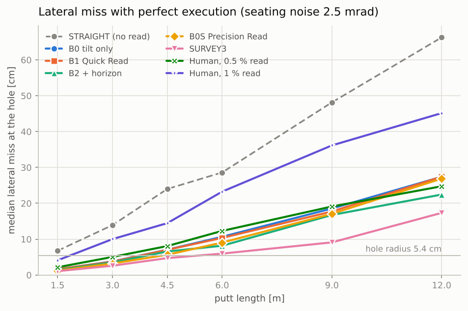
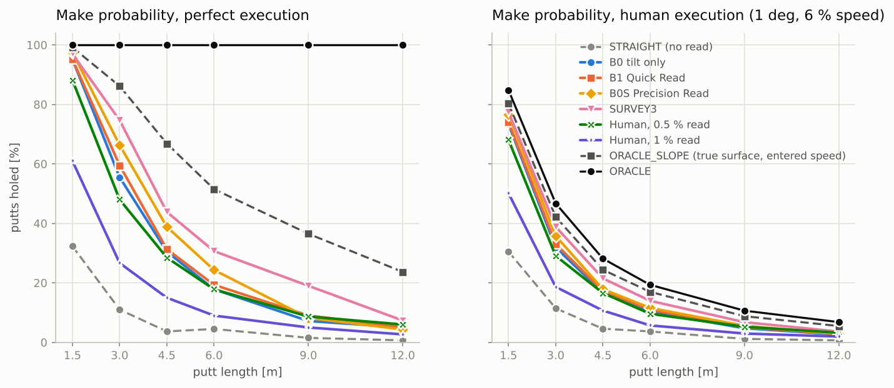
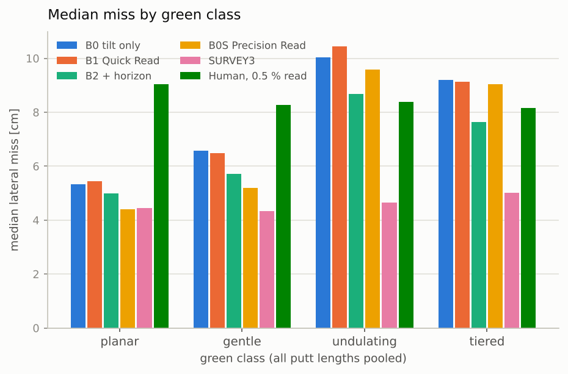
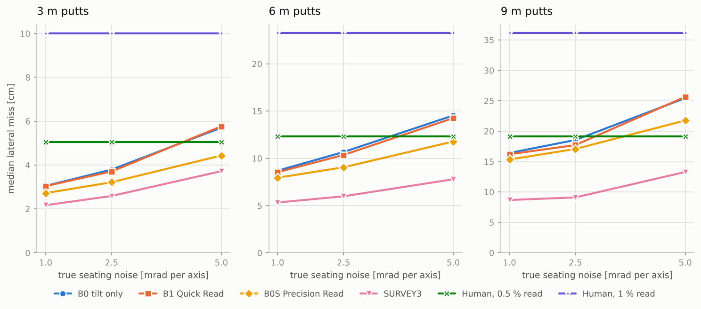
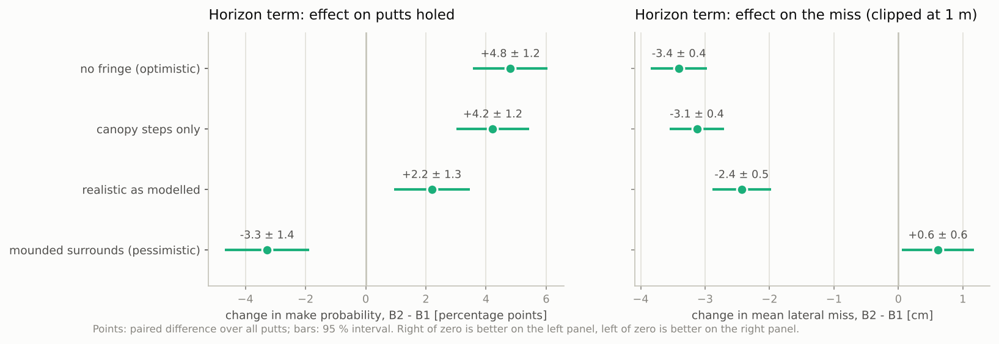
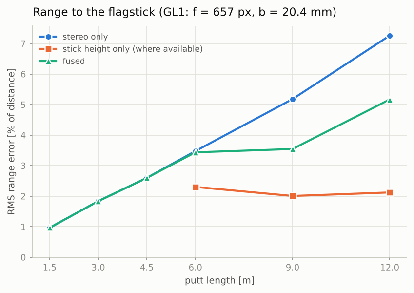
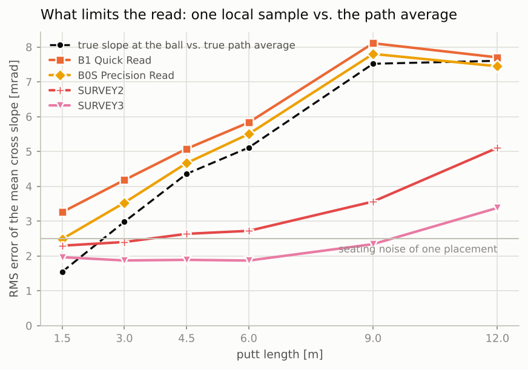
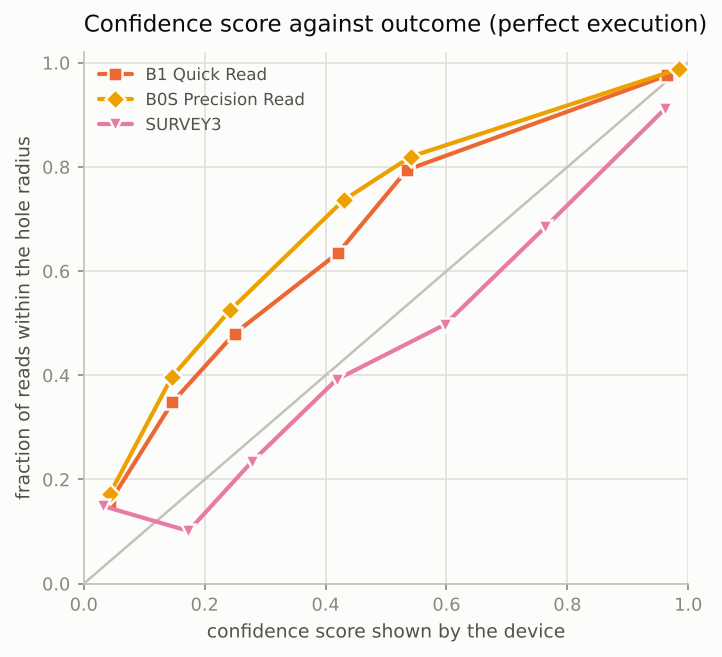

# GreenLine simulation report

Generated by `python -m greenline_sim.montecarlo` from the Python reference in `sim/greenline_sim`. Every number below is read from `results/summary.json`; the wording of the verdicts follows fixed rules applied to those numbers. Nothing here is a measurement of hardware: it is a simulation of the GL-1 design on synthetic greens, and several inputs are estimates (listed in section 13).

**Size of the run.** 3600 putts in the main experiment: 6 putt lengths x 4 green classes x 150 seeded greens, i.e. N = 150 per (length, class) cell and N = 600 per length. Each putt is evaluated for every method at 3 seating-noise levels, once with perfect execution and 20 times with human execution noise (1 deg direction, 6 % speed, 1 sigma). The sensitivity sweeps use the first 1440 putts. Master seed 20261111. Runtime 364 s (210 s main, 150 s sweeps) with numba 0.68.1. 0 (green, length) pairs had no legal putt and were skipped.

**Statistical resolution.** With N = 600 per length a make probability near 50 % has a standard error of about 2.0 percentage points (pp); per (length, class) cell it is about 4 pp, so single cells of the appendix tables are indicative only. Method comparisons are paired (same greens, same noise draws) and are quoted with 95 % intervals where a conclusion rests on them.

## 1. Headline

Median lateral miss at the hole / make probability, both with perfect execution, seating noise 2.5 mrad:

| Putt | STRAIGHT | B0 | B1 | B2 | ORACLE |
| --- | --- | --- | --- | --- | --- |
| 1.5 m | 6.8 cm / 32 % | 1.6 cm / 95 % | 1.6 cm / 95 % | 1.4 cm / 96 % | 0.0 cm / 100 % |
| 3 m | 13.9 cm / 11 % | 3.8 cm / 56 % | 3.7 cm / 60 % | 3.5 cm / 62 % | 0.0 cm / 100 % |
| 4.5 m | 24.0 cm / 4 % | 7.1 cm / 30 % | 7.0 cm / 31 % | 6.6 cm / 35 % | 0.0 cm / 100 % |
| 6 m | 28.6 cm / 4 % | 10.7 cm / 18 % | 10.4 cm / 19 % | 8.2 cm / 24 % | 0.0 cm / 100 % |
| 9 m | 48.2 cm / 2 % | 18.6 cm / 7 % | 17.7 cm / 9 % | 16.7 cm / 10 % | 0.0 cm / 100 % |
| 12 m | 66.3 cm / 1 % | 27.4 cm / 5 % | 27.4 cm / 5 % | 22.4 cm / 6 % | 0.0 cm / 100 % |

- **A read is worth a lot.** Aiming straight misses by a median of 13.9 cm at 3 m and 28.6 cm at 6 m. The Quick Read (B1) cuts that to 3.7 cm and 10.4 cm and, with perfect execution, holes 60 % of 3 m putts and 19 % of 6 m putts (STRAIGHT: 11 % and 4 %).
- **But one placement does not read a long putt.** The median miss of B1 exceeds the hole radius (5.4 cm) from 4.5 m on; for the Precision Read from 4.5 m, for the three-drop Survey from 6 m. The reason is not sensor noise: the slope under the ball differs from the average slope along the line (section 8).
- **The tilt does nearly all the work on the line.** B0 (tilt only) and B1 have the same median miss (7.4 cm and 7.3 cm over all lengths). The flag-base height improves the pace, not the line: median pace error at 6 m 48 cm for B0 against 35 cm for B1, and B1 holes +1.4 ± 0.8 pp more putts than B0.
- **Turf horizon (B2).** Against B1 on the same putts: helps with no fringe (+4.8 ± 1.2 pp), helps with the realistic geometry as modelled (+2.2 ± 1.3 pp), hurts with mounded surrounds (-3.3 ± 1.4 pp). The sign depends on what lies behind the green, which the device cannot sense. The firmware default is therefore B1; B2 stays an option (section 5).
- **More placements beat more optics.** Precision Read: +3.3 ± 1.2 pp makes over B1; three-drop Survey: +8.8 ± 1.4 pp, with the median miss falling from 7.3 cm to 4.6 cm over all lengths. The camera presets and the lens height change next to nothing (section 11).
- **Against a human reader.** At 2.5 mrad seating noise the Quick Read holes 36.6 % of all putts with perfect execution, a golfer who reads cross slope to 0.5 % holes 32.9 %, one who reads it to 1 % holes 19.9 %. At 5 mrad the Quick Read drops to 28.6 % (section 4).
- **Two limits no slope sensor removes.** With the true surface but the golfer's entered green speed (7 % error) and the measured grain, only 60.6 % of putts drop with perfect execution. And with human execution even the oracle holes 47 % at 3 m and 19 % at 6 m; B1 holes 33 % and 11 % (section 9).





## 2. What was simulated

**Hardware (preset GL1).** Stereo pair with f = 657 px and baseline 20.4 mm, optical axis 5.6 mm above the base plane (the puck sinks an unknown 0-1.5 mm into the canopy), horizontal field ±26 deg, usable upward field 17.6 deg. The device measures: puck tilt; flagstick bearing, stereo disparity, elevation of the lowest visible point of the stick and, when in the field, of its top; the turf-horizon elevation at 41 azimuths; grain; and takes the green speed from the golfer. It cannot see the surface between ball and hole in a range-resolved way, and nothing in the estimator pretends it can: at lens height h the ground at distance d subtends h / d^2 rad per metre (0.6 mrad per metre at 3 m, 0.4 px), so the whole green collapses onto the horizon line.

**Methods.**

| Name | What it is | Inputs |
| --- | --- | --- |
| STRAIGHT | aim at the flag, flat-green pace | camera bearing and range, entered Stimp |
| B0 | plane from one tilt reading (what a digital-level ball marker gives) | + puck tilt |
| B1 | Quick Read: MAP fit of a quadratic patch | + flag-base height (or a one-sided bound when the base is hidden) |
| B2 | B1 + turf-horizon residuals | + horizon profile |
| B0S | Precision Read: B1 with a 180-degree spin-and-reread | two seatings averaged, device bias cancelled |
| SURVEY2 / SURVEY3 | Survey: drops at the ball, the midpoint (and 1 m short of the hole) | each drop: tilt, own range and bearing, own hole height |
| FLAGOUT | flag-out fallback, tilt only | visor pointed by hand (1.5 deg), dialled distance (10 %) |
| HUMAN05 / HUMAN10 | golfer who reads the path-average cross slope with 0.5 % / 1 % error | true hole height, true bearing and distance; the same entered Stimp and measured grain as the device |
| ORACLE_SLOPE | true surface, but the entered Stimp and the measured grain | isolates slope reading from speed and grain knowledge |
| ORACLE | true surface, true Stimp, true grain | upper bound |

All methods aim for the same target pace (the ball would roll 0.30 m past the hole on a flat green). A camera read that does not find the flag is retried as a flag-out read, and every device mode then works from that. The estimator's assumed noise levels are firmware constants and stay at their nominal values in every sweep, as they would in a shipped device.

**Greens.** Four classes (planar, gentle, undulating, tiered), overall tilt 0.5-3 %, undulation correlation length 4-8 m, hole where the local slope is at most 3 %, green edge 9-16 m from the centre, collar +8 mm, rough +40 mm, surround terrain beyond the collar with a mean radial slope of -8 % to +2 %. True Stimp ~ N(10, 1.2), grain strong on 35 % of greens. The ball rolls with `dv/dt = -a_r v_hat - (5/7) G grad z + kappa a_r g_hat`.

## 3. Results at the nominal seating noise (2.5 mrad)

Median absolute lateral miss at the hole, perfect execution [cm]:

| Method | 1.5 m | 3 m | 4.5 m | 6 m | 9 m | 12 m | all |
| --- | --- | --- | --- | --- | --- | --- | --- |
| STRAIGHT | 6.8 | 13.9 | 24.0 | 28.6 | 48.2 | 66.3 | 23.2 |
| B0 | 1.6 | 3.8 | 7.1 | 10.7 | 18.6 | 27.4 | 7.4 |
| B1 | 1.6 | 3.7 | 7.0 | 10.4 | 17.7 | 27.4 | 7.3 |
| B2 | 1.4 | 3.5 | 6.6 | 8.2 | 16.7 | 22.4 | 6.5 |
| B0S | 1.2 | 3.2 | 5.7 | 9.1 | 17.1 | 26.9 | 6.4 |
| SURVEY2 | 1.2 | 3.0 | 5.2 | 6.7 | 13.1 | 20.7 | 5.3 |
| SURVEY3 | 1.1 | 2.6 | 4.7 | 6.0 | 9.1 | 17.3 | 4.6 |
| FLAGOUT | 3.4 | 7.0 | 11.3 | 13.7 | 26.9 | 36.0 | 11.1 |
| HUMAN05 | 2.2 | 5.0 | 8.1 | 12.3 | 19.1 | 24.8 | 8.5 |
| HUMAN10 | 4.1 | 10.0 | 14.5 | 23.3 | 36.2 | 45.2 | 15.8 |
| ORACLE_SLOPE | 0.5 | 1.3 | 2.1 | 3.0 | 4.6 | 5.9 | 2.3 |
| ORACLE | 0.0 | 0.0 | 0.0 | 0.0 | 0.0 | 0.0 | 0.0 |

90th percentile of the lateral miss, perfect execution [cm]:

| Method | 1.5 m | 3 m | 4.5 m | 6 m | 9 m | 12 m | all |
| --- | --- | --- | --- | --- | --- | --- | --- |
| STRAIGHT | 14.7 | 33.9 | 55.5 | 74.2 | 115.5 | 164.0 | 87.6 |
| B0 | 3.9 | 12.1 | 20.3 | 32.9 | 62.8 | 96.7 | 41.8 |
| B1 | 3.8 | 12.1 | 20.7 | 33.2 | 64.3 | 100.1 | 42.3 |
| B2 | 3.8 | 9.9 | 18.4 | 27.5 | 49.7 | 73.9 | 34.4 |
| B0S | 3.2 | 9.8 | 20.1 | 33.0 | 62.2 | 95.4 | 40.2 |
| SURVEY2 | 3.2 | 8.4 | 13.9 | 19.1 | 36.9 | 71.5 | 27.6 |
| SURVEY3 | 3.0 | 7.6 | 12.6 | 16.5 | 29.8 | 55.8 | 24.0 |
| FLAGOUT | 8.3 | 16.8 | 29.6 | 42.8 | 73.1 | 105.4 | 53.3 |
| HUMAN05 | 5.3 | 14.3 | 21.8 | 30.6 | 46.5 | 67.4 | 36.4 |
| HUMAN10 | 10.4 | 26.7 | 41.0 | 60.0 | 88.7 | 124.4 | 67.5 |
| ORACLE_SLOPE | 2.1 | 5.4 | 8.8 | 10.5 | 17.7 | 22.7 | 11.7 |
| ORACLE | 0.0 | 0.0 | 0.0 | 0.0 | 0.0 | 0.0 | 0.0 |

Make probability with perfect execution [%]:

| Method | 1.5 m | 3 m | 4.5 m | 6 m | 9 m | 12 m | all |
| --- | --- | --- | --- | --- | --- | --- | --- |
| STRAIGHT | 32 | 11 | 4 | 4 | 2 | 1 | 9 |
| B0 | 95 | 56 | 30 | 18 | 7 | 5 | 35 |
| B1 | 95 | 60 | 31 | 19 | 9 | 5 | 37 |
| B2 | 96 | 62 | 35 | 24 | 10 | 6 | 39 |
| B0S | 98 | 66 | 39 | 24 | 8 | 4 | 40 |
| SURVEY2 | 98 | 73 | 40 | 26 | 13 | 8 | 43 |
| SURVEY3 | 97 | 75 | 44 | 31 | 19 | 7 | 45 |
| FLAGOUT | 64 | 27 | 16 | 11 | 6 | 3 | 21 |
| HUMAN05 | 88 | 48 | 28 | 18 | 9 | 6 | 33 |
| HUMAN10 | 61 | 27 | 15 | 9 | 5 | 3 | 20 |
| ORACLE_SLOPE | 99 | 86 | 67 | 52 | 36 | 24 | 61 |
| ORACLE | 100 | 100 | 100 | 100 | 100 | 100 | 100 |

Make probability with human execution noise (1 deg, 6 %) [%]:

| Method | 1.5 m | 3 m | 4.5 m | 6 m | 9 m | 12 m | all |
| --- | --- | --- | --- | --- | --- | --- | --- |
| STRAIGHT | 30.5 | 11.4 | 4.6 | 3.7 | 1.2 | 0.7 | 8.7 |
| B0 | 73.4 | 31.9 | 16.8 | 10.3 | 4.7 | 2.7 | 23.3 |
| B1 | 74.0 | 33.1 | 17.3 | 11.0 | 5.1 | 2.8 | 23.9 |
| B2 | 75.3 | 35.3 | 18.6 | 12.7 | 6.0 | 3.3 | 25.2 |
| B0S | 76.7 | 35.8 | 17.9 | 11.6 | 5.6 | 2.8 | 25.0 |
| SURVEY2 | 77.2 | 37.8 | 20.5 | 13.0 | 6.4 | 3.8 | 26.5 |
| SURVEY3 | 77.4 | 38.9 | 21.5 | 14.0 | 6.8 | 3.6 | 27.0 |
| FLAGOUT | 53.8 | 22.1 | 11.4 | 7.5 | 3.4 | 1.8 | 16.7 |
| HUMAN05 | 68.1 | 29.1 | 16.6 | 9.6 | 5.2 | 3.2 | 22.0 |
| HUMAN10 | 50.1 | 18.6 | 10.7 | 5.7 | 3.0 | 1.9 | 15.0 |
| ORACLE_SLOPE | 80.3 | 42.2 | 24.4 | 17.0 | 8.8 | 5.5 | 29.7 |
| ORACLE | 84.8 | 46.7 | 28.1 | 19.3 | 10.6 | 6.8 | 32.7 |

By green class, all lengths pooled (median miss [cm] / make probability with perfect execution [%]):

| Method | planar | gentle | undulating | tiered |
| --- | --- | --- | --- | --- |
| STRAIGHT | 24.1 / 9 | 19.6 / 10 | 25.5 / 8 | 23.4 / 9 |
| B0 | 5.3 / 41 | 6.6 / 39 | 10.0 / 30 | 9.2 / 31 |
| B1 | 5.4 / 43 | 6.5 / 38 | 10.5 / 32 | 9.1 / 33 |
| B2 | 5.0 / 45 | 5.7 / 42 | 8.7 / 33 | 7.6 / 36 |
| B0S | 4.4 / 47 | 5.2 / 45 | 9.6 / 34 | 9.0 / 34 |
| SURVEY2 | 4.8 / 45 | 5.2 / 43 | 5.3 / 42 | 5.7 / 41 |
| SURVEY3 | 4.5 / 47 | 4.3 / 47 | 4.7 / 46 | 5.0 / 42 |
| FLAGOUT | 9.2 / 27 | 9.7 / 23 | 13.1 / 17 | 13.4 / 19 |
| HUMAN05 | 9.1 / 32 | 8.3 / 33 | 8.4 / 34 | 8.2 / 33 |
| HUMAN10 | 16.6 / 19 | 15.8 / 19 | 15.7 / 22 | 15.4 / 19 |
| ORACLE_SLOPE | 2.3 / 59 | 2.2 / 63 | 2.3 / 60 | 2.3 / 60 |
| ORACLE | 0.0 / 100 | 0.0 / 100 | 0.0 / 100 | 0.0 / 100 |



The per-length, per-class tables are in the appendix (section 14).

## 4. Seating noise: the dominant uncertainty

How a 46 mm puck seats on turf has not been measured; 2-5 mrad per placement is an estimate. Every method was therefore run at a TRUE seating noise of 1, 2.5, 5 mrad per axis (the estimator keeps assuming 2.5). The two human baselines, STRAIGHT and the oracles do not use the tilt and are identical in all three blocks.

**Seating noise 1 mrad** - median lateral miss [cm]:

| Method | 1.5 m | 3 m | 4.5 m | 6 m | 9 m | 12 m | all |
| --- | --- | --- | --- | --- | --- | --- | --- |
| STRAIGHT | 6.8 | 13.9 | 24.0 | 28.6 | 48.2 | 66.3 | 23.2 |
| B0 | 1.1 | 3.0 | 5.3 | 8.7 | 16.4 | 25.5 | 6.1 |
| B1 | 1.1 | 3.0 | 5.5 | 8.5 | 16.2 | 25.7 | 6.0 |
| B2 | 1.0 | 3.0 | 5.6 | 7.5 | 14.9 | 21.2 | 5.8 |
| B0S | 0.9 | 2.7 | 4.7 | 8.0 | 15.3 | 23.6 | 5.2 |
| SURVEY2 | 0.9 | 2.2 | 3.8 | 5.1 | 9.3 | 16.4 | 4.1 |
| SURVEY3 | 0.9 | 2.2 | 3.7 | 5.3 | 8.7 | 15.4 | 3.9 |
| FLAGOUT | 3.0 | 6.2 | 10.5 | 13.0 | 25.8 | 31.4 | 10.3 |
| HUMAN05 | 2.2 | 5.0 | 8.1 | 12.3 | 19.1 | 24.8 | 8.5 |
| HUMAN10 | 4.1 | 10.0 | 14.5 | 23.3 | 36.2 | 45.2 | 15.8 |
| ORACLE_SLOPE | 0.5 | 1.3 | 2.1 | 3.0 | 4.6 | 5.9 | 2.3 |
| ORACLE | 0.0 | 0.0 | 0.0 | 0.0 | 0.0 | 0.0 | 0.0 |

Seating noise 1 mrad - make probability, perfect execution [%]:

| Method | 1.5 m | 3 m | 4.5 m | 6 m | 9 m | 12 m | all |
| --- | --- | --- | --- | --- | --- | --- | --- |
| STRAIGHT | 32 | 11 | 4 | 4 | 2 | 1 | 9 |
| B0 | 97 | 65 | 40 | 21 | 10 | 4 | 39 |
| B1 | 97 | 68 | 40 | 22 | 12 | 5 | 41 |
| B2 | 96 | 66 | 40 | 26 | 12 | 7 | 41 |
| B0S | 98 | 72 | 45 | 26 | 13 | 8 | 43 |
| SURVEY2 | 97 | 79 | 54 | 32 | 19 | 10 | 48 |
| SURVEY3 | 97 | 80 | 52 | 33 | 22 | 8 | 49 |
| FLAGOUT | 66 | 31 | 16 | 11 | 4 | 3 | 22 |
| HUMAN05 | 88 | 48 | 28 | 18 | 9 | 6 | 33 |
| HUMAN10 | 61 | 27 | 15 | 9 | 5 | 3 | 20 |
| ORACLE_SLOPE | 99 | 86 | 67 | 52 | 36 | 24 | 61 |
| ORACLE | 100 | 100 | 100 | 100 | 100 | 100 | 100 |

Seating noise 1 mrad - make probability, human execution [%]:

| Method | 1.5 m | 3 m | 4.5 m | 6 m | 9 m | 12 m | all |
| --- | --- | --- | --- | --- | --- | --- | --- |
| STRAIGHT | 30.5 | 11.4 | 4.6 | 3.7 | 1.2 | 0.7 | 8.7 |
| B0 | 77.3 | 34.7 | 18.0 | 11.4 | 5.2 | 3.1 | 24.9 |
| B1 | 77.5 | 35.9 | 18.6 | 11.9 | 5.4 | 3.0 | 25.4 |
| B2 | 77.5 | 37.0 | 18.7 | 13.3 | 6.2 | 3.5 | 26.0 |
| B0S | 78.6 | 37.1 | 19.2 | 12.0 | 5.8 | 3.2 | 26.0 |
| SURVEY2 | 78.8 | 39.6 | 22.3 | 14.8 | 7.3 | 4.1 | 27.8 |
| SURVEY3 | 78.8 | 40.2 | 22.2 | 15.3 | 7.5 | 3.7 | 28.0 |
| FLAGOUT | 55.3 | 23.6 | 11.7 | 8.2 | 3.8 | 2.1 | 17.5 |
| HUMAN05 | 68.1 | 29.1 | 16.6 | 9.6 | 5.2 | 3.2 | 22.0 |
| HUMAN10 | 50.1 | 18.6 | 10.7 | 5.7 | 3.0 | 1.9 | 15.0 |
| ORACLE_SLOPE | 80.3 | 42.2 | 24.4 | 17.0 | 8.8 | 5.5 | 29.7 |
| ORACLE | 84.8 | 46.7 | 28.1 | 19.3 | 10.6 | 6.8 | 32.7 |

**Seating noise 2.5 mrad** - median lateral miss [cm]:

| Method | 1.5 m | 3 m | 4.5 m | 6 m | 9 m | 12 m | all |
| --- | --- | --- | --- | --- | --- | --- | --- |
| STRAIGHT | 6.8 | 13.9 | 24.0 | 28.6 | 48.2 | 66.3 | 23.2 |
| B0 | 1.6 | 3.8 | 7.1 | 10.7 | 18.6 | 27.4 | 7.4 |
| B1 | 1.6 | 3.7 | 7.0 | 10.4 | 17.7 | 27.4 | 7.3 |
| B2 | 1.4 | 3.5 | 6.6 | 8.2 | 16.7 | 22.4 | 6.5 |
| B0S | 1.2 | 3.2 | 5.7 | 9.1 | 17.1 | 26.9 | 6.4 |
| SURVEY2 | 1.2 | 3.0 | 5.2 | 6.7 | 13.1 | 20.7 | 5.3 |
| SURVEY3 | 1.1 | 2.6 | 4.7 | 6.0 | 9.1 | 17.3 | 4.6 |
| FLAGOUT | 3.4 | 7.0 | 11.3 | 13.7 | 26.9 | 36.0 | 11.1 |
| HUMAN05 | 2.2 | 5.0 | 8.1 | 12.3 | 19.1 | 24.8 | 8.5 |
| HUMAN10 | 4.1 | 10.0 | 14.5 | 23.3 | 36.2 | 45.2 | 15.8 |
| ORACLE_SLOPE | 0.5 | 1.3 | 2.1 | 3.0 | 4.6 | 5.9 | 2.3 |
| ORACLE | 0.0 | 0.0 | 0.0 | 0.0 | 0.0 | 0.0 | 0.0 |

Seating noise 2.5 mrad - make probability, perfect execution [%]:

| Method | 1.5 m | 3 m | 4.5 m | 6 m | 9 m | 12 m | all |
| --- | --- | --- | --- | --- | --- | --- | --- |
| STRAIGHT | 32 | 11 | 4 | 4 | 2 | 1 | 9 |
| B0 | 95 | 56 | 30 | 18 | 7 | 5 | 35 |
| B1 | 95 | 60 | 31 | 19 | 9 | 5 | 37 |
| B2 | 96 | 62 | 35 | 24 | 10 | 6 | 39 |
| B0S | 98 | 66 | 39 | 24 | 8 | 4 | 40 |
| SURVEY2 | 98 | 73 | 40 | 26 | 13 | 8 | 43 |
| SURVEY3 | 97 | 75 | 44 | 31 | 19 | 7 | 45 |
| FLAGOUT | 64 | 27 | 16 | 11 | 6 | 3 | 21 |
| HUMAN05 | 88 | 48 | 28 | 18 | 9 | 6 | 33 |
| HUMAN10 | 61 | 27 | 15 | 9 | 5 | 3 | 20 |
| ORACLE_SLOPE | 99 | 86 | 67 | 52 | 36 | 24 | 61 |
| ORACLE | 100 | 100 | 100 | 100 | 100 | 100 | 100 |

Seating noise 2.5 mrad - make probability, human execution [%]:

| Method | 1.5 m | 3 m | 4.5 m | 6 m | 9 m | 12 m | all |
| --- | --- | --- | --- | --- | --- | --- | --- |
| STRAIGHT | 30.5 | 11.4 | 4.6 | 3.7 | 1.2 | 0.7 | 8.7 |
| B0 | 73.4 | 31.9 | 16.8 | 10.3 | 4.7 | 2.7 | 23.3 |
| B1 | 74.0 | 33.1 | 17.3 | 11.0 | 5.1 | 2.8 | 23.9 |
| B2 | 75.3 | 35.3 | 18.6 | 12.7 | 6.0 | 3.3 | 25.2 |
| B0S | 76.7 | 35.8 | 17.9 | 11.6 | 5.6 | 2.8 | 25.0 |
| SURVEY2 | 77.2 | 37.8 | 20.5 | 13.0 | 6.4 | 3.8 | 26.5 |
| SURVEY3 | 77.4 | 38.9 | 21.5 | 14.0 | 6.8 | 3.6 | 27.0 |
| FLAGOUT | 53.8 | 22.1 | 11.4 | 7.5 | 3.4 | 1.8 | 16.7 |
| HUMAN05 | 68.1 | 29.1 | 16.6 | 9.6 | 5.2 | 3.2 | 22.0 |
| HUMAN10 | 50.1 | 18.6 | 10.7 | 5.7 | 3.0 | 1.9 | 15.0 |
| ORACLE_SLOPE | 80.3 | 42.2 | 24.4 | 17.0 | 8.8 | 5.5 | 29.7 |
| ORACLE | 84.8 | 46.7 | 28.1 | 19.3 | 10.6 | 6.8 | 32.7 |

**Seating noise 5 mrad** - median lateral miss [cm]:

| Method | 1.5 m | 3 m | 4.5 m | 6 m | 9 m | 12 m | all |
| --- | --- | --- | --- | --- | --- | --- | --- |
| STRAIGHT | 6.8 | 13.9 | 24.0 | 28.6 | 48.2 | 66.3 | 23.2 |
| B0 | 2.6 | 5.7 | 10.7 | 14.5 | 25.4 | 35.3 | 10.4 |
| B1 | 2.5 | 5.8 | 10.8 | 14.3 | 25.6 | 36.0 | 10.6 |
| B2 | 2.2 | 4.5 | 8.0 | 9.9 | 19.0 | 27.1 | 8.2 |
| B0S | 1.8 | 4.4 | 7.9 | 11.8 | 21.8 | 33.0 | 8.4 |
| SURVEY2 | 1.9 | 4.1 | 8.4 | 11.0 | 20.1 | 29.4 | 8.2 |
| SURVEY3 | 1.6 | 3.7 | 6.7 | 7.8 | 13.3 | 23.4 | 6.3 |
| FLAGOUT | 3.7 | 8.7 | 13.5 | 17.2 | 29.5 | 45.1 | 13.3 |
| HUMAN05 | 2.2 | 5.0 | 8.1 | 12.3 | 19.1 | 24.8 | 8.5 |
| HUMAN10 | 4.1 | 10.0 | 14.5 | 23.3 | 36.2 | 45.2 | 15.8 |
| ORACLE_SLOPE | 0.5 | 1.3 | 2.1 | 3.0 | 4.6 | 5.9 | 2.3 |
| ORACLE | 0.0 | 0.0 | 0.0 | 0.0 | 0.0 | 0.0 | 0.0 |

Seating noise 5 mrad - make probability, perfect execution [%]:

| Method | 1.5 m | 3 m | 4.5 m | 6 m | 9 m | 12 m | all |
| --- | --- | --- | --- | --- | --- | --- | --- |
| STRAIGHT | 32 | 11 | 4 | 4 | 2 | 1 | 9 |
| B0 | 81 | 38 | 17 | 12 | 5 | 3 | 26 |
| B1 | 84 | 44 | 18 | 14 | 7 | 4 | 29 |
| B2 | 89 | 52 | 27 | 18 | 10 | 5 | 34 |
| B0S | 92 | 52 | 27 | 17 | 7 | 4 | 33 |
| SURVEY2 | 92 | 55 | 26 | 16 | 8 | 4 | 34 |
| SURVEY3 | 95 | 59 | 32 | 24 | 11 | 6 | 38 |
| FLAGOUT | 59 | 22 | 14 | 11 | 4 | 2 | 19 |
| HUMAN05 | 88 | 48 | 28 | 18 | 9 | 6 | 33 |
| HUMAN10 | 61 | 27 | 15 | 9 | 5 | 3 | 20 |
| ORACLE_SLOPE | 99 | 86 | 67 | 52 | 36 | 24 | 61 |
| ORACLE | 100 | 100 | 100 | 100 | 100 | 100 | 100 |

Seating noise 5 mrad - make probability, human execution [%]:

| Method | 1.5 m | 3 m | 4.5 m | 6 m | 9 m | 12 m | all |
| --- | --- | --- | --- | --- | --- | --- | --- |
| STRAIGHT | 30.5 | 11.4 | 4.6 | 3.7 | 1.2 | 0.7 | 8.7 |
| B0 | 63.9 | 26.0 | 12.6 | 8.4 | 3.3 | 1.8 | 19.4 |
| B1 | 65.1 | 27.6 | 13.4 | 9.2 | 3.9 | 2.2 | 20.2 |
| B2 | 68.6 | 31.6 | 16.3 | 10.8 | 5.5 | 2.8 | 22.6 |
| B0S | 71.5 | 32.2 | 15.9 | 10.1 | 4.4 | 2.8 | 22.8 |
| SURVEY2 | 72.2 | 32.9 | 16.9 | 10.7 | 5.0 | 2.7 | 23.4 |
| SURVEY3 | 73.1 | 35.2 | 18.5 | 12.0 | 6.0 | 3.0 | 24.6 |
| FLAGOUT | 49.7 | 18.5 | 9.9 | 6.4 | 3.0 | 1.5 | 14.8 |
| HUMAN05 | 68.1 | 29.1 | 16.6 | 9.6 | 5.2 | 3.2 | 22.0 |
| HUMAN10 | 50.1 | 18.6 | 10.7 | 5.7 | 3.0 | 1.9 | 15.0 |
| ORACLE_SLOPE | 80.3 | 42.2 | 24.4 | 17.0 | 8.8 | 5.5 | 29.7 |
| ORACLE | 84.8 | 46.7 | 28.1 | 19.3 | 10.6 | 6.8 | 32.7 |



All lengths pooled, make probability with perfect execution: B1 40.5 % at 1 mrad, 36.6 % at 2.5 mrad, 28.6 % at 5 mrad; B0S 43.4 % at 1 mrad, 39.9 % at 2.5 mrad, 33.1 % at 5 mrad; SURVEY3 48.6 % at 1 mrad, 45.4 % at 2.5 mrad, 37.7 % at 5 mrad. Median miss [cm] at 1 / 2.5 / 5 mrad: B1 6.0 / 7.3 / 10.6, B0S 5.2 / 6.4 / 8.4, SURVEY2 4.1 / 5.3 / 8.2, SURVEY3 3.9 / 4.6 / 6.3.

Next to the human baselines (32.9 % for the 0.5 % reader, 19.9 % for the 1 % reader):

- Quick Read (B1) against the 0.5 % reader: ahead at 1 mrad (+7.7 pp), ahead at 2.5 mrad (+3.7 pp), behind at 5 mrad (-4.3 pp); against the 1 % reader: ahead at 1 mrad (+20.6 pp), ahead at 2.5 mrad (+16.7 pp), ahead at 5 mrad (+8.7 pp).
- Precision Read (B0S) against the 0.5 % reader: ahead at 1 mrad (+10.5 pp), ahead at 2.5 mrad (+7.1 pp), ahead at 5 mrad (+0.2 pp).
- Survey (SURVEY3) against the 0.5 % reader: ahead at 1 mrad (+15.8 pp), ahead at 2.5 mrad (+12.6 pp), ahead at 5 mrad (+4.8 pp).

Three things follow.

1. The device's standing against a good human reader is decided by a number nobody has measured. Across the plausible range of seating noise the Quick Read moves from +7.7 pp to -4.3 pp relative to the 0.5 % reader. At 5 mrad the modes that are still more than 1 pp ahead of that reader are: SURVEY3. Measuring the seating repeatability of the real puck on real turf is the first experiment the project needs.
2. Lower seating noise has diminishing returns for single-placement modes. Going from 2.5 to 1 mrad raises B1 by only 3.9 pp, because the error that remains is the difference between the slope under the ball and the average along the line (5.1 mrad RMS at 6 m, section 8), which no single placement sees.
3. The simulated human baselines assume that the golfer reads the PATH-AVERAGE cross slope and knows the hole height and the bearing exactly; only the size of the read error is varied. That is generous to the human on long, contoured putts, where a single placement cannot know the path average. Lengths at which the 0.5 % reader has a smaller median miss than B1 at 2.5 mrad: 12 m.

## 5. Is the turf horizon usable? (B2 against B1)

Reviewers of the concept expected the turf-horizon path to cross slope to fail in practice because the silhouette is formed by collar, rough and surrounds rather than by the putting surface. This was tested, not assumed. B2 differs from B1 only by the horizon residuals, and the same putts were re-measured with four versions of what lies beyond the putting surface: nothing (the camera sees the smooth continuation of the green - optimistic), the collar and rough canopy steps only, the generator's default surrounds (realistic as modelled), and surrounds with mounds and hollows of 0.2 m RMS that are independent of the green (pessimistic).

| Silhouette seen by the camera | Δ make prob. [pp] | Δ mean miss [cm] | median miss B1 -> B2 [cm] | B2 closer in [%] of putts | verdict |
| --- | --- | --- | --- | --- | --- |
| no fringe (optimistic) | +4.8 ± 1.2 | -3.41 ± 0.43 | 7.3 -> 5.7 | 66 | helps |
| canopy steps only | +4.2 ± 1.2 | -3.13 ± 0.42 | 7.3 -> 6.1 | 64 | helps |
| realistic as modelled | +2.2 ± 1.3 | -2.43 ± 0.45 | 7.3 -> 6.5 | 61 | helps |
| mounded surrounds (pessimistic) | -3.3 ± 1.4 | +0.61 ± 0.56 | 7.3 -> 8.3 | 48 | hurts |

Δ = B2 minus B1 on the same putts with the same noise, ± 95 % interval. "Mean miss" clips each miss at 1 m. Verdict rule (fixed before looking at the numbers): "helps" if the make probability rises or the mean miss falls by more than 2 standard errors while the other does not move the wrong way by 2 standard errors; "hurts" is the mirror image; otherwise "no measurable effect". A verdict can therefore rest on the miss distance alone.

| By green class | planar | gentle | undulating | tiered |
| --- | --- | --- | --- | --- |
| no fringe (optimistic) | +5.3 pp, -1.9 cm (helps) | +6.3 pp, -2.6 cm (helps) | +2.1 pp, -3.9 cm (helps) | +5.4 pp, -5.3 cm (helps) |
| canopy steps only | +4.4 pp, -1.6 cm (helps) | +5.0 pp, -2.3 cm (helps) | +2.3 pp, -3.7 cm (helps) | +5.1 pp, -4.9 cm (helps) |
| realistic as modelled | +1.4 pp, -0.5 cm (helps) | +3.4 pp, -1.4 cm (helps) | +0.4 pp, -3.2 cm (helps) | +3.4 pp, -4.7 cm (helps) |
| mounded surrounds (pessimistic) | -6.4 pp, +3.1 cm (hurts) | -6.0 pp, +1.6 cm (hurts) | +0.7 pp, -0.6 cm (no measurable effect) | -1.3 pp, -1.6 cm (helps) |

Weight of the horizon residuals (sweep subset, 1440 putts; per-sample sigma of the horizon residual, default 1 mrad):

| B2 vs B1 at sigma_horizon = | 0.3 mrad | 1 mrad | 3 mrad | 10 mrad |
| --- | --- | --- | --- | --- |
| no fringe (optimistic) | -1.1 pp, +0.4 cm (no measurable effect) | +3.3 pp, -3.4 cm (helps) | +3.2 pp, -3.2 cm (helps) | +1.9 pp, -2.3 cm (helps) |
| realistic as modelled | -5.5 pp, +3.2 cm (hurts) | +0.0 pp, -2.3 cm (helps) | +0.3 pp, -2.2 cm (helps) | -0.8 pp, -1.3 cm (helps) |
| mounded surrounds (pessimistic) | -15.7 pp, +16.0 cm (hurts) | -4.9 pp, +0.8 cm (hurts) | -3.6 pp, +0.3 cm (hurts) | -3.9 pp, +0.8 cm (hurts) |

What forms the silhouette in the realistic case (share of the 41 azimuth samples):

| Putt | putting surface [%] | collar [%] | rough / surrounds [%] | median distance of the silhouette [m] |
| --- | --- | --- | --- | --- |
| 1.5 m | 25 | 0 | 75 | 11.6 |
| 3 m | 28 | 0 | 72 | 12.2 |
| 4.5 m | 28 | 0 | 72 | 14.1 |
| 6 m | 27 | 0 | 73 | 14.4 |
| 9 m | 31 | 0 | 69 | 15.8 |
| 12 m | 35 | 0 | 65 | 18.3 |



**Verdict, stated plainly.** With no fringe at all (optimistic) the horizon term **helps** (+4.8 ± 1.2 pp makes, -3.4 ± 0.4 cm mean miss). With the realistic geometry as this simulator models it - collar, rough, smooth surrounds that mostly fall away - it **helps** (+2.2 ± 1.3 pp makes, -2.4 ± 0.5 cm mean miss); on planar greens alone the effect is +1.4 pp and -0.5 cm (helps). With mounded surrounds that are independent of the green (pessimistic) it **hurts** (-3.3 ± 1.4 pp makes, +0.6 ± 0.6 cm mean miss).

What the numbers mean:

- **The silhouette is mostly not the putting surface.** In the realistic case 65-75 % of the horizon samples are formed by the rough and the ground beyond it, at a median distance of 12-18 m from the lens. The reviewers' premise is confirmed.
- **Why it helps here anyway.** In this generator the ground under the collar and the rough is the smooth continuation of the putting surface plus a radial slope that varies slowly with azimuth and mostly falls away. The far silhouette is then the far edge of the green wearing a 40 mm canopy: its tilt across the field is the large-scale cross slope of the green, an independent second measurement of what the puck tilt measures locally. That is also why the gain grows with seating noise (B2 minus B1 in make probability: +0.8 pp at 1 mrad, +2.2 pp at 2.5 mrad, +4.9 pp at 5 mrad).
- **Why that cannot be relied on.** With mounds and hollows of 0.2 m RMS behind the green - a modest amount of greenside shaping - the same estimator is worse than not using the horizon at all, at every residual weight tested. A 0.2 m mound seen from 12 m stands 17 mrad high and is several metres wide, i.e. smooth across the whole field; to the fit it looks like cross slope and curvature, not like outliers, so the Huber loss does not reject it. Weighting the horizon at its bare pixel noise (0.3 mrad) hurts even with the default surrounds (-5.5 pp, +3.2 cm).
- **What is not in the simulation at all.** Trees, buildings, spectators, bunker lips and the flagstick's own surroundings above the turf line; errors in picking the turf silhouette out of the image; sun glare; a wet or dirty window. The surround terrain itself (both the default and the mounded variant) is an assumption with named parameters, not survey data. None of the omitted effects makes a silhouette more trustworthy, so the row "realistic as modelled" should be read as favourable to the horizon.

**Decision for the firmware default.** Under this simulator's own default geometry the horizon term helps (+2.2 ± 1.3 pp makes), so the simulation does not show that the path is useless. It shows that the benefit is modest and that its sign flips with the shape of the surrounds. Because the device cannot tell which case it is in, and the unmodelled effects all point the same way, the default method is **B1 (horizon off)**; B2 remains selectable (`estimate(meas, "B2")`) so that logged horizon profiles from real greens with surveyed slopes can settle the question.

## 6. Range to the flag: stereo, stick height, fused

| Putt | stereo only RMS [%] | stereo predicted D sigma_disp / (f b) [%] | stick-height range available [% of reads] | stick height only RMS [%] (learned, 2 %) | fused RMS [%] (learned) | stick height only RMS [%] (first hole, 7 % prior) | fused RMS [%] (first hole) |
| --- | --- | --- | --- | --- | --- | --- | --- |
| 1.5 m | 1.0 | 0.9 | 0 | - | 1.0 | - | 1.0 |
| 3 m | 1.8 | 1.8 | 0 | - | 1.8 | - | 1.9 |
| 4.5 m | 2.6 | 2.7 | 0 | - | 2.6 | - | 2.6 |
| 6 m | 3.5 | 3.6 | 4 | 2.3 | 3.4 | 4.0 | 3.4 |
| 9 m | 5.2 | 5.4 | 59 | 2.0 | 3.5 | 3.8 | 4.4 |
| 12 m | 7.3 | 7.2 | 51 | 2.1 | 5.2 | 4.0 | 6.4 |

The first-hole columns come from the sweep subset. Camera presets (sweep subset, fused RMS range error [%] / flag found [%]):

| Preset | 1.5 m | 3 m | 4.5 m | 6 m | 9 m | 12 m | flag found, all lengths [%] |
| --- | --- | --- | --- | --- | --- | --- | --- |
| GL1 | 1.0 | 1.9 | 2.6 | 3.4 | 3.5 | 5.7 | 95.6 |
| QVGA | 1.2 | 2.3 | 3.1 | 4.1 | 4.2 | 7.9 | 81.5 |
| VGA | 0.8 | 1.5 | 2.0 | 2.7 | 2.9 | 4.7 | 93.4 |
| 2MP | 0.3 | 0.6 | 0.8 | 1.1 | 1.5 | 2.0 | 97.9 |



- Stereo alone follows the textbook formula: 1.8 % at 3 m, 5.2 % at 9 m, 7.3 % at 12 m. The estimate `f b / disparity` is biased long by about the square of that (0.6 % at 12 m); this is not corrected.
- Ranging from the stick's angular height needs the top inside the 17.6 deg upward field (beyond about 6.7 m for a 2.13 m stick) AND a visible base. It is therefore available on 59 % of the reads at 9 m and 51 % at 12 m, where it is good (2.1 % with a learned stick height, 4.0 % with the first-hole default of 2.13 m; the simulated sticks are 2.0-2.3 m, the 7 % is the uncertainty the estimator assigns to that default).
- Fused: 3.5 % at 9 m and 5.2 % at 12 m over all reads (first hole: 4.4 % and 6.4 %). The design-spec figure of "about 2-3 % once the stick height is learned" is met only on the reads where the stick-height channel is available; on crowned lines, where the base is hidden, the range falls back to stereo.
- It hardly matters for the line: the 2MP preset ranges to 2.0 % at 12 m and its B1 median miss over all lengths is 6.9 cm against 7.1 cm for GL1. Range feeds the displayed distance and the pace.

## 7. The flagstick: detection and the hidden base

| Putt | flag found [%] | flag inside the field [%] | base hidden [%] | median hidden stick length when hidden [mm] | hidden, planar [%] | hidden, gentle [%] | hidden, undulating [%] | hidden, tiered [%] |
| --- | --- | --- | --- | --- | --- | --- | --- | --- |
| 1.5 m | 97.0 | 99.0 | 1 | 4 | 0 | 0 | 1 | 1 |
| 3 m | 98.0 | 99.8 | 10 | 6 | 0 | 1 | 22 | 18 |
| 4.5 m | 96.0 | 98.7 | 25 | 10 | 0 | 17 | 50 | 33 |
| 6 m | 96.3 | 99.0 | 28 | 18 | 0 | 31 | 46 | 37 |
| 9 m | 95.8 | 98.8 | 41 | 34 | 1 | 36 | 63 | 64 |
| 12 m | 90.5 | 99.3 | 49 | 45 | 7 | 47 | 65 | 77 |

- **Detection.** The flag is found on 97.0 % of reads at 1.5 m and 90.5 % at 12 m (2 % floor, loss of the 12.7 mm stick at long range, and the visor pointing more than 26 deg off the flag about 1 % of the time). A read without the flag falls back to hand-pointing; on those putts every device mode is as poor as FLAGOUT (section 12, subset "flag_not_found"). The detection model is an engineering guess.
- **Hidden base.** From 5.6 mm above the turf a gently crowned line hides the bottom of the stick: on 0.7 % of putts at 1.5 m, 28 % at 6 m and 49 % at 12 m, with a median of 45 mm of stick hidden at 12 m. By class at 12 m: planar 7 %, gentle 47 %, undulating 65 %, tiered 77 %.
- **Consequence for the pace.** With the base visible B1 knows the mean slope along the line to 0.5 mrad RMS at 6 m; with the base hidden to 7.4 mrad, barely better than the tilt alone (11.2 mrad). The one-sided bound carries almost no information: the fit sits at the tilt plane or on the bound, never below it, so on crowned lines B1 expects the hole higher than it is and hits long (mean pace error of B1 at 6 m +9 cm against +0 cm with the true surface).
- **The device is assumed to know whether the base is hidden.** That flag comes from the simulator's line-of-sight test; real firmware has to infer it. The sweep in section 11 shows that nothing is lost if it cannot: treating the lowest visible point as the base in every case gives B1 38.0 % makes against 37.4 % with perfect knowledge (paired difference +0.6 ± 0.6 pp).

## 8. Error budget of the read

RMS error of the mean cross slope along the line (the quantity that sets the break) [mrad]:

| Putt | RMS of the true mean cross slope | true slope at the ball minus true path average | B0 | B1 | B2 | B0S | SURVEY2 | SURVEY3 |
| --- | --- | --- | --- | --- | --- | --- | --- | --- |
| 1.5 m | 12.7 | 1.5 | 3.3 | 3.3 | 2.9 | 2.5 | 2.3 | 2.0 |
| 3 m | 12.8 | 3.0 | 4.2 | 4.2 | 3.4 | 3.5 | 2.4 | 1.9 |
| 4.5 m | 13.1 | 4.4 | 5.1 | 5.1 | 4.4 | 4.7 | 2.6 | 1.9 |
| 6 m | 13.4 | 5.1 | 5.9 | 5.8 | 4.4 | 5.5 | 2.7 | 1.9 |
| 9 m | 14.2 | 7.5 | 8.1 | 8.1 | 6.0 | 7.8 | 3.6 | 2.3 |
| 12 m | 14.3 | 7.6 | 7.7 | 7.7 | 5.8 | 7.4 | 5.1 | 3.4 |

RMS error of the mean slope along the line (which sets the pace) [mrad], base visible / base hidden from the ball:

| Putt | B0 | B1 | B2 | B0S | SURVEY2 | SURVEY3 |
| --- | --- | --- | --- | --- | --- | --- |
| 1.5 m | 3.4 / 13.7 | 0.6 / 3.4 | 0.6 / 4.3 | 0.6 / 3.5 | 0.5 / 1.3 | 0.5 / 2.3 |
| 3 m | 4.7 / 10.4 | 0.5 / 4.9 | 0.6 / 4.4 | 0.5 / 4.9 | 0.5 / 1.0 | 0.5 / 1.1 |
| 4.5 m | 6.2 / 11.0 | 0.5 / 6.8 | 2.4 / 6.3 | 0.5 / 6.8 | 0.5 / 1.1 | 0.5 / 2.0 |
| 6 m | 7.1 / 11.2 | 0.5 / 7.4 | 1.3 / 5.8 | 0.5 / 7.5 | 0.5 / 1.5 | 0.5 / 3.6 |
| 9 m | 7.3 / 13.3 | 0.5 / 10.0 | 0.7 / 8.0 | 0.5 / 10.0 | 0.5 / 2.7 | 0.5 / 6.3 |
| 12 m | 7.5 / 14.4 | 0.6 / 12.7 | 0.9 / 7.7 | 0.6 / 12.5 | 0.5 / 3.5 | 0.5 / 9.0 |

Pace: median absolute error of the roll-out past the hole against the 0.30 m target [cm] (perfect execution):

| Method | 1.5 m | 3 m | 4.5 m | 6 m | 9 m | 12 m | all |
| --- | --- | --- | --- | --- | --- | --- | --- |
| STRAIGHT | 21 | 43 | 66 | 89 | 138 | 179 | 66 |
| B0 | 11 | 20 | 34 | 48 | 81 | 118 | 35 |
| B1 | 9 | 17 | 27 | 35 | 59 | 89 | 28 |
| B0S | 9 | 17 | 27 | 36 | 58 | 86 | 27 |
| SURVEY2 | 9 | 17 | 25 | 34 | 51 | 76 | 26 |
| SURVEY3 | 9 | 17 | 25 | 35 | 54 | 81 | 26 |
| FLAGOUT | 15 | 28 | 46 | 63 | 97 | 133 | 46 |
| HUMAN05 | 9 | 16 | 24 | 32 | 46 | 61 | 24 |
| ORACLE_SLOPE | 9 | 16 | 25 | 31 | 46 | 58 | 24 |
| ORACLE | 0 | 0 | 0 | 0 | 0 | 0 | 0 |

Putts that stop short of the hole with perfect execution [%]:

| Method | 1.5 m | 3 m | 4.5 m | 6 m | 9 m | 12 m | all |
| --- | --- | --- | --- | --- | --- | --- | --- |
| STRAIGHT | 16 | 30 | 36 | 41 | 40 | 42 | 34 |
| B0 | 2 | 15 | 24 | 34 | 37 | 45 | 26 |
| B1 | 1 | 8 | 19 | 26 | 31 | 39 | 21 |
| SURVEY3 | 1 | 9 | 23 | 31 | 36 | 43 | 24 |
| HUMAN05 | 1 | 8 | 19 | 28 | 31 | 39 | 21 |
| ORACLE_SLOPE | 1 | 8 | 18 | 28 | 31 | 39 | 21 |
| ORACLE | 0 | 0 | 0 | 0 | 0 | 0 | 0 |



- **Line.** A single placement measures the slope under the ball with 2.7 mrad per axis (seating 2.5 mrad and device bias 1 mrad). The slope it should have measured - the average along the line - differs from the slope under the ball by 1.5 mrad RMS at 1.5 m, 5.1 mrad at 6 m and 7.5 mrad at 9 m (all classes pooled). From 3 m on, this representativeness error is larger than the measurement error. The two add in quadrature to the B1 column. The Precision Read shrinks only the first term (to 1.8 mrad if the two seatings are independent); the Survey attacks the second (1.9 mrad at 6 m against 5.8 mrad for B1).
- **Pace.** The median pace error of B1 at 6 m is 35 cm; with the true surface and the same entered green speed it is still 31 cm. A 7 % error in the entered Stimp is a 7 % error in roll-out, about 44 cm at 6 m, larger than the 0.30 m of intended over-run: 28 % of perfectly struck 6 m putts stop short even with perfect knowledge of the surface. Green-speed knowledge, not slope sensing, sets the pace accuracy of every mode.

## 9. Sensing against human execution

| Putt | ORACLE | ORACLE_SLOPE | SURVEY3 | B0S | B1 | HUMAN05 | HUMAN10 | STRAIGHT | median miss, execution only (ORACLE) [cm] | median miss, read only (B1) [cm] | median miss, read + execution (B1) [cm] |
| --- | --- | --- | --- | --- | --- | --- | --- | --- | --- | --- | --- |
| 1.5 m | 84.8 | 80.3 | 77.4 | 76.7 | 74.0 | 68.1 | 50.1 | 30.5 | 2.1 | 1.6 | 2.7 |
| 3 m | 46.7 | 42.2 | 38.9 | 35.8 | 33.1 | 29.1 | 18.6 | 11.4 | 4.4 | 3.7 | 5.9 |
| 4.5 m | 28.1 | 24.4 | 21.5 | 17.9 | 17.3 | 16.6 | 10.7 | 4.6 | 6.7 | 7.0 | 9.9 |
| 6 m | 19.3 | 17.0 | 14.0 | 11.6 | 11.0 | 9.6 | 5.7 | 3.7 | 8.6 | 10.4 | 13.9 |
| 9 m | 10.6 | 8.8 | 6.8 | 5.6 | 5.1 | 5.2 | 3.0 | 1.2 | 13.1 | 17.7 | 23.5 |
| 12 m | 6.8 | 5.5 | 3.6 | 2.8 | 2.8 | 3.2 | 1.9 | 0.7 | 17.2 | 27.4 | 32.3 |

Columns 2-9: make probability with human execution [%].

With 1 deg of direction scatter and 6 % of speed scatter, the make probability splits as follows:

- 1.5 m: execution alone costs 15 pp (the oracle holes 85 %); the Quick Read costs a further 10.8 pp (74.0 %); the Survey gives 3.4 pp of that back (77.4 %).
- 3 m: execution alone costs 53 pp (the oracle holes 47 %); the Quick Read costs a further 13.7 pp (33.1 %); the Survey gives 5.8 pp of that back (38.9 %).
- 6 m: execution alone costs 81 pp (the oracle holes 19 %); the Quick Read costs a further 8.3 pp (11.0 %); the Survey gives 3.0 pp of that back (14.0 %).

Up to about 4.5 m the read error (median 3.7 cm at 3 m) and the execution error (median 4.4 cm) are of the same size, so a better read is visible in the make rate. Beyond 6 m nobody holes much: at 12 m the oracle holes 6.8 % and B1 2.8 %. On long putts the product's value is the leave, not the make: the read decides whether the ball finishes inside tap-in range, and that is governed by the pace (section 8).

## 10. Value of the camera bearing (flag-out fallback)

| Method | 1.5 m | 3 m | 4.5 m | 6 m | 9 m | 12 m | all |
| --- | --- | --- | --- | --- | --- | --- | --- |
| B0 | 1.6 | 3.8 | 7.1 | 10.7 | 18.6 | 27.4 | 7.4 |
| FLAGOUT | 3.4 | 7.0 | 11.3 | 13.7 | 26.9 | 36.0 | 11.1 |

Median lateral miss [cm] above; make probability with perfect execution [%] below.

| Method | 1.5 m | 3 m | 4.5 m | 6 m | 9 m | 12 m | all |
| --- | --- | --- | --- | --- | --- | --- | --- |
| B0 | 95 | 56 | 30 | 18 | 7 | 5 | 35 |
| FLAGOUT | 64 | 27 | 16 | 11 | 6 | 3 | 21 |

Both rows use the same tilt-only plane; FLAGOUT replaces the camera's bearing (about 1 mrad) by hand-pointing (1.5 deg, 1 sigma) and the camera's range by a dialled distance (10 %). The camera bearing is worth +13.9 ± 1.6 pp of make probability and 4.5 cm of mean miss. A pointing error of 1.5 deg is 7.9 cm at 3 m, more than the hole radius, before any slope error: the flagstick bearing is the most valuable thing the cameras deliver. The 1.5 deg figure is an assumption about how well a golfer can aim a 46 mm puck by eye.

## 11. Sensitivity sweeps (1440 putts, seating noise 2.5 mrad)

All rows of one table use the same putts and the same noise draws. "pace err" is the median absolute pace error.

**Camera preset.** The legacy presets also differ from GL1 in field of view (±40 deg) and lens height (4.5 mm).

| Preset | Method | miss 1.5 m | miss 3 m | miss 4.5 m | miss 6 m | miss 9 m | miss 12 m | miss all [cm] | make all [%] | pace err [cm] |
| --- | --- | --- | --- | --- | --- | --- | --- | --- | --- | --- |
| GL1 | B1 | 1.6 | 3.7 | 7.2 | 9.8 | 17.5 | 27.8 | 7.1 | 37.4 | 29 |
| GL1 | B2 | 1.3 | 3.7 | 7.1 | 7.7 | 16.5 | 21.7 | 6.8 | 37.4 | 29 |
| QVGA | B1 | 1.6 | 3.7 | 7.5 | 9.7 | 21.3 | 32.1 | 7.3 | 37.0 | 30 |
| QVGA | B2 | 1.7 | 3.7 | 7.2 | 9.5 | 20.5 | 31.4 | 7.9 | 34.3 | 31 |
| VGA | B1 | 1.6 | 3.7 | 7.2 | 9.7 | 18.0 | 26.3 | 7.0 | 37.7 | 29 |
| VGA | B2 | 1.7 | 3.8 | 7.2 | 9.8 | 18.6 | 23.0 | 7.5 | 35.4 | 29 |
| 2MP | B1 | 1.6 | 3.7 | 7.1 | 9.8 | 16.9 | 26.2 | 6.9 | 37.5 | 28 |
| 2MP | B2 | 1.6 | 3.7 | 7.3 | 9.5 | 17.3 | 23.7 | 7.7 | 35.2 | 27 |

**Lens height** (fraction of reads with the base hidden in the last column):

| Lens height | Method | miss 1.5 m | miss 3 m | miss 4.5 m | miss 6 m | miss 9 m | miss 12 m | miss all [cm] | make all [%] | pace err [cm] | base hidden [%] |
| --- | --- | --- | --- | --- | --- | --- | --- | --- | --- | --- | --- |
| 3 mm | B1 | 1.6 | 3.6 | 7.3 | 9.8 | 17.5 | 28.2 | 7.1 | 37.2 | 30 | 28 |
| 3 mm | B2 | 1.3 | 3.5 | 7.6 | 7.9 | 16.7 | 21.3 | 6.8 | 37.6 | 29 | 28 |
| 4.5 mm | B1 | 1.6 | 3.6 | 7.3 | 9.8 | 17.5 | 27.8 | 7.1 | 37.5 | 29 | 26 |
| 4.5 mm | B2 | 1.3 | 3.7 | 7.3 | 7.7 | 16.9 | 21.4 | 6.9 | 37.3 | 29 | 26 |
| 6 mm | B1 | 1.6 | 3.7 | 7.2 | 9.8 | 17.4 | 27.9 | 7.1 | 37.4 | 29 | 24 |
| 6 mm | B2 | 1.3 | 3.7 | 7.1 | 7.7 | 16.5 | 21.4 | 6.8 | 37.4 | 29 | 24 |
| 5.6 (GL1) mm | B1 | 1.6 | 3.7 | 7.2 | 9.8 | 17.5 | 27.8 | 7.1 | 37.4 | 29 | 25 |
| 5.6 (GL1) mm | B2 | 1.3 | 3.7 | 7.1 | 7.7 | 16.5 | 21.7 | 6.8 | 37.4 | 29 | 25 |

**Flag-base height.**

| Variant | Method | miss 1.5 m | miss 3 m | miss 4.5 m | miss 6 m | miss 9 m | miss 12 m | miss all [cm] | make all [%] | pace err [cm] |
| --- | --- | --- | --- | --- | --- | --- | --- | --- | --- | --- |
| with flag base | B1 | 1.6 | 3.7 | 7.2 | 9.8 | 17.5 | 27.8 | 7.1 | 37.4 | 29 |
| with flag base | B2 | 1.3 | 3.7 | 7.1 | 7.7 | 16.5 | 21.7 | 6.8 | 37.4 | 29 |
| without flag base | B1 | 1.7 | 3.7 | 7.3 | 9.9 | 18.2 | 27.4 | 7.1 | 35.9 | 37 |
| without flag base | B2 | 1.4 | 3.2 | 6.7 | 8.1 | 15.3 | 21.3 | 6.4 | 39.9 | 33 |
| base visibility unknown (always assumed visible) | B1 | 1.6 | 3.7 | 7.1 | 9.8 | 17.4 | 26.3 | 7.1 | 38.0 | 29 |

**Error of the entered green speed** (1 sigma, % of Stimp):

| Stimp error [%] | Method | miss 1.5 m | miss 3 m | miss 4.5 m | miss 6 m | miss 9 m | miss 12 m | miss all [cm] | make all [%] | pace err [cm] |
| --- | --- | --- | --- | --- | --- | --- | --- | --- | --- | --- |
| 0 | B1 | 1.6 | 3.5 | 6.9 | 9.8 | 17.6 | 27.0 | 6.9 | 41.9 | 12 |
| 0 | ORACLE_SLOPE | 0.3 | 0.7 | 0.9 | 1.4 | 2.4 | 3.6 | 1.2 | 79.7 | 3 |
| 7 | B1 | 1.6 | 3.7 | 7.2 | 9.8 | 17.5 | 27.8 | 7.1 | 37.4 | 29 |
| 7 | ORACLE_SLOPE | 0.5 | 1.2 | 2.3 | 3.2 | 4.6 | 6.3 | 2.4 | 59.3 | 26 |
| 15 | B1 | 1.7 | 3.9 | 7.2 | 9.4 | 18.3 | 27.6 | 7.2 | 30.4 | 55 |
| 15 | ORACLE_SLOPE | 0.7 | 1.6 | 2.9 | 3.6 | 5.7 | 7.5 | 2.7 | 44.0 | 55 |

Make probability with perfect execution [%] by length, same sweep:

| Stimp error [%] | Method | 1.5 m | 3 m | 4.5 m | 6 m | 9 m | 12 m |
| --- | --- | --- | --- | --- | --- | --- | --- |
| 0 | B1 | 96 | 66 | 40 | 30 | 14 | 6 |
| 0 | ORACLE_SLOPE | 100 | 93 | 83 | 77 | 67 | 59 |
| 7 | B1 | 94 | 62 | 31 | 21 | 10 | 6 |
| 7 | ORACLE_SLOPE | 99 | 85 | 63 | 52 | 34 | 22 |
| 15 | B1 | 87 | 50 | 22 | 17 | 4 | 3 |
| 15 | ORACLE_SLOPE | 90 | 68 | 40 | 32 | 20 | 14 |

**Grain sensor.**

| Variant | Method | miss 1.5 m | miss 3 m | miss 4.5 m | miss 6 m | miss 9 m | miss 12 m | miss all [cm] | make all [%] | pace err [cm] |
| --- | --- | --- | --- | --- | --- | --- | --- | --- | --- | --- |
| grain sensor as specified (20 deg, 30 %) | B1 | 1.6 | 3.7 | 7.2 | 9.8 | 17.5 | 27.8 | 7.1 | 37.4 | 29 |
| grain sensor off (estimator assumes no grain) | B1 | 2.2 | 4.7 | 8.3 | 11.8 | 20.9 | 34.9 | 9.0 | 30.9 | 32 |
| perfect grain sensor | B1 | 1.5 | 3.5 | 6.6 | 8.5 | 16.7 | 27.7 | 6.5 | 38.5 | 27 |

**Precision Read when the two seatings are correlated** (0 = independent, 1 = the spin only cancels the device bias):

| Correlation | Method | miss 1.5 m | miss 3 m | miss 4.5 m | miss 6 m | miss 9 m | miss 12 m | miss all [cm] | make all [%] | pace err [cm] |
| --- | --- | --- | --- | --- | --- | --- | --- | --- | --- | --- |
| 0 | B1 | 1.6 | 3.7 | 7.2 | 9.8 | 17.5 | 27.8 | 7.1 | 37.4 | 29 |
| 0 | B0S | 1.3 | 3.2 | 6.1 | 8.2 | 16.6 | 27.8 | 6.1 | 39.9 | 29 |
| 0.5 | B0S | 1.2 | 3.6 | 6.2 | 9.3 | 19.4 | 24.6 | 6.7 | 38.1 | 29 |
| 1 | B0S | 1.4 | 3.5 | 7.3 | 10.4 | 21.4 | 27.6 | 7.2 | 37.8 | 29 |

**Survey: allowance for the slope field not being plane-plus-curvature** (`sigma_field`):

| sigma_field [mrad] | Method | miss 1.5 m | miss 3 m | miss 4.5 m | miss 6 m | miss 9 m | miss 12 m | miss all [cm] | make all [%] | pace err [cm] |
| --- | --- | --- | --- | --- | --- | --- | --- | --- | --- | --- |
| 2.5 (default) | SURVEY2 | 1.2 | 2.8 | 6.2 | 7.3 | 13.0 | 21.7 | 5.9 | 42.1 | 27 |
| 2.5 (default) | SURVEY3 | 1.1 | 2.5 | 5.2 | 6.3 | 8.6 | 17.8 | 4.7 | 44.5 | 29 |
| 0 (local samples trusted fully) | SURVEY2 | 1.2 | 2.8 | 6.2 | 7.3 | 12.4 | 22.1 | 5.8 | 41.7 | 28 |
| 0 (local samples trusted fully) | SURVEY3 | 1.2 | 2.5 | 5.2 | 6.3 | 8.6 | 18.7 | 4.8 | 44.5 | 29 |

- **Camera preset.** B1 make probability: GL1 37.4 %, QVGA 37.0 %, VGA 37.7 %, 2MP 37.5 %. Focal length and baseline change the range accuracy and the flag-detection rate (QVGA finds the flag on 81 % of reads against 96 % for GL1), not the read. B2 with the ±40 deg presets is worse than with GL1 on short putts (85 % against 96 % at 1.5 m); the likely reason is that the wider field gives the far silhouette more leverage over a putt that does not go there (the lens-height sweep rules out the height).
- **Lens height.** Between 3 and 6 mm nothing moves (B1 make probability 37.2 % at 3 mm, 37.5 % at 4.5 mm, 37.4 % at 6 mm); the share of hidden bases changes only from 28 % to 24 %. A crown hides the base beyond sqrt(2 h / curvature), which grows only with the square root of the height.
- **Flag-base height.** Removing it costs B1 1.5 pp and raises the median pace error from 29 to 37 cm; the median lateral miss is unchanged (7.1 and 7.1 cm). B2 holes 39.9 % without the flag base and 37.4 % with it (paired difference with minus without: -2.5 ± 1.3 pp): the hole-height constraint does not help B2, which suggests that it and the horizon residuals pull the fitted curvature along the line in different directions - one more sign that B2's picture of the far field is not right.
- **Entered green speed.** B1 make probability 41.9 % at 0 % error, 37.4 % at 7 % error, 30.4 % at 15 % error; with the true surface 79.7 % at 0 %, 59.3 % at 7 %, 44.0 % at 15 %. This is the largest single lever in the whole table. Even with a perfectly known Stimp the true-surface reference stays below 100 % because of the grain reading (20 deg, 30 %).
- **Grain.** grain sensor as specified (20 deg, 30 %): 37.4 %; grain sensor off (estimator assumes no grain): 30.9 %; perfect grain sensor: 38.5 %. On these greens (35 % strongly grained) even the coarse grain reading is worth 6.5 pp. The design spec ships the grain sensor DISABLED until it is validated, so the "sensor off" row is the configuration that would ship today, and every device number in this report that uses the grain reading is optimistic by about that much on grainy greens.
- **Precision Read.** Its gain over B1 (+2.6 pp) assumes two independent seatings. If half of the seating error is a property of the spot the gain is +0.7 pp, and if all of it is (the spin only cancels the device bias) +0.4 pp. Which of these is true is part of the unmeasured seating question.
- **Survey model-error allowance.** With `sigma_field` = 2.5 (default) SURVEY3 holes 44.5 %, with 0 (local samples trusted fully) 44.5 %: no measurable effect on accuracy. It is kept because it makes the Survey's reported confidence honest (section 12).

## 12. Where fusion helps, where it does not

Median miss [cm] / make probability with perfect execution [%] on subsets of the putts:

| Subset | N | STRAIGHT | B0 | B1 | B2 | B0S | SURVEY3 | HUMAN05 | HUMAN10 |
| --- | --- | --- | --- | --- | --- | --- | --- | --- | --- |
| base_visible | 2673 | 18.3 / 11 | 5.3 / 43 | 5.3 / 45 | 5.0 / 46 | 4.4 / 49 | 3.6 / 54 | 6.8 / 39 | 12.8 / 24 |
| base_hidden (crowned line) | 927 | 41.3 / 3 | 17.5 / 13 | 17.6 / 13 | 14.3 / 17 | 17.3 / 15 | 8.9 / 21 | 14.0 / 16 | 26.3 / 8 |
| single_break | 3367 | 23.5 / 9 | 6.6 / 37 | 6.6 / 39 | 6.0 / 41 | 5.6 / 42 | 4.4 / 47 | 8.0 / 34 | 15.2 / 21 |
| double_break | 233 | 19.6 / 7 | 35.9 / 5 | 35.3 / 5 | 22.1 / 10 | 35.4 / 6 | 10.6 / 21 | 16.9 / 12 | 32.4 / 7 |
| double_break, D >= 6 m | 194 | 25.0 / 3 | 42.9 / 2 | 45.2 / 1 | 30.2 / 6 | 41.9 / 2 | 15.9 / 15 | 20.2 / 8 | 39.5 / 5 |
| flag_not_found | 158 | 32.9 / 6 | 15.1 / 15 | 15.1 / 15 | 15.1 / 15 | 16.1 / 15 | 15.1 / 15 | 12.4 / 22 | 23.9 / 11 |

Share of putts with a double break (cross slope changes sign along the line with at least 0.3 % on both sides): 1.5 m 0 %, 3 m 2 %, 4.5 m 4 %, 6 m 6 %, 9 m 10 %, 12 m 16 %.

Confidence score against outcome (perfect execution; "within" = the ball passes within the hole radius of its centre):

| Confidence bin | B1: mean score -> fraction within | B0S | SURVEY3 | B2 |
| --- | --- | --- | --- | --- |
| 0.00-0.10 | 0.04 -> 0.16 (n=1513) | 0.04 -> 0.17 (n=1491) | 0.03 -> 0.15 (n=121) | 0.04 -> 0.12 (n=154) |
| 0.10-0.20 | 0.15 -> 0.35 (n=709) | 0.15 -> 0.40 (n=698) | 0.17 -> 0.10 (n=89) | 0.15 -> 0.17 (n=77) |
| 0.20-0.35 | 0.25 -> 0.48 (n=252) | 0.24 -> 0.52 (n=263) | 0.28 -> 0.23 (n=760) | 0.29 -> 0.14 (n=502) |
| 0.35-0.50 | 0.42 -> 0.63 (n=471) | 0.43 -> 0.74 (n=455) | 0.42 -> 0.39 (n=513) | 0.42 -> 0.24 (n=552) |
| 0.50-0.70 | 0.53 -> 0.79 (n=73) | 0.54 -> 0.82 (n=111) | 0.60 -> 0.50 (n=710) | 0.61 -> 0.32 (n=599) |
| 0.70-0.85 | 0.77 -> 1.00 (n=3) | 0.79 -> 1.00 (n=3) | 0.76 -> 0.68 (n=345) | 0.77 -> 0.47 (n=523) |
| 0.85-1.00 | 0.97 -> 0.98 (n=579) | 0.98 -> 0.99 (n=579) | 0.96 -> 0.91 (n=1062) | 0.96 -> 0.80 (n=1193) |



How the aim was obtained (number of reads solved on the fitted patch / on its secant plane / best effort / straight): B0 3599/0/1/0; B1 3600/0/0/0; B2 3600/0/0/0; B0S 3600/0/0/0; SURVEY2 3596/3/1/0; SURVEY3 3600/0/0/0; FLAGOUT 3599/0/1/0.

**Where it works.** On planar and gently contoured greens a single placement is representative of the line: B1's median miss is 5.4 cm on planar and 6.5 cm on gentle greens (all lengths), the Precision Read 4.4 and 5.2 cm. With the base visible (N = 2673) B1 holes 45 % against 39 % for the 0.5 % reader.

**Where it does not.**

- *Contoured greens.* On undulating greens B1's median miss is 10.5 cm and on tiered greens 9.1 cm; the Precision Read helps little there (9.6 and 9.0 cm) because the error is not seating noise. The Survey does (4.7 and 5.0 cm).
- *Convex (crowned) lines.* When the base of the stick is hidden (N = 927, mostly long putts on contoured greens) B1's median miss is 17.6 cm and it holes 13 %; B0 is the same (17.5 cm, 13 %): on these putts the fusion adds nothing to the tilt. SURVEY3 reaches 8.9 cm and 21 %.
- *Double breaks.* Where the cross slope changes sign along the line (N = 233) a single read is WORSE than no read: B1 misses by a median of 35.3 cm, STRAIGHT by 19.6 cm. The puck reads the first break correctly and applies it to the whole putt. SURVEY3 gets 10.6 cm, the 0.5 % human 16.9 cm. The device has no way of knowing from one placement that it is on such a putt.
- *Survey pace on long crowned putts.* SURVEY3's mean slope along the line is worse than SURVEY2's when the base is hidden from the ball (6.3 against 2.7 mrad RMS at 9 m). The plane-plus-curvature model has two parameters for the slope along the line; the third drop adds a precise local height difference near the hole that this model cannot place correctly on a tiered or S-shaped profile. A piecewise slope field through the drops would be the natural next step; it was not implemented because the specification asks for plane plus curvature.

**Confidence score.** It is not well calibrated. For B1 it is too pessimistic: a score near 0.15 goes with 0.35 of reads inside the hole radius and one near 0.53 with 0.79. The likely cause is the curvature prior (0.004 1/m) that sets it: about right for undulating greens, too wide for planar and gentle ones. For B2 it is too optimistic (a score near 0.15 goes with 0.17 of reads inside the hole radius and one near 0.61 with 0.32) because the fit treats the 41 horizon samples as independent. For SURVEY3 it is close (a score near 0.17 goes with 0.10 of reads inside the hole radius and one near 0.60 with 0.50). The score ranks reads usefully within one mode; it should not be shown as a probability.

## 13. Assumptions and limits of this evaluation

Inputs that are estimates, not measurements:

- **Seating noise** (2.5 mrad nominal; 1 and 5 mrad also run). No published data. Everything in section 4 hinges on it. The Precision Read additionally assumes that two seatings on the same spot are independent.
- **Device tilt bias** 1 mrad per axis after cradle calibration.
- **Surround terrain** (default: mean radial slope -8 % to +2 % with slow azimuthal variation; stress case: 0.2 m RMS mounds). Decides the horizon result (section 5).
- **Flag detection** (2 % floor, loss of a 12.7 mm stick with range) and the **hand-pointing error** (1.5 deg).
- **Entered green speed** (7 %) and the **grain sensor** (20 deg, 30 %; unproven, ships disabled).
- **Human baselines**: read error applied to the true path-average cross slope; perfect hole height, bearing and distance.
- **Human execution**: 1 deg and 6 %, independent, Gaussian.
- **Capture rule** (Holmes / Penner style: holed if the path passes within the hole radius slower than 1.63 m/s x sqrt(1 - (delta/R)^2)); lip-outs do not deflect the ball.

Simplifications of the model:

- The ball rolls deterministically on a smooth surface: no bumpiness, footprints, wind or ball imbalance. Real putts scatter even with perfect execution, so all make probabilities with "perfect execution" are upper bounds.
- Grain is a constant push; green speed is uniform over the green; the rough does not slow a ball that runs off.
- The lens is taken to be at the ball position (the real cameras sit 16 mm ahead and 10 mm either side of the puck centre).
- The device is told whether the base of the stick is visible (section 7), and the turf silhouette is assumed to be extracted from the image without error; nothing above the turf line exists in the simulated scene.
- The estimator's noise constants stay at their nominal values when the true noise is varied.

Things that did not work as hoped, in one place:

1. A single placement cannot read putts beyond about 4.5 m on contoured greens; the limit is the green, not the sensor (sections 1, 8).
2. The flag-base height does not improve the line, is unavailable on a quarter to a half of the putts beyond 4.5 m, and its one-sided form on crowned lines is no better than treating the sight line as the base (sections 7, 11).
3. The turf-horizon path is helpful or harmful depending on the surrounds; it is off by default (section 5).
4. Stick-height ranging is available on only about half of the long putts; fused range at 12 m does not reach the 2-3 % of the design spec (section 6).
5. On double-breaking putts a Quick Read is worse than aiming straight, and nothing in a single read reveals that (section 12).
6. The Survey's plane-plus-curvature model handles the cross slope well but not the pace on long crowned putts (section 12).
7. The confidence score is conservative for B1 and overconfident for B2 (section 12).
8. Pace accuracy is set by the golfer's green-speed entry, not by anything the device senses (sections 8, 11).
9. The aim solver could not solve the fitted patch in a handful of reads and fell back to the secant plane or a best-effort iterate (counts in section 12); the true-surface oracle solved 3600 of 3600 putts. Putts for which a reference had no usable solution and rolled its best iterate instead: ORACLE 0, ORACLE_SLOPE 0, HUMAN05 0, HUMAN10 0.

## 14. Appendix

### 14.1 Per length and class

Median lateral miss, perfect execution [cm] (N = 150 per row):

| Putt | Class | STRAIGHT | B0 | B1 | B2 | B0S | SURVEY3 | HUMAN05 | HUMAN10 | ORACLE |
| --- | --- | --- | --- | --- | --- | --- | --- | --- | --- | --- |
| 1.5 m | planar | 7.2 | 1.6 | 1.5 | 1.5 | 1.2 | 1.1 | 2.2 | 4.4 | 0.0 |
| 1.5 m | gentle | 6.0 | 1.4 | 1.4 | 1.4 | 1.1 | 1.2 | 2.3 | 4.4 | 0.0 |
| 1.5 m | undulating | 7.6 | 1.8 | 1.8 | 1.4 | 1.5 | 1.0 | 1.6 | 3.2 | 0.0 |
| 1.5 m | tiered | 6.6 | 1.7 | 1.8 | 1.4 | 1.1 | 1.1 | 2.6 | 4.7 | 0.0 |
| 3 m | planar | 16.0 | 3.7 | 3.4 | 3.0 | 2.7 | 2.7 | 5.6 | 10.4 | 0.0 |
| 3 m | gentle | 12.1 | 3.6 | 3.6 | 3.4 | 2.5 | 2.8 | 4.8 | 9.6 | 0.0 |
| 3 m | undulating | 15.8 | 4.3 | 3.8 | 4.5 | 4.2 | 2.5 | 4.6 | 9.1 | 0.0 |
| 3 m | tiered | 13.2 | 3.9 | 4.2 | 3.4 | 3.7 | 2.4 | 5.6 | 10.9 | 0.0 |
| 4.5 m | planar | 24.3 | 4.7 | 4.8 | 4.4 | 4.0 | 4.1 | 8.4 | 15.4 | 0.0 |
| 4.5 m | gentle | 22.0 | 7.4 | 7.0 | 6.3 | 5.3 | 4.8 | 8.6 | 14.1 | 0.0 |
| 4.5 m | undulating | 24.2 | 8.7 | 8.9 | 8.4 | 8.1 | 4.5 | 8.1 | 14.5 | 0.0 |
| 4.5 m | tiered | 24.8 | 9.8 | 8.9 | 6.7 | 8.1 | 5.2 | 7.2 | 14.0 | 0.0 |
| 6 m | planar | 24.9 | 7.8 | 7.5 | 6.4 | 5.9 | 5.5 | 12.5 | 24.9 | 0.0 |
| 6 m | gentle | 22.3 | 7.2 | 7.3 | 6.0 | 5.7 | 5.0 | 13.0 | 23.4 | 0.0 |
| 6 m | undulating | 36.8 | 15.1 | 15.4 | 11.2 | 14.8 | 6.2 | 11.8 | 20.9 | 0.0 |
| 6 m | tiered | 28.7 | 15.1 | 14.5 | 11.7 | 15.1 | 7.3 | 12.1 | 23.5 | 0.0 |
| 9 m | planar | 49.1 | 11.4 | 11.8 | 9.4 | 9.8 | 8.5 | 17.9 | 35.6 | 0.0 |
| 9 m | gentle | 37.5 | 16.4 | 14.8 | 13.2 | 14.5 | 6.6 | 17.6 | 33.7 | 0.0 |
| 9 m | undulating | 54.8 | 29.3 | 28.2 | 22.9 | 28.7 | 12.5 | 21.5 | 40.4 | 0.0 |
| 9 m | tiered | 50.5 | 29.3 | 30.6 | 22.3 | 26.3 | 11.2 | 19.8 | 36.3 | 0.0 |
| 12 m | planar | 66.0 | 18.1 | 18.4 | 15.4 | 13.1 | 13.0 | 26.3 | 48.7 | 0.0 |
| 12 m | gentle | 56.7 | 24.6 | 24.2 | 19.2 | 21.4 | 14.4 | 22.3 | 44.0 | 0.0 |
| 12 m | undulating | 66.2 | 40.0 | 43.5 | 33.1 | 46.3 | 24.1 | 26.2 | 47.8 | 0.0 |
| 12 m | tiered | 82.9 | 42.1 | 43.1 | 31.9 | 44.7 | 25.5 | 25.0 | 43.3 | 0.0 |

90th percentile of the lateral miss, perfect execution [cm] (N = 150 per row):

| Putt | Class | STRAIGHT | B0 | B1 | B2 | B0S | SURVEY3 | HUMAN05 | HUMAN10 | ORACLE |
| --- | --- | --- | --- | --- | --- | --- | --- | --- | --- | --- |
| 1.5 m | planar | 15.8 | 4.0 | 3.6 | 3.7 | 3.1 | 3.4 | 5.6 | 10.8 | 0.0 |
| 1.5 m | gentle | 14.0 | 3.9 | 3.5 | 3.7 | 2.9 | 2.9 | 5.7 | 11.1 | 0.0 |
| 1.5 m | undulating | 15.8 | 3.7 | 3.9 | 4.0 | 3.5 | 2.5 | 4.4 | 8.1 | 0.0 |
| 1.5 m | tiered | 13.5 | 4.0 | 4.0 | 3.6 | 3.3 | 2.7 | 5.5 | 10.6 | 0.0 |
| 3 m | planar | 33.0 | 10.3 | 10.4 | 9.0 | 8.2 | 9.0 | 15.0 | 28.2 | 0.0 |
| 3 m | gentle | 28.3 | 9.6 | 9.2 | 8.6 | 6.9 | 7.7 | 13.0 | 26.2 | 0.0 |
| 3 m | undulating | 36.9 | 14.0 | 13.7 | 10.4 | 11.7 | 6.8 | 13.6 | 26.5 | 0.0 |
| 3 m | tiered | 36.4 | 14.0 | 13.3 | 10.9 | 12.0 | 6.9 | 14.3 | 24.3 | 0.0 |
| 4.5 m | planar | 51.7 | 16.6 | 14.7 | 14.5 | 10.5 | 10.4 | 19.8 | 38.9 | 0.0 |
| 4.5 m | gentle | 52.8 | 17.2 | 17.2 | 17.2 | 14.5 | 12.9 | 22.5 | 45.0 | 0.0 |
| 4.5 m | undulating | 58.5 | 24.5 | 24.9 | 24.7 | 22.5 | 13.0 | 23.8 | 40.3 | 0.0 |
| 4.5 m | tiered | 55.6 | 27.3 | 26.1 | 19.1 | 23.9 | 13.5 | 19.4 | 35.1 | 0.0 |
| 6 m | planar | 69.4 | 16.4 | 16.1 | 15.6 | 14.9 | 14.4 | 27.3 | 52.3 | 0.0 |
| 6 m | gentle | 64.4 | 19.9 | 22.2 | 17.8 | 16.2 | 16.5 | 33.2 | 62.5 | 0.0 |
| 6 m | undulating | 78.1 | 38.7 | 41.2 | 34.6 | 39.7 | 15.3 | 32.2 | 61.5 | 0.0 |
| 6 m | tiered | 83.8 | 48.7 | 45.6 | 31.7 | 48.0 | 17.5 | 30.5 | 61.1 | 0.0 |
| 9 m | planar | 102.6 | 29.2 | 29.5 | 27.6 | 23.2 | 25.6 | 50.1 | 96.6 | 0.0 |
| 9 m | gentle | 101.0 | 39.2 | 38.4 | 33.4 | 31.7 | 20.0 | 43.0 | 87.8 | 0.0 |
| 9 m | undulating | 136.3 | 76.8 | 74.5 | 65.7 | 72.5 | 37.7 | 46.8 | 84.5 | 0.0 |
| 9 m | tiered | 133.7 | 107.4 | 102.3 | 63.0 | 104.5 | 32.6 | 46.5 | 85.5 | 0.0 |
| 12 m | planar | 154.1 | 42.3 | 40.5 | 45.4 | 34.5 | 37.1 | 65.0 | 129.0 | 0.0 |
| 12 m | gentle | 133.1 | 56.2 | 51.8 | 45.8 | 47.1 | 34.3 | 58.8 | 110.2 | 0.0 |
| 12 m | undulating | 155.7 | 133.2 | 133.8 | 111.3 | 130.8 | 72.0 | 67.9 | 121.2 | 0.0 |
| 12 m | tiered | 201.6 | 144.2 | 138.5 | 98.8 | 139.0 | 81.6 | 72.9 | 131.5 | 0.0 |

Make probability, perfect execution [%] (N = 150 per row):

| Putt | Class | STRAIGHT | B0 | B1 | B2 | B0S | SURVEY3 | HUMAN05 | HUMAN10 | ORACLE |
| --- | --- | --- | --- | --- | --- | --- | --- | --- | --- | --- |
| 1.5 m | planar | 29 | 95 | 95 | 95 | 99 | 97 | 87 | 59 | 100 |
| 1.5 m | gentle | 37 | 96 | 96 | 96 | 98 | 97 | 86 | 56 | 100 |
| 1.5 m | undulating | 29 | 95 | 95 | 96 | 97 | 97 | 93 | 75 | 100 |
| 1.5 m | tiered | 35 | 95 | 94 | 96 | 97 | 97 | 86 | 55 | 100 |
| 3 m | planar | 14 | 62 | 63 | 66 | 71 | 71 | 45 | 26 | 100 |
| 3 m | gentle | 8 | 62 | 61 | 65 | 76 | 71 | 49 | 28 | 100 |
| 3 m | undulating | 12 | 49 | 57 | 55 | 57 | 78 | 51 | 25 | 100 |
| 3 m | tiered | 10 | 49 | 57 | 63 | 61 | 78 | 47 | 27 | 100 |
| 4.5 m | planar | 4 | 40 | 42 | 44 | 53 | 46 | 27 | 11 | 100 |
| 4.5 m | gentle | 4 | 35 | 33 | 39 | 45 | 47 | 31 | 13 | 100 |
| 4.5 m | undulating | 3 | 20 | 23 | 21 | 30 | 43 | 27 | 15 | 100 |
| 4.5 m | tiered | 4 | 27 | 27 | 34 | 27 | 39 | 29 | 20 | 100 |
| 6 m | planar | 3 | 25 | 30 | 32 | 33 | 35 | 17 | 10 | 100 |
| 6 m | gentle | 9 | 28 | 25 | 34 | 33 | 35 | 18 | 9 | 100 |
| 6 m | undulating | 3 | 9 | 11 | 13 | 15 | 32 | 19 | 9 | 100 |
| 6 m | tiered | 3 | 10 | 11 | 15 | 17 | 21 | 17 | 7 | 100 |
| 9 m | planar | 1 | 15 | 17 | 19 | 13 | 19 | 11 | 7 | 100 |
| 9 m | gentle | 1 | 7 | 9 | 9 | 11 | 25 | 9 | 5 | 100 |
| 9 m | undulating | 2 | 3 | 5 | 5 | 4 | 16 | 7 | 5 | 100 |
| 9 m | tiered | 1 | 4 | 6 | 8 | 5 | 16 | 9 | 3 | 100 |
| 12 m | planar | 1 | 11 | 11 | 11 | 10 | 13 | 6 | 4 | 100 |
| 12 m | gentle | 1 | 3 | 4 | 5 | 6 | 6 | 7 | 2 | 100 |
| 12 m | undulating | 1 | 3 | 2 | 4 | 1 | 7 | 4 | 2 | 100 |
| 12 m | tiered | 0 | 3 | 3 | 3 | 1 | 3 | 7 | 3 | 100 |

Make probability, human execution [%] (N = 150 per row):

| Putt | Class | STRAIGHT | B0 | B1 | B2 | B0S | SURVEY3 | HUMAN05 | HUMAN10 | ORACLE |
| --- | --- | --- | --- | --- | --- | --- | --- | --- | --- | --- |
| 1.5 m | planar | 28 | 73 | 73 | 74 | 76 | 76 | 65 | 48 | 84 |
| 1.5 m | gentle | 32 | 74 | 75 | 75 | 77 | 77 | 67 | 48 | 86 |
| 1.5 m | undulating | 30 | 74 | 74 | 76 | 76 | 79 | 72 | 58 | 84 |
| 1.5 m | tiered | 31 | 74 | 74 | 76 | 78 | 78 | 68 | 47 | 85 |
| 3 m | planar | 11 | 34 | 35 | 36 | 37 | 37 | 28 | 18 | 46 |
| 3 m | gentle | 13 | 35 | 35 | 36 | 40 | 39 | 30 | 20 | 49 |
| 3 m | undulating | 10 | 28 | 30 | 33 | 32 | 39 | 29 | 19 | 45 |
| 3 m | tiered | 12 | 30 | 33 | 36 | 34 | 40 | 30 | 18 | 47 |
| 4.5 m | planar | 4 | 20 | 19 | 20 | 21 | 22 | 16 | 10 | 28 |
| 4.5 m | gentle | 5 | 19 | 19 | 20 | 20 | 22 | 17 | 10 | 28 |
| 4.5 m | undulating | 4 | 15 | 17 | 18 | 16 | 22 | 15 | 10 | 28 |
| 4.5 m | tiered | 4 | 13 | 14 | 17 | 15 | 20 | 18 | 13 | 29 |
| 6 m | planar | 4 | 14 | 13 | 14 | 14 | 14 | 9 | 5 | 19 |
| 6 m | gentle | 5 | 13 | 13 | 14 | 15 | 14 | 10 | 6 | 19 |
| 6 m | undulating | 2 | 7 | 9 | 12 | 9 | 14 | 10 | 6 | 19 |
| 6 m | tiered | 3 | 7 | 8 | 11 | 9 | 13 | 9 | 5 | 20 |
| 9 m | planar | 1 | 7 | 7 | 7 | 8 | 8 | 5 | 3 | 10 |
| 9 m | gentle | 1 | 6 | 6 | 7 | 6 | 8 | 6 | 3 | 12 |
| 9 m | undulating | 1 | 3 | 4 | 5 | 4 | 5 | 5 | 3 | 10 |
| 9 m | tiered | 1 | 3 | 3 | 5 | 4 | 5 | 4 | 3 | 10 |
| 12 m | planar | 1 | 5 | 5 | 5 | 5 | 5 | 4 | 2 | 7 |
| 12 m | gentle | 1 | 3 | 3 | 4 | 4 | 5 | 3 | 2 | 7 |
| 12 m | undulating | 1 | 2 | 2 | 3 | 1 | 3 | 3 | 2 | 7 |
| 12 m | tiered | 0 | 1 | 2 | 2 | 1 | 2 | 3 | 2 | 7 |

### 14.2 Closed-form check of the physics

Dying putt (`past = 0`) on a plane with pure cross slope `s`; small-slope theory `phi = (5/14) G s / a_r`:

| Cross slope | Stimp | theory (5/14) G s / a_r [rad] | solved, 2 m | solved, 4 m | solved, 8 m | solved / theory |
| --- | --- | --- | --- | --- | --- | --- |
| 0.5 % | 8 | 0.025501 | 0.025521 | 0.025521 | 0.025521 | 1.0008 |
| 0.5 % | 10 | 0.031877 | 0.031915 | 0.031915 | 0.031915 | 1.0012 |
| 0.5 % | 12.5 | 0.039846 | 0.039920 | 0.039920 | 0.039920 | 1.0019 |
| 1 % | 8 | 0.051003 | 0.051159 | 0.051159 | 0.051159 | 1.0031 |
| 1 % | 10 | 0.063754 | 0.064059 | 0.064059 | 0.064059 | 1.0048 |
| 1 % | 12.5 | 0.079692 | 0.080291 | 0.080291 | 0.080291 | 1.0075 |
| 2 % | 8 | 0.102006 | 0.103273 | 0.103273 | 0.103273 | 1.0124 |
| 2 % | 10 | 0.127507 | 0.130016 | 0.130016 | 0.130016 | 1.0197 |
| 2 % | 12.5 | 0.159384 | 0.164388 | 0.164392 | 0.164392 | 1.0314 |

The solved angle is independent of distance (the three columns agree to better than 1e-4 relative) and exceeds the first-order formula by the neglected second-order term (0.1 % at 0.5 % slope on a slow green, 3 % at 2 % slope on a fast one). Reference point: 10 ft, 1 % cross slope, Stimp 10, 0.43 m past the hole gives an aim offset of **0.1374 m** (phi 0.04504 rad, v0 1.9553 m/s); the paced small-slope formula gives 0.1371 m. Known value: about 0.14 m.

### 14.3 Reproducing

```
cd sim
python -m pytest -q                 # test-suite
python -m greenline_sim.montecarlo  # this report, summary.json, plots, reference vectors (about 6 min)
python -m greenline_sim.report      # rebuild REPORT.md and the plots from summary.json
```

Files: `summary.json` (all numbers), `REPORT.md`, `fig1_miss_by_distance.png`, `fig2_make_probability.png`, `fig3_seating_noise.png`, `fig4_horizon_test.png`, `fig5_range_error.png`, `fig6_cross_slope_error.png`, `fig7_confidence_calibration.png`, `fig8_by_class.png`, `reference_vectors.json` and `REFERENCE_VECTORS.md` (vectors for the C port).
